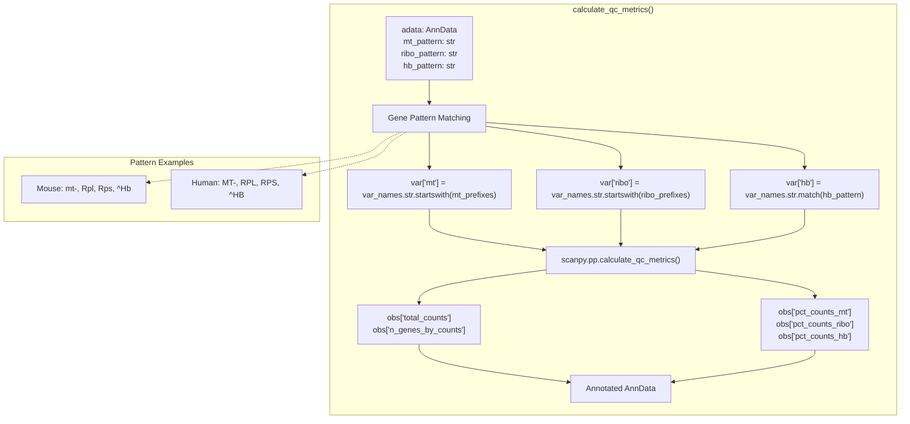
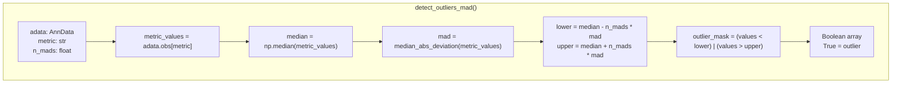
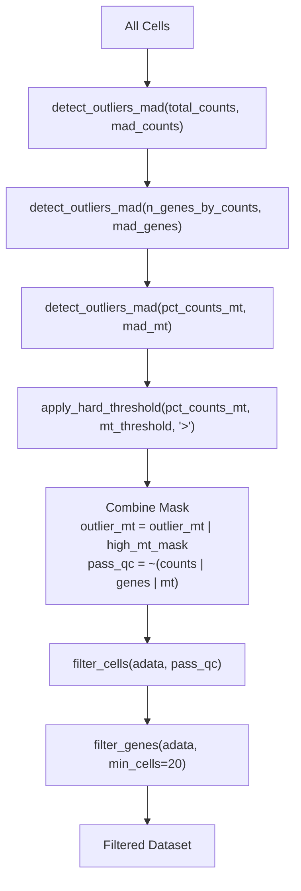
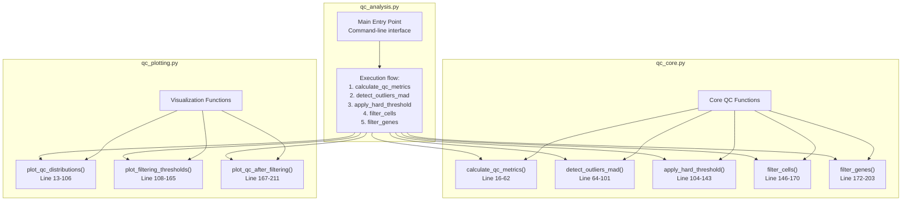

<!-- source: DeepWiki mcp.deepwiki.com · repo anthropics/life-sciences · extra page QC Best Practices and Guidelines · fetched 2026-10-26 -->

# QC Best Practices and Guidelines

Relevant source files

The following files were used as context for generating this wiki page:

- [single-cell-rna-qc/SKILL.md](single-cell-rna-qc/SKILL.md)
- [single-cell-rna-qc/references/scverse_qc_guidelines.md](single-cell-rna-qc/references/scverse_qc_guidelines.md)
- [single-cell-rna-qc/scripts/qc_analysis.py](single-cell-rna-qc/scripts/qc_analysis.py)
- [single-cell-rna-qc/scripts/qc_core.py](single-cell-rna-qc/scripts/qc_core.py)
- [single-cell-rna-qc/scripts/qc_plotting.py](single-cell-rna-qc/scripts/qc_plotting.py)

This document provides comprehensive technical documentation of the quality control methodology implemented in the single-cell RNA-seq QC skill. It explains the scverse best practices, the rationale for MAD-based filtering, recommended thresholds, interpretation of QC visualizations, and species-specific considerations.

For information about executing the QC pipeline, see [Complete Pipeline (Approach 1)](#4.1.2). For custom workflow integration, see [Modular Building Blocks (Approach 2)](#4.1.3). For detailed API documentation of individual functions, see [Core Functions Reference](#4.1.5) and [Plotting Functions Reference](#4.1.6).

## Quality Control Metrics

The QC workflow calculates five core metrics for each cell, implemented in `calculate_qc_metrics` [single-cell-rna-qc/scripts/qc_core.py:16-62](). These metrics identify technical artifacts, low-quality cells, and biological outliers.

### Metric Definitions and Biological Significance

| Metric | What It Measures | Biological Significance | Typical Range | Red Flags |
|--------|------------------|------------------------|---------------|-----------|
| **Total Counts** | Total UMI/reads per cell | Sequencing depth, capture efficiency | 500-50,000 counts | Bimodal distributions (quality mixing) |
| **Genes Detected** | Number of genes with ≥1 count | Transcriptome complexity, capture quality | 200-5,000 genes | Very low values (<200, technical failure) |
| **Mitochondrial %** | Percentage from MT genes | Cell stress, apoptosis, membrane integrity | <5% typical, up to 10-15% for active cells | High values (>15%, lysed cells) |
| **Ribosomal %** | Percentage from ribosomal protein genes | Metabolic activity, protein synthesis | Varies by cell type | Context-dependent, not inherently bad |
| **Hemoglobin %** | Percentage from hemoglobin genes | Blood contamination | Near 0% in non-blood tissues | High values in brain/liver samples |

**Metric Calculation Diagram**

Sources: [single-cell-rna-qc/scripts/qc_core.py:16-62](), [single-cell-rna-qc/references/scverse_qc_guidelines.md:5-39]()

### Count Depth (Total Counts)

Measures the total number of UMI or reads detected per cell. Low count depth indicates empty droplets, cellular debris, or poor capture efficiency. The distribution is typically right-skewed, with high-quality cells forming a clear mode separated from low-quality outliers [single-cell-rna-qc/references/scverse_qc_guidelines.md:7-11]().

**Implementation**: Calculated by `sc.pp.calculate_qc_metrics` [single-cell-rna-qc/scripts/qc_core.py:52-58]() and stored in `adata.obs['total_counts']`.

### Gene Detection (Genes per Cell)

Counts the number of genes with at least one detected read. Strongly correlates with count depth. Values below 200 genes often indicate technical failures, while very high values may suggest doublets (not filtered by this workflow) [single-cell-rna-qc/references/scverse_qc_guidelines.md:13-17]().

**Implementation**: Stored in `adata.obs['n_genes_by_counts']` after calling `calculate_qc_metrics`.

### Mitochondrial Content

Percentage of counts originating from mitochondrial genes. High mitochondrial content indicates cell stress, apoptosis, or compromised membrane integrity, causing cytoplasmic RNA to leak out while mitochondrial RNA remains trapped [single-cell-rna-qc/references/scverse_qc_guidelines.md:19-22]().

**Context matters**: Some cell types naturally have higher mitochondrial content:
- Cardiomyocytes/Neurons: Up to 10-15% (high metabolic activity) [single-cell-rna-qc/references/scverse_qc_guidelines.md:22-26]().
- Most other tissues: <5% typical [single-cell-rna-qc/references/scverse_qc_guidelines.md:22]().

**Implementation**: Gene identification uses species-specific patterns in `calculate_qc_metrics` [single-cell-rna-qc/scripts/qc_core.py:43-44](), percentage stored in `adata.obs['pct_counts_mt']`.

### Ribosomal and Hemoglobin Content

**Ribosomal genes** (Rpl/RPL, Rps/RPS) indicate protein synthesis activity. High ribosomal content is not necessarily problematic—metabolically active cells require more ribosomes [single-cell-rna-qc/references/scverse_qc_guidelines.md:28-32]().

**Hemoglobin genes** (Hb/HB, excluding Hbp1/HBP1) indicate blood contamination. Particularly important for non-blood tissues like brain or liver [single-cell-rna-qc/references/scverse_qc_guidelines.md:34-38]().

**Implementation**: Pattern matching in `calculate_qc_metrics` [single-cell-rna-qc/scripts/qc_core.py:46-49](), percentages stored in `adata.obs['pct_counts_ribo']` and `adata.obs['pct_counts_hb']`.

## MAD-Based Filtering Rationale

This workflow uses **MAD (Median Absolute Deviation)** for outlier detection instead of fixed thresholds, following scverse best practices.

### Why MAD Instead of Fixed Thresholds?

Fixed thresholds (e.g., "remove cells with <500 genes") fail because protocols, tissues, and species yield different ranges [single-cell-rna-qc/references/scverse_qc_guidelines.md:42-49]().

**MAD adapts to your dataset**, using the distribution's properties to define outliers statistically [single-cell-rna-qc/references/scverse_qc_guidelines.md:50-54]().

### MAD Calculation and Outlier Detection

The MAD statistic measures spread around the median, robust to extreme values:
`MAD = median(|X - median(X)|)` [single-cell-rna-qc/references/scverse_qc_guidelines.md:52]().

**Implementation**: The `detect_outliers_mad` [single-cell-rna-qc/scripts/qc_core.py:64-101]() function computes MAD-based outlier masks:

Sources: [single-cell-rna-qc/scripts/qc_core.py:64-101](), [single-cell-rna-qc/references/scverse_qc_guidelines.md:50-54]()

## Recommended Thresholds

The default thresholds in `qc_analysis.py` [single-cell-rna-qc/scripts/qc_analysis.py:37-44]() follow scverse recommendations and are intentionally **permissive**.

### Threshold Values and Rationale

| Parameter | Default Value | Rationale |
|-----------|---------------|-----------|
| `mad-counts` | 5 MADs | Permissive to retain rare cell populations [single-cell-rna-qc/references/scverse_qc_guidelines.md:60-63](). |
| `mad-genes` | 5 MADs | Parallels count depth filtering [single-cell-rna-qc/references/scverse_qc_guidelines.md:65-69](). |
| `mad-mt` | 3 MADs | More stringent because high MT% strongly indicates dying cells [single-cell-rna-qc/references/scverse_qc_guidelines.md:70-74](). |
| `mt-threshold` | 8% | Conservative hard cutoff that works across most tissues [single-cell-rna-qc/references/scverse_qc_guidelines.md:75-79](). |
| `min-cells` | 20 | Balances noise reduction with information retention [single-cell-rna-qc/references/scverse_qc_guidelines.md:118-121](). |

Sources: [single-cell-rna-qc/scripts/qc_analysis.py:37-44](), [single-cell-rna-qc/references/scverse_qc_guidelines.md:56-87]()

### Combined Filtering Logic

The complete filtering logic in `qc_analysis.py` [single-cell-rna-qc/scripts/qc_analysis.py:137-160]() combines multiple criteria:

Sources: [single-cell-rna-qc/scripts/qc_analysis.py:137-160](), [single-cell-rna-qc/scripts/qc_core.py:64-203]()

## Interpreting QC Visualizations

The workflow generates visualizations via `qc_plotting.py` [single-cell-rna-qc/scripts/qc_plotting.py:1-211]().

### Visualization Types

- **Histograms**: Identify bimodal distributions (mixing of cell types) or long tails [single-cell-rna-qc/references/scverse_qc_guidelines.md:90-93]().
- **Violin Plots**: Show distribution shape and density; median and mean should be similar for symmetric distributions [single-cell-rna-qc/references/scverse_qc_guidelines.md:95-98]().
- **Scatter Plots**: 
    - *Counts vs Genes*: Strong positive correlation (R² > 0.8) expected [single-cell-rna-qc/references/scverse_qc_guidelines.md:102-106]().
    - *Counts vs MT%*: Negative correlation expected as dying cells lose counts [single-cell-rna-qc/references/scverse_qc_guidelines.md:107-111]().

Sources: [single-cell-rna-qc/scripts/qc_plotting.py:13-106](), [single-cell-rna-qc/references/scverse_qc_guidelines.md:88-115]()

## Species-Specific Considerations

Gene name patterns differ across species, requiring pattern matching adjustments.

| Species | Mitochondrial | Ribosomal | Hemoglobin |
|---------|---------------|-----------|------------|
| **Mouse** | `mt-*` | `Rpl*`, `Rps*` | `Hb*` (not Hbp1) |
| **Human** | `MT-*` | `RPL*`, `RPS*` | `HB*` (not HBP1) |

**Implementation**: The default patterns in `qc_analysis.py` [single-cell-rna-qc/scripts/qc_analysis.py:42-44]() cover both mouse and human prefixes.

Sources: [single-cell-rna-qc/references/scverse_qc_guidelines.md:123-137](), [single-cell-rna-qc/scripts/qc_analysis.py:42-44]()

## When to Adjust Parameters

Consider adjusting thresholds when:
- **More Stringent**: High ambient RNA contamination or many low-quality cells observed [single-cell-rna-qc/references/scverse_qc_guidelines.md:142-146]().
- **More Permissive**: Studying rare cell populations or high-quality datasets [single-cell-rna-qc/references/scverse_qc_guidelines.md:147-151]().
- **Tissue-Specific**: Brain/Neurons (10-15% MT%), Blood (5-8% MT%), Tumor samples (higher variation) [single-cell-rna-qc/references/scverse_qc_guidelines.md:152-156]().

## Advanced QC Methods (Out of Scope)

The following methods are recommended for droplet-based data but not included in the basic workflow:
- **Ambient RNA correction**: SoupX, CellBender [single-cell-rna-qc/references/scverse_qc_guidelines.md:161-164]().
- **Doublet detection**: scDblFinder, scrublet [single-cell-rna-qc/references/scverse_qc_guidelines.md:166-169]().
- **Cell cycle scoring**: scanpy's `score_genes_cell_cycle` [single-cell-rna-qc/references/scverse_qc_guidelines.md:171-174]().
- **Batch correction**: Harmony, scVI [single-cell-rna-qc/references/scverse_qc_guidelines.md:176-179]().

## Reference Implementation Summary

Sources: [single-cell-rna-qc/scripts/qc_analysis.py:1-175](), [single-cell-rna-qc/scripts/qc_core.py:1-233](), [single-cell-rna-qc/scripts/qc_plotting.py:1-211]()

---

