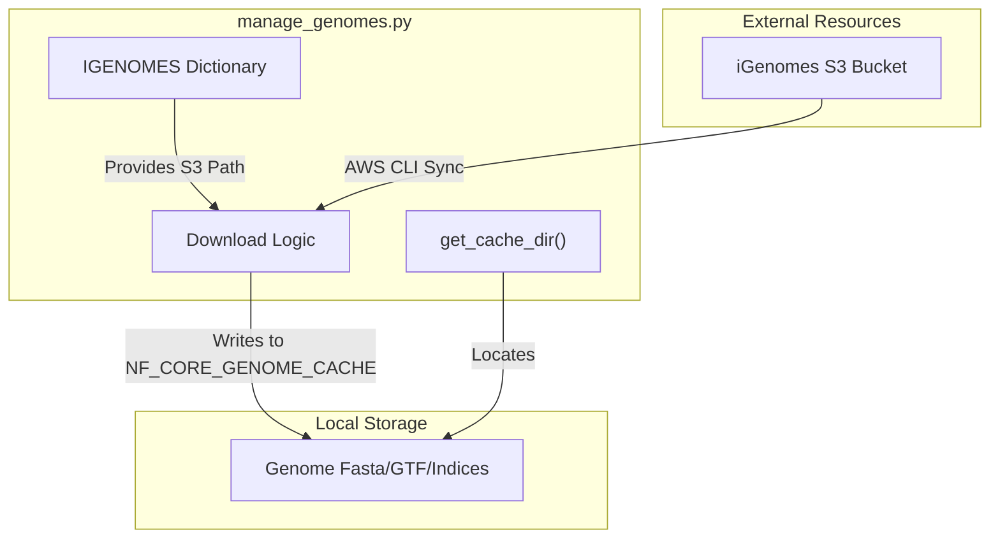
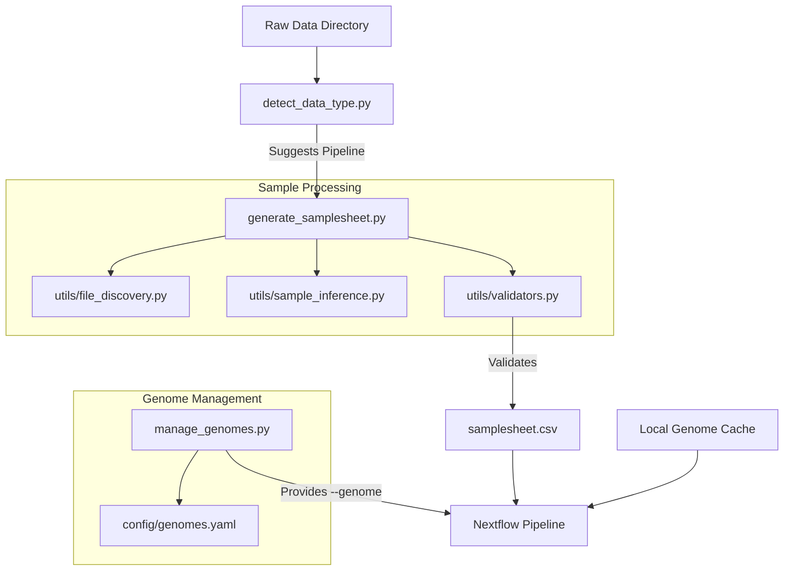

<!-- source: DeepWiki mcp.deepwiki.com · repo anthropics/life-sciences · extra page Samplesheet Generation and Genome Management · fetched 2026-10-26 -->

# Samplesheet Generation and Genome Management

Relevant source files

The following files were used as context for generating this wiki page:

- [nextflow-development/scripts/config/genomes.yaml](nextflow-development/scripts/config/genomes.yaml)
- [nextflow-development/scripts/detect_data_type.py](nextflow-development/scripts/detect_data_type.py)
- [nextflow-development/scripts/generate_samplesheet.py](nextflow-development/scripts/generate_samplesheet.py)
- [nextflow-development/scripts/manage_genomes.py](nextflow-development/scripts/manage_genomes.py)
- [nextflow-development/scripts/utils/file_discovery.py](nextflow-development/scripts/utils/file_discovery.py)
- [nextflow-development/scripts/utils/sample_inference.py](nextflow-development/scripts/utils/sample_inference.py)
- [nextflow-development/scripts/utils/validators.py](nextflow-development/scripts/utils/validators.py)

This section documents the automation tools used to prepare metadata and reference data for Nextflow pipelines. These scripts bridge the gap between raw sequencing files and the structured inputs required by nf-core pipelines like `rnaseq`, `sarek`, and `atacseq`.

## 1. Automated Pipeline Detection

The `detect_data_type.py` script analyzes local directories to recommend the most suitable nf-core pipeline based on file content and naming conventions [nextflow-development/scripts/detect_data_type.py:2-11]().

### Implementation Details
The script performs a multi-stage analysis of the target directory:
1.  **File Scanning**: Uses `os.walk` to count FASTQ, BAM, and CRAM files and record directory structures [nextflow-development/scripts/detect_data_type.py:50-77]().
2.  **Configuration Loading**: Loads pipeline-specific YAML configurations from a local `config/pipelines` directory [nextflow-development/scripts/detect_data_type.py:23-34]().
3.  **Scoring Engine**: The `calculate_pipeline_scores` function applies weighted rules to determine the best fit [nextflow-development/scripts/detect_data_type.py:80-85]():
    *   **Filename/Directory Hints**: Matches keywords like "rna", "atac", or "tumor" against filenames (+10-15 points) [nextflow-development/scripts/detect_data_type.py:92-110]().
    *   **Compatibility**: Checks if the pipeline supports the discovered file types (e.g., BAM for `sarek`) [nextflow-development/scripts/detect_data_type.py:112-122]().
    *   **Specific Logic**: `sarek` receives boosts if both tumor and normal indicators are found in the same set [nextflow-development/scripts/detect_data_type.py:124-138]().

**Sources:** [nextflow-development/scripts/detect_data_type.py:23-172]()

---

## 2. Samplesheet Generation

The `generate_samplesheet.py` script automates the creation of the CSV samplesheets required by Nextflow. It handles complex tasks like R1/R2 read pairing and metadata inference [nextflow-development/scripts/generate_samplesheet.py:3-10]().

### Core Logic and Data Flow

The generator follows a strict pipeline: Discovery -> Inference -> Validation -> Writing.

#### Natural Language to Code Entity: Samplesheet Logic
| User Concept | Code Entity | File Reference |
| :--- | :--- | :--- |
| **File Discovery** | `discover_files` | [nextflow-development/scripts/utils/file_discovery.py:42]() |
| **Read Pairing** | `match_read_pairs` | [nextflow-development/scripts/utils/sample_inference.py:197]() |
| **Metadata Extraction** | `extract_sample_info` | [nextflow-development/scripts/utils/sample_inference.py:78]() |
| **Pipeline Rules** | `load_pipeline_config` | [nextflow-development/scripts/generate_samplesheet.py:39]() |
| **Error Checking** | `validate_samplesheet` | [nextflow-development/scripts/utils/validators.py:57]() |

### Read Pairing and Inference
The system uses a scoring-based approach to match R1 and R2 files. It defines patterns with priority scores (e.g., `_R1_001` is higher confidence than `_1`) [nextflow-development/scripts/utils/sample_inference.py:14-30]().

For the `sarek` pipeline, the script attempts to automatically classify samples as **Tumor (1)** or **Normal (0)** by searching for keywords like "metastasis", "germline", or "blood" in the filename [nextflow-development/scripts/utils/sample_inference.py:32-56]().

### Validation Workflow
Before writing the CSV, the `ValidationResult` class collects errors and warnings [nextflow-development/scripts/utils/validators.py:15-21]().
*   **Path Validation**: Checks if every file listed in the generated rows actually exists on disk [nextflow-development/scripts/utils/validators.py:113-119]().
*   **Pipeline Consistency**: Ensures `sarek` patients have matched tumor-normal pairs [nextflow-development/scripts/utils/validators.py:191-200]().

**Sources:** [nextflow-development/scripts/generate_samplesheet.py:52-160](), [nextflow-development/scripts/utils/sample_inference.py:78-247](), [nextflow-development/scripts/utils/validators.py:57-164]()

---

## 3. Reference Genome Management

Reference genomes are managed via `manage_genomes.py`, which coordinates with the nf-core `iGenomes` resource [nextflow-development/scripts/manage_genomes.py:3-6]().

### Genome Configuration
The system maintains a mapping between common organism names (e.g., "Homo sapiens") and their standard iGenomes keys (e.g., "GRCh38") [nextflow-development/scripts/config/genomes.yaml:4-9](). It also suggests pipelines based on library strategies, such as mapping "WGS" to "sarek" [nextflow-development/scripts/config/genomes.yaml:137-143]().

### Data Management Flow
The `manage_genomes.py` script provides a CLI for:
*   **Listing**: Showing available genomes defined in the `IGENOMES` dictionary [nextflow-development/scripts/manage_genomes.py:25-195]().
*   **Caching**: Storing downloaded references in a local directory defined by `NF_CORE_GENOME_CACHE` [nextflow-development/scripts/manage_genomes.py:198-203]().
*   **Parameter Generation**: Providing the specific Nextflow `--fasta` and `--gtf` paths required to run a pipeline locally [nextflow-development/scripts/manage_genomes.py:12-13]().

### Reference Data Flow
"System Entity Association"

**Sources:** [nextflow-development/scripts/manage_genomes.py:25-203](), [nextflow-development/scripts/config/genomes.yaml:1-148]()

---

## 4. Technical Component Architecture

The following diagram illustrates how these scripts interact to transform raw data into a pipeline-ready state.

### Pipeline Preparation Architecture

**Sources:** [nextflow-development/scripts/detect_data_type.py:175-201](), [nextflow-development/scripts/generate_samplesheet.py:52-75](), [nextflow-development/scripts/manage_genomes.py:8-13]()

---

