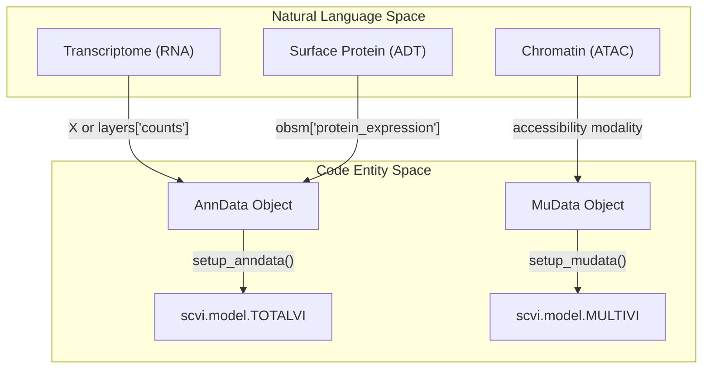
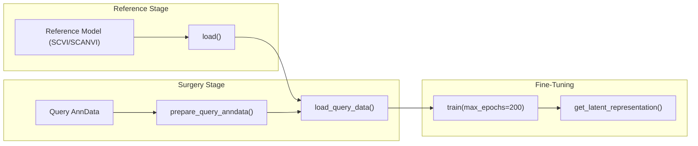

<!-- source: DeepWiki mcp.deepwiki.com · repo anthropics/life-sciences · extra page Specialized Analysis References · fetched 2026-10-26 -->

# Specialized Analysis References

Relevant source files

The following files were used as context for generating this wiki page:

- [scvi-tools/references/citeseq_totalvi.md](scvi-tools/references/citeseq_totalvi.md)
- [scvi-tools/references/data_preparation.md](scvi-tools/references/data_preparation.md)
- [scvi-tools/references/rna_velocity_velovi.md](scvi-tools/references/rna_velocity_velovi.md)
- [scvi-tools/references/scarches_mapping.md](scvi-tools/references/scarches_mapping.md)
- [scvi-tools/references/scrna_integration.md](scvi-tools/references/scrna_integration.md)
- [scvi-tools/references/spatial_deconvolution.md](scvi-tools/references/spatial_deconvolution.md)
- [scvi-tools/references/troubleshooting.md](scvi-tools/references/troubleshooting.md)

This section provides technical documentation for specialized single-cell analytical workflows using the `scvi-tools` framework. These references cover multi-modal integration (CITE-seq, Multiome), spatial deconvolution, RNA velocity, reference mapping, and advanced batch correction.

## Multi-modal Analysis (CITE-seq & Multiome)

### CITE-seq with totalVI
`totalVI` jointly models RNA and protein surface markers (ADT) to learn a shared latent representation. It accounts for technical noise in both modalities, specifically addressing background protein signal (ambient antibodies) [scvi-tools/references/citeseq_totalvi.md:11-15]().

**Key Requirements:**
*   **RNA**: Raw integer counts [scvi-tools/references/citeseq_totalvi.md:110-111]().
*   **Protein**: Raw ADT counts. **Warning**: Do not use CLR-normalized data from Seurat, as `totalVI` requires raw integers [scvi-tools/references/citeseq_totalvi.md:113-116]().
*   **Data Structure**: Proteins are stored in `adata.obsm["protein_expression"]` and names in `adata.uns["protein_names"]` [scvi-tools/references/citeseq_totalvi.md:58-66]().

### Multiome with MultiVI
`MultiVI` integrates paired RNA-seq and ATAC-seq data (Multiome). It can also integrate datasets where only one modality is present (e.g., integrating scRNA-seq with scATAC-seq) [scvi-tools/references/data_preparation.md:202-218]().

### Entity Mapping: Multi-modal Workflows
The following diagram maps the logical data modalities to the specific `scvi-tools` model classes and data keys.

"Multi-modal Data to Code Entity Mapping"

**Sources:** [scvi-tools/references/citeseq_totalvi.md:58-66](), [scvi-tools/references/data_preparation.md:184-219]()

---

## Spatial Transcriptomics

### Deconvolution with DestVI
`DestVI` performs multi-cellular spot deconvolution by leveraging a single-cell RNA-seq reference. It uses a two-step process involving `CondSCVI` (Conditional scVI) to learn cell-type-specific gene expression profiles before applying them to spatial data [scvi-tools/references/spatial_deconvolution.md:9-11]().

| Step | Class/Function | Purpose |
| :--- | :--- | :--- |
| 1 | `scvi.model.CondSCVI` | Train on scRNA-seq reference with `labels_key` [scvi-tools/references/spatial_deconvolution.md:86-97](). |
| 2 | `scvi.model.DestVI.from_rna_model` | Initialize spatial model from the trained `CondSCVI` model [scvi-tools/references/spatial_deconvolution.md:111-114](). |
| 3 | `model.get_proportions()` | Infer cell type fractions per Visium spot [scvi-tools/references/spatial_deconvolution.md:123-127](). |

### Spatial Modeling with resolVI
`resolVI` (found in `scvi.external`) is a semi-supervised method for learning spatially-aware representations and refined cell type assignments directly from spatial data [scvi-tools/references/spatial_deconvolution.md:141-143]().

**Sources:** [scvi-tools/references/spatial_deconvolution.md:9-19](), [scvi-tools/references/spatial_deconvolution.md:82-117](), [scvi-tools/references/spatial_deconvolution.md:139-186]()

---

## Dynamics and Reference Mapping

### RNA Velocity with veloVI
`veloVI` provides a probabilistic framework for RNA velocity, improving upon steady-state assumptions of traditional methods. It requires both **spliced** and **unspliced** count layers [scvi-tools/references/rna_velocity_velovi.md:20-24]().

*   **Setup**: `scvi.model.VELOVI.setup_anndata(adata, spliced_layer="spliced", unspliced_layer="unspliced")` [scvi-tools/references/rna_velocity_velovi.md:111-115]().
*   **Outputs**: `get_latent_time()` and `get_velocity()` provide uncertainty-aware estimates of cellular dynamics [scvi-tools/references/rna_velocity_velovi.md:137-147]().

### Reference Mapping with scArches
`scArches` (Single-cell Architecture Surgery) allows mapping new "query" data onto a pre-trained reference model without retraining the entire atlas.

"scArches Workflow Implementation"

**Sources:** [scvi-tools/references/scarches_mapping.md:7-11](), [scvi-tools/references/scarches_mapping.md:39-108]()

---

## Troubleshooting and Data Preparation

Proper data preparation is the most common source of model failure. The `scvi-tools` suite enforces strict requirements on input data types.

### Common Failure Modes
| Symptom | Root Cause | Solution |
| :--- | :--- | :--- |
| `X should contain integers` | Input data is normalized (log1p/CPM) | Use `layer="counts"` in `setup_anndata` [scvi-tools/references/troubleshooting.md:9](). |
| `CUDA out of memory` | Batch size or model too large for GPU | Reduce `batch_size` or `n_latent` [scvi-tools/references/troubleshooting.md:10](). |
| `Training loss is NaN` | All-zero cells/genes or extreme LR | Filter data using `sc.pp.filter_cells` [scvi-tools/references/troubleshooting.md:11](). |
| `Batches not mixing` | Insufficient HVG overlap | Increase `n_top_genes` in `highly_variable_genes` [scvi-tools/references/troubleshooting.md:12](). |

### Data Preparation Checklist
1.  **Raw Counts**: Verify integer status using `np.allclose(adata.X.data, adata.X.data.astype(int))` [scvi-tools/references/data_preparation.md:25]().
2.  **HVG Selection**: For multi-batch data, use `flavor="seurat_v3"` with a `batch_key` to ensure genes are variable within batches [scvi-tools/references/data_preparation.md:104-116]().
3.  **Mitochondrial Filtering**: Standard threshold is `< 20%` MT counts [scvi-tools/references/data_preparation.md:61]().
4.  **Registration**: Call the model-specific `setup_anndata` (e.g., `scvi.model.SCVI.setup_anndata`) before instantiation [scvi-tools/references/data_preparation.md:126-137]().

**Sources:** [scvi-tools/references/troubleshooting.md:5-14](), [scvi-tools/references/data_preparation.md:7-10](), [scvi-tools/references/data_preparation.md:22-67](), [scvi-tools/references/data_preparation.md:104-116]()

---

