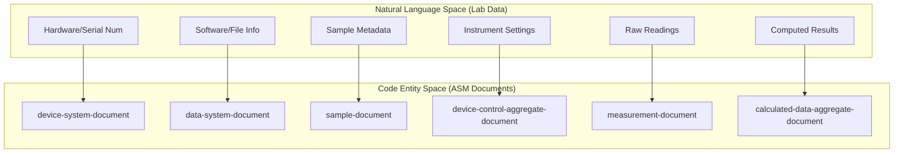
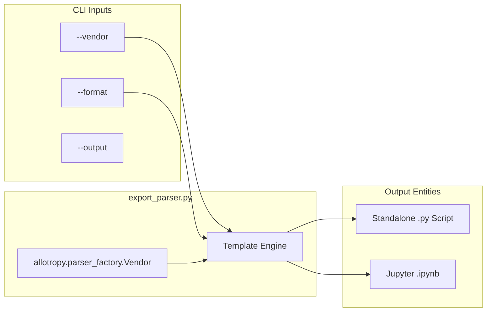

<!-- source: DeepWiki mcp.deepwiki.com · repo anthropics/life-sciences · extra page Supported Instruments and Field Classification · fetched 2026-10-26 -->

# Supported Instruments and Field Classification

Relevant source files

The following files were used as context for generating this wiki page:

- [instrument-data-to-allotrope/references/field_classification_guide.md](instrument-data-to-allotrope/references/field_classification_guide.md)
- [instrument-data-to-allotrope/references/supported_instruments.md](instrument-data-to-allotrope/references/supported_instruments.md)
- [instrument-data-to-allotrope/requirements.txt](instrument-data-to-allotrope/requirements.txt)
- [instrument-data-to-allotrope/scripts/export_parser.py](instrument-data-to-allotrope/scripts/export_parser.py)

This page documents the analytical instruments supported by the `instrument-data-to-allotrope` skill, the classification framework for mapping instrument fields to the Allotrope Simple Model (ASM), and the utility for exporting standalone parser code.

## Supported Instruments

The skill supports a wide range of laboratory instruments through a tiered parsing strategy: native `allotropy` parsers, a flexible tabular fallback, and PDF extraction [instrument-data-to-allotrope/references/supported_instruments.md:5-9]().

### Native Allotropy Parsers
The highest fidelity conversions are achieved using optimized parsers within the `allotropy` library (version 0.1.55) [instrument-data-to-allotrope/requirements.txt:13-13](). These parsers use specific `Vendor` enum values to handle vendor-specific file formats [instrument-data-to-allotrope/references/supported_instruments.md:126-138]().

| Category | Supported Instruments | Vendor Enum |
| :--- | :--- | :--- |
| **Cell Counting** | Vi-CELL BLU, Vi-CELL XR, NucleoView NC-200, NC-View, Matrix | `BECKMAN_VI_CELL_BLU`, `BECKMAN_VI_CELL_XR`, `CHEMOMETEC_NUCLEOVIEW`, `CHEMOMETEC_NC_VIEW`, `REVVITY_MATRIX` |
| **Spectrophotometry** | NanoDrop (One, Eight, 8000), Lunatic, Genesys 30 | `THERMO_FISHER_NANODROP_ONE`, `UNCHAINED_LABS_LUNATIC`, `THERMO_FISHER_GENESYS30` |
| **Plate Readers** | SoftMax Pro, EnVision, Gen5, BMG MARS, SkanIt, Kaleido, Magellan | `MOLDEV_SOFTMAX_PRO`, `PERKIN_ELMER_ENVISION`, `AGILENT_GEN5`, `BMG_MARS`, `THERMO_SKANIT` |
| **qPCR / PCR** | QuantStudio, CFX Maestro, LightCycler | `APPBIO_QUANTSTUDIO`, `BIORAD_CFX_MAESTRO`, `ROCHE_LIGHTCYCLER` |
| **Chromatography** | Empower, Chromeleon, ChemStation | `WATERS_EMPOWER`, `THERMO_FISHER_CHROMELEON`, `AGILENT_CHEMSTATION` |
| **Flow Cytometry** | FACSDiva, FlowJo | `BD_BIOSCIENCES_FACSDIVA`, `FLOWJO` |

**Sources:** [instrument-data-to-allotrope/references/supported_instruments.md:19-99](), [instrument-data-to-allotrope/requirements.txt:1-26]()

### Auto-Detection Logic
The skill attempts to identify the instrument type automatically by scanning file contents for specific column patterns [instrument-data-to-allotrope/references/supported_instruments.md:100-102]().

*   **Vi-CELL BLU**: Looks for "Sample ID", "Viable cells (x10^6 cells/mL)", and "Viability (%)" [instrument-data-to-allotrope/references/supported_instruments.md:104-106]().
*   **NanoDrop**: Looks for "Nucleic Acid Conc.", "A260", and "A280" [instrument-data-to-allotrope/references/supported_instruments.md:112-114]().
*   **Plate Readers**: Detects block-based structures and well identifiers like the "A1-H12" pattern [instrument-data-to-allotrope/references/supported_instruments.md:116-119]().

**Sources:** [instrument-data-to-allotrope/references/supported_instruments.md:100-125]()

## Field Classification Guide

When mapping raw instrument output to the ASM structure, fields must be categorized based on their role in the experimental hierarchy [instrument-data-to-allotrope/references/field_classification_guide.md:3-5]().

### ASM Document Hierarchy
The following diagram bridges the conceptual data types found in lab exports to the specific JSON document structures defined in the ASM schema.

**Data Space to ASM Entity Mapping**

**Sources:** [instrument-data-to-allotrope/references/field_classification_guide.md:7-26]()

### Classification Rules
| Category | ASM Field Examples | Classification Rule |
| :--- | :--- | :--- |
| **Device Info** | `model-number`, `equipment-serial-number` | Describes physical hardware; doesn't change between runs [instrument-data-to-allotrope/references/field_classification_guide.md:30-43](). |
| **Data System** | `software-name`, `file-name`, `ASM-converter-name` | Describes software, file metadata, or data provenance [instrument-data-to-allotrope/references/field_classification_guide.md:47-59](). |
| **Sample Info** | `sample-identifier`, `location-identifier` (well) | Identifies *what* was measured, not *how* [instrument-data-to-allotrope/references/field_classification_guide.md:63-76](). |
| **Device Control** | `detector-wavelength-setting`, `flow-rate` | Configurable parameters that affect the measurement [instrument-data-to-allotrope/references/field_classification_guide.md:80-94](). |
| **Raw Measurement** | `absorbance`, `total-cell-count`, `peak-area` | Direct "ground truth" readings that were not computed from other values [instrument-data-to-allotrope/references/field_classification_guide.md:114-128](). |
| **Calculated Data** | `viability %`, `concentration (from curve)` | Values computed from raw measurements during the analysis [instrument-data-to-allotrope/references/field_classification_guide.md:132-154](). |

**Sources:** [instrument-data-to-allotrope/references/field_classification_guide.md:28-156]()

## Standalone Parser Export

The `export_parser.py` script generates self-contained Python scripts or Jupyter notebooks that encapsulate the parsing logic for a specific instrument [instrument-data-to-allotrope/scripts/export_parser.py:2-7](). This allows data engineers to integrate the conversion logic into production pipelines without needing the full skill environment.

### Implementation Details
The script uses `SCRIPT_TEMPLATE` [instrument-data-to-allotrope/scripts/export_parser.py:21-172]() and `NOTEBOOK_TEMPLATE` [instrument-data-to-allotrope/scripts/export_parser.py:176-250]() to inject vendor-specific configurations into a boilerplate parser.

**Export Workflow**

**Sources:** [instrument-data-to-allotrope/scripts/export_parser.py:9-12](), [instrument-data-to-allotrope/scripts/export_parser.py:20-250]()

### Key Functions in Exported Code
When a parser is exported, the resulting code includes two primary functions for handling ASM data:
1.  `convert_to_asm(filepath)`: Calls `allotrope_from_file` using the hardcoded `Vendor` enum for that instrument [instrument-data-to-allotrope/scripts/export_parser.py:63-81]().
2.  `flatten_asm(asm)`: A utility function that traverses the ASM JSON structure to produce a flat list of dictionaries, suitable for conversion to CSV via `pandas` [instrument-data-to-allotrope/scripts/export_parser.py:84-129]().

**Sources:** [instrument-data-to-allotrope/scripts/export_parser.py:63-130]()

---

