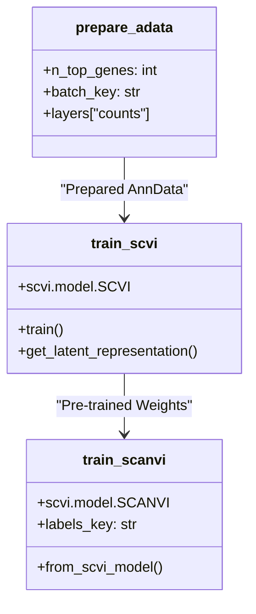

<!-- source: DeepWiki mcp.deepwiki.com · repo anthropics/life-sciences · extra page Training and Integration Workflows · fetched 2026-10-26 -->

# Training and Integration Workflows

<details>
<summary>Relevant source files</summary>

The following files were used as context for generating this wiki page:

- [scvi-tools/scripts/cluster_embed.py](scvi-tools/scripts/cluster_embed.py)
- [scvi-tools/scripts/differential_expression.py](scvi-tools/scripts/differential_expression.py)
- [scvi-tools/scripts/integrate_datasets.py](scvi-tools/scripts/integrate_datasets.py)
- [scvi-tools/scripts/model_utils.py](scvi-tools/scripts/model_utils.py)
- [scvi-tools/scripts/prepare_data.py](scvi-tools/scripts/prepare_data.py)
- [scvi-tools/scripts/train_model.py](scvi-tools/scripts/train_model.py)
- [scvi-tools/scripts/transfer_labels.py](scvi-tools/scripts/transfer_labels.py)

</details>


This page documents the end-to-end training and integration workflows for single-cell omics data using the `scvi-tools` skill. These workflows are implemented as a series of CLI scripts that handle data preparation, model training, latent space analysis, and cross-dataset integration.

## Workflow Overview

The standard analysis pipeline follows a linear progression from raw `AnnData` objects to biological insights. The core of this process is the transition from a generative model (scVI) to a semi-supervised model (scANVI) for label transfer and refined batch correction.

### Data Flow Architecture

The following diagram illustrates how data moves through the CLI scripts and interacts with the underlying `scvi-tools` classes.

**System Data Flow and Code Entities**
```mermaid
graph TD
    subgraph ["Data Preparation"]
        A["Raw .h5ad"] --> B["prepare_data.py"]
        B --> C["AnnData (HVGs + 'counts' layer)"]
    end

    subgraph ["Training Phase"]
        C --> D["train_model.py"]
        D -- "scvi.model.SCVI" --> E["scVI Model"]
        E -- "scvi.model.SCANVI.from_scvi_model" --> F["scANVI Model"]
    end

    subgraph ["Downstream Analysis"]
        F --> G["cluster_embed.py"]
        F --> H["differential_expression.py"]
        F --> I["transfer_labels.py"]
    end

    C -- "integrate_datasets.py" --> J["Integrated AnnData"]
    J --> G
```
**Sources:** [scvi-tools/scripts/prepare_data.py:17-52](), [scvi-tools/scripts/train_model.py:44-73](), [scvi-tools/scripts/integrate_datasets.py:17-46]()

---

## 1. Data Preparation (`prepare_data.py`)

The preparation step ensures that the input `AnnData` object meets the requirements for deep learning models, specifically regarding raw count preservation and Highly Variable Gene (HVG) selection.

### Implementation Details
- **QC Filtering**: The script identifies mitochondrial genes using `get_mito_genes` [scvi-tools/scripts/model_utils.py:15-31]() and filters cells based on `min_genes`, `max_genes`, and `max_mito_pct` [scvi-tools/scripts/prepare_data.py:60-75]().
- **Layer Setup**: Raw counts are explicitly copied to `adata.layers["counts"]` to ensure the generative model uses non-normalized data [scvi-tools/scripts/prepare_data.py:77-78]().
- **Batch-Aware HVG**: If a `batch_key` is provided, it uses the `seurat_v3` flavor to select HVGs independently across batches, preventing batch-specific noise from dominating the gene selection [scvi-tools/scripts/prepare_data.py:81-89]().

**Sources:** [scvi-tools/scripts/prepare_data.py:17-106](), [scvi-tools/scripts/model_utils.py:34-112]()

---

## 2. Model Training and scVI-to-scANVI Transition

The training workflow supports multiple modalities, but the most common path is the integration of RNA-seq data using scVI and scANVI.

### scVI to scANVI Workflow
The `train_scanvi` function implements the recommended two-step training process:
1. **Unsupervised Pre-training**: An `scvi.model.SCVI` model is trained on the entire dataset to learn a global latent representation [scvi-tools/scripts/train_model.py:49-60]().
2. **Semi-supervised Fine-tuning**: A `scvi.model.SCANVI` model is initialized from the pre-trained scVI weights using `SCANVI.from_scvi_model()` [scvi-tools/scripts/train_model.py:63-67](). This step incorporates cell type labels (with an "Unknown" category for unlabeled cells) to refine the latent space.

**Code Entity Relationship**

**Sources:** [scvi-tools/scripts/train_model.py:18-73](), [scvi-tools/scripts/model_utils.py:115-198]()

---

## 3. Integration and Evaluation (`integrate_datasets.py`)

Integration involves concatenating disparate datasets and using the `batch_key` to project them into a shared latent space.

### Key Integration Functions
- **`integrate_datasets`**: Handles the concatenation of multiple `AnnData` objects, finds the intersection of genes, and runs the scVI/scANVI training loop [scvi-tools/scripts/integrate_datasets.py:17-129]().
- **Evaluation Metrics**: The `evaluate_integration` function in `model_utils.py` calculates quantitative scores to assess batch mixing vs. biological separation [scvi-tools/scripts/model_utils.py:200-259]():

| Metric | Purpose | Ideal Value |
| :--- | :--- | :--- |
| `silhouette_label` | Separation of cell types in latent space | High (1.0) |
| `silhouette_batch` | Mixing of batches (lower is better mixing) | Low (0.0) |
| `batch_mixing` | Proportion of unique batches in local neighborhoods | High (1.0) |

**Sources:** [scvi-tools/scripts/integrate_datasets.py:17-129](), [scvi-tools/scripts/model_utils.py:200-259]()

---

## 4. Downstream Analysis Scripts

### Label Transfer (`transfer_labels.py`)
This script implements the **scArches** approach for reference mapping. It loads a pre-trained reference model and uses `SCANVI.prepare_query_anndata` and `SCANVI.load_query_data` to map new query data into the same latent space without retraining the entire model [scvi-tools/scripts/transfer_labels.py:17-105]().

### Differential Expression (`differential_expression.py`)
Instead of using traditional statistical tests, this script leverages the generative model's `differential_expression` method. This accounts for batch effects and technical noise by sampling from the model's posterior distribution [scvi-tools/scripts/differential_expression.py:18-97]().

### Clustering and Embedding (`cluster_embed.py`)
A wrapper for `scanpy` functions that automatically detects the `scvi-tools` latent representation (e.g., `X_scVI`, `X_scANVI`, `X_totalVI`) and performs:
- Neighbor graph construction (`sc.pp.neighbors`) [scvi-tools/scripts/cluster_embed.py:67]()
- UMAP projection (`sc.tl.umap`) [scvi-tools/scripts/cluster_embed.py:71]()
- Leiden clustering (`sc.tl.leiden`) [scvi-tools/scripts/cluster_embed.py:75]()

**Sources:** [scvi-tools/scripts/transfer_labels.py:67-74](), [scvi-tools/scripts/differential_expression.py:53-74](), [scvi-tools/scripts/cluster_embed.py:18-80]()

---

