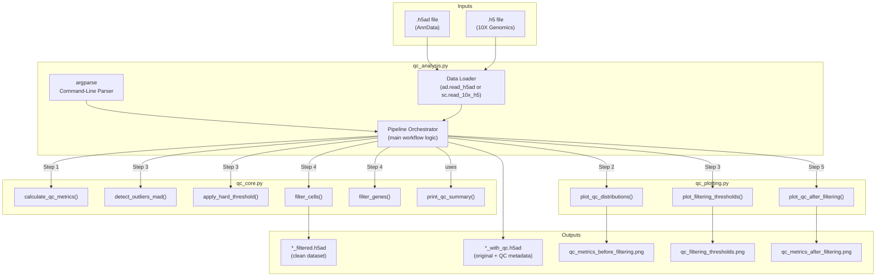
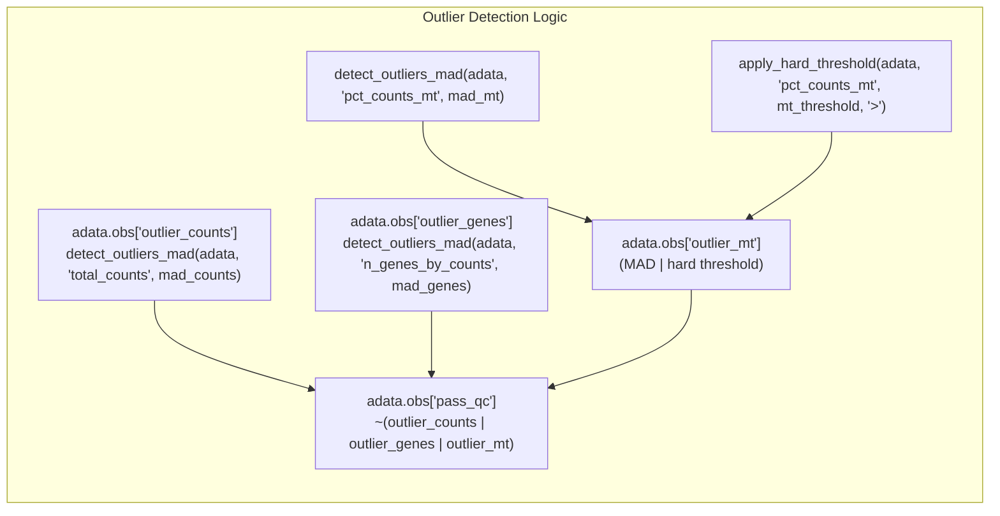
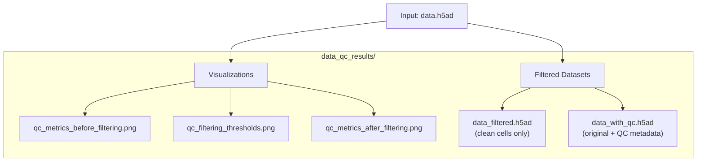
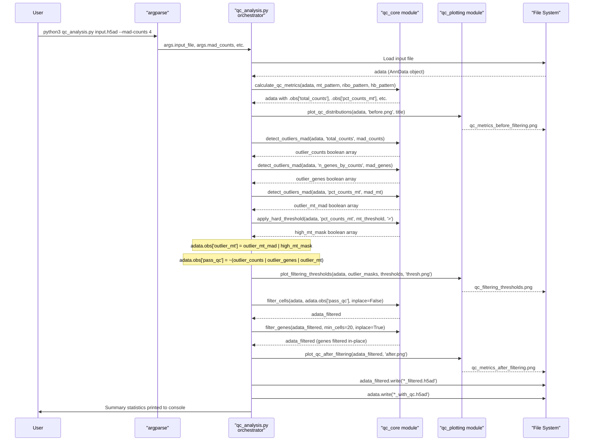

<!-- source: DeepWiki mcp.deepwiki.com · repo anthropics/life-sciences · extra page Complete Pipeline (Approach 1) · fetched 2026-10-26 -->

# Complete Pipeline (Approach 1)

<details>
<summary>Relevant source files</summary>

The following files were used as context for generating this wiki page:

- [single-cell-rna-qc/SKILL.md](single-cell-rna-qc/SKILL.md)
- [single-cell-rna-qc/references/scverse_qc_guidelines.md](single-cell-rna-qc/references/scverse_qc_guidelines.md)
- [single-cell-rna-qc/scripts/qc_analysis.py](single-cell-rna-qc/scripts/qc_analysis.py)
- [single-cell-rna-qc/scripts/qc_core.py](single-cell-rna-qc/scripts/qc_core.py)
- [single-cell-rna-qc/scripts/qc_plotting.py](single-cell-rna-qc/scripts/qc_plotting.py)

</details>


## Purpose and Scope

This page documents the automated end-to-end quality control pipeline provided by `qc_analysis.py`, which implements Approach 1 of the Single-Cell RNA-seq QC skill. This approach provides a "batteries-included" command-line interface for standard QC workflows that follow scverse best practices with minimal configuration.

For custom workflows requiring different filtering logic or conditional processing, see **Modular Building Blocks (Approach 2)**. For quick-start instructions without detailed explanation, see **Quick Start Guide**. For understanding the methodology and best practices behind the pipeline, see **QC Best Practices and Guidelines**.

**Sources:** [single-cell-rna-qc/SKILL.md:25-76]()

## Overview

The `qc_analysis.py` script is a convenience wrapper that orchestrates modular functions from `qc_core.py` and `qc_plotting.py` to execute a complete QC workflow. It automatically:
- Detects input file format (`.h5ad` or `.h5`) [single-cell-rna-qc/scripts/qc_analysis.py:98-111]()
- Calculates comprehensive QC metrics [single-cell-rna-qc/scripts/qc_analysis.py:118-128]()
- Applies MAD-based filtering with configurable thresholds [single-cell-rna-qc/scripts/qc_analysis.py:137-160]()
- Generates before/after visualizations [single-cell-rna-qc/scripts/qc_analysis.py:131-135]()
- Produces filtered datasets ready for downstream analysis [single-cell-rna-qc/scripts/qc_analysis.py:178-217]()

This script is designed for users who want standard QC with adjustable parameters but do not require custom filtering logic or conditional workflows.

**Sources:** [single-cell-rna-qc/scripts/qc_analysis.py:1-9](), [single-cell-rna-qc/SKILL.md:25-43]()

## Command-Line Interface

### Basic Usage

```bash
python3 scripts/qc_analysis.py input.h5ad
```

For 10X Genomics Cell Ranger output:
```bash
python3 scripts/qc_analysis.py raw_feature_bc_matrix.h5
```

The script automatically detects file format based on extension and loads data appropriately.

**Sources:** [single-cell-rna-qc/scripts/qc_analysis.py:98-111](), [single-cell-rna-qc/SKILL.md:29-35]()

### Parameters

All filtering thresholds and gene patterns can be customized via command-line arguments:

```bash
python3 scripts/qc_analysis.py data.h5ad \
  --output-dir custom_results/ \
  --mad-counts 4 \
  --mad-genes 4 \
  --mad-mt 2.5 \
  --mt-threshold 10 \
  --min-cells 10 \
  --mt-pattern "^mt-" \
  --ribo-pattern "^Rpl,^Rps"
```

Use `--help` to display all available parameters with current default values.

**Sources:** [single-cell-rna-qc/scripts/qc_analysis.py:46-70](), [single-cell-rna-qc/SKILL.md:47-54]()

## Pipeline Architecture

The following diagram shows how `qc_analysis.py` orchestrates modular components to execute the complete workflow:

### System Orchestration Diagram


**Sources:** [single-cell-rna-qc/scripts/qc_analysis.py:18-30](), [single-cell-rna-qc/SKILL.md:67-75]()

## Workflow Steps

The pipeline executes five sequential steps, each corresponding to a section in the script output:

### Step 1: Load Data

**Code Location:** [single-cell-rna-qc/scripts/qc_analysis.py:98-111]()

The script detects file format by extension and loads data using the appropriate reader:
- `.h5ad` → `anndata.read_h5ad()` [single-cell-rna-qc/scripts/qc_analysis.py:102]()
- `.h5` → `scanpy.read_10x_h5()` [single-cell-rna-qc/scripts/qc_analysis.py:105]()

For 10X Genomics data, variable names are made unique using `adata.var_names_make_unique()` to handle duplicate gene names in Cell Ranger output [single-cell-rna-qc/scripts/qc_analysis.py:108]().

Original cell and gene counts are stored for summary statistics: `n_cells_original` and `n_genes_original` [single-cell-rna-qc/scripts/qc_analysis.py:114-115]().

### Step 2: Calculate QC Metrics

**Code Location:** [single-cell-rna-qc/scripts/qc_analysis.py:117-128]()

Invokes `calculate_qc_metrics()` from `qc_core.py` to compute:
- `total_counts` - Total UMI counts per cell
- `n_genes_by_counts` - Number of genes detected per cell
- `pct_counts_mt` - Percentage of counts from mitochondrial genes
- `pct_counts_ribo` - Percentage of counts from ribosomal genes
- `pct_counts_hb` - Percentage of counts from hemoglobin genes

Gene annotations (`adata.var['mt']`, `adata.var['ribo']`, `adata.var['hb']`) are created based on patterns specified by `--mt-pattern`, `--ribo-pattern`, and `--hb-pattern` [single-cell-rna-qc/scripts/qc_core.py:42-50]().

The script reports how many genes match each pattern and calls `print_qc_summary()` to display summary statistics [single-cell-rna-qc/scripts/qc_analysis.py:124-128]().

### Step 3: Apply MAD-Based Filtering

**Code Location:** [single-cell-rna-qc/scripts/qc_analysis.py:136-176]()

This step detects outlier cells using Median Absolute Deviation (MAD) thresholds:

### Filtering Logic Data Flow


**Key variables created:**
- `adata.obs['outlier_counts']` - Boolean mask for low/high count outliers [single-cell-rna-qc/scripts/qc_analysis.py:140]()
- `adata.obs['outlier_genes']` - Boolean mask for low/high gene detection outliers [single-cell-rna-qc/scripts/qc_analysis.py:141]()
- `adata.obs['outlier_mt']` - Boolean mask combining MAD-based + hard threshold for mitochondrial content [single-cell-rna-qc/scripts/qc_analysis.py:149]()
- `adata.obs['pass_qc']` - Boolean mask of cells passing all filters [single-cell-rna-qc/scripts/qc_analysis.py:152-156]()

The mitochondrial filter uses dual criteria [single-cell-rna-qc/scripts/qc_analysis.py:149](): statistical MAD detection combined with a hard threshold (default 8%) to catch biologically concerning high-MT cells.

Visualizations are generated via `plot_filtering_thresholds()`, which overlays threshold lines on histograms [single-cell-rna-qc/scripts/qc_plotting.py:129-148]().

### Step 4: Filter Cells and Genes

**Code Location:** [single-cell-rna-qc/scripts/qc_analysis.py:178-186]()

Two filtering operations are applied:

**Cell Filtering:**
```python
adata_filtered = filter_cells(adata, adata.obs['pass_qc'].values, inplace=False)
```
Creates a new AnnData object containing only cells where `pass_qc == True` [single-cell-rna-qc/scripts/qc_core.py:164-169](). The original `adata` is preserved with QC annotations.

**Gene Filtering:**
```python
filter_genes(adata_filtered, min_cells=args.min_cells, inplace=True)
```
Removes genes detected in fewer than `min_cells` cells (default: 20) [single-cell-rna-qc/scripts/qc_core.py:195-196]().

### Step 5: Generate Outputs

**Code Location:** [single-cell-rna-qc/scripts/qc_analysis.py:189-217]()

The pipeline produces comprehensive outputs:

**Visualization Files:**
1. `qc_metrics_before_filtering.png` - Histograms and violin plots of raw QC metrics [single-cell-rna-qc/scripts/qc_plotting.py:13-105]()
2. `qc_filtering_thresholds.png` - Threshold overlays showing which cells are flagged [single-cell-rna-qc/scripts/qc_plotting.py:108-165]()
3. `qc_metrics_after_filtering.png` - Post-filtering distributions to verify filtering effect [single-cell-rna-qc/scripts/qc_plotting.py:167-200]()

**Data Files:**
1. `<input_basename>_filtered.h5ad` - Clean dataset ready for downstream analysis [single-cell-rna-qc/scripts/qc_analysis.py:211]()
2. `<input_basename>_with_qc.h5ad` - Original unfiltered data with QC annotations in `.obs` [single-cell-rna-qc/scripts/qc_analysis.py:216]()

**Sources:** [single-cell-rna-qc/scripts/qc_analysis.py:189-217](), [single-cell-rna-qc/SKILL.md:56-65]()

## Output Directory Structure

All outputs are written to `<input_basename>_qc_results/` by default, or to a custom directory specified by `--output-dir`.



**Sources:** [single-cell-rna-qc/scripts/qc_analysis.py:82-88](), [single-cell-rna-qc/SKILL.md:58-65]()

## Parameter Reference

The following table documents all command-line parameters with their default values:

| Parameter | Type | Default | Description |
|-----------|------|---------|-------------|
| `input_file` | str | *required* | Input `.h5ad` or `.h5` file path |
| `--output-dir` | str | `<input>_qc_results` | Custom output directory |
| `--mad-counts` | float | `5` | MAD threshold for total UMI counts [single-cell-rna-qc/scripts/qc_analysis.py:37]() |
| `--mad-genes` | float | `5` | MAD threshold for detected genes [single-cell-rna-qc/scripts/qc_analysis.py:38]() |
| `--mad-mt` | float | `3` | MAD threshold for mitochondrial percentage [single-cell-rna-qc/scripts/qc_analysis.py:39]() |
| `--mt-threshold` | float | `8` | Hard cutoff for mitochondrial percentage (%) [single-cell-rna-qc/scripts/qc_analysis.py:40]() |
| `--min-cells` | int | `20` | Minimum cells required for gene retention [single-cell-rna-qc/scripts/qc_analysis.py:41]() |
| `--mt-pattern` | str | `'mt-,MT-'` | Mitochondrial gene prefixes [single-cell-rna-qc/scripts/qc_analysis.py:42]() |
| `--ribo-pattern` | str | `'Rpl,Rps,RPL,RPS'` | Ribosomal gene prefixes [single-cell-rna-qc/scripts/qc_analysis.py:43]() |
| `--hb-pattern` | str | `'^Hb[^(p)]|^HB[^(P)]'` | Regex for hemoglobin genes [single-cell-rna-qc/scripts/qc_analysis.py:44]() |

### MAD Threshold Interpretation

Higher MAD values result in more permissive filtering. The default values (5 for counts/genes, 3 for MT%) are intentionally permissive to avoid losing rare cell populations [single-cell-rna-qc/references/scverse_qc_guidelines.md:58-87]().

**Sources:** [single-cell-rna-qc/scripts/qc_analysis.py:37-44](), [single-cell-rna-qc/SKILL.md:149-154]()

## Data Flow

### Complete Pipeline Execution Sequence


**Sources:** [single-cell-rna-qc/scripts/qc_analysis.py:98-217]()

## When to Use This Approach

Use the complete pipeline (`qc_analysis.py`) when:

✅ **Standard QC workflow** - All cells filtered using the same criteria  
✅ **Batch processing** - Processing multiple datasets with consistent parameters  
✅ **Quick exploratory analysis** - Need results quickly without custom logic  
✅ **"Just works" solution** - Default parameters are appropriate for your data  

Do **not** use this approach when:

❌ **Custom filtering logic required** - Different thresholds for cell subsets  
❌ **Conditional workflows** - Need to skip steps or change order based on data properties  
❌ **Partial execution** - Only want metrics without filtering, or only filtering without plots

**Sources:** [single-cell-rna-qc/SKILL.md:37-42](), [single-cell-rna-qc/SKILL.md:91-96]()

---

