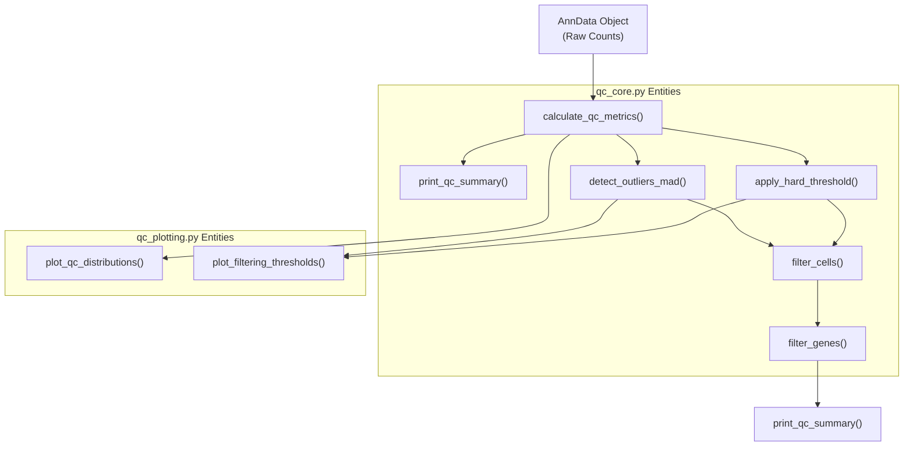
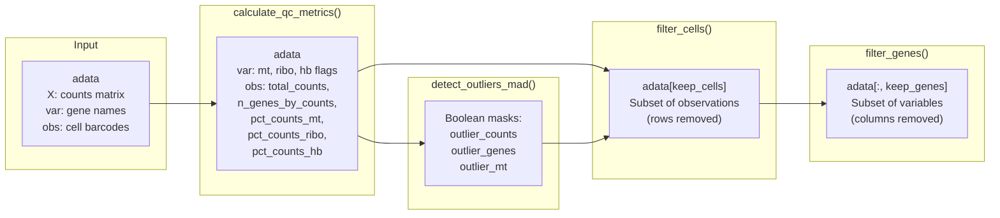

<!-- source: DeepWiki mcp.deepwiki.com · repo anthropics/life-sciences · extra page Core Functions Reference · fetched 2026-10-26 -->

# Core Functions Reference

<details>
<summary>Relevant source files</summary>

The following files were used as context for generating this wiki page:

- [single-cell-rna-qc/SKILL.md](single-cell-rna-qc/SKILL.md)
- [single-cell-rna-qc/references/scverse_qc_guidelines.md](single-cell-rna-qc/references/scverse_qc_guidelines.md)
- [single-cell-rna-qc/scripts/qc_analysis.py](single-cell-rna-qc/scripts/qc_analysis.py)
- [single-cell-rna-qc/scripts/qc_core.py](single-cell-rna-qc/scripts/qc_core.py)
- [single-cell-rna-qc/scripts/qc_plotting.py](single-cell-rna-qc/scripts/qc_plotting.py)

</details>


This page provides detailed API documentation for all functions in the `qc_core` module. These functions implement the core quality control operations for single-cell RNA-seq data following scverse best practices.

For information about using these functions in custom workflows, see [Modular Building Blocks (Approach 2)](./4.1.3). For visualization functions, see [Plotting Functions Reference](./4.1.6). For the automated pipeline that uses these functions, see [Complete Pipeline (Approach 1)](./4.1.2).

**Sources:** [single-cell-rna-qc/scripts/qc_core.py:1-233]()

## Module Overview

The `qc_core.py` module provides six primary functions organized into four functional categories:

| Category | Functions | Purpose |
|----------|-----------|---------|
| **Metric Calculation** | `calculate_qc_metrics()` | Compute QC metrics and annotate AnnData object |
| **Outlier Detection** | `detect_outliers_mad()`<br/>`apply_hard_threshold()` | Identify cells that fail quality thresholds |
| **Data Filtering** | `filter_cells()`<br/>`filter_genes()` | Apply filtering operations to remove low-quality data |
| **Reporting** | `print_qc_summary()` | Display summary statistics |

**Sources:** [single-cell-rna-qc/scripts/qc_core.py:1-233](), [single-cell-rna-qc/SKILL.md:98-107]()

### Function Workflow Diagram

This diagram maps the natural language steps of a QC pipeline to the specific code entities in `qc_core.py` and `qc_plotting.py`.



**Sources:** [single-cell-rna-qc/scripts/qc_core.py:16-233](), [single-cell-rna-qc/scripts/qc_analysis.py:118-200]()

### Data Flow and AnnData Transformations

The following diagram illustrates how the `AnnData` object structure is modified by the core functions.



**Sources:** [single-cell-rna-qc/scripts/qc_core.py:16-61](), [single-cell-rna-qc/scripts/qc_core.py:146-170](), [single-cell-rna-qc/scripts/qc_core.py:172-203]()

## Function Reference

### `calculate_qc_metrics()`

Calculates comprehensive quality control metrics for single-cell RNA-seq data and annotates the AnnData object with results. This function identifies mitochondrial, ribosomal, and hemoglobin genes, then uses `scanpy.pp.calculate_qc_metrics()` to compute per-cell statistics.

**Function Signature:**
```python
calculate_qc_metrics(
    adata,
    mt_pattern='mt-,MT-',
    ribo_pattern='Rpl,Rps,RPL,RPS',
    hb_pattern='^Hb[^(p)]|^HB[^(P)]',
    inplace=True
)
```

**Parameters:**

| Parameter | Type | Default | Description |
|-----------|------|---------|-------------|
| `adata` | `AnnData` | Required | Annotated data matrix with raw counts |
| `mt_pattern` | `str` | `'mt-,MT-'` | Comma-separated mitochondrial gene prefixes. Mouse uses `mt-`, human uses `MT-` [scverse_qc_guidelines.md:24-25]() |
| `ribo_pattern` | `str` | `'Rpl,Rps,RPL,RPS'` | Comma-separated ribosomal gene prefixes. Mouse uses `Rpl/Rps`, human uses `RPL/RPS` [scverse_qc_guidelines.md:31]() |
| `hb_pattern` | `str` | `'^Hb[^(p)]|^HB[^(P)]'` | Regex pattern for hemoglobin genes (excludes hemoglobin-binding proteins) [scverse_qc_guidelines.md:37]() |
| `inplace` | `bool` | `True` | If `True`, modifies `adata` in place. If `False`, returns a modified copy |

**Returns:**

| Return Type | Description |
|-------------|-------------|
| `None` or `AnnData` | Returns `None` if `inplace=True`, otherwise returns modified `AnnData` object |

**Implementation Details:**

The function performs three steps:
1. **Gene Identification** [single-cell-rna-qc/scripts/qc_core.py:42-49](): Uses string matching and regex to identify gene categories and stores them in `adata.var['mt']`, `adata.var['ribo']`, and `adata.var['hb']`.
2. **Metric Calculation** [single-cell-rna-qc/scripts/qc_core.py:52-58](): Calls `scanpy.pp.calculate_qc_metrics()` with the identified gene categories.
3. **Result Storage**: Metrics are stored in `adata.obs` (e.g., `total_counts`, `pct_counts_mt`).

**Sources:** [single-cell-rna-qc/scripts/qc_core.py:16-62]()

---

### `detect_outliers_mad()`

Identifies outlier cells using Median Absolute Deviation (MAD), a robust statistical method that is less sensitive to extreme values than standard deviation.

**Function Signature:**
```python
detect_outliers_mad(
    adata,
    metric,
    n_mads,
    verbose=True
)
```

**Parameters:**

| Parameter | Type | Default | Description |
|-----------|------|---------|-------------|
| `adata` | `AnnData` | Required | Annotated data matrix with QC metrics in `adata.obs` |
| `metric` | `str` | Required | Column name in `adata.obs` to use for outlier detection (e.g., `'total_counts'`) |
| `n_mads` | `float` | Required | Number of MADs from median to use as threshold [scverse_qc_guidelines.md:53]() |
| `verbose` | `bool` | `True` | If `True`, prints median, MAD, bounds, and outlier count |

**Returns:**

| Return Type | Description |
|-------------|-------------|
| `np.ndarray` | Boolean array where `True` indicates outlier cells. Length equals `adata.n_obs` |

**MAD Calculation Implementation:**

The function utilizes `scipy.stats.median_abs_deviation` [single-cell-rna-qc/scripts/qc_core.py:86]() to compute bounds:
- `lower = median - n_mads * mad` [single-cell-rna-qc/scripts/qc_core.py:89]()
- `upper = median + n_mads * mad` [single-cell-rna-qc/scripts/qc_core.py:90]()

**Sources:** [single-cell-rna-qc/scripts/qc_core.py:64-102](), [single-cell-rna-qc/references/scverse_qc_guidelines.md:50-54]()

---

### `apply_hard_threshold()`

Applies a fixed cutoff threshold to a QC metric, returning a boolean mask indicating cells that fail the threshold.

**Function Signature:**
```python
apply_hard_threshold(
    adata,
    metric,
    threshold,
    operator='>',
    verbose=True
)
```

**Parameters:**

| Parameter | Type | Default | Description |
|-----------|------|---------|-------------|
| `adata` | `AnnData` | Required | Annotated data matrix |
| `metric` | `str` | Required | Column name in `adata.obs` to filter on |
| `threshold` | `float` | Required | Threshold value to compare against |
| `operator` | `str` | `'>'` | Comparison operator: `'>'`, `'<'`, `'>='`, or `'<='` |

**Returns:**

| Return Type | Description |
|-------------|-------------|
| `np.ndarray` | Boolean array where `True` indicates cells that **fail** the threshold (should be filtered out) |

**Sources:** [single-cell-rna-qc/scripts/qc_core.py:104-144]()

---

### `filter_cells()`

Filters cells from an AnnData object based on a boolean mask.

**Function Signature:**
```python
filter_cells(
    adata,
    mask,
    inplace=False
)
```

**Parameters:**

| Parameter | Type | Default | Description |
|-----------|------|---------|-------------|
| `adata` | `AnnData` | Required | Annotated data matrix |
| `mask` | `np.ndarray` | Required | Boolean array where `True` indicates cells to **KEEP** |

**Important Note:**
Due to AnnData's architecture, this function returns a `.copy()` of the subsetted object [single-cell-rna-qc/scripts/qc_core.py:167-169]().

**Sources:** [single-cell-rna-qc/scripts/qc_core.py:146-170]()

---

### `filter_genes()`

Filters genes based on detection thresholds.

**Function Signature:**
```python
filter_genes(
    adata,
    min_cells=20,
    min_counts=None,
    inplace=True
)
```

**Parameters:**

| Parameter | Type | Default | Description |
|-----------|------|---------|-------------|
| `min_cells` | `int` | `20` | Minimum cells a gene must be detected in [scverse_qc_guidelines.md:118]() |
| `min_counts` | `int` | `None` | Minimum total counts across all cells |

**Implementation:**
Wraps `scanpy.pp.filter_genes()` [single-cell-rna-qc/scripts/qc_core.py:196-199]().

**Sources:** [single-cell-rna-qc/scripts/qc_core.py:172-203]()

---

### `print_qc_summary()`

Prints summary statistics for an AnnData object, including mean/median counts and genes per cell, and mitochondrial percentage.

**Sources:** [single-cell-rna-qc/scripts/qc_core.py:205-233]()

## Module Dependencies

The `qc_core` module requires the following Python packages:

| Package | Purpose |
|---------|---------|
| `anndata` | AnnData data structure management [single-cell-rna-qc/scripts/qc_core.py:10]() |
| `scanpy` | Core QC calculation and gene filtering [single-cell-rna-qc/scripts/qc_core.py:11]() |
| `numpy` | Numerical array operations and median calculation [single-cell-rna-qc/scripts/qc_core.py:12]() |
| `scipy.stats` | Robust outlier detection via MAD [single-cell-rna-qc/scripts/qc_core.py:13]() |

**Sources:** [single-cell-rna-qc/scripts/qc_core.py:10-13]()

---

