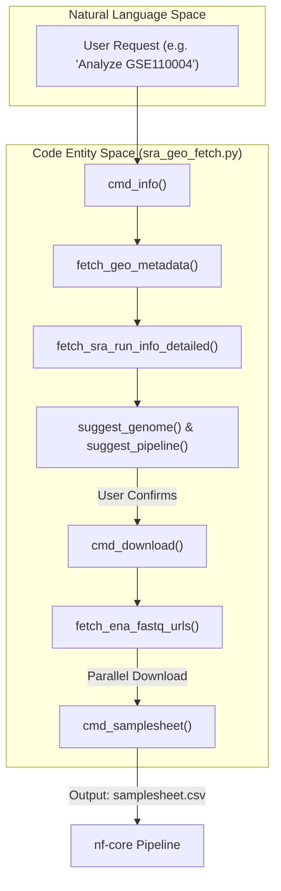
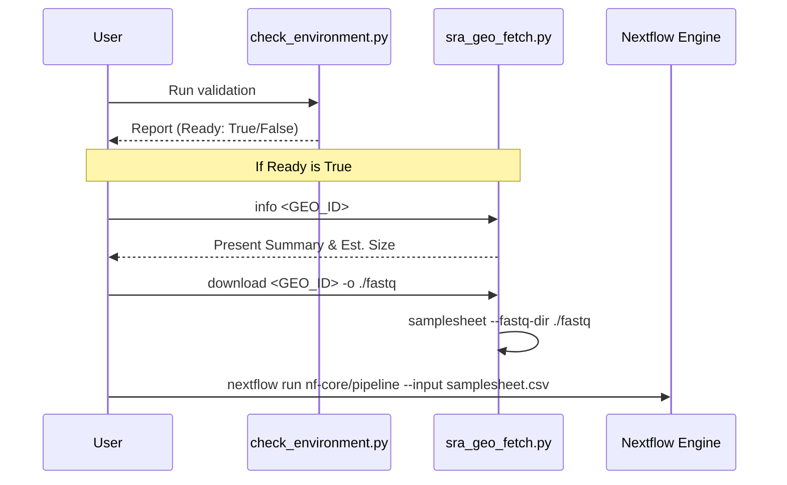

<!-- source: DeepWiki mcp.deepwiki.com · repo anthropics/life-sciences · extra page Environment Setup and Data Acquisition · fetched 2026-10-26 -->

# Environment Setup and Data Acquisition

Relevant source files

The following files were used as context for generating this wiki page:

- [nextflow-development/SKILL.md](nextflow-development/SKILL.md)
- [nextflow-development/references/geo-sra-acquisition.md](nextflow-development/references/geo-sra-acquisition.md)
- [nextflow-development/references/installation.md](nextflow-development/references/installation.md)
- [nextflow-development/scripts/check_environment.py](nextflow-development/scripts/check_environment.py)
- [nextflow-development/scripts/sra_geo_fetch.py](nextflow-development/scripts/sra_geo_fetch.py)

This page documents the prerequisites and initial workflows required to utilize the Nextflow Development skill. It covers environment validation using `check_environment.py` and the acquisition of public sequencing data from GEO/SRA using `sra_geo_fetch.py`.

## 1. Environment Prerequisites

Before running any nf-core pipelines, the local environment must meet specific software requirements. The system relies on Docker for process isolation and Nextflow for workflow orchestration.

### Core Requirements
| Component | Requirement | Purpose |
|:---|:---|:---|
| **Java** | Version 11+ | Runtime for Nextflow [nextflow-development/scripts/check_environment.py:181-182]() |
| **Nextflow** | Version 23.04+ | Pipeline orchestration engine [nextflow-development/scripts/check_environment.py:114-115]() |
| **Docker** | Installed & Running | Containerization of bioinformatics tools [nextflow-development/scripts/check_environment.py:47-48]() |
| **Hardware** | Varies by pipeline | RAM and CPU requirements depend on the specific nf-core pipeline used [nextflow-development/SKILL.md:219-222]() |

### Validation with `check_environment.py`
The `check_environment.py` script serves as a pre-flight validation tool. It executes a series of checks to ensure the environment is ready for pipeline execution [nextflow-development/scripts/check_environment.py:2-6]().

**Key Functions:**
*   `check_docker()`: Verifies if Docker is in the `PATH`, if the daemon is reachable, and if the current user has permissions (e.g., membership in the `docker` group) [nextflow-development/scripts/check_environment.py:47-96]().
*   `check_nextflow()`: Validates the Nextflow installation and ensures the version meets the minimum requirement of 23.04 [nextflow-development/scripts/check_environment.py:113-156]().
*   `check_java()`: Confirms Java 11 or higher is available, which is necessary for Nextflow to operate [nextflow-development/scripts/check_environment.py:180-221]().

**Sources:**
* [nextflow-development/scripts/check_environment.py:1-221]()
* [nextflow-development/SKILL.md:53-85]()

---

## 2. GEO/SRA Data Acquisition

The `sra_geo_fetch.py` script facilitates the downloading of raw sequencing data from NCBI GEO (Gene Expression Omnibus) and SRA (Sequence Read Archive) and prepares it for analysis [nextflow-development/scripts/sra_geo_fetch.py:2-5]().

### Data Flow Architecture

The following diagram illustrates the transition from a GEO Accession ID to a pipeline-ready samplesheet.

**GEO/SRA Data Acquisition Workflow**

**Sources:**
* [nextflow-development/scripts/sra_geo_fetch.py:1-150]()
* [nextflow-development/references/geo-sra-acquisition.md:22-93]()

### Implementation Details

#### 1. Study Information Retrieval
The `cmd_info` function aggregates metadata to help the user decide which data to process [nextflow-development/scripts/sra_geo_fetch.py:152-154]().
*   **Organism Mapping:** Uses `suggest_genome()` to map organisms (e.g., "Homo sapiens") to standard reference genomes (e.g., "GRCh38") [nextflow-development/scripts/sra_geo_fetch.py:98-131]().
*   **Pipeline Suggestion:** Uses `suggest_pipeline()` to match library strategies (e.g., "RNA-SEQ", "WGS") to specific nf-core pipelines (e.g., `rnaseq`, `sarek`) [nextflow-development/scripts/sra_geo_fetch.py:134-149]().

#### 2. Sample Grouping and Selection
For studies with complex designs (e.g., mixed Single-end and Paired-end data), the script groups samples by type and layout [nextflow-development/scripts/sra_geo_fetch.py:179-180]().
*   Users can filter by specific subsets using the `--subset` flag (e.g., `"RNA-Seq:PAIRED"`) [nextflow-development/scripts/sra_geo_fetch.py:221-224]().

#### 3. Optimized Downloading
Data is primarily fetched from the **European Nucleotide Archive (ENA)** via FTP/HTTP using `fetch_ena_fastq_urls()`, as this is typically faster than SRA tools [nextflow-development/scripts/sra_geo_fetch.py:181-182]().
*   The script supports parallel transfers via `ThreadPoolExecutor` [nextflow-development/scripts/sra_geo_fetch.py:27]().

#### 4. Samplesheet Generation
The final step in acquisition is `cmd_samplesheet()`, which maps the downloaded FASTQ files back to their SRR/GSM accessions and generates the CSV format required by nf-core pipelines [nextflow-development/scripts/sra_geo_fetch.py:11]().

**Sources:**
* [nextflow-development/scripts/sra_geo_fetch.py:73-226]()
* [nextflow-development/references/geo-sra-acquisition.md:117-200]()

---

## 3. Workflow Integration

The relationship between environment setup and data acquisition is critical: the environment must be validated before data is downloaded to ensure the analysis can proceed immediately.

**Environment and Acquisition Logic**

### Quick Start Commands

| Task | Command |
|:---|:---|
| **Validate Env** | `python scripts/check_environment.py` [nextflow-development/SKILL.md:58]() |
| **Inspect Study** | `python scripts/sra_geo_fetch.py info GSE110004` [nextflow-development/SKILL.md:36]() |
| **Download Data** | `python scripts/sra_geo_fetch.py download GSE110004 -o ./fastq -i` [nextflow-development/SKILL.md:39]() |
| **Make Samplesheet** | `python scripts/sra_geo_fetch.py samplesheet GSE110004 --fastq-dir ./fastq -o samplesheet.csv` [nextflow-development/SKILL.md:42]() |

**Sources:**
* [nextflow-development/SKILL.md:14-50]()
* [nextflow-development/references/installation.md:11-22]()

---

