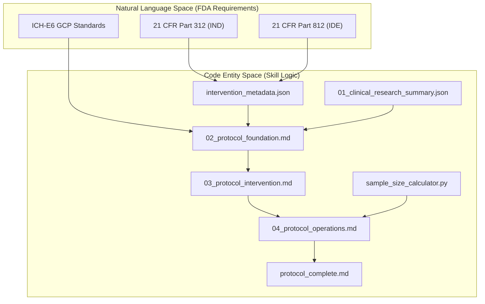
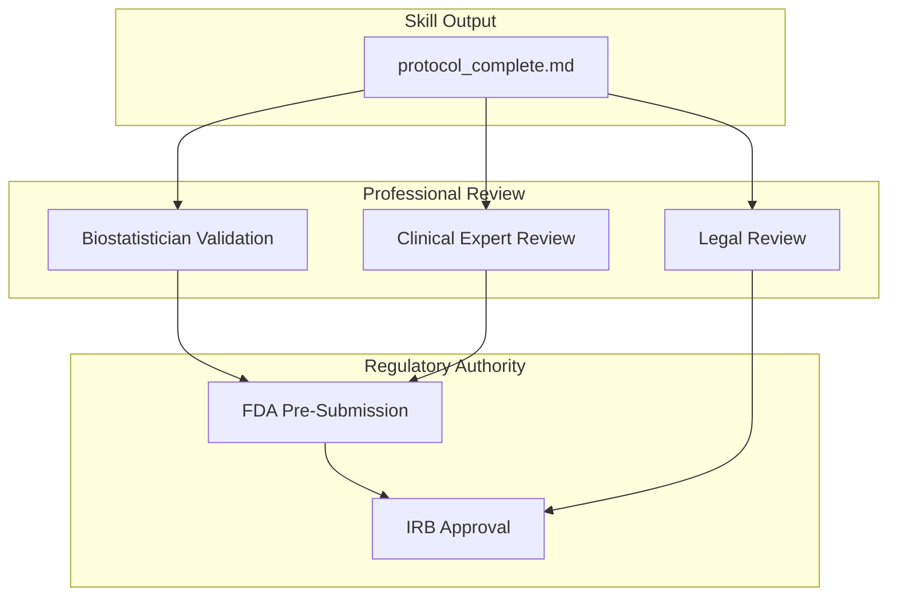

<!-- source: DeepWiki mcp.deepwiki.com · repo anthropics/life-sciences · extra page FDA Protocol Template and Regulatory Guidance · fetched 2026-10-26 -->

# FDA Protocol Template and Regulatory Guidance

Relevant source files

The following files were used as context for generating this wiki page:

- [clinical-trial-protocol-skill/README.md](clinical-trial-protocol-skill/README.md)
- [clinical-trial-protocol-skill/assets/FDA-Clinical-Protocol-Template.md](clinical-trial-protocol-skill/assets/FDA-Clinical-Protocol-Template.md)

This page documents the structural and regulatory foundation of the Clinical Trial Protocol skill. The skill leverages official NIH/FDA templates to ensure that generated protocols meet the standards for Phase 2 and 3 clinical trials, while providing the necessary context for various regulatory pathways.

## FDA Clinical Protocol Template Structure

The skill utilizes a standardized template based on the *International Conference on Harmonisation (ICH) Guidance for Industry, E6 Good Clinical Practice: Consolidated Guidance (ICH-E6)* [clinical-trial-protocol-skill/assets/FDA-Clinical-Protocol-Template.md:7-7](). This template is specifically designed for trials conducted under an Investigational New Drug (IND) or Investigational Device Exemption (IDE) application [clinical-trial-protocol-skill/assets/FDA-Clinical-Protocol-Template.md:5-5]().

### Template Organization
The template is structured into several key areas that the skill populates across its modular waypoint-based workflow:

| Section Category | Template Sections | Workflow Step |
| :--- | :--- | :--- |
| **Foundation** | 1-6: Summary, Objectives, Design, Population | Step 2: Foundation [clinical-trial-protocol-skill/README.md:41-41]() |
| **Intervention** | 7-8: Administration, Dose Modifications | Step 3: Intervention [clinical-trial-protocol-skill/README.md:42-42]() |
| **Operations** | 9-12: Assessments, Statistics, Regulatory | Step 4: Operations [clinical-trial-protocol-skill/README.md:43-43]() |

### Implementation Mapping: Template to Code

The following diagram illustrates how the natural language requirements of the FDA Template are mapped to specific file outputs and generation logic within the skill.

**Protocol Generation Data Flow**

Sources: [clinical-trial-protocol-skill/README.md:37-44](), [clinical-trial-protocol-skill/assets/FDA-Clinical-Protocol-Template.md:1-13]()

## Regulatory Pathways

The skill distinguishes between drug and device pathways to apply the correct regulatory terminology and guidance [clinical-trial-protocol-skill/README.md:7-7]().

### Medical Devices (IDE Pathway)
For medical devices, the skill references **21 CFR Part 812: Investigational Device Exemptions** [clinical-trial-protocol-skill/assets/FDA-Clinical-Protocol-Template.md:51-51](). This pathway is used for devices that are not yet cleared or approved for a specific indication.

### Drugs and Biologics (IND Pathway)
For drugs and biologics, the skill references **21 CFR Part 312: Investigational New Drug Application** [clinical-trial-protocol-skill/assets/FDA-Clinical-Protocol-Template.md:49-49](). This is intended for Phase 2 and 3 clinical trials [clinical-trial-protocol-skill/assets/FDA-Clinical-Protocol-Template.md:5-5]().

### Regulatory Guidance Integration
The skill is designed to incorporate guidance from:
* **ClinicalTrials.gov**: To find similar trials and benchmark study designs [clinical-trial-protocol-skill/README.md:49-49]().
* **FDA Guidance Documents**: Accessed via web search to ensure compliance with current industry standards [clinical-trial-protocol-skill/README.md:50-50]().

Sources: [clinical-trial-protocol-skill/README.md:13-17](), [clinical-trial-protocol-skill/assets/FDA-Clinical-Protocol-Template.md:49-51]()

## Disclaimers and Professional Requirements

Due to the high-stakes nature of clinical trial protocols, the skill includes mandatory disclaimers and requires professional consultation.

### Professional Consultation Requirements
The generated protocols are considered **preliminary** and do not constitute official FDA or IRB approval [clinical-trial-protocol-skill/README.md:21-21](). The following actions are required before proceeding with any clinical study:

1.  **Biostatistician Review**: Validation of sample sizes and statistical analysis plans [clinical-trial-protocol-skill/README.md:29-29]().
2.  **FDA Pre-Submission Meeting**: Q-Submission for devices or Pre-IND for drugs [clinical-trial-protocol-skill/README.md:30-30]().
3.  **IRB Review**: Institutional Review Board approval [clinical-trial-protocol-skill/README.md:31-31]().
4.  **Legal Review**: Review of the protocol and informed consent forms [clinical-trial-protocol-skill/README.md:33-33]().

### Regulatory Logic Flow

This diagram shows the relationship between the skill's output and the required professional/regulatory checkpoints.

**Regulatory Checkpoint Workflow**

Sources: [clinical-trial-protocol-skill/README.md:19-33]()

---

