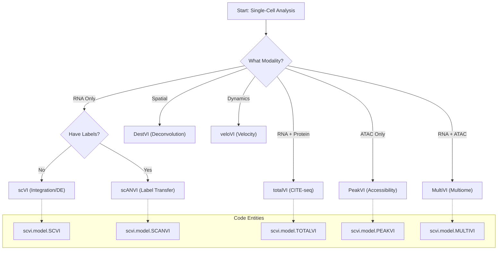
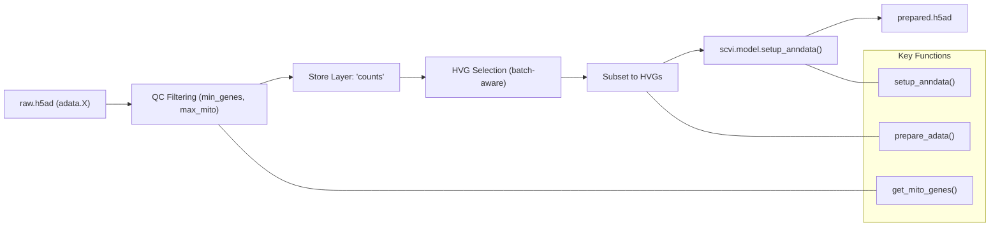

<!-- source: DeepWiki mcp.deepwiki.com · repo anthropics/life-sciences · extra page Model Selection and Data Preparation · fetched 2026-10-26 -->

# Model Selection and Data Preparation

Relevant source files

The following files were used as context for generating this wiki page:

- [scvi-tools/SKILL.md](scvi-tools/SKILL.md)
- [scvi-tools/references/atac_peakvi.md](scvi-tools/references/atac_peakvi.md)
- [scvi-tools/references/batch_correction_sysvi.md](scvi-tools/references/batch_correction_sysvi.md)
- [scvi-tools/references/citeseq_totalvi.md](scvi-tools/references/citeseq_totalvi.md)
- [scvi-tools/references/data_preparation.md](scvi-tools/references/data_preparation.md)
- [scvi-tools/references/environment_setup.md](scvi-tools/references/environment_setup.md)
- [scvi-tools/references/label_transfer.md](scvi-tools/references/label_transfer.md)
- [scvi-tools/references/multiome_multivi.md](scvi-tools/references/multiome_multivi.md)
- [scvi-tools/references/troubleshooting.md](scvi-tools/references/troubleshooting.md)
- [scvi-tools/scripts/model_utils.py](scvi-tools/scripts/model_utils.py)
- [scvi-tools/scripts/prepare_data.py](scvi-tools/scripts/prepare_data.py)

This page provides technical guidance for selecting the appropriate probabilistic model from the `scvi-tools` framework and preparing `AnnData` objects for deep learning-based single-cell analysis. The `scvi-tools` skill leverages a suite of Variational Autoencoders (VAEs) to handle various omics modalities and analytical tasks [scvi-tools/SKILL.md:2-4]().

## Model Selection Guide

Selecting the correct model depends primarily on the data modality and the specific analytical goal (e.g., integration, label transfer, or deconvolution).

| Data Type | Model | Primary Use Case |
|-----------|-------|------------------|
| **scRNA-seq** | `SCVI` | Unsupervised integration, batch correction, DE, and imputation [scvi-tools/SKILL.md:31]() |
| **scRNA-seq + labels** | `SCANVI` | Semi-supervised integration and label transfer from reference to query [scvi-tools/SKILL.md:32]() |
| **CITE-seq** (RNA+Protein) | `TOTALVI` | Joint multi-modal integration and protein denoising [scvi-tools/SKILL.md:33]() |
| **scATAC-seq** | `PEAKVI` | Chromatin accessibility analysis and differential accessibility [scvi-tools/SKILL.md:34]() |
| **Multiome** (RNA+ATAC) | `MULTIVI` | Joint analysis of simultaneous RNA and ATAC measurements [scvi-tools/SKILL.md:35]() |
| **Spatial + scRNA ref** | `DESTVI` | Cell type deconvolution for spatial transcriptomics [scvi-tools/SKILL.md:36]() |
| **RNA Velocity** | `VELOVI` | Modeling transcriptional dynamics and splicing [scvi-tools/SKILL.md:37]() |
| **Cross-technology** | `SYSVI` | System-level batch correction (e.g., 10x vs Smart-seq2) [scvi-tools/SKILL.md:38]() |

### Decision Logic Flow

The following diagram illustrates the selection logic implemented in the `scvi-tools` skill.

**Model Selection Decision Tree**

**Sources:** [scvi-tools/SKILL.md:29-38](), [scvi-tools/SKILL.md:127-148]()

---

## Data Preparation Requirements

All `scvi-tools` models share three critical prerequisites: raw integer counts, specific feature selection (HVGs), and batch identification [scvi-tools/SKILL.md:107-123]().

### 1. Raw Count Enforcement
Models within `scvi-tools` use probabilistic likelihoods (e.g., Negative Binomial) that require non-normalized, integer data [scvi-tools/references/data_preparation.md:8-10]().
* **Implementation**: Raw counts should be stored in a specific layer, typically `adata.layers["counts"]` [scvi-tools/scripts/model_utils.py:86]().
* **Validation**: The `prepare_adata` function checks for integer counts and preserves them before any internal normalization steps [scvi-tools/scripts/prepare_data.py:78-98]().

### 2. Highly Variable Gene (HVG) Selection
Models perform best when subset to 2,000–4,000 HVGs to focus on biological signal rather than technical noise [scvi-tools/references/data_preparation.md:83-84]().
* **Batch-Aware HVG**: For multi-batch data, the `seurat_v3` flavor is recommended as it operates on raw counts and accounts for batch variance [scvi-tools/references/data_preparation.md:107-115]().
* **Code Reference**: `sc.pp.highly_variable_genes(adata, flavor="seurat_v3", batch_key=batch_key, layer="counts")` [scvi-tools/scripts/model_utils.py:90-96]().

### 3. Batch Key Setup
To perform integration, the `batch_key` must point to a column in `adata.obs` representing technical replicates or different samples [scvi-tools/references/data_preparation.md:142-147]().

---

## Technical Implementation: `prepare_data.py`

The system provides a standardized preparation pipeline via `scripts/prepare_data.py` and the underlying `model_utils.py`.

**Data Flow: Raw to Model-Ready**

### Core Preparation Function: `prepare_adata`
Defined in `scripts/model_utils.py`, this function automates the standard scverse-compliant preparation workflow:

1.  **Mitochondrial Identification**: Uses `get_mito_genes` to handle human (`MT-`) and mouse (`mt-`) prefixes [scvi-tools/scripts/model_utils.py:15-31]().
2.  **Cell Filtering**: Filters by `min_genes`, `max_genes`, and `max_mito_pct` [scvi-tools/scripts/model_utils.py:78-80]().
3.  **Gene Filtering**: Removes genes present in fewer than `min_cells` [scvi-tools/scripts/model_utils.py:83]().
4.  **Layer Assignment**: Copies `adata.X` to `adata.layers["counts"]` [scvi-tools/scripts/model_utils.py:86]().
5.  **HVG Selection**: Executes batch-aware selection if a `batch_key` is provided [scvi-tools/scripts/model_utils.py:89-96]().

**Sources:** [scvi-tools/scripts/model_utils.py:34-112](), [scvi-tools/scripts/prepare_data.py:17-106](), [scvi-tools/references/data_preparation.md:46-125]()

---

## Modality-Specific Preparation

### CITE-seq (totalVI)
* **Protein Storage**: Protein ADT counts must be raw integers and stored in `adata.obsm["protein_expression"]` [scvi-tools/references/citeseq_totalvi.md:58-66]().
* **Protein Names**: Names should be stored in `adata.uns["protein_names"]` [scvi-tools/references/citeseq_totalvi.md:65]().
* **Setup**: Requires `scvi.model.TOTALVI.setup_anndata` with `protein_expression_obsm_key` [scvi-tools/references/data_preparation.md:194-199]().

### scATAC-seq (PeakVI)
* **Binarization**: PeakVI typically models binary accessibility; counts should be binarized (`adata.X > 0`) [scvi-tools/references/atac_peakvi.md:77-84]().
* **Feature Selection**: Since HVG logic doesn't apply to ATAC, the system selects the top 50,000 most accessible peaks [scvi-tools/references/atac_peakvi.md:92-98]().

### Multiome (MultiVI)
* **Structure**: Uses `MuData` objects containing `rna` and `atac` modalities [scvi-tools/references/multiome_multivi.md:26-38]().
* **Setup**: Requires `scvi.model.MULTIVI.setup_mudata` to map the respective layers for both modalities [scvi-tools/references/multiome_multivi.md:124-134]().

**Sources:** [scvi-tools/references/citeseq_totalvi.md:1-68](), [scvi-tools/references/atac_peakvi.md:77-110](), [scvi-tools/references/multiome_multivi.md:120-134](), [scvi-tools/references/data_preparation.md:182-219]()

---

