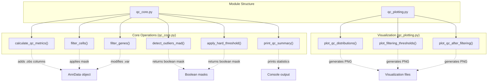
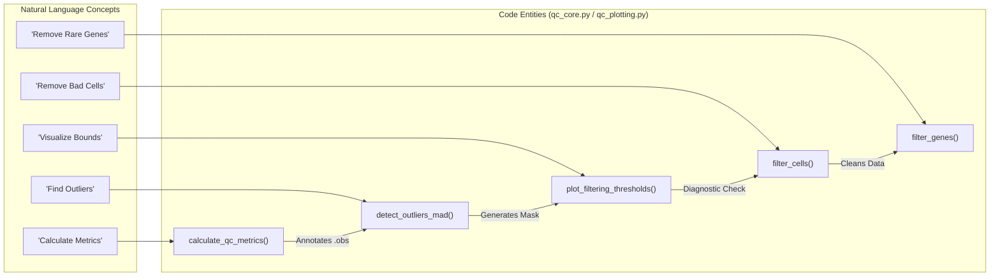

<!-- source: DeepWiki mcp.deepwiki.com · repo anthropics/life-sciences · extra page Modular Building Blocks (Approach 2) · fetched 2026-10-26 -->

# Modular Building Blocks (Approach 2)

<details>
<summary>Relevant source files</summary>

The following files were used as context for generating this wiki page:

- [single-cell-rna-qc/SKILL.md](single-cell-rna-qc/SKILL.md)
- [single-cell-rna-qc/references/scverse_qc_guidelines.md](single-cell-rna-qc/references/scverse_qc_guidelines.md)
- [single-cell-rna-qc/scripts/qc_analysis.py](single-cell-rna-qc/scripts/qc_analysis.py)
- [single-cell-rna-qc/scripts/qc_core.py](single-cell-rna-qc/scripts/qc_core.py)
- [single-cell-rna-qc/scripts/qc_plotting.py](single-cell-rna-qc/scripts/qc_plotting.py)

</details>


This document describes the modular approach to single-cell RNA-seq quality control, which provides programmatic access to individual QC functions for building custom analysis workflows. This approach is intended for users who need non-standard filtering logic, conditional processing, or integration with larger analytical pipelines.

For the automated end-to-end QC pipeline, see [Complete Pipeline (Approach 1) (4.1.2)](). For detailed API specifications of individual functions, see [Core Functions Reference (4.1.5)]() and [Plotting Functions Reference (4.1.6)]().

## When to Use Approach 2

Approach 2 is appropriate when:

- **Custom workflow order** - Steps need to be skipped, reordered, or executed conditionally [single-cell-rna-qc/SKILL.md:92-92]().
- **Subset-specific processing** - Different filtering thresholds must be applied to cell subpopulations (e.g., neurons vs. other cells) [single-cell-rna-qc/SKILL.md:93-93]().
- **Partial execution** - Only metrics calculation or visualization is needed without filtering [single-cell-rna-qc/SKILL.md:94-94]().
- **Pipeline integration** - QC operations must be embedded within a larger analysis workflow [single-cell-rna-qc/SKILL.md:95-95]().
- **Non-standard criteria** - Filtering logic exceeds what command-line parameters support in Approach 1 [single-cell-rna-qc/SKILL.md:96-96]().

The modular functions share the same underlying implementation as Approach 1, ensuring consistency in methodology while providing flexibility in execution.

**Sources:** [single-cell-rna-qc/SKILL.md:76-97]()

## Module Architecture

The modular approach consists of two Python modules located in [single-cell-rna-qc/scripts/](): `qc_core.py` for analytical operations and `qc_plotting.py` for visualization.

### Code Entity Space to System Architecture



**Sources:** [single-cell-rna-qc/SKILL.md:98-112](), [single-cell-rna-qc/scripts/qc_core.py:1-233](), [single-cell-rna-qc/scripts/qc_plotting.py:1-235]()

## Function Workflow Patterns

### Data Flow: Natural Language to Code Entities

This diagram maps the conceptual steps of QC analysis to the specific functions provided in the `qc_core` and `qc_plotting` modules.



The workflow follows this pattern:
1. **Annotation**: `calculate_qc_metrics()` adds QC columns to `adata.obs` [single-cell-rna-qc/scripts/qc_core.py:52-58]().
2. **Threshold detection**: `detect_outliers_mad()` or `apply_hard_threshold()` generate boolean masks [single-cell-rna-qc/scripts/qc_core.py:64-143]().
3. **Mask combination**: Multiple masks are combined using logical operators (e.g., `~` for inversion, `|` for union) [single-cell-rna-qc/scripts/qc_analysis.py:152-156]().
4. **Cell filtering**: `filter_cells()` applies the combined mask [single-cell-rna-qc/scripts/qc_core.py:146-170]().
5. **Gene filtering**: `filter_genes()` removes lowly-detected genes [single-cell-rna-qc/scripts/qc_core.py:172-203]().
6. **Visualization**: Optional plotting functions generate diagnostic figures [single-cell-rna-qc/scripts/qc_plotting.py:13-178]().

**Sources:** [single-cell-rna-qc/SKILL.md:80-89](), [single-cell-rna-qc/scripts/qc_core.py:10-233](), [single-cell-rna-qc/scripts/qc_analysis.py:137-160]()

## Module Import and Setup

Both modules must be imported from the `scripts/` directory. If the execution context is outside this directory, it must be added to the system path.

```python
import sys
import anndata as ad

# If not running from scripts/ directory, add it to path
sys.path.insert(0, 'path/to/single-cell-rna-qc/scripts/')

from qc_core import (
    calculate_qc_metrics,
    detect_outliers_mad,
    apply_hard_threshold,
    filter_cells,
    filter_genes,
    print_qc_summary
)

from qc_plotting import (
    plot_qc_distributions,
    plot_filtering_thresholds,
    plot_qc_after_filtering
)
```

### Module Dependencies

| Module | Dependencies |
|--------|-------------|
| `qc_core.py` | `anndata`, `scanpy`, `numpy`, `scipy.stats.median_abs_deviation` [single-cell-rna-qc/scripts/qc_core.py:10-13]() |
| `qc_plotting.py` | `numpy`, `matplotlib.pyplot`, `scipy.stats.median_abs_deviation` [single-cell-rna-qc/scripts/qc_plotting.py:8-10]() |

**Sources:** [single-cell-rna-qc/SKILL.md:80-89](), [single-cell-rna-qc/scripts/qc_core.py:1-14](), [single-cell-rna-qc/scripts/qc_plotting.py:1-10]()

## Core Function Overview

### Metrics Calculation
The `calculate_qc_metrics()` function annotates an AnnData object with QC metrics using `scanpy.pp.calculate_qc_metrics` [single-cell-rna-qc/scripts/qc_core.py:52-58]().

- **Parameters**: Supports custom patterns for mitochondrial (`mt_pattern`), ribosomal (`ribo_pattern`), and hemoglobin (`hb_pattern`) genes [single-cell-rna-qc/scripts/qc_core.py:16-17]().
- **Outputs**: Modifies `adata.var` to tag gene types and `adata.obs` to include columns like `total_counts`, `n_genes_by_counts`, and `pct_counts_mt` [single-cell-rna-qc/scripts/qc_core.py:43-58]().

**Sources:** [single-cell-rna-qc/scripts/qc_core.py:16-62]()

### Outlier Detection
Two primary methods are available for identifying low-quality cells:

1.  **MAD-based detection**: `detect_outliers_mad()` calculates bounds based on Median Absolute Deviation: `median ± n_MADs × MAD` [single-cell-rna-qc/scripts/qc_core.py:89-90](). This is robust to outliers and adapts to dataset-specific variance [single-cell-rna-qc/references/scverse_qc_guidelines.md:50-54]().
2.  **Hard threshold detection**: `apply_hard_threshold()` applies fixed cutoffs (e.g., `pct_counts_mt > 8`) [single-cell-rna-qc/scripts/qc_core.py:104-143]().

Both functions return a boolean mask where `True` indicates an outlier [single-cell-rna-qc/scripts/qc_core.py:101, 124]().

**Sources:** [single-cell-rna-qc/scripts/qc_core.py:64-144](), [single-cell-rna-qc/references/scverse_qc_guidelines.md:50-54]()

### Filtering Operations
- **`filter_cells(adata, mask, inplace=False)`**: Applies a boolean mask to the AnnData object. Note that `mask` should be `True` for cells to **keep** [single-cell-rna-qc/scripts/qc_core.py:155, 169]().
- **`filter_genes(adata, min_cells=20, ...)`**: Removes genes detected in fewer than a specified number of cells [single-cell-rna-qc/scripts/qc_core.py:172-203]().

**Sources:** [single-cell-rna-qc/scripts/qc_core.py:146-203]()

## Custom Workflow Examples

### Example 1: Metrics and Visualization Only
Useful for exploratory analysis without data modification.
```python
adata = ad.read_h5ad('input.h5ad')
calculate_qc_metrics(adata, inplace=True)
plot_qc_distributions(adata, 'qc_before.png', title='Initial QC')
print_qc_summary(adata, label='Before filtering')
```
**Sources:** [single-cell-rna-qc/SKILL.md:115-121]()

### Example 2: Subset-Specific Filtering
Different cell types may have different biological baselines (e.g., neurons often have higher mitochondrial content) [single-cell-rna-qc/references/scverse_qc_guidelines.md:153-156]().

```python
# Neurons tolerate higher MT%, other cells use stricter threshold
neurons = adata.obs['cell_type'] == 'neuron'
other_cells = ~neurons

neuron_qc = apply_hard_threshold(adata[neurons], 'pct_counts_mt', 15, operator='>')
other_qc = apply_hard_threshold(adata[other_cells], 'pct_counts_mt', 8, operator='>')
```
**Sources:** [single-cell-rna-qc/SKILL.md:134-147](), [single-cell-rna-qc/references/scverse_qc_guidelines.md:153-156]()

## Comparison: Approach 1 vs Approach 2

| Aspect | Approach 1 (qc_analysis.py) | Approach 2 (Modular Functions) |
|--------|----------------------------|-------------------------------|
| **Interface** | Command-line script | Python API |
| **Flexibility** | Fixed workflow with parameters | Fully customizable workflow |
| **Setup** | Direct execution | Requires import and scripting |
| **Subset handling** | Uniform thresholds | Per-subset thresholds possible |
| **Integration** | Standalone tool | Embeddable functions |

**Sources:** [single-cell-rna-qc/SKILL.md:25-97]()

## Mask Operations and Boolean Logic

When combining multiple QC criteria, use logical bitwise operators:
- **Union (`|`)**: Cell fails if it is an outlier in *any* metric [single-cell-rna-qc/scripts/qc_analysis.py:152-156]().
- **Inversion (`~`)**: Converts an "outlier mask" (True=Remove) to a "keep mask" (True=Keep) [single-cell-rna-qc/scripts/qc_analysis.py:152-156]().

```python
# Combine MT filters (MAD + hard threshold)
adata.obs['outlier_mt'] = adata.obs['outlier_mt'] | high_mt_mask
# Overall filtering decision
adata.obs['pass_qc'] = ~(adata.obs['outlier_counts'] | adata.obs['outlier_genes'] | adata.obs['outlier_mt'])
```
**Sources:** [single-cell-rna-qc/scripts/qc_analysis.py:149-156]()

---

