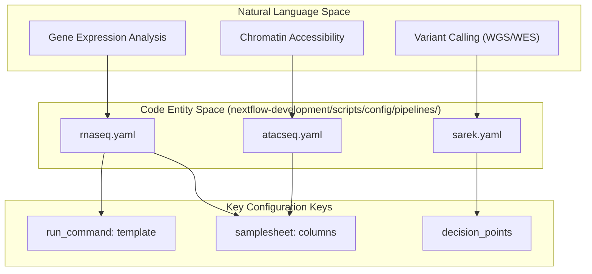
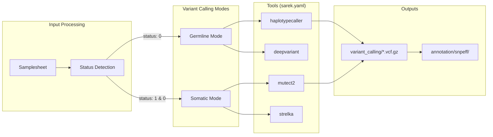

<!-- source: DeepWiki mcp.deepwiki.com · repo anthropics/life-sciences · extra page Pipeline Reference: RNA-seq, Sarek, and ATAC-seq · fetched 2026-10-26 -->

# Pipeline Reference: RNA-seq, Sarek, and ATAC-seq

Relevant source files

The following files were used as context for generating this wiki page:

- [nextflow-development/references/pipelines/atacseq.md](nextflow-development/references/pipelines/atacseq.md)
- [nextflow-development/references/pipelines/rnaseq.md](nextflow-development/references/pipelines/rnaseq.md)
- [nextflow-development/references/pipelines/sarek.md](nextflow-development/references/pipelines/sarek.md)
- [nextflow-development/scripts/config/pipelines/atacseq.yaml](nextflow-development/scripts/config/pipelines/atacseq.yaml)
- [nextflow-development/scripts/config/pipelines/rnaseq.yaml](nextflow-development/scripts/config/pipelines/rnaseq.yaml)
- [nextflow-development/scripts/config/pipelines/sarek.yaml](nextflow-development/scripts/config/pipelines/sarek.yaml)

This page provides technical documentation for the three core nf-core pipelines supported by the Nextflow Development skill. These pipelines—`rnaseq`, `sarek`, and `atacseq`—are industry standards for gene expression quantification, variant calling, and chromatin accessibility analysis, respectively.

### Pipeline Architecture and Configuration

The integration of these pipelines is managed through YAML configuration files that define metadata, samplesheet requirements, and execution templates.

**Pipeline Mapping: Configuration to Code**

The following diagram illustrates how natural language pipeline concepts map to specific configuration entities in the codebase.

**Sources:** [nextflow-development/scripts/config/pipelines/rnaseq.yaml:1-3]() | [nextflow-development/scripts/config/pipelines/sarek.yaml:1-3]() | [nextflow-development/scripts/config/pipelines/atacseq.yaml:1-3]()

---

## 1. nf-core/rnaseq (Gene Expression)

The `rnaseq` pipeline (v3.22.2) is used for quantifying gene expression from bulk RNA-seq data. It supports multiple aligners and provides raw counts suitable for downstream differential expression analysis.

### Samplesheet Format
The pipeline requires a CSV samplesheet with specific columns for file paths and library metadata.

| Column | Required | Values | Description |
|--------|----------|--------|-------------|
| `sample` | Yes | Alphanumeric | Unique sample identifier |
| `fastq_1` | Yes | Path | Absolute path to R1 FASTQ |
| `fastq_2` | No | Path | Absolute path to R2 (empty for single-end) |
| `strandedness` | Yes | `auto`, `forward`, `reverse`, `unstranded` | Library preparation type |

**Sources:** [nextflow-development/references/pipelines/rnaseq.md:25-39]() | [nextflow-development/scripts/config/pipelines/rnaseq.yaml:34-63]()

### Execution and Parameters
The default execution uses `star_salmon` for alignment and quantification.

*   **Minimal Command:** `nextflow run nf-core/rnaseq -r 3.22.2 -profile docker --input samplesheet.csv --outdir results --genome GRCh38` [nextflow-development/references/pipelines/rnaseq.md:49-53]()
*   **Key Parameters:**
    *   `--aligner`: Defaults to `star_salmon`. Alternatives include `star_rsem` and `hisat2` [nextflow-development/scripts/config/pipelines/rnaseq.yaml:84-96]().
    *   `--genome`: Supported defaults include `GRCh38`, `GRCh37`, `mm10`, and `BDGP6` [nextflow-development/references/pipelines/rnaseq.md:57-60]().

### Outputs
Primary results are stored in the `star_salmon/` directory:
*   `salmon.merged.gene_counts.tsv`: Raw matrix for `DESeq2` [nextflow-development/references/pipelines/rnaseq.md:77-86]().
*   `salmon.merged.gene_tpm.tsv`: Normalized expression values [nextflow-development/references/pipelines/rnaseq.md:78-87]().

---

## 2. nf-core/sarek (Variant Calling)

The `sarek` pipeline (v3.7.1) handles germline and somatic variant calling for Whole Genome (WGS) and Whole Exome (WES) sequencing data.

### Data Flow and Tool Selection
The pipeline dynamically selects tools based on the detected sample status (Tumor vs. Normal).

**Sources:** [nextflow-development/scripts/config/pipelines/sarek.yaml:120-138]() | [nextflow-development/references/pipelines/sarek.md:115-129]()

### Samplesheet Formats
Sarek is unique in supporting multiple input types beyond FASTQ.

*   **FASTQ Input:** Requires `patient`, `sample`, `lane`, `fastq_1`, `fastq_2`, and `status` [nextflow-development/references/pipelines/sarek.md:27-33]().
*   **BAM/CRAM Input:** Requires `patient`, `sample`, `bam`, and `bai` [nextflow-development/references/pipelines/sarek.md:35-40]().
*   **Status Mapping:** `0` for normal/germline, `1` for tumor [nextflow-development/references/pipelines/sarek.md:49]().

### Key Parameters
*   `--tools`: Comma-separated list (e.g., `mutect2,strelka,snpeff`) [nextflow-development/references/pipelines/sarek.md:60-64]().
*   `--wes`: Set to `true` for exome data; requires `--intervals` [nextflow-development/scripts/config/pipelines/sarek.yaml:140-150]().

---

## 3. nf-core/atacseq (Chromatin Accessibility)

The `atacseq` pipeline (v2.1.2) identifies regions of open chromatin and performs peak calling.

### Samplesheet and Design
Unlike RNA-seq, ATAC-seq requires a `replicate` column to manage consensus peak calling across multiple runs of the same condition.

| Column | Required | Description |
|--------|----------|-------------|
| `sample` | Yes | Condition/group identifier |
| `fastq_1` | Yes | Absolute path to R1 |
| `fastq_2` | Yes | Absolute path to R2 (Paired-end required) |
| `replicate` | Yes | Integer (1, 2, etc.) |

**Sources:** [nextflow-development/references/pipelines/atacseq.md:25-40]() | [nextflow-development/scripts/config/pipelines/atacseq.yaml:35-60]()

### Key Analysis Parameters
*   `--read_length`: Used for MACS2 optimization (default: 50) [nextflow-development/scripts/config/pipelines/atacseq.yaml:77-92]().
*   `--narrow_peak`: `true` for standard ATAC-seq; `false` for broad peaks like histone marks [nextflow-development/references/pipelines/atacseq.md:65]().
*   `--deseq2_design`: Optional CSV for differential accessibility analysis [nextflow-development/references/pipelines/atacseq.md:43-49]().

### Quality Metrics and Troubleshooting
The pipeline produces specific metrics to validate library complexity and enrichment.

| Metric | Good Threshold | Source |
|--------|----------------|--------|
| **FRiP** (Reads in Peaks) | >30% | [nextflow-development/references/pipelines/atacseq.md:107]() |
| **TSS Enrichment** | >6 | [nextflow-development/references/pipelines/atacseq.md:108]() |
| **Mitochondrial Reads** | <20% | [nextflow-development/references/pipelines/atacseq.md:105]() |

**Common Fixes:**
*   **Low FRiP:** Check `plotFingerprint` for over-transposition [nextflow-development/scripts/config/pipelines/atacseq.yaml:174-175]().
*   **High Mitochondrial Reads:** The pipeline filters these by default using `--keep_mito false` [nextflow-development/scripts/config/pipelines/atacseq.yaml:180-181]().

---

## Genome Configuration Summary

All three pipelines utilize a unified genome configuration strategy via the `--genome` parameter, which leverages iGenomes for standardized resource paths.

| Genome Code | Description | Supported Pipelines |
|-------------|-------------|---------------------|
| `GRCh38` | Human (latest) | All |
| `GRCh37` | Human (legacy) | All |
| `mm10` | Mouse | All |
| `BDGP6` | Drosophila | RNA-seq |

**Sources:** [nextflow-development/scripts/config/pipelines/rnaseq.yaml:65-82]() | [nextflow-development/scripts/config/pipelines/sarek.yaml:105-118]() | [nextflow-development/scripts/config/pipelines/atacseq.yaml:61-75]()

---

