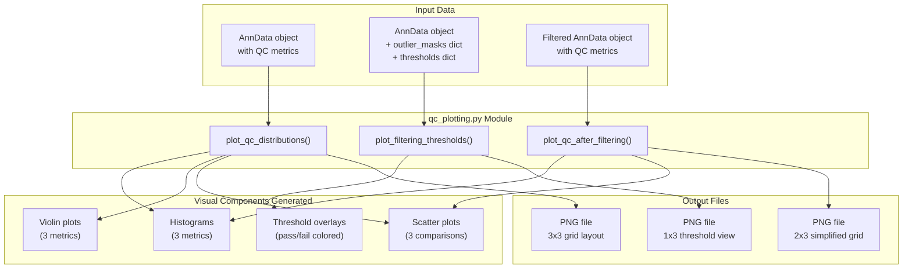
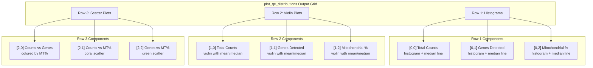
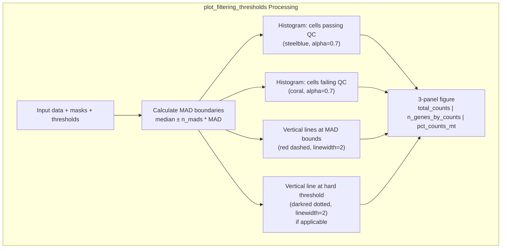
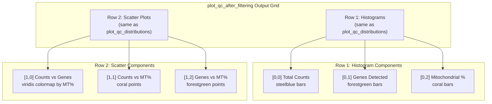

<!-- source: DeepWiki mcp.deepwiki.com · repo anthropics/life-sciences · extra page Plotting Functions Reference · fetched 2026-10-26 -->

# Plotting Functions Reference

<details>
<summary>Relevant source files</summary>

The following files were used as context for generating this wiki page:

- [single-cell-rna-qc/SKILL.md](single-cell-rna-qc/SKILL.md)
- [single-cell-rna-qc/references/scverse_qc_guidelines.md](single-cell-rna-qc/references/scverse_qc_guidelines.md)
- [single-cell-rna-qc/scripts/qc_analysis.py](single-cell-rna-qc/scripts/qc_analysis.py)
- [single-cell-rna-qc/scripts/qc_core.py](single-cell-rna-qc/scripts/qc_core.py)
- [single-cell-rna-qc/scripts/qc_plotting.py](single-cell-rna-qc/scripts/qc_plotting.py)

</details>


This page provides detailed API documentation for all visualization functions in the `qc_plotting` module. These functions generate comprehensive quality control plots for single-cell RNA-seq data analysis following scverse best practices.

For the complementary statistical and filtering functions, see [Core Functions Reference](#4.1.5). For usage examples in complete workflows, see [Complete Pipeline (Approach 1)](#4.1.2) and [Modular Building Blocks (Approach 2)](#4.1.3).

**Sources:** [single-cell-rna-qc/scripts/qc_plotting.py:1-235](), [single-cell-rna-qc/SKILL.md:108-111]()

## Module Overview

The `qc_plotting` module provides three visualization functions that correspond to different stages of the QC workflow. All functions use `matplotlib` for rendering and save output as high-resolution PNG files.

### Plotting Function Architecture



**Purpose:** Shows the three plotting functions and their distinct input requirements and outputs. `plot_qc_distributions` generates comprehensive pre-filtering visualizations, `plot_filtering_thresholds` overlays filtering criteria on distributions, and `plot_qc_after_filtering` generates simplified post-filtering visualizations.

**Sources:** [single-cell-rna-qc/scripts/qc_plotting.py:13-106](), [single-cell-rna-qc/scripts/qc_plotting.py:108-164](), [single-cell-rna-qc/scripts/qc_plotting.py:167-235]()

## Function Reference

### plot_qc_distributions

Creates comprehensive QC distribution plots showing histograms, violin plots, and scatter plots for three key metrics: total counts, genes detected, and mitochondrial percentage.

**Function Signature:**
```python
plot_qc_distributions(adata, output_path, title='Quality Control Metrics')
```

**Parameters:**

| Parameter | Type | Description |
|-----------|------|-------------|
| `adata` | `AnnData` | Annotated data matrix with QC metrics in `.obs` (must contain `total_counts`, `n_genes_by_counts`, `pct_counts_mt`) |
| `output_path` | `str` | Path where the PNG figure will be saved |
| `title` | `str` | Figure title (default: `'Quality Control Metrics'`) |

**Returns:** None (saves figure to disk)

**Output Specifications:**

- **Figure size:** 15 x 12 inches [single-cell-rna-qc/scripts/qc_plotting.py:26]()
- **Grid layout:** 3 rows × 3 columns (9 subplots) [single-cell-rna-qc/scripts/qc_plotting.py:26]()
- **Resolution:** 300 DPI [single-cell-rna-qc/scripts/qc_plotting.py:104]()
- **File format:** PNG with tight bounding box [single-cell-rna-qc/scripts/qc_plotting.py:104]()

**Visual Layout:**



**Purpose:** Maps the 3×3 grid structure generated by `plot_qc_distributions`. Each row provides a different visualization type (histogram, violin, scatter), and each column corresponds to a specific metric or metric comparison.

**Code Implementation Details:**

- Histograms use 100 bins with color-coded bars: `steelblue` for counts, `forestgreen` for genes, `coral` for mitochondrial percentage [single-cell-rna-qc/scripts/qc_plotting.py:30-49]()
- Violin plots show both mean and median indicators via `showmeans=True` and `showmedians=True` [single-cell-rna-qc/scripts/qc_plotting.py:52-65]()
- First scatter plot uses `viridis` colormap to encode mitochondrial percentage as a third dimension [single-cell-rna-qc/scripts/qc_plotting.py:68-79]()
- All scatter plots use `alpha=0.5` and `s=10` for semi-transparent 10-pixel markers [single-cell-rna-qc/scripts/qc_plotting.py:73-74]()

**Sources:** [single-cell-rna-qc/scripts/qc_plotting.py:13-106]()

---

### plot_filtering_thresholds

Visualizes MAD-based filtering thresholds overlaid on distribution histograms, showing which cells pass or fail QC criteria.

**Function Signature:**
```python
plot_filtering_thresholds(adata, outlier_masks, thresholds, output_path)
```

**Parameters:**

| Parameter | Type | Description |
|-----------|------|-------------|
| `adata` | `AnnData` | Annotated data matrix with QC metrics in `.obs` |
| `outlier_masks` | `dict[str, np.ndarray]` | Boolean masks for each metric indicating outliers. Keys: `'total_counts'`, `'n_genes_by_counts'`, `'pct_counts_mt'`. |
| `thresholds` | `dict[str, dict]` | Nested dictionary containing threshold parameters (e.g., `n_mads`, `hard`). |
| `output_path` | `str` | Path where the PNG figure will be saved |

**Returns:** None (saves figure to disk)

**Parameter Structure Example:**

```python
outlier_masks = {
    'total_counts': np.array([False, True, False, ...]),     # Boolean mask
    'n_genes_by_counts': np.array([False, False, True, ...]),
    'pct_counts_mt': np.array([True, False, False, ...])
}

thresholds = {
    'total_counts': {'n_mads': 5},
    'n_genes_by_counts': {'n_mads': 5},
    'pct_counts_mt': {'n_mads': 3, 'hard': 8.0}  # Optional hard threshold
}
```

**Output Specifications:**

- **Figure size:** 15 x 4 inches [single-cell-rna-qc/scripts/qc_plotting.py:125]()
- **Grid layout:** 1 row × 3 columns (3 subplots) [single-cell-rna-qc/scripts/qc_plotting.py:125]()
- **Resolution:** 300 DPI [single-cell-rna-qc/scripts/qc_plotting.py:163]()
- **File format:** PNG with tight bounding box [single-cell-rna-qc/scripts/qc_plotting.py:163]()

**Threshold Visualization Logic:**



**Purpose:** Illustrates the processing flow within `plot_filtering_thresholds`, showing how MAD-based boundaries are calculated and overlaid on pass/fail histograms. Hard thresholds are optionally added for metrics like mitochondrial percentage.

**Code Implementation Details:**

- Each subplot uses the helper function `plot_with_threshold` defined at [single-cell-rna-qc/scripts/qc_plotting.py:129-148]()
- MAD calculation uses `scipy.stats.median_abs_deviation` imported at [single-cell-rna-qc/scripts/qc_plotting.py:10]()
- Lower threshold: `median - n_mads * MAD` [single-cell-rna-qc/scripts/qc_plotting.py:133]()
- Upper threshold: `median + n_mads * MAD` [single-cell-rna-qc/scripts/qc_plotting.py:134]()
- Hard thresholds are drawn as `darkred` dotted lines when present in the `thresholds` dictionary [single-cell-rna-qc/scripts/qc_plotting.py:142-143]()

**Sources:** [single-cell-rna-qc/scripts/qc_plotting.py:108-164]()

---

### plot_qc_after_filtering

Creates simplified QC plots for filtered datasets, showing only histograms and scatter plots without threshold overlays or violin plots.

**Function Signature:**
```python
plot_qc_after_filtering(adata, output_path)
```

**Parameters:**

| Parameter | Type | Description |
|-----------|------|-------------|
| `adata` | `AnnData` | Filtered annotated data matrix with QC metrics in `.obs` |
| `output_path` | `str` | Path where the PNG figure will be saved |

**Returns:** None (saves figure to disk)

**Output Specifications:**

- **Figure size:** 15 x 8 inches [single-cell-rna-qc/scripts/qc_plotting.py:178]()
- **Grid layout:** 2 rows × 3 columns (6 subplots) [single-cell-rna-qc/scripts/qc_plotting.py:178]()
- **Resolution:** 300 DPI [single-cell-rna-qc/scripts/qc_plotting.py:234]()
- **File format:** PNG with tight bounding box [single-cell-rna-qc/scripts/qc_plotting.py:234]()
- **Title:** `'Quality Control Metrics - After Filtering'` [single-cell-rna-qc/scripts/qc_plotting.py:179]()

**Visual Layout:**



**Purpose:** Shows the simplified 2×3 grid layout for post-filtering visualization. This function omits violin plots since threshold interpretation is no longer needed after filtering.

**Differences from plot_qc_distributions:**

| Aspect | plot_qc_distributions | plot_qc_after_filtering |
|--------|----------------------|-------------------------|
| Grid size | 3×3 (9 subplots) | 2×3 (6 subplots) |
| Histograms | ✓ (with median lines) | ✓ (without median lines) |
| Violin plots | ✓ | ✗ |
| Scatter plots | ✓ | ✓ |
| Title | Customizable | Fixed: "After Filtering" |

**Code Implementation Details:**

- Histograms use identical styling to `plot_qc_distributions` but omit median reference lines [single-cell-rna-qc/scripts/qc_plotting.py:182-195]()
- Scatter plots are pixel-perfect replicas of those in `plot_qc_distributions` [single-cell-rna-qc/scripts/qc_plotting.py:197-231]()

**Sources:** [single-cell-rna-qc/scripts/qc_plotting.py:167-235]()

---

## Common Requirements and Dependencies

### Required Imports

```python
import numpy as np
import matplotlib.pyplot as plt
from scipy.stats import median_abs_deviation
```

**Sources:** [single-cell-rna-qc/scripts/qc_plotting.py:8-10]()

### AnnData Observation Metadata Requirements

All functions expect the following columns in `adata.obs`:

| Column Name | Type | Description |
|-------------|------|-------------|
| `total_counts` | `float` | Total UMI counts per cell |
| `n_genes_by_counts` | `int` | Number of genes detected per cell |
| `pct_counts_mt` | `float` | Percentage of counts from mitochondrial genes |

These metrics are calculated by `calculate_qc_metrics()` from the `qc_core` module.

**Sources:** [single-cell-rna-qc/scripts/qc_plotting.py:30-49](), [single-cell-rna-qc/SKILL.md:101]()

---

## Usage Patterns

### Pattern 1: Standard QC Visualization Workflow

Generate all three visualization types during a complete QC pipeline as seen in `qc_analysis.py`:

```python
from qc_plotting import (
    plot_qc_distributions,
    plot_filtering_thresholds, 
    plot_qc_after_filtering
)

# Step 1: Before filtering
plot_qc_distributions(adata, 'qc_before.png')

# Step 2: Threshold visualization
plot_filtering_thresholds(adata, outlier_masks, thresholds, 'qc_thresholds.png')

# Step 3: After filtering
plot_qc_after_filtering(adata_filtered, 'qc_after.png')
```

**Sources:** [single-cell-rna-qc/scripts/qc_analysis.py:131-180]()

### Color Scheme Consistency

The module uses consistent color coding across all functions to aid interpretation:

| Metric | Color | Rationale |
|--------|-------|-----------|
| Total counts | `steelblue` | Standard cool color for count data |
| Genes detected | `forestgreen` | Growth/information metaphor |
| Mitochondrial % | `coral` | Warm color for quality/stress indicator |
| Pass QC | `steelblue` | Matches count data color |
| Fail QC | `coral` | Matches stress/outlier color |

**Sources:** [single-cell-rna-qc/scripts/qc_plotting.py:30-49](), [single-cell-rna-qc/scripts/qc_plotting.py:136-137]()

### Memory Considerations

For large datasets (>100K cells):
- Scatter plots use `s=10` (small markers) to reduce rendering time and overplotting [single-cell-rna-qc/scripts/qc_plotting.py:74]().
- `alpha=0.5` semi-transparency helps visualize density in overlapping points [single-cell-rna-qc/scripts/qc_plotting.py:73]().
- Histograms use 100 bins regardless of cell count to maintain consistent visualization [single-cell-rna-qc/scripts/qc_plotting.py:30]().

**Sources:** [single-cell-rna-qc/scripts/qc_plotting.py:13-235]()

---

