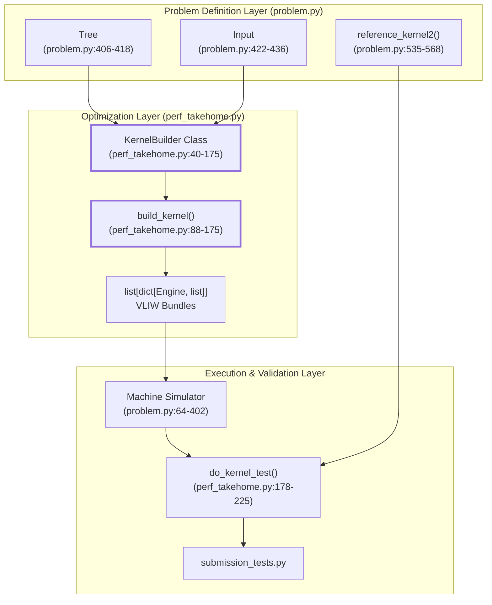
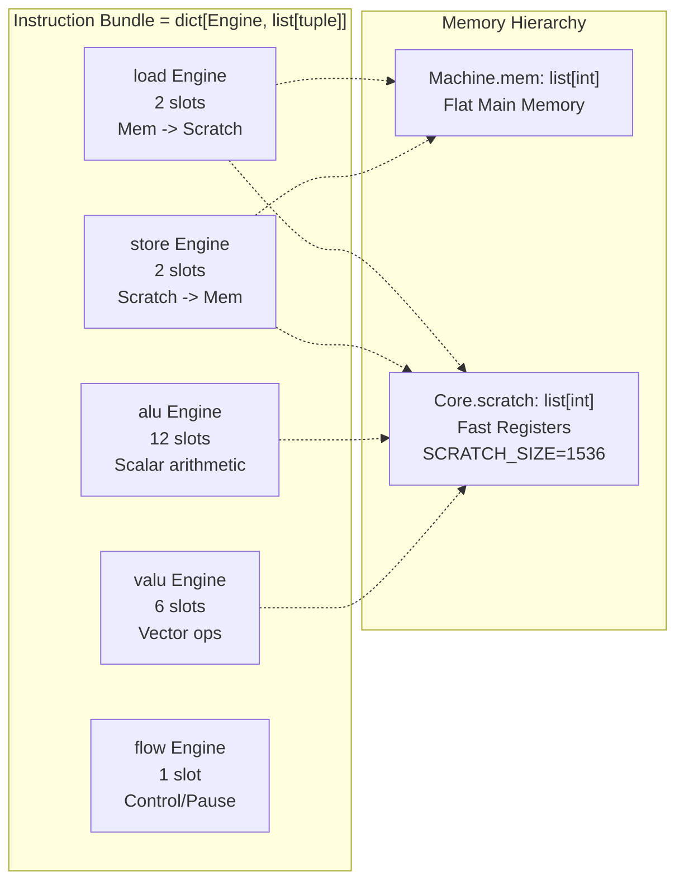
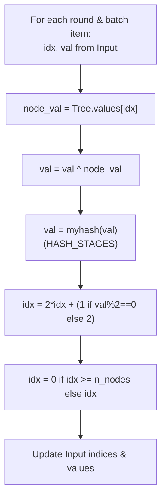
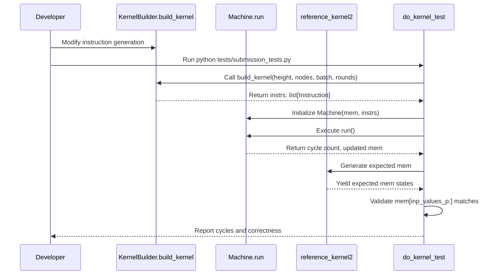

<!-- source: DeepWiki mcp.deepwiki.com · repo anthropics/original_performance_takehome · page 1 Introduction and Overview · fetched 2026-10-26 -->

# Introduction and Overview

<details>
<summary>Relevant source files</summary>

The following files were used as context for generating this wiki page:

- [Readme.md](Readme.md)
- [perf_takehome.py](perf_takehome.py)

</details>


This document provides a high-level introduction to the performance optimization benchmark repository. It explains the system's purpose, architecture, and key concepts needed to begin optimization work.

For detailed instructions on running tests and beginning optimization, see [Quick Start Guide](#1.2). For comprehensive architectural details, see [System Architecture Overview](#1.3). For specific information about optimizing the kernel, see [Kernel Builder - The Optimization Target](#5).

## Purpose and Scope

This repository implements a **performance optimization benchmark** for a custom VLIW SIMD machine architecture. The system is used for:

| Use Case | Description |
|----------|-------------|
| **AI Code Generation Evaluation** | Testing code generation capabilities of models like Claude Opus 4.5 |
| **Performance Engineering Recruitment** | Identifying skilled optimizers who achieve sub-1487 cycle performance |
| **Educational Tool** | Teaching compiler optimization techniques for parallel architectures |
| **Research Platform** | Studying optimization strategies for VLIW SIMD systems |

The core challenge is to optimize instruction generation in the `KernelBuilder.build_kernel` method to minimize cycle count on a frozen simulator while maintaining correctness.

**Sources:** [Readme.md:1-21](), [perf_takehome.py:8-14]()

## System Overview

The repository consists of three primary layers:



**Diagram: Core System Components and Data Flow**

The optimization target is `KernelBuilder.build_kernel`, which generates instruction sequences executed by the `Machine` simulator. Correctness is validated against `reference_kernel2`, and performance is measured in cycle count.

**Sources:** [perf_takehome.py:40-175](), [problem.py:64-402](), [problem.py:535-568]()

## Key Concepts

### VLIW SIMD Architecture

The system simulates a custom architecture with two key features:

| Feature | Description | Implementation |
|---------|-------------|----------------|
| **VLIW** (Very Long Instruction Word) | Multiple operations execute in parallel per cycle, organized into engines with slot limits | `SLOT_LIMITS` dict in [problem.py:48-55]() |
| **SIMD** (Single Instruction Multiple Data) | Vector operations process multiple elements simultaneously | `VLEN = 8` in [problem.py:57]() |



**Diagram: Machine Architecture Components**

Each `Instruction` is a dictionary mapping `Engine` types to lists of operation tuples. The `Machine.step` method executes all slots in parallel within a single cycle using a two-phase commit model (read all inputs, then write all outputs).

**Sources:** [problem.py:14-15](), [problem.py:48-55](), [problem.py:57-60](), [problem.py:64-96](), [problem.py:352-397]()

### The Computational Problem

The kernel implements a parallel tree traversal algorithm with a custom hash function:



**Diagram: Tree Traversal Algorithm Flow**

The `myhash` function applies six stages of bitwise operations defined in the `HASH_STAGES` constant. The reference implementation is provided in `reference_kernel` and `reference_kernel2`.

**Sources:** [problem.py:439-464](), [problem.py:467-484](), [problem.py:535-568]()

## System Components

### Core Classes and Functions

| Component | Location | Purpose |
|-----------|----------|---------|
| `KernelBuilder` | [perf_takehome.py:40-175]() | Generates instruction sequences (**OPTIMIZATION TARGET**) |
| `Machine` | [problem.py:64-402]() | VLIW SIMD simulator that executes instructions |
| `Tree` | [problem.py:406-418]() | Implicit balanced binary tree data structure |
| `Input` | [problem.py:422-436]() | Batch of indices and values for processing |
| `reference_kernel2` | [problem.py:535-568]() | Ground truth implementation for validation |
| `do_kernel_test` | [perf_takehome.py:178-225]() | Test harness that runs and validates kernels |
| `build_mem_image` | [problem.py:487-513]() | Serializes Tree and Input into flat memory layout |

**Sources:** [perf_takehome.py:40-175](), [problem.py:64-402](), [problem.py:406-436](), [problem.py:487-568](), [perf_takehome.py:178-225]()

### File Structure

```
.
├── perf_takehome.py       # KernelBuilder and local tests (MAIN WORKSPACE)
├── problem.py             # Machine simulator, data structures, reference kernels
├── frozen_problem.py      # Frozen simulator for official submission testing
├── watch_trace.py         # HTTP server for trace visualization
├── watch_trace.html       # Web UI for Perfetto integration
└── tests/
    └── submission_tests.py  # Official test suite with performance thresholds
```

**Sources:** [perf_takehome.py:1-20](), [problem.py:1-20](), [Readme.md:25-39]()

## Performance Benchmarks

Performance is measured in clock cycles from the simulated machine. The benchmark suite establishes a performance ladder:

| Cycles | Description | Speedup |
|--------|-------------|---------|
| 147,734 | `BASELINE` - Unoptimized scalar starting point | 1.0× |
| 18,532 | Starter point for the 2-hour version | 7.97× |
| 2,164 | Claude Opus 4 after many hours | 68.3× |
| 1,790 | Claude Opus 4.5 casual session (≈ best human 2hr) | 82.5× |
| 1,579 | Claude Opus 4.5 after 2 hours in harness | 93.5× |
| 1,548 | Claude Sonnet 4.5 after many hours | 95.4× |
| **1,487** | **Claude Opus 4.5 at launch (RECRUITMENT GATE)** | **99.3×** |
| 1,363 | Claude Opus 4.5 with improved harness (best known) | 108.4× |

Run `python tests/submission_tests.py` to see which thresholds you pass. Achieving sub-1487 cycle performance qualifies for contacting Anthropic recruiting.

**Sources:** [Readme.md:9-21](), [perf_takehome.py:176]()

## Development Workflow



**Diagram: Optimization Development Workflow**

The `Machine` class in `problem.py` is the development simulator, while `frozen_problem.py` (identical code) is used by submission tests to ensure integrity.

**Sources:** [perf_takehome.py:178-225](), [problem.py:64-402](), [problem.py:535-568]()

## Trace Visualization

For performance debugging, the system includes trace generation and visualization:

| Component | Purpose |
|-----------|---------|
| `Machine(trace=True)` | Generates `trace.json` in Chrome Trace Event Format |
| `watch_trace.py` | Local HTTP server on port 8000 for serving traces |
| `watch_trace.html` | Browser UI with live-reload and Perfetto integration |
| Perfetto UI | Professional performance visualization at `ui.perfetto.dev` |

To use: Run a test that enables tracing, then `python watch_trace.py` in another terminal. The browser will open with automatic trace reloading.

**Sources:** [problem.py:118-120](), [problem.py:151-196](), [perf_takehome.py:244-247]()

## Next Steps

- **To get started immediately:** See [Quick Start Guide](#1.2)
- **To understand the problem in detail:** See [The Tree Traversal Problem](#2.1)
- **To learn the machine architecture:** See [Machine Architecture](#4)
- **To begin optimization:** See [Kernel Builder - The Optimization Target](#5)

The key optimization target is the `build_kernel` method at [perf_takehome.py:88-175](). The current implementation generates one instruction bundle per operation using only scalar ALU and load/store engines. Significant performance gains are possible through VLIW packing and SIMD vectorization.

**Sources:** [perf_takehome.py:88-175](), [perf_takehome.py:51-56]()

---

