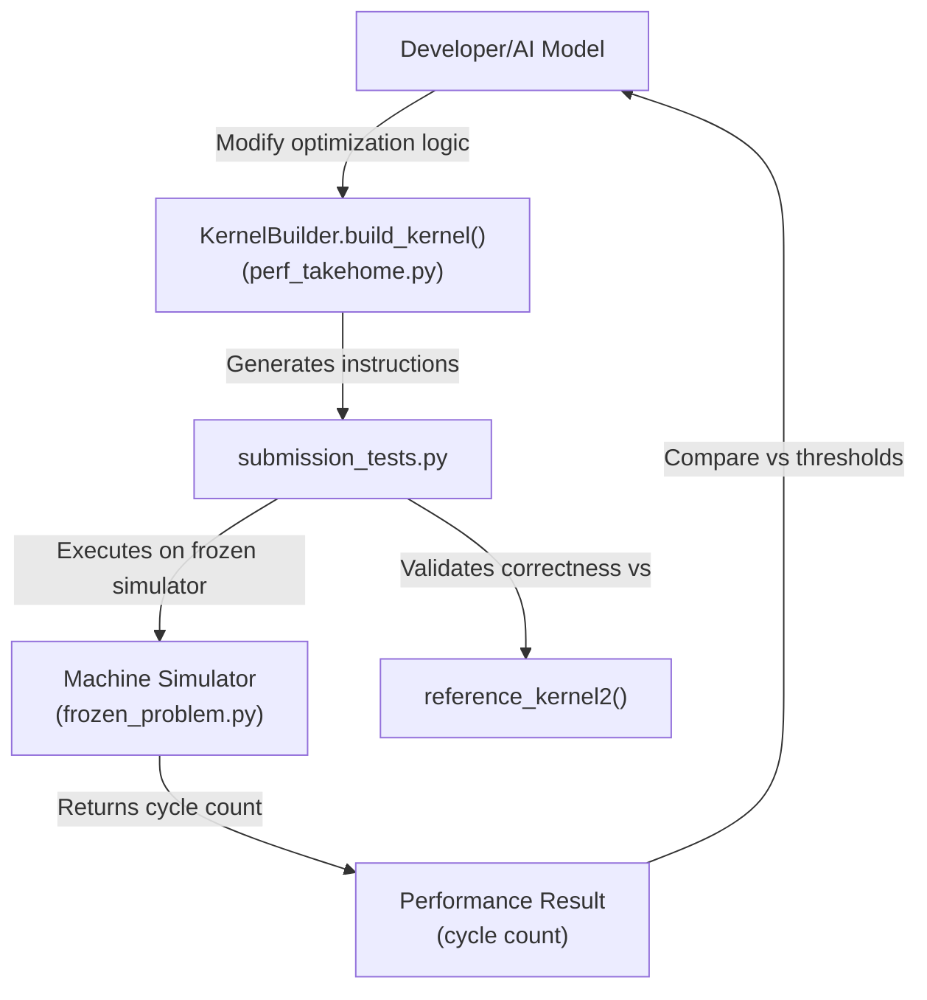
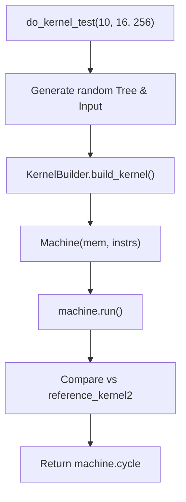
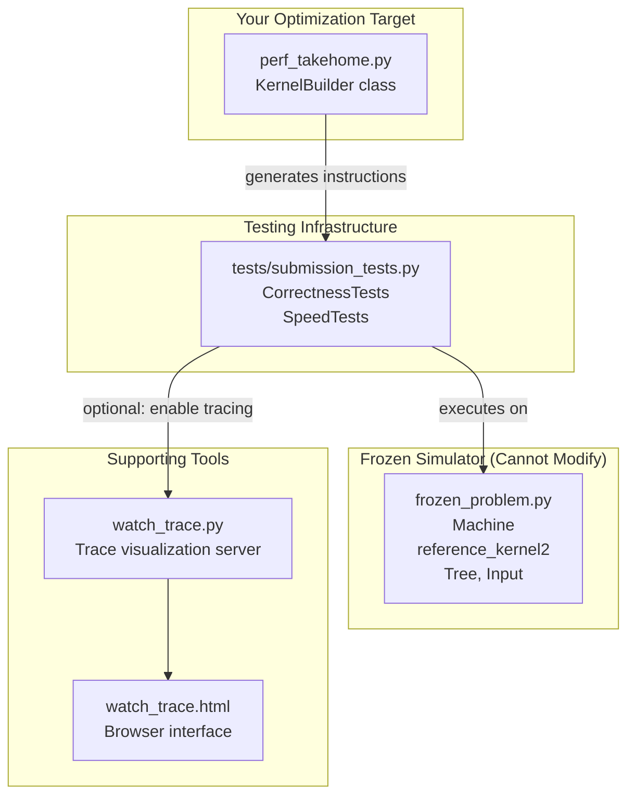

<!-- source: DeepWiki mcp.deepwiki.com · repo anthropics/original_performance_takehome · page 1.1 What is This Repository · fetched 2026-10-26 -->

# What is This Repository

<details>
<summary>Relevant source files</summary>

The following files were used as context for generating this wiki page:

- [Readme.md](Readme.md)

</details>


This document explains the purpose and scope of this repository, its intended audiences, and what constitutes success when using it. For technical details about how to run your first test, see [Quick Start Guide](1.2). For comprehensive architecture information, see [System Architecture Overview](1.3).

## Purpose and Scope

This repository contains **Anthropic's original performance take-home challenge**: a compiler optimization benchmark for a custom VLIW SIMD machine simulator. The repository serves three distinct purposes:

1. **AI Code Generation Benchmark** - Evaluates AI models' ability to optimize low-level systems code. [Readme.md:1-5]()
2. **Recruitment Tool** - Identifies exceptional performance engineers who can beat state-of-the-art AI. [Readme.md:21-21]()
3. **Educational Platform** - Teaches compiler optimization for parallel architectures.

The challenge is **frozen** - the simulator implementation at [frozen_problem.py:1-500]() cannot be modified, ensuring fair comparison across all submissions. [Readme.md:27-34]()

---

## The Core Challenge

Your task is to optimize the `KernelBuilder.build_kernel()` method in [perf_takehome.py:46-56]() to generate efficient instruction sequences for a parallel tree traversal computation.

### Challenge Flow



**Sources:** [Readme.md:1-21](), [tests/submission_tests.py:1-120](), [perf_takehome.py:46-56]()

---

## Three Audiences, Three Goals

### Audience 1: AI Models Being Evaluated

AI models (like Claude Opus 4.5) attempt to optimize [perf_takehome.py:KernelBuilder]() through iterative refinement in a test-time compute harness. [Readme.md:3-7]()

**Success Metric:** Cycle count achieved after N hours of computation time.


**Sources:** [Readme.md:3-17]()

### Audience 2: Human Performance Engineers (Recruitment)

Exceptional optimizers who beat the **1487-cycle threshold** (Claude Opus 4.5's best performance at launch) are invited to contact `performance-recruiting@anthropic.com`. [Readme.md:21-21]()

**Success Metric:** Achieve `< 1487 cycles` on the standard test case `(forest_height=10, rounds=16, batch_size=256)`. [tests/submission_tests.py:109-111]()

**How to Verify:**
```bash
python tests/submission_tests.py
```

The test suite at [tests/submission_tests.py:109-111]() explicitly checks this threshold:
```python
def test_opus45_11hr(self):
    # Claude Opus 4.5 after 11.5 hours in the harness
    assert cycles() < 1487
```

**Sources:** [Readme.md:18-21](), [tests/submission_tests.py:109-111]()

### Audience 3: Students and Learners

Those interested in learning compiler optimization, VLIW architectures, and performance engineering techniques.

**Success Metric:** Progressive improvement through the performance ladder (see next section).

---

## The Performance Ladder

The repository defines a stratified benchmark suite with progressively aggressive targets. All benchmarks are measured in clock cycles from the simulated machine. [Readme.md:9-11]()

| Threshold | Cycles | Speedup | Achievement |
|-----------|--------|---------|-------------|
| **Baseline** | 147,734 | 1.0x | Starting point (unoptimized) |
| **Updated Starting Point** | 18,532 | 7.97x | Newer take-home starting code |
| **Claude Opus 4 (many hours)** | 2,164 | 68.3x | First AI success in harness |
| **Claude Opus 4.5 (casual)** | 1,790 | 82.5x | ≈ Best human 2hr performance |
| **Claude Opus 4.5 (2hr harness)** | 1,579 | 93.5x | Test-time compute (2 hours) |
| **Claude Sonnet 4.5 (many hours)** | 1,548 | 95.4x | Extended compute |
| **🎯 RECRUITMENT GATE** | **1,487** | **99.3x** | **Opus 4.5 after 11.5 hours** |
| **Best AI (improved harness)** | 1,363 | 108.4x | Claude Opus 4.5 optimized |

**Sources:** [Readme.md:13-18](), [tests/submission_tests.py:76-116]()

### How Testing Works

The test function [tests/submission_tests.py:30-54]() measures performance:



The `do_kernel_test()` function:
1. Generates random test data with `Tree.generate(10)` and `Input.generate()` [tests/submission_tests.py:34-36]()
2. Builds instruction sequence via `KernelBuilder.build_kernel()` [tests/submission_tests.py:38-38]()
3. Executes on `Machine` simulator from [frozen_problem.py:273-273]()
4. Validates correctness against `reference_kernel2()` [tests/submission_tests.py:46-46]()
5. Returns cycle count [tests/submission_tests.py:54-54]()

**Sources:** [tests/submission_tests.py:30-54](), [frozen_problem.py:273-300]()

---

## Repository Structure at a Glance



**Key Files:**
- **[perf_takehome.py]()** - Your optimization target (`KernelBuilder` class). [perf_takehome.py:8-10]()
- **[frozen_problem.py]()** - Frozen simulator (cannot modify). [frozen_problem.py:273-273]()
- **[tests/submission_tests.py]()** - Validation and benchmarking. [tests/submission_tests.py:1-5]()
- **[watch_trace.py]()** - Performance visualization server. [watch_trace.py:1-10]()
- **[Readme.md]()** - Instructions and performance benchmarks. [Readme.md:1-5]()

**Sources:** [Readme.md:1-21](), [perf_takehome.py:8-10](), [tests/submission_tests.py:1-5]()

---

## What Success Looks Like

### Tier 1: Functional Correctness
Pass `CorrectnessTests` in [tests/submission_tests.py:57-60]():
```python
def test_kernel_correctness(self):
    for i in range(8):
        do_kernel_test(10, 16, 256)
```
Your generated instructions must produce identical results to `reference_kernel2()`. [tests/submission_tests.py:46-46]()

### Tier 2: Basic Optimization
Beat the baseline: `cycles() < 147734` ([tests/submission_tests.py:85-86]())

### Tier 3: Professional Performance
Beat updated starting point: `cycles() < 18532` ([tests/submission_tests.py:88-90]()). This corresponds to the starting point of the 2-hour version of the take-home. [Readme.md:5-5]()

### Tier 4: Expert Optimization
Beat AI models in the ladder (1790 → 1579 → 1548 cycles). [Readme.md:13-16]()

### Tier 5: 🎯 Recruitment Threshold
**`cycles() < 1487`** - Beat Claude Opus 4.5's best performance after 11.5 hours in the harness. [Readme.md:17-17]()
- Email `performance-recruiting@anthropic.com` with your code. [Readme.md:21-21]()
- Include resume for interview consideration.

### Tier 6: State-of-the-Art
Beat the best AI performance: `cycles() < 1363` ([tests/submission_tests.py:113-115]()). [Readme.md:18-18]()

**Sources:** [Readme.md:18-21](), [tests/submission_tests.py:76-116]()

---

## Why This Problem is Interesting

The challenge tests three critical skills:

1. **Instruction-Level Parallelism** - The VLIW architecture exposes parallelism explicitly via multiple engine slots (alu, valu, load, store, flow); you must pack operations efficiently. [frozen_problem.py:348-354]()
2. **Memory Hierarchy Optimization** - Understanding the two-tier memory model (main memory + scratch space) is crucial. [frozen_problem.py:302-315]()
3. **Algorithmic Insight** - The tree traversal problem (with HASH_STAGES=16) has structure that can be exploited via vectorization. [frozen_problem.py:10-15]()

**Warning:** Multicore is disabled intentionally (`N_CORES = 1`). Attempting to enable multicore or modifying the `tests/` folder constitutes an invalid solution. [Readme.md:39-40]()

**Sources:** [Readme.md:39-40](), [frozen_problem.py:10-15](), [frozen_problem.py:348-354]()

---

