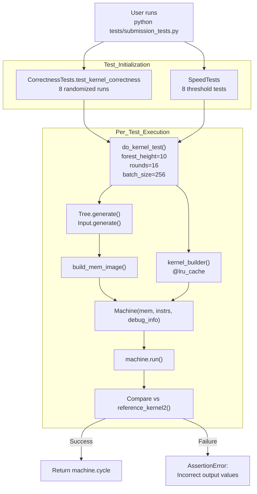
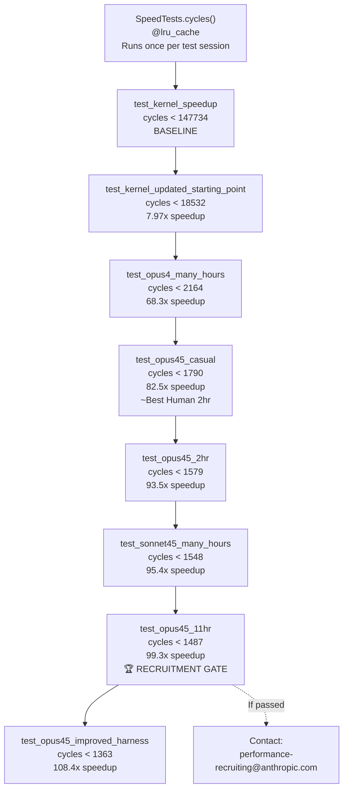
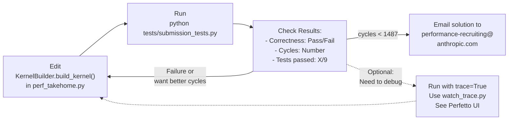

<!-- source: DeepWiki mcp.deepwiki.com · repo anthropics/original_performance_takehome · page 1.2 Quick Start Guide · fetched 2026-10-26 -->

# Quick Start Guide

<details>
<summary>Relevant source files</summary>

The following files were used as context for generating this wiki page:

- [Readme.md](Readme.md)
- [tests/submission_tests.py](tests/submission_tests.py)

</details>


This guide walks you through running your first performance test within minutes of cloning the repository. You'll learn how to execute the test suite, interpret cycle count results, and understand the performance benchmarks that define success.

For detailed information about the optimization challenge itself, see **2. The Optimization Challenge**. For comprehensive system architecture, see **1.3. System Architecture Overview**.

## Prerequisites

**Dependencies**: This repository requires Python 3.x with no external dependencies. All required modules are part of the Python standard library.

**Repository Structure**: Clone the repository and verify you have these key files:
- `perf_takehome.py`: Contains the `KernelBuilder` class you'll optimize [[perf_takehome.py:85-87]]().
- `tests/submission_tests.py`: Official test suite for performance validation [[tests/submission_tests.py:1-20]]().
- `problem.py`: Development simulator (mutable).
- `frozen_problem.py`: Frozen simulator used for testing to ensure a stable environment [[tests/submission_tests.py:11-19]]().

Sources: [Readme.md:1-21](), [perf_takehome.py:1-14](), [tests/submission_tests.py:1-20]()

## Running Your First Test

### Quick Start: Submission Tests

The fastest way to see where you stand is to run the official submission test suite:

```bash
python tests/submission_tests.py
```

This command executes both correctness validation and performance benchmarking against the frozen simulator defined in `frozen_problem.py`.

### Alternative: Development Tests

For iterative development with more detailed output, you can run the main file directly:

```bash
python perf_takehome.py
```

Or run a specific test method within the `Tests` class:

```bash
python perf_takehome.py Tests.test_kernel_cycles
```

**Diagram: Test Execution Flow**



Sources: [tests/submission_tests.py:30-54](), [tests/submission_tests.py:57-61]()

## Understanding Test Output

### Correctness Validation

The `CorrectnessTests.test_kernel_correctness` test runs 8 iterations with different random seeds to verify your implementation produces correct results [[tests/submission_tests.py:57-61]]():

```
Testing forest_height=10, rounds=16, batch_size=256
CYCLES:  147734
.
Testing forest_height=10, rounds=16, batch_size=256
CYCLES:  147734
.
...
```

Each `.` indicates a passed test. If correctness fails, you'll see an `AssertionError`. This means your `KernelBuilder.build_kernel()` generated instructions that produce different memory values than the `reference_kernel2()` [[tests/submission_tests.py:45-52]]().

Sources: [tests/submission_tests.py:57-61](), [tests/submission_tests.py:45-52]()

### Performance Benchmarks

After correctness tests pass, the `SpeedTests` class runs performance benchmarks. Here's what the output looks like:

```
Testing forest_height=10, rounds=16, batch_size=256
CYCLES:  147734
Speedup over baseline:  1.0
```

**Key Metrics Explained**:

| Metric | Description | Example Value |
|--------|-------------|---------------|
| `CYCLES` | Total machine cycles to complete execution [[tests/submission_tests.py:53]]() | 147734 (baseline) |
| `Speedup over baseline` | Performance ratio: `BASELINE / machine.cycle` [[tests/submission_tests.py:70]]() | 1.0x (no improvement) |
| `BASELINE` | Unoptimized starting point constant [[tests/submission_tests.py:63]]() | 147734 cycles |

Sources: [tests/submission_tests.py:63-74](), [perf_takehome.py:173]()

### Performance Threshold Ladder

The `SpeedTests` class contains multiple test methods, each representing a performance milestone achieved by various Claude models or human benchmarks.

**Diagram: Performance Test Hierarchy**



Sources: [tests/submission_tests.py:76-116](), [Readme.md:7-18]()

### Test Caching Behavior

The submission tests use `@lru_cache` decorators to optimize test execution:

- **`kernel_builder()`** [[tests/submission_tests.py:23-27]](): Caches the generated instructions for a specific configuration so the machine doesn't re-compile the kernel for every test.
- **`cycles()`** [[tests/submission_tests.py:66-74]](): Runs the simulator once per test session and reuses the result across all `SpeedTests` assertions.

Sources: [tests/submission_tests.py:23-27](), [tests/submission_tests.py:66-74]()

## Development Workflow Overview

**Diagram: Typical Optimization Iteration**



Sources: [perf_takehome.py:85-172](), [Readme.md:18-20]()

### Key Files for Optimization

| File | Your Role | What to Modify |
|------|-----------|----------------|
| `perf_takehome.py` | **Primary optimization target** | Modify the `KernelBuilder.build_kernel()` method [[perf_takehome.py:85-172]](). |
| `tests/submission_tests.py` | Run to validate | Do not modify (uses the frozen simulator to prevent cheating) [[Readme.md:29-37]](). |
| `problem.py` | Reference/documentation | Read for understanding; not used in official tests. |
| `frozen_problem.py` | Testing environment | Do not modify (this is the ground truth for tests) [[tests/submission_tests.py:11-19]](). |

Sources: [perf_takehome.py:85-172](), [tests/submission_tests.py:11-19](), [Readme.md:29-37]()

## Next Steps

Once you have tests running successfully:

1. **Understand the Problem**: Read **2.1. The Tree Traversal Problem** to understand the hashing and tree logic.
2. **Learn the Architecture**: Review **4. Machine Architecture** to understand the VLIW SIMD execution model.
3. **Study the Current Implementation**: Examine **5.1. KernelBuilder Class Overview** to see the baseline approach.
4. **Enable Trace Visualization**: Follow **7.1. Trace Generation** to visualize instruction execution in Perfetto.

### Quick Command Reference

```bash
# Official submission tests (what counts)
python tests/submission_tests.py

# Development testing with trace generation (requires watch_trace.py)
python perf_takehome.py Tests.test_kernel_trace

# In separate terminal: Launch trace viewer server
python watch_trace.py
```

Sources: [perf_takehome.py:258-269](), [Readme.md:20]()

## Understanding Your Starting Point

The unmodified `KernelBuilder.build_kernel()` method generates a **scalar implementation** that:

- Uses only scalar ALU operations (no vector VALU engine) [[perf_takehome.py:131-167]]().
- Processes batch items sequentially in nested loops [[perf_takehome.py:131-167]]().
- Achieves 147,734 cycles (the `BASELINE`) [[tests/submission_tests.py:63]]().
- Uses simple non-VLIW instruction packing (each instruction is emitted as a single-operation bundle) [[perf_takehome.py:48-53]]().

**Your optimization goal**: Modify `build_kernel()` to generate more efficient instruction sequences that utilize the VLIW slots (ALU, VALU, LOAD, STORE, FLOW) in parallel while maintaining correctness [[perf_takehome.py:85-172]]().

The recruitment threshold of 1,487 cycles represents a **99.3x speedup** over baseline—achievable through vectorization, VLIW instruction packing, and efficient memory management [[Readme.md:15-18]]().

Sources: [perf_takehome.py:85-172](), [tests/submission_tests.py:63](), [Readme.md:15-18]()

---

