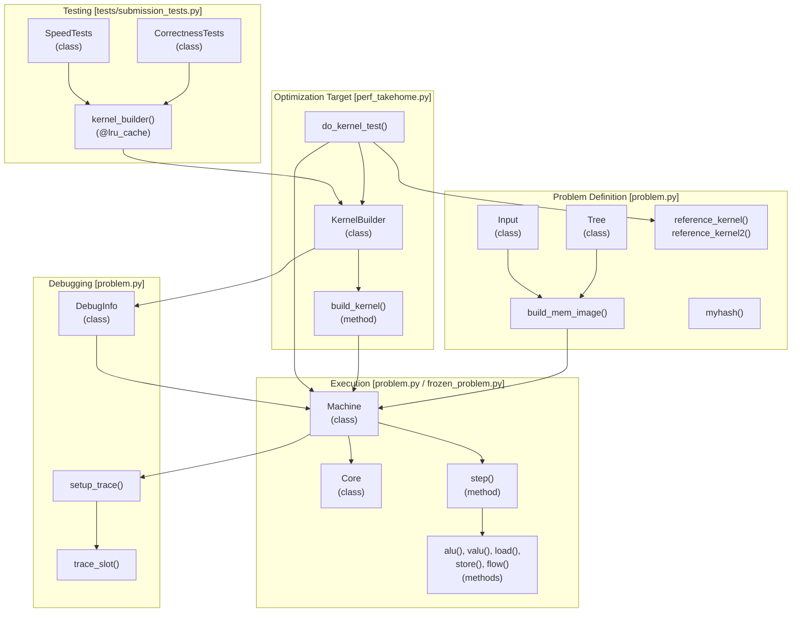
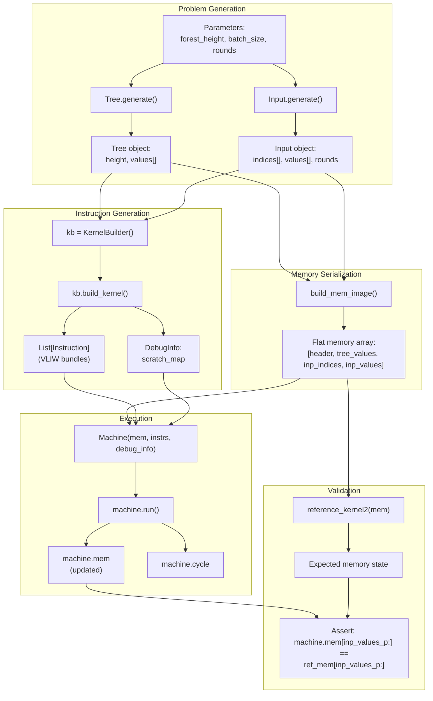
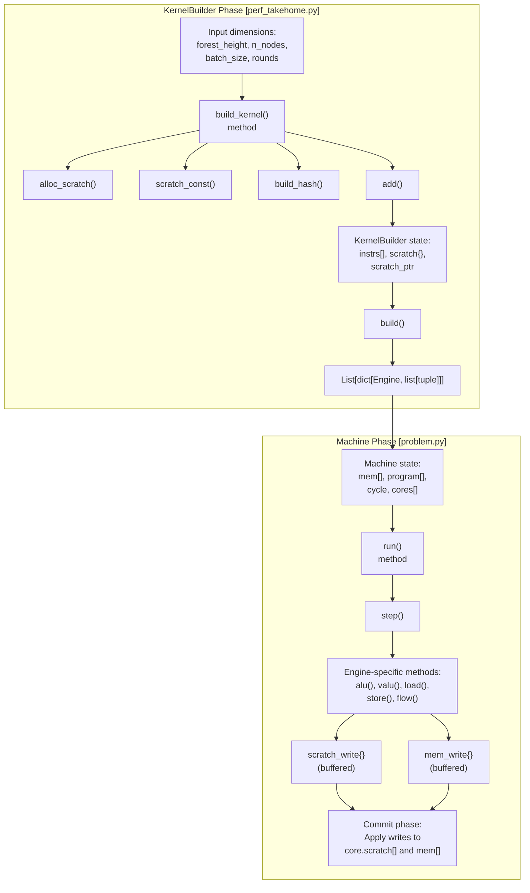
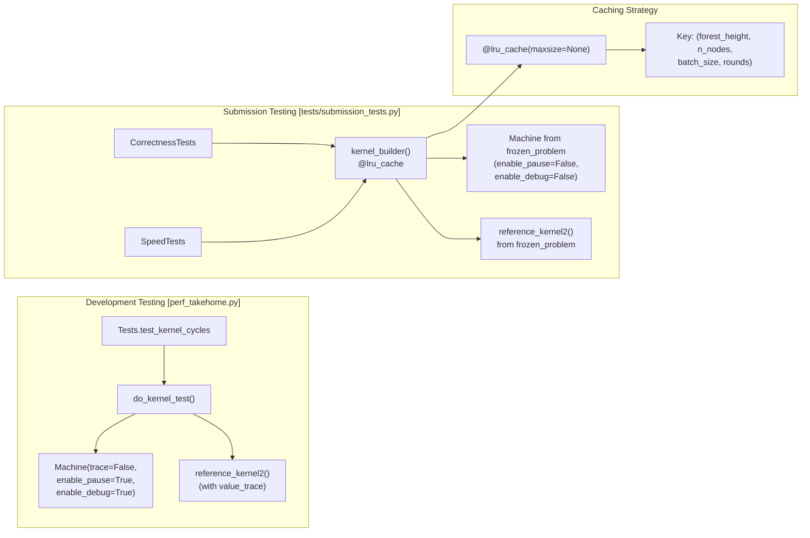
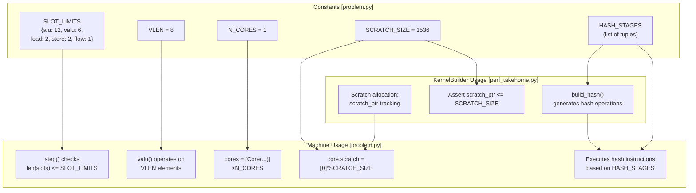

<!-- source: DeepWiki mcp.deepwiki.com · repo anthropics/original_performance_takehome · page 1.3 System Architecture Overview · fetched 2026-10-26 -->

# System Architecture Overview

<details>
<summary>Relevant source files</summary>

The following files were used as context for generating this wiki page:

- [perf_takehome.py](perf_takehome.py)
- [problem.py](problem.py)
- [tests/frozen_problem.py](tests/frozen_problem.py)

</details>


This document provides a high-level overview of the system architecture for the performance optimization take-home challenge. It explains how the major components interact, the data flow through the system, and how code execution and validation work.

For detailed information about the optimization target itself, see [KernelBuilder - The Optimization Target](5.1). For the machine instruction set and execution semantics, see [Machine Architecture](4.1). For the testing infrastructure, see [Testing Framework](6.1).

## Purpose and Scope

This system implements a performance optimization benchmark for a custom VLIW SIMD architecture. The architecture consists of three primary layers:

1.  **Problem Definition Layer**: Defines the computational problem (tree traversal with hashing), input data structures, and reference implementations.
2.  **Optimization Layer**: The `KernelBuilder` class that participants modify to generate efficient instruction sequences.
3.  **Execution and Validation Layer**: The `Machine` simulator that executes generated instructions and validates correctness.

## Component Architecture

The following diagram shows the major code entities and their relationships:

**Component Interaction Diagram**


**Sources**: [perf_takehome.py:1-176](), [problem.py:1-569](), [tests/submission_tests.py:1-120](), [tests/frozen_problem.py:1-569]()

### Component Table

| Component | File Location | Primary Responsibility |
|-----------|--------------|------------------------|
| `Tree` | [problem.py:406-418]() | Represents implicit balanced binary tree structure with node values |
| `Input` | [problem.py:421-436]() | Batch of input indices and values for tree traversal |
| `reference_kernel` / `reference_kernel2` | [problem.py:467-569]() | Ground truth implementations defining correct computation |
| `KernelBuilder` | [perf_takehome.py:40-174]() | **Optimization target**: Generates instruction sequences |
| `Machine` | [problem.py:64-403]() | VLIW SIMD simulator that executes instruction bundles |
| `Core` | [problem.py:25-30]() | Per-core state (scratch space, PC, execution state) |
| `do_kernel_test` | [perf_takehome.py:178-226]() | Main testing harness for development |

**Sources**: [perf_takehome.py:23-37](), [problem.py:405-437](), [problem.py:64-95]()

## Data Flow Architecture

The following diagram shows how data transforms through the system, from problem generation to validation:

**Data Flow Diagram**


**Sources**: [perf_takehome.py:178-226](), [problem.py:487-513](), [problem.py:535-569]()

### Memory Layout

The `build_mem_image` function creates a flat memory layout that both the simulator and reference kernel operate on:

| Offset | Content | Description |
|--------|---------|-------------|
| `mem[0]` | `rounds` | Number of traversal rounds to execute |
| `mem[1]` | `n_nodes` | Total number of tree nodes (2^(height+1) - 1) |
| `mem[2]` | `batch_size` | Number of parallel traversals |
| `mem[3]` | `forest_height` | Height of the binary tree |
| `mem[4]` | `forest_values_p` | Pointer to tree node values array |
| `mem[5]` | `inp_indices_p` | Pointer to input indices array |
| `mem[6]` | `inp_values_p` | Pointer to input values array |
| `mem[7:]` | Data arrays | Tree values, input indices, input values, extra room |

**Sources**: [problem.py:487-513]()

## Execution Architecture

This diagram shows the relationship between the instruction generation phase and the execution phase:

**Execution Phase Diagram**


**Sources**: [perf_takehome.py:40-174](), [problem.py:197-217](), [problem.py:352-398]()

### Instruction Bundle Structure

Each instruction in the program is a dictionary mapping engine names to lists of operation tuples:

```python
# Example instruction structure
{"valu": [("*", 4, 0, 0), ("+", 8, 4, 0)], "load": [("load", 16, 17)]}
```

The `KernelBuilder` generates these through the `build()` method, which can optionally pack multiple operations into single instruction bundles (VLIW packing):

**Sources**: [perf_takehome.py:51-56](), [problem.py:14-15]()

### Execution Model: Two-Phase Commit

The `Machine.step()` method implements a two-phase execution model:

1.  **Read Phase**: All slots read their operands from the cycle-start state [problem.py:356-382]().
2.  **Write Phase**: All writes are buffered in `scratch_write` and `mem_write` dictionaries [problem.py:383-394]().
3.  **Commit Phase**: Buffered writes are applied atomically at the end of the cycle [problem.py:396-398]().

**Sources**: [problem.py:352-398]()

## Testing and Validation Architecture

**Testing Architecture Diagram**


**Sources**: [perf_takehome.py:178-256](), [tests/submission_tests.py:23-74]()

### Test Execution Flow

The testing system uses two different simulator instances:

| Testing Context | Simulator Source | Debug Features | Purpose |
|----------------|-----------------|----------------|---------|
| Development (`perf_takehome.py`) | `problem.py` | Pause points, debug instructions, value tracing | Interactive debugging during optimization |
| Submission (`tests/submission_tests.py`) | `tests/frozen_problem.py` | Disabled | Fair performance measurement on frozen simulator |

**Key differences**:
*   **Development**: `Machine(trace=True/False, value_trace={...})` with pause points that match `reference_kernel2` yields for step-by-step validation [perf_takehome.py:194-204]().
*   **Submission**: `Machine(enable_pause=False, enable_debug=False)` for pure performance measurement [tests/submission_tests.py:40-43]().

**Sources**: [perf_takehome.py:194-204](), [tests/submission_tests.py:40-43]()

### Performance Measurement

Cycle counting occurs in `Machine.run()`:

```python
# Logic from problem.py:216-217
if has_non_debug:
    self.cycle += 1
```

Only non-debug instructions increment the cycle counter. The baseline of 147,734 cycles represents the unoptimized starting point.

**Sources**: [problem.py:197-217](), [perf_takehome.py:176](), [tests/submission_tests.py:63-74]()

## Cross-Component Data Dependencies

**Constant Dependencies Diagram**


**Sources**: [problem.py:48-62](), [problem.py:439-446](), [perf_takehome.py:61-68](), [problem.py:383]()

## Key Architectural Invariants

1.  **Instruction Format**: All instructions are dictionaries mapping `Engine` names to lists of operation tuples [problem.py:14-15]().
2.  **Memory Model**: Flat word array with pointer-based addressing; all addresses are word offsets [problem.py:79-83]().
3.  **Scratch Space**: Per-core fast memory (1536 words) for intermediate values; addresses are managed by `KernelBuilder` [problem.py:60](), [perf_takehome.py:61-68]().
4.  **Atomic Cycles**: Within a cycle, all reads see the cycle-start state; all writes are buffered and committed atomically [problem.py:352-398]().
5.  **Correctness Oracle**: `reference_kernel2` defines ground truth; the optimized kernel must produce identical `inp_values` array [problem.py:535-569]().
6.  **Performance Metric**: Total cycle count (non-debug instructions only) measured by the frozen simulator [problem.py:216-217]().

**Sources**: [problem.py:64-95](), [problem.py:352-398](), [tests/submission_tests.py:48-53]()

---

