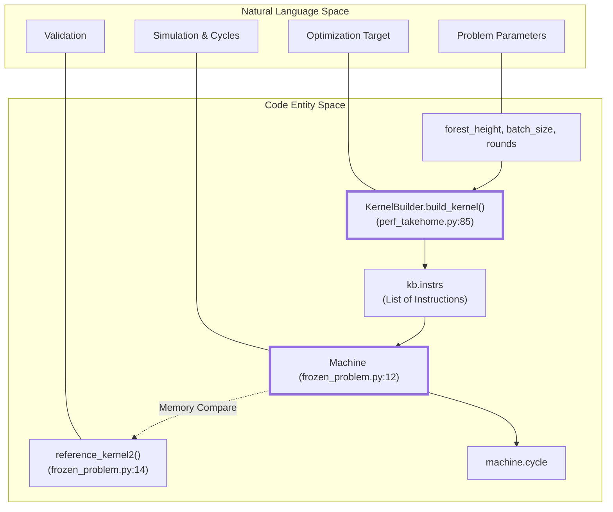
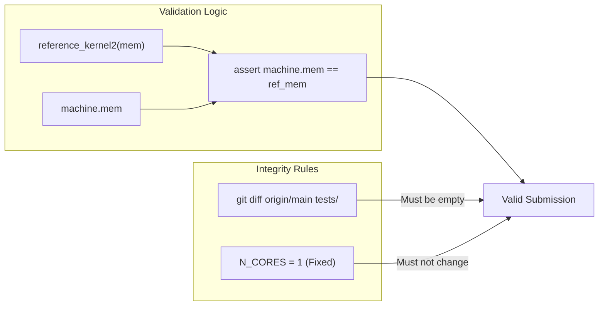

<!-- source: DeepWiki mcp.deepwiki.com · repo anthropics/original_performance_takehome · page 2 The Optimization Challenge · fetched 2026-10-26 -->

# The Optimization Challenge

<details>
<summary>Relevant source files</summary>

The following files were used as context for generating this wiki page:

- [Readme.md](Readme.md)
- [tests/submission_tests.py](tests/submission_tests.py)

</details>


This page frames the core optimization challenge in this repository: what you're trying to optimize, how performance is measured, what targets exist, and how to validate your solution. For detailed information about the tree traversal algorithm being optimized, see [The Tree Traversal Problem](#2.1). For comprehensive performance benchmark details, see [Performance Benchmarks and Thresholds](#2.2). For the structure of the `KernelBuilder` class you'll be modifying, see [Kernel Builder - The Optimization Target](#5).

## The Core Task

Your objective is to optimize the `KernelBuilder.build_kernel` method in [perf_takehome.py:85-172]() to generate the most efficient instruction sequence possible for a custom VLIW SIMD architecture. The challenge measures performance in **clock cycles** consumed by the `Machine` simulator when executing your generated instructions.

### Optimization Flow: Code to Execution

The following diagram bridges the "Natural Language Space" of the challenge to the "Code Entity Space" where you will be working.



**Sources:** [perf_takehome.py:85-172](), [tests/submission_tests.py:11-20](), [tests/submission_tests.py:40-43]()

## What You're Optimizing

The optimization target is a **tree traversal kernel** that processes batches of inputs through a perfect binary tree. Each input follows a path determined by hashing operations at each node.

### The `KernelBuilder.build_kernel` Method

The method signature is:

```python
def build_kernel(
    self, forest_height: int, n_nodes: int, batch_size: int, rounds: int
):
```

This method generates a list of `Instruction` objects (dictionaries mapping engine names to slot lists) that the `Machine` simulator will execute. The current implementation in [perf_takehome.py:85-172]() is a **scalar baseline** that processes one input element at a time using only scalar ALU and load/store operations.

**Key constraints:**
- You generate instructions **only** from dimensional parameters (heights, counts).
- Instructions must work for **any** valid tree and input data with those dimensions.
- The generated code must match `reference_kernel2` output at pause points.
- The frozen simulator in `frozen_problem.py` evaluates your submission.

### The Architecture You're Targeting

You're compiling for a custom **VLIW SIMD** machine. All slots in an instruction bundle execute **in parallel** within a single cycle.

| Engine | Slots | Purpose | Key Operations |
|--------|-------|---------|----------------|
| `alu` | 12 | Scalar arithmetic | `+`, `-`, `*`, `^`, `<<`, `>>`, `%`, `<`, `==` |
| `valu` | 6 | Vector arithmetic (VLEN=8) | Same ops + `vbroadcast`, `multiply_add` |
| `load` | 2 | Memory to scratch | `load`, `vload`, `const` |
| `store` | 2 | Scratch to memory | `store`, `vstore` |
| `flow` | 1 | Control flow | `select`, `vselect`, `pause`, `halt` |
| `debug` | 64 | Validation (submission ignores) | `compare`, `vcompare`, `comment` |

**Sources:** [perf_takehome.py:37-83](), [tests/submission_tests.py:17-19]()

## Performance Measurement

Performance is measured by the `machine.cycle` counter after executing your generated instructions. The baseline scalar implementation consumes **147,734 cycles** for the standard test case (forest_height=10, batch_size=256, rounds=16) [tests/submission_tests.py:63-71]().

### Performance Ladder

The repository defines a performance ladder representing progressively better optimizations. Beating the **1,487 cycle threshold** demonstrates optimization skill exceeding Claude Opus 4.5's launch-time performance [Readme.md:17-21]().

| Threshold (cycles) | Speedup vs Baseline | Achievement |
|-------------------|---------------------|-------------|
| 147,734 | 1.0x | Starting baseline |
| 18,532 | 7.97x | Updated starting point |
| 2,164 | 68.3x | Claude Opus 4 (many hours) |
| 1,790 | 82.5x | Claude Opus 4.5 casual / Best human (2hr) |
| 1,579 | 93.5x | Claude Opus 4.5 (2hr harness) |
| 1,548 | 95.4x | Claude Sonnet 4.5 (many hours) |
| **1,487** | **99.3x** | **Claude Opus 4.5 launch (recruitment gate)** |
| 1,363 | 108.4x | Claude Opus 4.5 (improved harness) |

**Sources:** [Readme.md:9-21](), [tests/submission_tests.py:85-115]()

## Validation and Submission

### Correctness and Test Integrity

The testing harness validates functional correctness by comparing the final memory state of the `Machine` against the output of `reference_kernel2` [tests/submission_tests.py:45-52]().



**Important Submission Rules:**
1. **No Test Modification**: The `tests/` folder must remain unchanged. Run `git diff origin/main tests/` to verify [Readme.md:31-34]().
2. **No Multicore Hacks**: `N_CORES` is intentionally set to 1. Modifying this to achieve speedup is considered an invalid solution [Readme.md:39]().
3. **Beating the Gate**: If you optimize below **1487 cycles**, you are encouraged to email your code to `performance-recruiting@anthropic.com` [Readme.md:21]().

**Sources:** [Readme.md:25-40](), [tests/submission_tests.py:45-54](), [tests/submission_tests.py:17]()

For details on the validation process and how to submit, see [Validation and Submission](#2.3).

---

