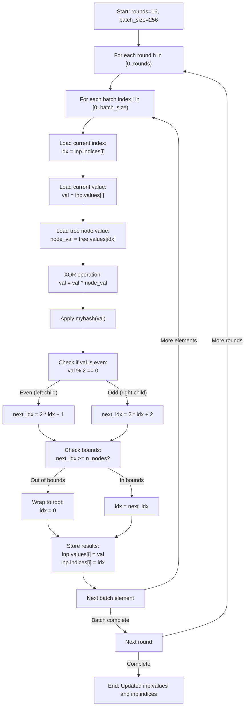
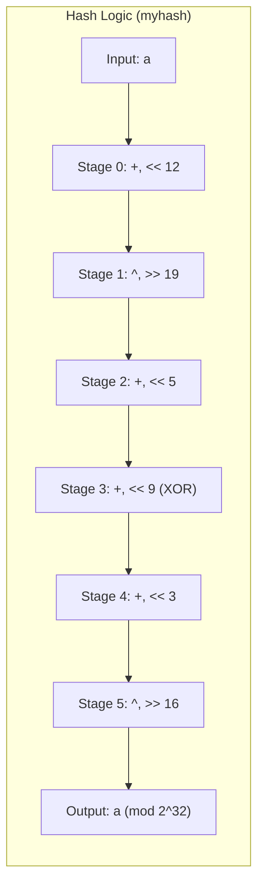
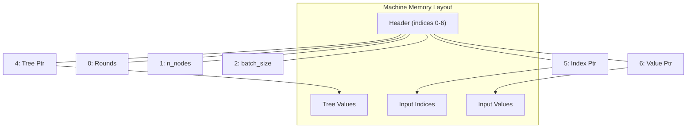

<!-- source: DeepWiki mcp.deepwiki.com · repo anthropics/original_performance_takehome · page 2.1 The Tree Traversal Problem · fetched 2026-10-26 -->

# The Tree Traversal Problem

<details>
<summary>Relevant source files</summary>

The following files were used as context for generating this wiki page:

- [problem.py](problem.py)
- [tests/frozen_problem.py](tests/frozen_problem.py)

</details>


This page describes the computational problem at the heart of the optimization challenge: a parallel tree traversal algorithm with cryptographic-style hashing. Understanding this algorithm is essential before attempting to optimize the `KernelBuilder` in `perf_takehome.py`.

## Overview

The tree traversal problem processes a batch of independent traversals through an implicit binary tree structure. Each traversal follows a deterministic path based on hashing operations, and the entire batch is processed for multiple rounds. The challenge is to implement this computation efficiently on a VLIW SIMD architecture.

**Key characteristics:**
- **Batch parallelism**: 256 independent traversals processed simultaneously [tests/frozen_problem.py:421-436]().
- **Data-dependent control flow**: Path decisions (left vs. right child) are based on computed hash values [tests/frozen_problem.py:476-484]().
- **Memory access patterns**: Irregular tree node lookups based on current indices [tests/frozen_problem.py:551-564]().
- **Computational intensity**: A 6-stage hash function is applied at every step [tests/frozen_problem.py:439-464]().
- **Multiple iterations**: The default configuration runs 16 rounds of traversal [tests/frozen_problem.py:421-436]().

Sources: [tests/frozen_problem.py:421-436](), [tests/frozen_problem.py:439-464](), [tests/frozen_problem.py:476-484](), [tests/frozen_problem.py:551-564]()

## The Algorithm

The following diagram illustrates the logical flow of the traversal as defined in the reference implementations.



Sources: [tests/frozen_problem.py:467-484](), [tests/frozen_problem.py:535-568]()

### Algorithm Steps in Detail

The reference implementation `reference_kernel` [tests/frozen_problem.py:467-484]() performs the following operations:

1.  **Outer loop**: Iterate `rounds` times (typically 16).
2.  **Inner loop**: Process each of `batch_size` elements (typically 256).
3.  **Node lookup**: Read `tree.values[idx]` using the current index.
4.  **Hash computation**: Compute `myhash(val ^ node_val)`.
5.  **Branch decision**: Choose the left child (`2*idx + 1`) if the hash is even, or the right child (`2*idx + 2`) if it is odd.
6.  **Boundary handling**: If the new index exceeds the tree size (`n_nodes`), wrap back to the root (index 0).
7.  **State update**: Store the updated value and index back to the input arrays.

This creates a complex dependency chain where the next memory address to load (`tree.values[idx]`) depends on the previous cycle's hash result.

Sources: [tests/frozen_problem.py:476-484]()

## Data Structures

### Tree Structure

The `Tree` class [tests/frozen_problem.py:405-418]() represents an implicit perfect binary tree stored as a flat array.

| Field | Type | Description |
| :--- | :--- | :--- |
| `height` | `int` | Tree height (default: 10) |
| `values` | `list[int]` | Node values in breadth-first order |

**Implicit tree properties:**
- Total nodes: $2^{height+1} - 1$ (default: 2047 nodes).
- Node $i$ has left child at $2i + 1$ and right child at $2i + 2$.
- Root node is at index 0.

Sources: [tests/frozen_problem.py:405-418]()

### Input Structure

The `Input` class [tests/frozen_problem.py:421-436]() represents the batch of traversals.

| Field | Type | Description |
| :--- | :--- | :--- |
| `indices` | `list[int]` | Current tree node index for each traversal |
| `values` | `list[int]` | Current hash value for each traversal |
| `rounds` | `int` | Number of traversal iterations |

Sources: [tests/frozen_problem.py:421-436]()

## The Hash Function

The `myhash` function [tests/frozen_problem.py:449-464]() implements a 6-stage mixing operation. Each stage follows the pattern: `a = (a op1 constant) op2 (a op3 shift_amount)`.



### HASH_STAGES Definition

The specific operations and constants are defined in the `HASH_STAGES` list:

```python
# tests/frozen_problem.py:439-446
HASH_STAGES = [
    ("+", 0x7ED55D16, "+", "<<", 12),  # Stage 0
    ("^", 0xC761C23C, "^", ">>", 19),  # Stage 1
    ("+", 0x165667B1, "+", "<<", 5),   # Stage 2
    ("+", 0xD3A2646C, "^", "<<", 9),   # Stage 3
    ("+", 0xFD7046C5, "+", "<<", 3),   # Stage 4
    ("^", 0xB55A4F09, "^", ">>", 16),  # Stage 5
]
```

Sources: [tests/frozen_problem.py:439-446](), [tests/frozen_problem.py:449-464]()

## Why This Problem Is Interesting for Optimization

### 1. Data-Dependent Memory Access
The memory address for the next node lookup (`tree.values[idx]`) is calculated from the result of the `myhash` function. This prevents simple prefetching and creates a "pointer chasing" bottleneck.

### 2. SIMD and Vectorization
While individual traversals are serial, the `batch_size` of 256 allows for massive parallelism. The `Machine` architecture supports vector operations (`valu`) on `VLEN=8` elements [tests/frozen_problem.py:57](). Efficiently grouping 8 traversals into vector registers is key to high performance.

### 3. VLIW Instruction Packing
The `Machine` can execute multiple slots per cycle (e.g., 12 ALU slots, 6 VALU slots, 2 Load slots) [tests/frozen_problem.py:48-55](). Optimization involves "packing" the hash computation of one batch while simultaneously loading the tree nodes for another batch to hide latency.

### 4. Register Management
The `SCRATCH_SIZE` is limited to 1536 words [tests/frozen_problem.py:60](). Managing this space for constants, loop counters, and vector registers for 256 traversals requires careful allocation.

Sources: [tests/frozen_problem.py:48-55](), [tests/frozen_problem.py:57](), [tests/frozen_problem.py:60]()

## Reference Implementations

### reference_kernel
A high-level Python implementation used for conceptual correctness [tests/frozen_problem.py:467-484]().

### reference_kernel2
A lower-level implementation that operates on a flat memory array, simulating how the `Machine` sees data [tests/frozen_problem.py:535-568](). It uses a `yield` pattern to allow the test suite to pause and inspect memory at specific points [tests/frozen_problem.py:548]().

## Memory Layout and Data Flow

The `build_mem_image` function [tests/frozen_problem.py:487-513]() serializes the `Tree` and `Input` into a single list of integers.



Sources: [tests/frozen_problem.py:487-513]()

---

