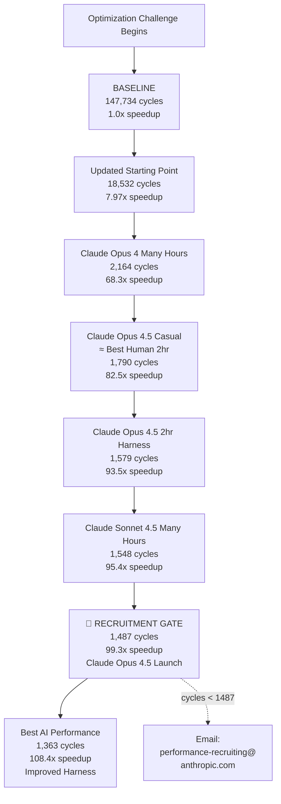
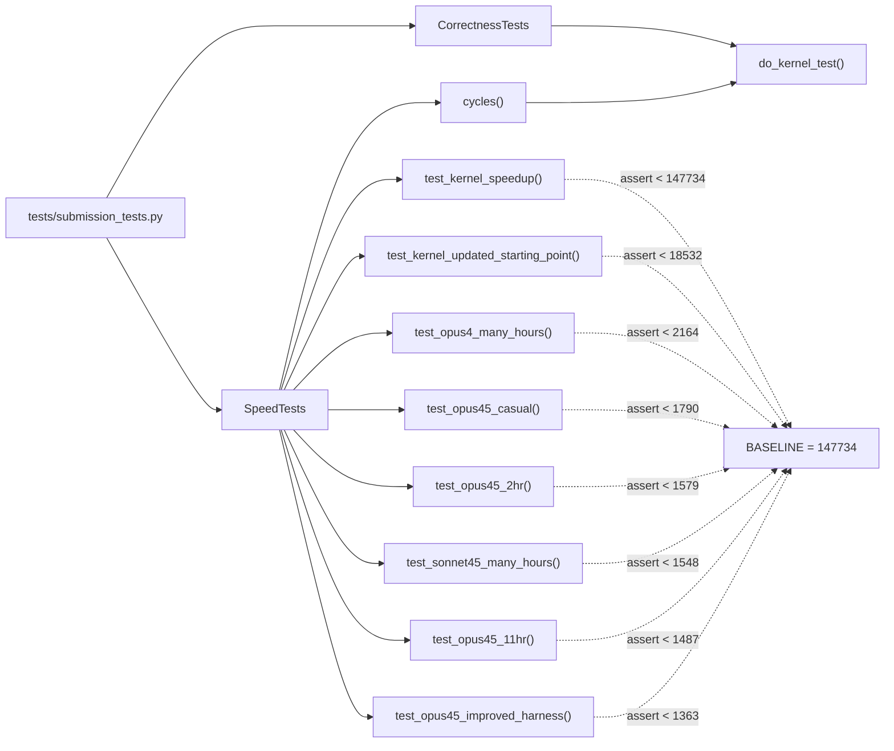
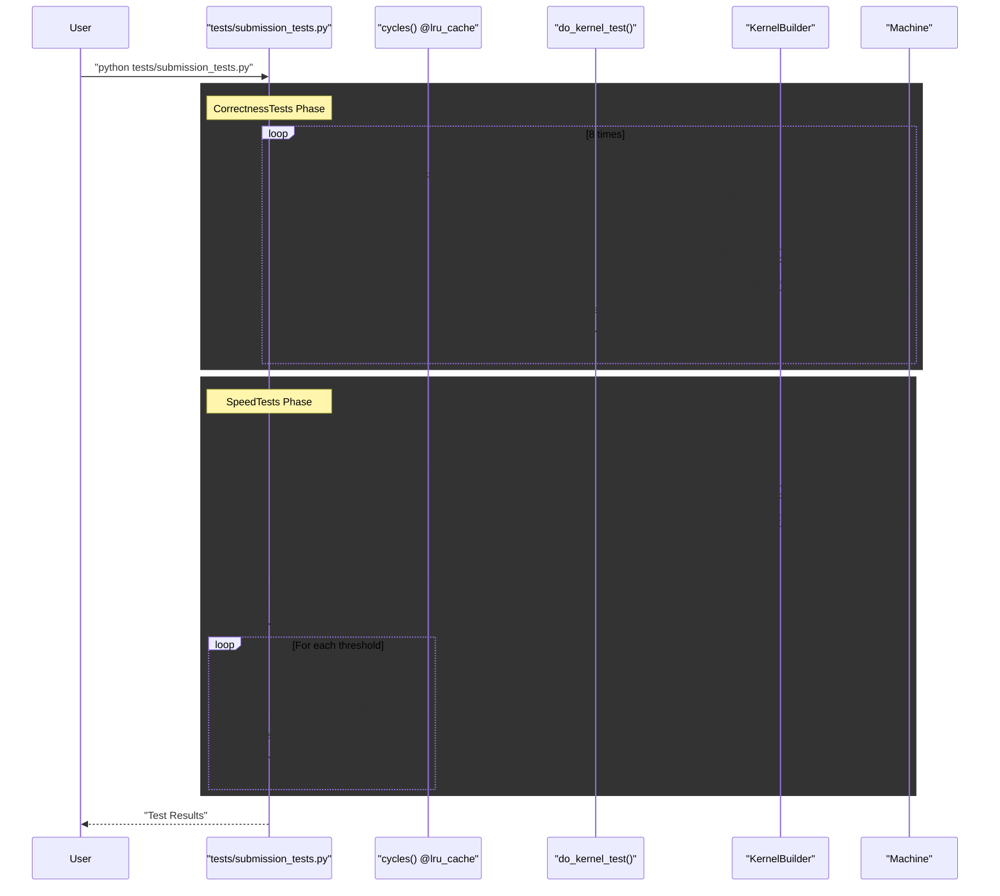

<!-- source: DeepWiki mcp.deepwiki.com · repo anthropics/original_performance_takehome · page 2.2 Performance Benchmarks and Thresholds · fetched 2026-10-26 -->

# Performance Benchmarks and Thresholds

<details>
<summary>Relevant source files</summary>

The following files were used as context for generating this wiki page:

- [Readme.md](Readme.md)
- [tests/submission_tests.py](tests/submission_tests.py)

</details>


## Purpose and Scope

This page documents the performance benchmark ladder used to evaluate optimization submissions, from the baseline (147,734 cycles) to the best AI-achieved performance (1,363 cycles). It explains each threshold level, what performance they represent, the recruitment gate at 1,487 cycles, and how to test your implementation against these benchmarks.

For information about correctness validation, see **2.3 Validation and Submission**. For details about how cycle counting works in the simulator, see **4.4 Execution Model and Cycle Semantics**. For guidance on running and interpreting test results, see **6.4 Running and Interpreting Tests**.

## The Performance Ladder

The repository defines a stratified benchmark suite with increasingly aggressive cycle count targets. Each threshold represents a specific AI model's performance under particular compute conditions, providing context for optimization difficulty.

### Benchmark Levels

| Threshold | Cycles | Speedup | Description | Test Method |
|-----------|--------|---------|-------------|-------------|
| **Baseline** | 147,734 | 1.0x | Original unoptimized starting point | `test_kernel_speedup()` |
| **Updated Starting Point** | 18,532 | 7.97x | Improved starter code provided to candidates in later versions | `test_kernel_updated_starting_point()` |
| **Opus 4 (Many Hours)** | 2,164 | 68.3x | Claude Opus 4 with extensive test-time compute | `test_opus4_many_hours()` |
| **Opus 4.5 Casual** | 1,790 | 82.5x | Claude Opus 4.5 casual session ≈ best human 2hr | `test_opus45_casual()` |
| **Opus 4.5 (2hr)** | 1,579 | 93.5x | Claude Opus 4.5 with 2hr harness | `test_opus45_2hr()` |
| **Sonnet 4.5 (Many Hours)** | 1,548 | 95.4x | Claude Sonnet 4.5 with extended compute | `test_sonnet45_many_hours()` |
| **🎯 Recruitment Gate** | **1,487** | **99.3x** | Claude Opus 4.5 at launch (11.5hr harness) | `test_opus45_11hr()` |
| **Best AI Performance** | 1,363 | 108.4x | Claude Opus 4.5 with improved harness | `test_opus45_improved_harness()` |

The 1,487-cycle threshold serves as the recruitment screening gate, representing Claude Opus 4.5's performance at launch time.

**Sources:** [Readme.md:9-21](), [tests/submission_tests.py:63-115]()

### Performance Ladder Diagram



**Sources:** [Readme.md:9-21](), [tests/submission_tests.py:63-115]()

## The Baseline: 147,734 Cycles

The baseline performance is established by the `BASELINE` constant at 147,734 cycles, representing the original unoptimized implementation. This serves as the reference point for all speedup calculations.

[tests/submission_tests.py:63-63]()
```python
BASELINE = 147734
```

All submissions are measured against this baseline using the standard test configuration in `do_kernel_test`:
- **Forest height:** 10 (2,047 tree nodes) [tests/submission_tests.py:60]()
- **Batch size:** 256 input indices and values [tests/submission_tests.py:60]()
- **Rounds:** 16 processing rounds [tests/submission_tests.py:60]()

The speedup factor is calculated as: `speedup = BASELINE / res` [tests/submission_tests.py:70]().

**Sources:** [tests/submission_tests.py:60-70]()

## The Recruitment Threshold: 1,487 Cycles

The 1,487-cycle threshold represents a critical performance gate. This benchmark captures Claude Opus 4.5's best performance at launch, achieved after 11.5 hours in the test-time compute harness. 

According to the repository documentation:

> If you optimize below 1487 cycles, beating Claude Opus 4.5's best performance at launch, email us at performance-recruiting@anthropic.com with your code (and ideally a resume) so we can be appropriately impressed.

This threshold serves dual purposes:
1. **Talent identification:** Automatically identifies exceptionally skilled performance engineers.
2. **Benchmark reference:** Provides a concrete measure of state-of-the-art AI code generation capability.

**Sources:** [Readme.md:17-21](), [tests/submission_tests.py:109-111]()

## Testing Against Benchmarks

### Test Suite Structure

The benchmark thresholds are implemented as unit tests in the `SpeedTests` class in `tests/submission_tests.py`. Each test method asserts that the measured cycle count falls below a specific threshold.



**Sources:** [tests/submission_tests.py:76-115]()

### Execution Flow

When you run `python tests/submission_tests.py`, the testing system:

1. **Correctness First:** Executes `CorrectnessTests.test_kernel_correctness()` which runs 8 randomized correctness tests [tests/submission_tests.py:58-60]().
2. **Performance Second:** Executes each `SpeedTests` method in sequence [tests/submission_tests.py:76-115]().
3. **Caching:** Uses `@lru_cache` on the `cycles()` function to avoid re-running the kernel for every threshold test [tests/submission_tests.py:66-67]().
4. **Failure Handling:** Returns `BASELINE * 2` (295,468 cycles) if an assertion error occurs during testing [tests/submission_tests.py:72-73]().



**Sources:** [tests/submission_tests.py:23-74](), [tests/submission_tests.py:58-60]()

### The cycles() Function

The `cycles()` function is the central measurement point:

[tests/submission_tests.py:66-74]()
```python
@lru_cache(maxsize=None)
def cycles():
    try:
        res = do_kernel_test(10, 16, 256)
        print("Speedup over baseline: ", BASELINE / res)
        return res
    except AssertionError as e:
        return BASELINE * 2
```

Key characteristics:
- **Cached:** Uses `@lru_cache` to ensure the kernel is only executed once per test run [tests/submission_tests.py:66]().
- **Error handling:** Returns double the baseline (295,468 cycles) on assertion errors, causing all speed tests to fail [tests/submission_tests.py:73]().
- **Speedup reporting:** Prints the speedup factor relative to baseline [tests/submission_tests.py:70]().

**Sources:** [tests/submission_tests.py:66-74]()

## Measuring Cycle Count

The cycle count is obtained from the `machine.cycle` attribute after calling `machine.run()` in the `do_kernel_test` function:

[tests/submission_tests.py:40-54]()
```python
    machine = Machine(mem, kb.instrs, kb.debug_info(), n_cores=N_CORES)
    machine.enable_pause = False
    machine.enable_debug = False
    machine.run()

    # ... validation ...

    print("CYCLES: ", machine.cycle)
    return machine.cycle
```

The `Machine` simulator increments its `cycle` counter on each execution cycle. The final count represents the total number of cycles required to complete the tree traversal computation.

**Sources:** [tests/submission_tests.py:40-54]()

## Speedup Calculation

The speedup factor is calculated as the ratio of baseline cycles to measured cycles:

```
speedup = BASELINE / measured_cycles
speedup = 147734 / measured_cycles
```

### Example Calculations

| Measured Cycles | Calculation | Speedup | Performance Level |
|----------------|-------------|---------|-------------------|
| 147,734 | 147734 / 147734 | 1.0x | Baseline |
| 18,532 | 147734 / 18532 | 7.97x | Updated Starting Point |
| 2,164 | 147734 / 2164 | 68.3x | Opus 4 Many Hours |
| 1,487 | 147734 / 1487 | 99.3x | 🎯 Recruitment Gate |
| 1,363 | 147734 / 1363 | 108.4x | Best AI Performance |

The speedup metric provides an intuitive measure of optimization effectiveness, with higher values indicating better performance.

**Sources:** [tests/submission_tests.py:70]()

## Test Configuration Parameters

All benchmark measurements use standardized test parameters defined in the `do_kernel_test()` function call within `cycles()`:

| Parameter | Value | Description |
|-----------|-------|-------------|
| `forest_height` | 10 | Creates a balanced binary tree with 2^11-1 = 2,047 nodes |
| `rounds` | 16 | Number of processing rounds over the input batch |
| `batch_size` | 256 | Number of input indices and values to process |

These parameters are fixed across all tests to ensure fair comparison. The problem size is substantial enough to expose optimization opportunities while remaining manageable for iterative development.

**Sources:** [tests/submission_tests.py:30-34](), [tests/submission_tests.py:69]()

## Running the Benchmark Suite

To execute all benchmarks and see which thresholds you pass:

```bash
python tests/submission_tests.py
```

The test output will show:
1. **Correctness results:** Pass/fail for 8 randomized correctness tests.
2. **Cycle count:** The measured number of cycles for your implementation.
3. **Speedup:** The speedup factor relative to baseline.
4. **Threshold results:** Pass/fail for each performance threshold.

Example output format:
```
Testing forest_height=10, rounds=16, batch_size=256
CYCLES:  1500
Speedup over baseline:  98.489...
```

If your cycle count is below 1,487, the README instructs you to contact `performance-recruiting@anthropic.com` with your code and resume.

**Sources:** [Readme.md:21-23](), [tests/submission_tests.py:30-54]()

---

