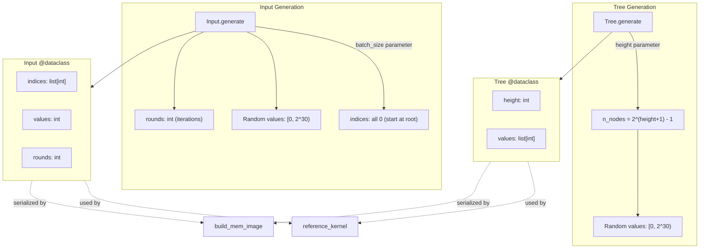
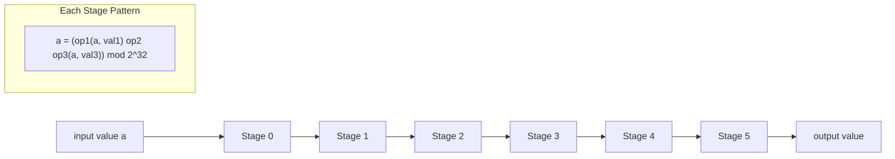
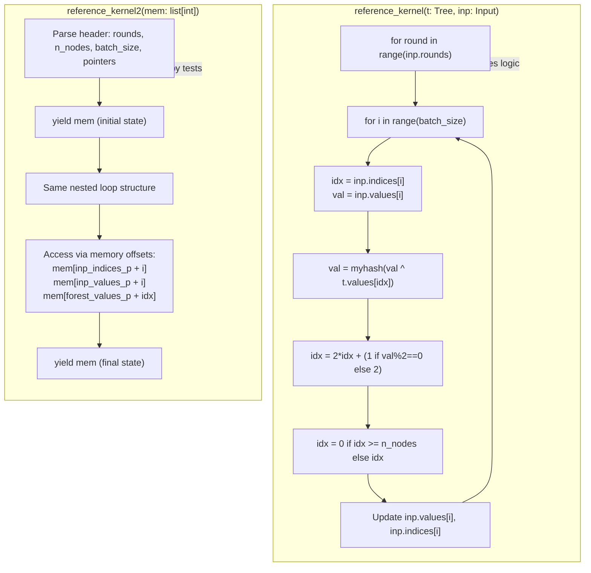
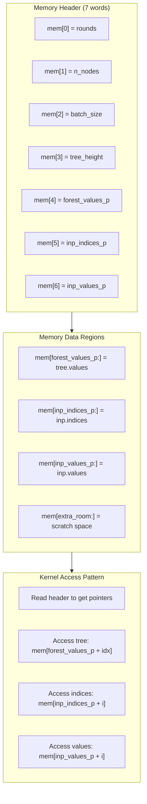

<!-- source: DeepWiki mcp.deepwiki.com · repo anthropics/original_performance_takehome · page 3 Problem Definition and Reference Implementation · fetched 2026-10-26 -->

# Problem Definition and Reference Implementation

Relevant source files

The following files were used as context for generating this wiki page:

- [problem.py](problem.py)
- [tests/frozen_problem.py](tests/frozen_problem.py)

This page documents the computational problem at the heart of the performance optimization challenge: the data structures that define problem instances, the algorithm to be implemented, the reference implementations that define correct behavior, and how data is serialized into the simulator's memory space.

For information about optimizing the implementation, see [Kernel Builder - The Optimization Target](#5). For details on the machine architecture that executes the code, see [Machine Architecture](#4).

## Overview

The optimization challenge involves implementing a parallel tree traversal algorithm where multiple independent traversals occur simultaneously across a shared binary tree. Each traversal maintains its own state (current position and accumulated value) and performs cryptographic-style hash mixing at each node to determine the next traversal step.

**Core Algorithm**: For each of multiple parallel traversals, repeatedly:
1. Read the value at the current tree node.
2. XOR it with the current traversal value.
3. Apply a multi-stage hash function to the result.
4. Use the hash output's parity to decide left (even) or right (odd) child.
5. Wrap back to root if reaching a leaf.
6. Update the traversal state and repeat.

Sources: [tests/frozen_problem.py:467-484]()

## Data Structures

The problem domain is defined by two primary data structures: `Tree` and `Input`. For deep technical details on their generation and properties, see [Data Structures: Tree and Input](#3.1).

Sources: [tests/frozen_problem.py:405-436]()

### Tree Structure

The `Tree` class represents an implicit perfect balanced binary tree stored as a flat array. Node relationships are computed using array indexing rather than explicit pointers.

| Property | Description |
|----------|-------------|
| `height` | Tree height parameter (typical: 10) |
| `values` | Flat array of node values, size = 2^(height+1) - 1 |
| Node indexing | Root at index 0, children of node `i` at `2*i+1` (left) and `2*i+2` (right) |
| Value range | Random integers in [0, 2^30) |

Sources: [tests/frozen_problem.py:405-418]()

### Input Structure

The `Input` class defines a batch of parallel traversals to execute.

| Property | Description |
|----------|-------------|
| `indices` | Current tree position for each traversal (initially all 0) |
| `values` | Accumulated hash value for each traversal |
| `rounds` | Number of tree traversal steps to execute (typical: 16) |
| `batch_size` | Number of parallel traversals (typical: 256) |

All indices start at 0 (the root), representing `batch_size` independent traversals that will explore the tree in parallel based on their unique initial values.

Sources: [tests/frozen_problem.py:421-436]()

## Hash Function: `myhash`

The hash function performs six sequential mixing stages, each applying arithmetic and bitwise operations. This creates data-dependent computation that resists simple optimization patterns. For a full explanation of the mixing operations, see [The Hash Algorithm](#3.2).

Sources: [tests/frozen_problem.py:439-464]()

### Hash Stage Configuration

The `HASH_STAGES` constant defines the six mixing stages. Each stage computes: `a = (a op1 val1) op2 (a op3 val3)`, with all operations modulo 2^32.

Sources: [tests/frozen_problem.py:439-446]()

### Implementation

The `myhash` function at [tests/frozen_problem.py:449-464]() iterates through `HASH_STAGES` and applies each transformation. All arithmetic is modulo 2^32 to match 32-bit word semantics of the target architecture.

Sources: [tests/frozen_problem.py:449-464]()

## Reference Implementations

Two reference implementations define the correct behavior: `reference_kernel` operates on high-level data structures, while `reference_kernel2` operates on flat memory and is used for validation. For details on how these are used for ground truth, see [Reference Implementations](#3.3).

Sources: [tests/frozen_problem.py:467-484](), [tests/frozen_problem.py:535-568]()

### `reference_kernel`: High-Level Implementation

This implementation at [tests/frozen_problem.py:467-484]() operates directly on `Tree` and `Input` objects. It serves as the most readable specification of the algorithm, including the XOR operation, the `myhash` call, and the child selection logic.

Sources: [tests/frozen_problem.py:467-484]()

### `reference_kernel2`: Memory-Based Implementation

This implementation at [tests/frozen_problem.py:535-568]() operates on the flat memory layout produced by `build_mem_image`. It is a generator function that yields memory states at checkpoints (initial state and final state). Tests compare machine execution output against these yields to validate correctness.

Sources: [tests/frozen_problem.py:535-568]()

## Memory Layout: `build_mem_image`

The `build_mem_image` function at [tests/frozen_problem.py:487-513]() serializes the problem into a flat memory array for the simulator. For details on the convention and pointer structure, see [Memory Layout and Serialization](#3.4).

Sources: [tests/frozen_problem.py:487-513]()

### Memory Layout Structure

The header at indices `0-6` provides self-describing metadata (rounds, `n_nodes`, `batch_size`, pointers) so the kernel can locate all data regions. This enables the same kernel code to work with different problem sizes.

Sources: [tests/frozen_problem.py:501-508]()

### Extra Room Allocation

The function allocates additional scratch space beyond the input data:
`extra_room = len(t.values) + len(inp.indices) * 2 + VLEN * 2 + 32` [tests/frozen_problem.py:492](). This provides working memory for the kernel to use for temporary values or vectorized operations.

Sources: [tests/frozen_problem.py:492]()

## Traced Variants for Debugging

The module includes traced versions of functions that record intermediate values for debugging and validation.

### `myhash_traced`

Located at [tests/frozen_problem.py:516-532](), this variant of `myhash` accepts a `trace` dictionary and records the output of each hash stage. This enables the debug engine in the simulator to validate that optimized implementations compute identical intermediate values at each step.

Sources: [tests/frozen_problem.py:516-532]()

### Trace Keys in `reference_kernel2`

The reference implementation records extensive trace information when the `trace` parameter is provided, including current indices, node values, and intermediate hash results [tests/frozen_problem.py:552-562](). These traces can be used with the simulator's debug engine to validate optimized kernels step-by-step.

Sources: [tests/frozen_problem.py:552-562]()

## Summary

The problem definition consists of:

1. **Data structures**: `Tree` (implicit binary tree) and `Input` (parallel traversal batch).
2. **Algorithm**: Multi-round tree traversal with cryptographic-style hash mixing.
3. **Reference implementations**: High-level (`reference_kernel`) and memory-based (`reference_kernel2`).
4. **Memory layout**: Self-describing flat structure with header and data regions.
5. **Validation support**: Traced variants for debugging and correctness checking.

The reference implementations define correct behavior. The optimization challenge (see [Kernel Builder - The Optimization Target](#5)) is to generate efficient instruction sequences that produce identical outputs when executed on the custom VLIW SIMD architecture (see [Machine Architecture](#4)).

Sources: [tests/frozen_problem.py:1-569](), [problem.py:1-569]()

---

