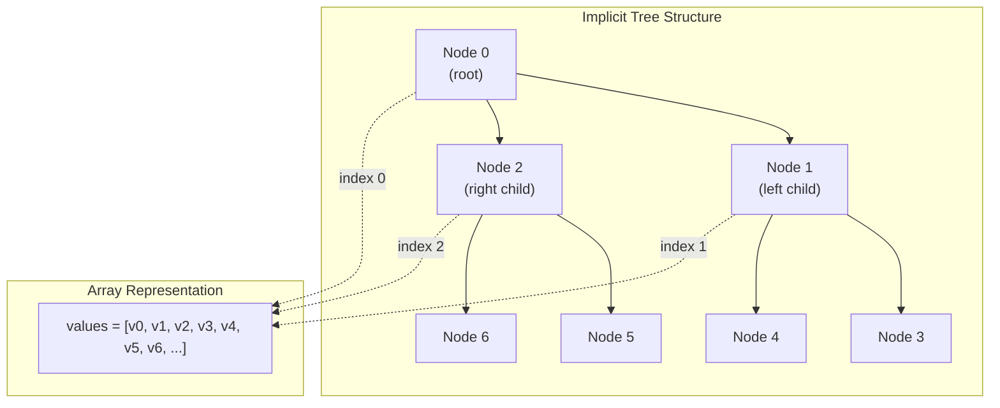
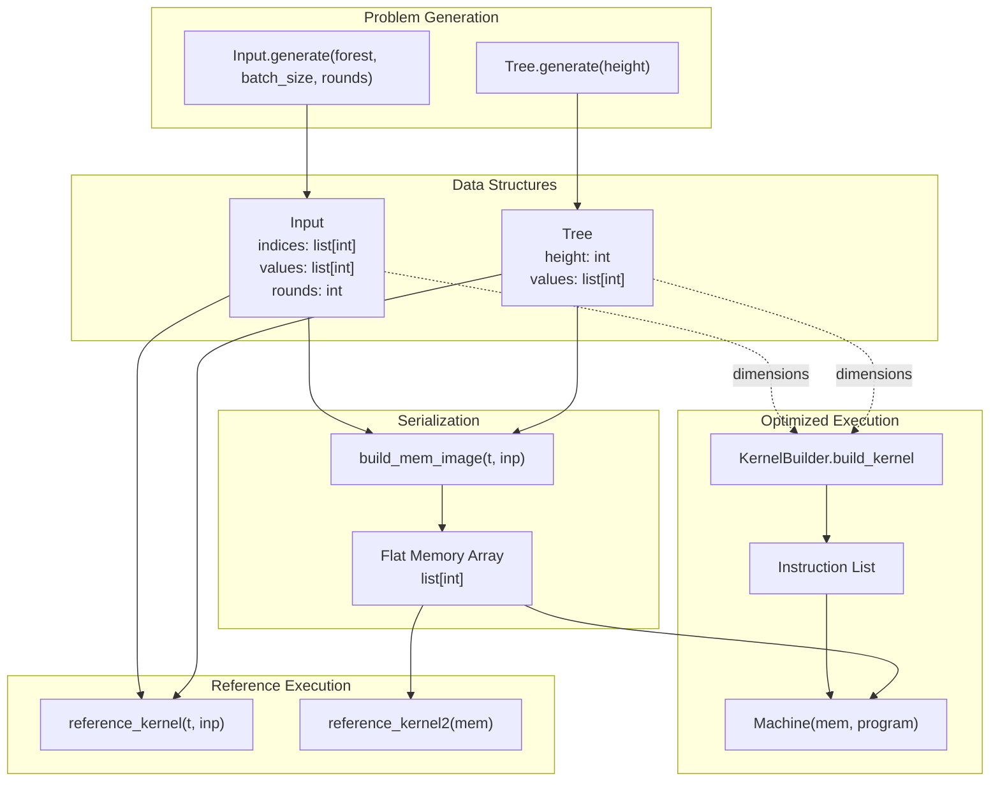
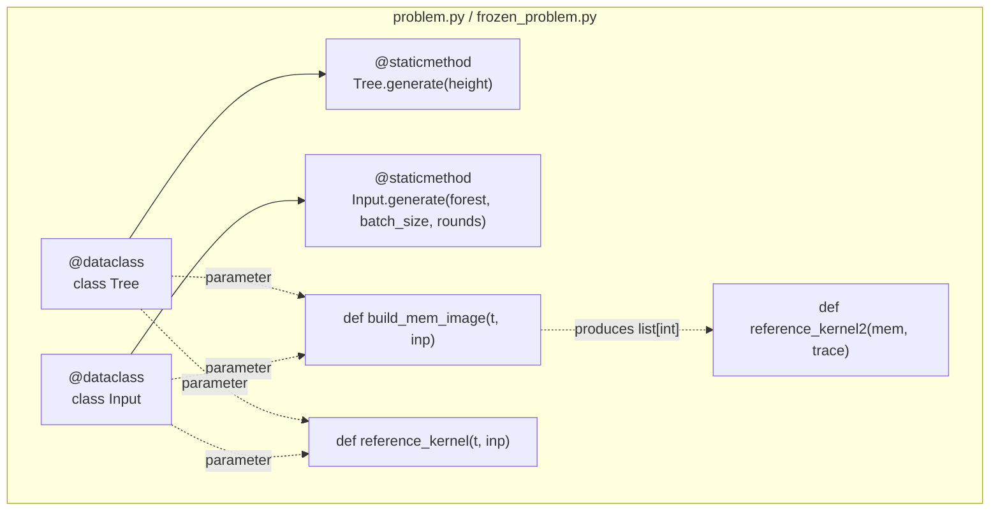

<!-- source: DeepWiki mcp.deepwiki.com · repo anthropics/original_performance_takehome · page 3.1 Data Structures: Tree and Input · fetched 2026-10-26 -->

# Data Structures: Tree and Input

<details>
<summary>Relevant source files</summary>

The following files were used as context for generating this wiki page:

- [problem.py](problem.py)
- [tests/frozen_problem.py](tests/frozen_problem.py)

</details>


## Purpose and Scope

This page documents the `Tree` and `Input` data structures defined in [problem.py:405-436]() and [tests/frozen_problem.py:405-436](). These classes represent the problem domain data for the tree traversal optimization challenge. They serve as intermediate representations during test generation and are eventually serialized into flat memory images for the simulator.

For information about how these structures are serialized into memory, see [3.4 Memory Layout and Serialization](). For details on the algorithms that operate on this data, see [3.3 Reference Implementations]().

---

## The Tree Data Structure

### Class Definition

The `Tree` class represents an **implicit perfect balanced binary tree** stored as a flat array of node values.

**Class: `Tree`** ([problem.py:405-418]())

| Field | Type | Description |
|-------|------|-------------|
| `height` | `int` | Height of the tree (root is at height 0) |
| `values` | `list[int]` | Flat array of node values, indexed by implicit position |

### Implicit Tree Representation

The tree uses an **array-based implicit representation** where parent-child relationships are determined by index arithmetic rather than explicit pointers:



**Index arithmetic for navigation:**
- Node at index `i` has:
  - Left child at index `2*i + 1`
  - Right child at index `2*i + 2`
  - Parent at index `(i-1) // 2`

**Sources:** [problem.py:405-418]()

### Tree Properties

**Perfect Binary Tree Dimensions:**

For a tree with `height = h`:
- **Total nodes:** `n_nodes = 2^(h+1) - 1` ([problem.py:415]())
- **Leaf nodes:** `2^h`
- **Maximum index:** `2^(h+1) - 2`

**Example dimensions:**

| Height | Nodes | Array Size |
|--------|-------|------------|
| 3 | 15 | 15 |
| 5 | 63 | 63 |
| 10 | 2047 | 2047 |

**Sources:** [problem.py:415-417]()

### Tree Generation

**Method: `Tree.generate(height: int)`** ([problem.py:414-418]())

Static method that creates a randomized tree for testing:

```python
n_nodes = 2 ** (height + 1) - 1
values = [random.randint(0, 2**30 - 1) for _ in range(n_nodes)]
return Tree(height, values)
```

**Generation parameters:**
- Each node value is a random 32-bit integer in range `[0, 2^30 - 1)` ([problem.py:416]())
- Uses Python's `random` module for generation ([problem.py:12]())
- Values are uniformly distributed

**Sources:** [problem.py:414-418]()

---

## The Input Data Structure

### Class Definition

The `Input` class represents a **batch of tree traversal operations** that will be executed in parallel.

**Class: `Input`** ([problem.py:421-436]())

| Field | Type | Description |
|-------|------|-------------|
| `indices` | `list[int]` | Current position of each traversal in the tree (node indices) |
| `values` | `list[int]` | Current hash values for each traversal |
| `rounds` | `int` | Number of traversal iterations to perform |

### Batch Processing Model

```mermaid
graph LR
    subgraph "Input Batch Structure"
        I0["indices[0]<br/>values[0]"]
        I1["indices[1]<br/>values[1]"]
        I2["indices[2]<br/>values[2]"]
        Idots["..."]
        In["indices[n-1]<br/>values[n-1]"]
    end
    
    subgraph "Tree"
        Tree["Tree with<br/>2^(h+1)-1 nodes"]
    end
    
    I0 -.->|"traverse"| Tree
    I1 -.->|"traverse"| Tree
    I2 -.->|"traverse"| Tree
    In -.->|"traverse"| Tree
    
    subgraph "Execution"
        Rounds["Repeat for<br/>'rounds' iterations"]
    end
    
    Tree --> Rounds
```

**Key characteristics:**
- Each batch element operates **independently** (no data dependencies between elements) ([problem.py:471-484]())
- All elements traverse the **same tree** but start from potentially different positions ([problem.py:433]())
- Operations are suitable for **SIMD vectorization** (same operation, different data)

**Sources:** [problem.py:421-436](), [problem.py:467-484]()

### Input Generation

**Method: `Input.generate(forest: Tree, batch_size: int, rounds: int)`** ([problem.py:432-436]())

Static method that creates input batches for testing:

```python
indices = [0 for _ in range(batch_size)]
values = [random.randint(0, 2**30 - 1) for _ in range(batch_size)]
return Input(indices, values, rounds)
```

**Generation behavior:**
- All indices start at `0` (tree root) ([problem.py:433]())
- Values are random 32-bit integers in range `[0, 2^30 - 1)` ([problem.py:434]())
- The `rounds` parameter is passed through unchanged ([problem.py:435]())
- The `forest` parameter is currently unused but retained for API compatibility ([problem.py:432]())

**Sources:** [problem.py:432-436]()

---

## Data Structure Relationships

### From Generation to Execution



**Key observations:**

1. **Tree and Input objects are used in two ways:**
   - Directly by `reference_kernel` for validation ([problem.py:467-484]())
   - Serialized to memory for simulator execution ([problem.py:487-513]())

2. **KernelBuilder operates on dimensions, not data:**
   - Extracts `height`, `batch_size`, `rounds` from structures ([perf_takehome.py:440-443]())
   - Generates generic instruction sequences based on problem size
   - See [5.2 The build_kernel Method]() for details

3. **Memory serialization is one-way:**
   - Once serialized, Tree/Input objects are no longer needed
   - The flat memory image contains all necessary data ([problem.py:487-513]())
   - See [3.4 Memory Layout and Serialization]() for format details

**Sources:** [problem.py:405-513](), [tests/submission_tests.py]()

---

## Typical Test Parameters

Common parameter combinations used in testing (inferred from `submission_tests.py` logic):

| Test Case | Height | Nodes | Batch Size | Rounds | Total Operations |
|-----------|--------|-------|------------|--------|------------------|
| Small | 3 | 15 | 32 | 4 | 128 |
| Medium | 5 | 63 | 128 | 8 | 1,024 |
| Standard | 10 | 2,047 | 256 | 16 | 4,096 |

**Performance implications:**
- Larger `batch_size` increases SIMD parallelism opportunities.
- Larger `rounds` amortizes loop overhead.
- Larger tree `height` increases memory footprint and cache pressure.

---

## Code Entity Reference

### Classes and Methods



**Function signatures:**

- `Tree.generate(height: int) -> Tree` ([problem.py:414-418]())
- `Input.generate(forest: Tree, batch_size: int, rounds: int) -> Input` ([problem.py:432-436]())
- `build_mem_image(t: Tree, inp: Input) -> list[int]` ([problem.py:487-513]())
- `reference_kernel(t: Tree, inp: Input)` ([problem.py:467-484]())
- `reference_kernel2(mem: list[int], trace: dict[Any, int] = {})` ([problem.py:535-568]())

**Sources:** [problem.py:405-568](), [tests/frozen_problem.py:405-568]()

---

## Summary

The `Tree` and `Input` data structures provide a clean, high-level representation of the tree traversal problem:

- **Tree:** Implicit binary tree with random node values.
- **Input:** Batch of parallel traversal operations with iteration count.
- **Generation:** Static methods create randomized test cases.
- **Usage:** Feed directly to reference implementations or serialize to memory for simulator.

These structures abstract away the low-level memory layout details, making test generation and reference implementations straightforward to write and understand. The actual optimization challenge involves generating efficient machine code to process the serialized form of these structures.

**Sources:** [problem.py:405-513](), [tests/frozen_problem.py:405-513]()

---

