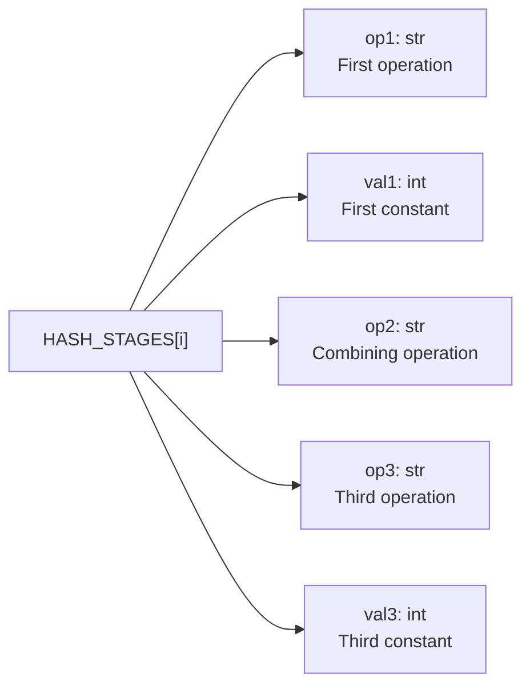
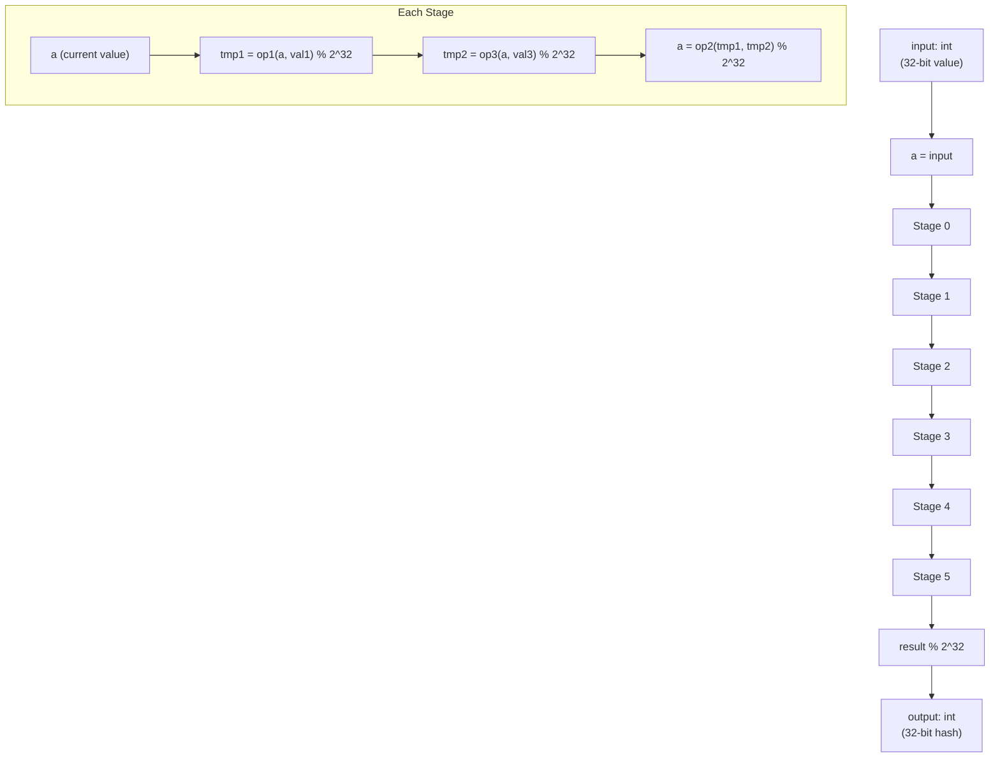
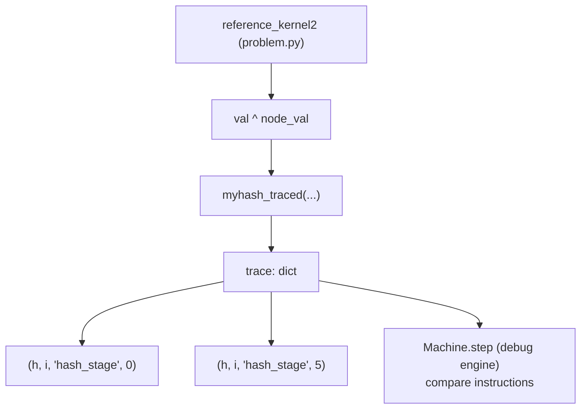
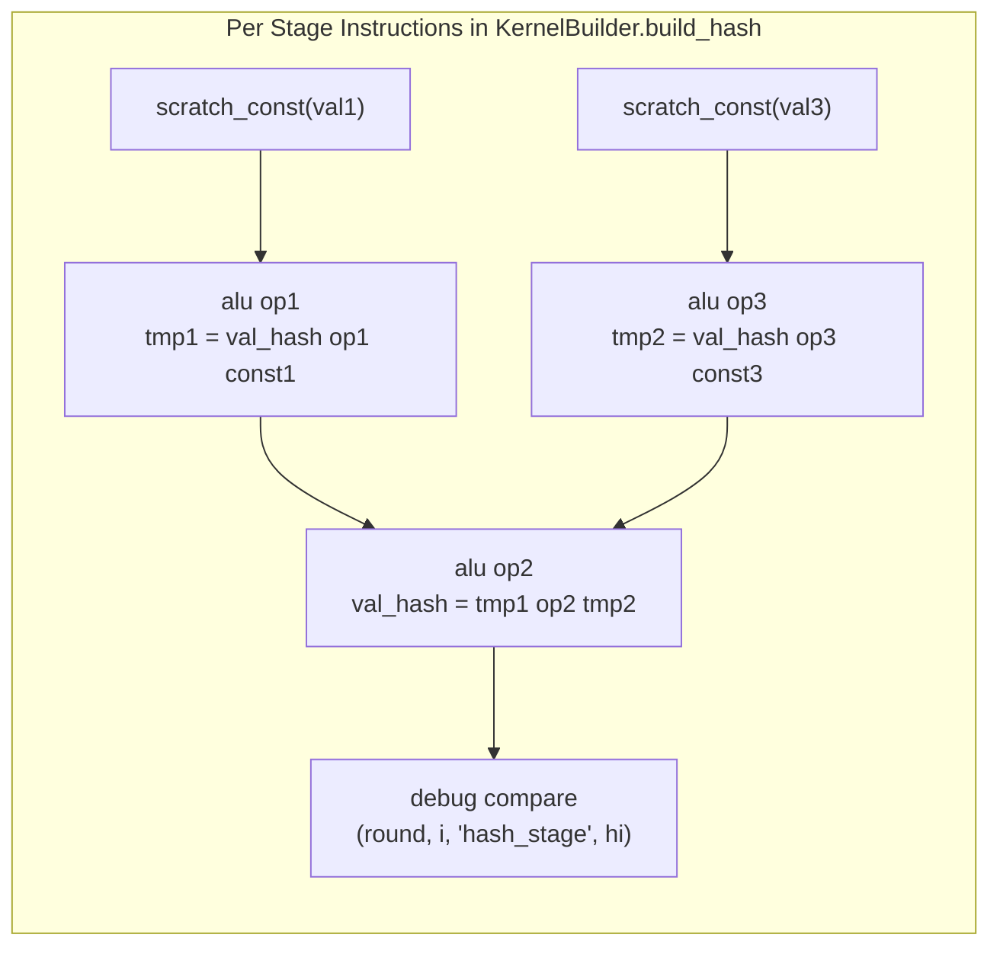
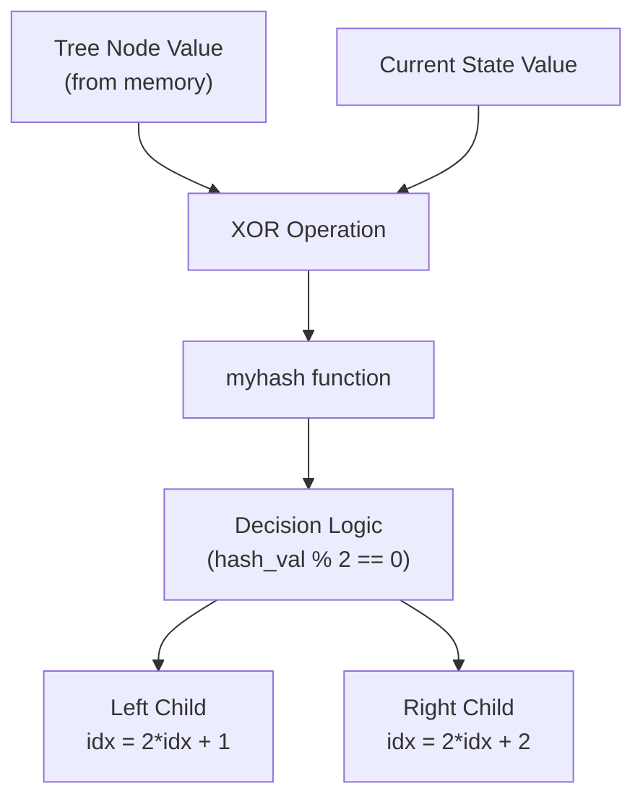

<!-- source: DeepWiki mcp.deepwiki.com · repo anthropics/original_performance_takehome · page 3.2 The Hash Algorithm · fetched 2026-10-26 -->

# The Hash Algorithm

<details>
<summary>Relevant source files</summary>

The following files were used as context for generating this wiki page:

- [problem.py](problem.py)
- [tests/frozen_problem.py](tests/frozen_problem.py)

</details>


This page documents the cryptographic-style hash function (`myhash`) used in the tree traversal kernel. The hash is applied at each node of the tree to transform the current value before making traversal decisions. For information about how the hash is used in the overall algorithm, see [2.1 The Tree Traversal Problem](). For the actual instruction generation that implements this hash, see [5.2 The build_kernel Method]().

## Overview

The hash algorithm is a 32-bit mixing function that applies six sequential stages of arithmetic and bitwise operations. It is designed to provide mixing properties for the tree traversal problem, where the hash output determines which branch to take at each node. The configuration is defined by a global constant `HASH_STAGES`.

**Sources:** [problem.py:439-464](), [perf_takehome.py:30-31]()

## The HASH_STAGES Configuration

The hash function is defined by the `HASH_STAGES` constant in `problem.py` (and its frozen counterpart), which specifies six transformation stages. Each stage is a tuple of five values that define the operations to perform.

### Stage Configuration Format



**Sources:** [problem.py:439-446]()

### Stage Values

| Stage | op1 | val1 (hex) | op2 | op3 | val3 |
|-------|-----|------------|-----|-----|------|
| 0 | `"+"` | `0x7ED55D16` | `"+"` | `"<<"` | `12` |
| 1 | `"^"` | `0xC761C23C` | `"^"` | `">>"` | `19` |
| 2 | `"+"` | `0x165667B1` | `"+"` | `"<<"` | `5` |
| 3 | `"+"` | `0xD3A2646C` | `"^"` | `"<<"` | `9` |
| 4 | `"+"` | `0xFD7046C5` | `"+"` | `"<<"` | `3` |
| 5 | `"^"` | `0xB55A4F09` | `"^"` | `">>"` | `16` |

**Sources:** [problem.py:439-446](), [tests/frozen_problem.py:439-446]()

## The myhash Function

The reference implementation `myhash` applies each stage sequentially to transform an input value.

### Algorithm Flow



**Sources:** [problem.py:449-464]()

### Stage Computation

For each stage defined in `HASH_STAGES`, the function performs:

1.  **First Operation:** Compute `tmp1 = op1(a, val1) % 2^32`
2.  **Third Operation:** Compute `tmp2 = op3(a, val3) % 2^32`
3.  **Combine:** Compute `a = op2(tmp1, tmp2) % 2^32`

The operations (`+`, `^`, `<<`, `>>`) are standard arithmetic and bitwise operations. All intermediate values are reduced modulo 2^32 to maintain 32-bit word size.

**Sources:** [problem.py:449-464]()

## The myhash_traced Function

A traced variant exists for debugging purposes, which records intermediate values after each stage into a trace dictionary. This is used by `reference_kernel2` to provide ground truth for the simulator's `debug` engine.

### Trace Key Format

The traced version (`myhash_traced`) stores intermediate hash values with keys of the form:

```
(round: int, batch_i: int, "hash_stage", stage_index: int) -> hash_value: int
```

**Sources:** [problem.py:516-532](), [tests/frozen_problem.py:516-532]()

### Integration with Reference Kernel



**Sources:** [problem.py:535-568](), [problem.py:516-532]()

## Implementation in KernelBuilder

The `KernelBuilder` class provides the `build_hash` method to generate machine instructions that implement the hash function on the custom VLIW architecture.

### build_hash Method Signature

The method at [perf_takehome.py:74-83]() has the signature:

```python
def build_hash(self, val_hash_addr, tmp1, tmp2, round, i)
```

Where:
*   `val_hash_addr`: Scratch address containing the value to hash (both input and output).
*   `tmp1`, `tmp2`: Scratch addresses for temporary storage.
*   `round`, `i`: Used for generating debug comparison keys.

### Instruction Generation Pattern

For each of the six stages in `HASH_STAGES`, the method generates a sequence of ALU and debug operations:



**Sources:** [perf_takehome.py:74-83]()

### Generated Slots

Each stage typically generates four slots:
1.  `("alu", (op1, tmp1, val_hash_addr, const_addr_1))` - First operation.
2.  `("alu", (op3, tmp2, val_hash_addr, const_addr_3))` - Third operation.
3.  `("alu", (op2, val_hash_addr, tmp1, tmp2))` - Combining operation.
4.  `("debug", ("compare", val_hash_addr, (round, i, "hash_stage", hi)))` - Debug verification.

**Sources:** [perf_takehome.py:74-83](), [perf_takehome.py:67-72]()

## Hash Properties and Usage

### Characteristics

1.  **Deterministic:** Same input always produces same output.
2.  **32-bit Word Size:** All operations maintain 32-bit precision via modulo 2^32.
3.  **Mix Operations:** Combines additive (+), XOR (^), and shift (<<, >>) operations.
4.  **Avalanche Effect:** Small input changes produce large output changes due to the mixing stages.

### Usage Context in Tree Traversal



The hash output determines tree traversal direction:
*   If `hash_value % 2 == 0`: Take left child.
*   Otherwise: Take right child.

**Sources:** [problem.py:467-484](), [problem.py:535-568]()

## Performance Considerations

The hash computation accounts for a significant portion of the kernel's execution time:
*   **6 stages** × **3 ALU operations per stage** = **18 ALU operations** per hash.
*   Executed **once per batch element per round**.

For the standard test case (256 batch elements × 16 rounds), the hash is computed 4,096 times. Optimization strategies in `KernelBuilder.build_kernel` often focus on vectorizing these 18 ALU operations using `valu` instructions to process `VLEN` elements in parallel.

**Sources:** [perf_takehome.py:74-83](), [perf_takehome.py:131-167]()

---

