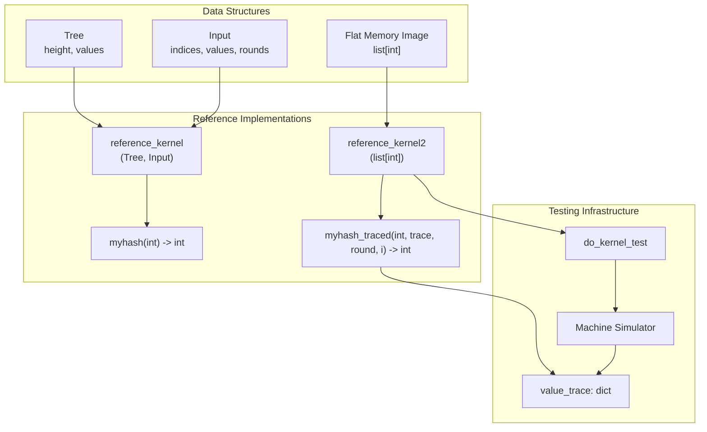
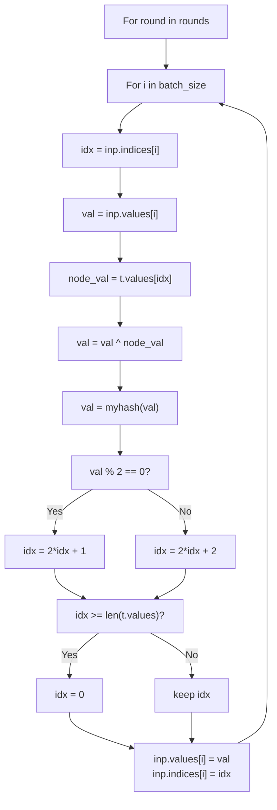
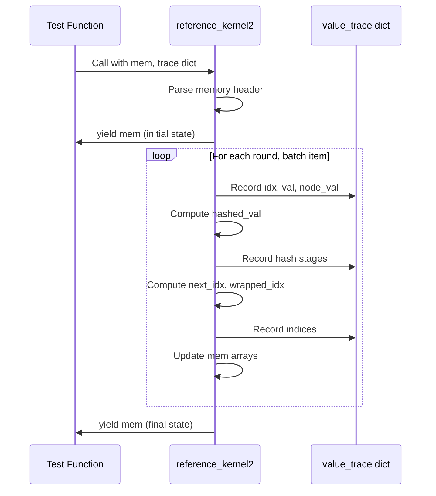
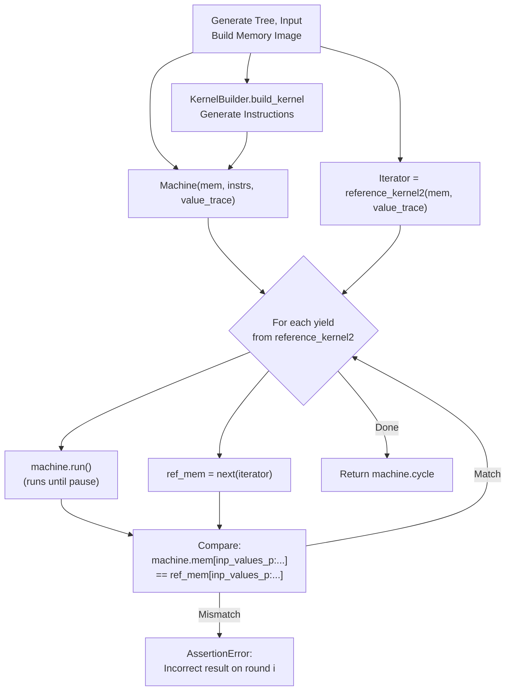

<!-- source: DeepWiki mcp.deepwiki.com · repo anthropics/original_performance_takehome · page 3.3 Reference Implementations · fetched 2026-10-26 -->

# Reference Implementations

<details>
<summary>Relevant source files</summary>

The following files were used as context for generating this wiki page:

- [problem.py](problem.py)
- [tests/frozen_problem.py](tests/frozen_problem.py)

</details>


This page documents the reference implementations that define the correct behavior of the tree traversal kernel. These implementations serve as the ground truth against which optimized kernels are validated for correctness.

For information about the data structures these implementations operate on, see [Data Structures: Tree and Input](3.1). For information about the hash algorithm details, see [The Hash Algorithm](3.2). For information about how these references are used in testing, see [Correctness Validation](6.2).

## Overview

The codebase provides two reference implementations of the kernel computation, both implementing the same algorithm but operating on different representations:

| Implementation | Input Types | Purpose | Location |
|---------------|------------|---------|----------|
| `reference_kernel` | `Tree`, `Input` objects | Simple reference, validation of implementations | [tests/frozen_problem.py:467-484]() |
| `reference_kernel2` | Flat memory (`list[int]`) | Primary validation reference, supports pause points | [tests/frozen_problem.py:535-568]() |

Both implementations exist in both `problem.py` and `tests/frozen_problem.py`, with the frozen version used for official submission testing to prevent accidental modifications to the ground truth.

**Reference Implementation Architecture**



Sources: [tests/frozen_problem.py:467-568](), [tests/frozen_problem.py:449-464]()

## reference_kernel Function

The `reference_kernel` function is the simplest reference implementation, operating directly on `Tree` and `Input` objects. It implements the tree traversal algorithm in straightforward Python.

**Function Signature:** `reference_kernel(t: Tree, inp: Input)` [tests/frozen_problem.py:467]()

**Algorithm:** For each round and each batch element, the function:
1. Loads current index and value from input [tests/frozen_problem.py:472-473]()
2. Fetches node value from tree at current index [tests/frozen_problem.py:474]()
3. Computes `val = myhash(val ^ node_val)` (XOR then hash) [tests/frozen_problem.py:475]()
4. Determines next index: `idx = 2*idx + (1 if val%2==0 else 2)` (left child if even, right child if odd) [tests/frozen_problem.py:476-477]()
5. Wraps index to 0 if beyond tree bounds [tests/frozen_problem.py:478-479]()
6. Updates input indices and values in-place [tests/frozen_problem.py:480-481]()

**Implementation Details:**



Sources: [tests/frozen_problem.py:467-484]()

The implementation is deliberately simple and readable, avoiding optimization in favor of clarity. This makes it easy to verify correctness by inspection.

## reference_kernel2 Function

The `reference_kernel2` function is the primary validation reference. It implements the same algorithm as `reference_kernel` but operates on the flat memory representation used by the `Machine` simulator.

**Function Signature:** `reference_kernel2(mem: list[int], trace: dict[Any, int] = {}) -> Generator[list[int]]` [tests/frozen_problem.py:535]()

**Key Differences from reference_kernel:**

1. **Generator Pattern:** Yields memory state at pause points, allowing incremental validation [tests/frozen_problem.py:549, 568]()
2. **Flat Memory:** Operates on serialized memory image matching `Machine` layout [tests/frozen_problem.py:540-547]()
3. **Value Tracing:** Records intermediate values in `trace` dictionary for debug validation [tests/frozen_problem.py:552-562]()
4. **Pause Points:** First yield before loop, final yield after completion.

**Memory Header Unpacking:**

The function begins by extracting problem parameters from the memory header [tests/frozen_problem.py:540-547]():

```
mem[0] = rounds
mem[1] = n_nodes  
mem[2] = batch_size
mem[3] = forest_height
mem[4] = forest_values_p  (pointer)
mem[5] = inp_indices_p    (pointer)
mem[6] = inp_values_p     (pointer)
```

**Value Trace Keys:**

The `trace` dictionary records intermediate values with composite tuple keys [tests/frozen_problem.py:552-562]():

| Key Pattern | Value | Purpose |
|-------------|-------|---------|
| `(round, i, "idx")` | `mem[inp_indices_p + i]` | Initial index |
| `(round, i, "val")` | `mem[inp_values_p + i]` | Initial value |
| `(round, i, "node_val")` | `mem[forest_values_p + idx]` | Node value from tree |
| `(round, i, "hashed_val")` | Result of `myhash_traced` | Value after hashing |
| `(round, i, "hash_stage", stage)` | Intermediate hash state | Per-stage hash value |
| `(round, i, "next_idx")` | `2*idx + branch` | Index before wrapping |
| `(round, i, "wrapped_idx")` | Final wrapped index | Index after bounds check |

**Generator Yield Points:**



Sources: [tests/frozen_problem.py:535-568]()

The yield points align with `pause` instructions in the generated kernel, allowing the test harness to validate intermediate states.

## Hash Function Implementations

Two variants of the hash function exist to support different validation needs:

### myhash Function

**Function Signature:** `myhash(a: int) -> int` [tests/frozen_problem.py:449]()

A simple 32-bit hash function that applies six stages of mixing operations defined by the `HASH_STAGES` constant [tests/frozen_problem.py:439-446]():

```python
HASH_STAGES = [
    ("+", 0x7ED55D16, "+", "<<", 12),
    ("^", 0xC761C23C, "^", ">>", 19),
    ("+", 0x165667B1, "+", "<<", 5),
    ("+", 0xD3A2646C, "^", "<<", 9),
    ("+", 0xFD7046C5, "+", "<<", 3),
    ("^", 0xB55A4F09, "^", ">>", 16),
]
```

The algorithm applies: `a = (op1(a, const1) op2 op3(a, const3)) % 2^32` [tests/frozen_problem.py:461-462]()

Sources: [tests/frozen_problem.py:439-464]()

### myhash_traced Function

**Function Signature:** `myhash_traced(a: int, trace: dict[Any, int], round: int, batch_i: int) -> int` [tests/frozen_problem.py:516]()

Identical to `myhash` but records intermediate values after each stage in the `trace` dictionary with keys `(round, batch_i, "hash_stage", stage_index)` [tests/frozen_problem.py:529-530]().

This enables debug instructions in optimized kernels to validate hash computation correctness at each stage using the `debug` engine's `compare` operation.

Sources: [tests/frozen_problem.py:516-532]()

## Role in Validation

The reference implementations serve as the ground truth for correctness validation in the test infrastructure.

**Validation Workflow in do_kernel_test**



Sources: [tests/frozen_problem.py:197-222](), [tests/frozen_problem.py:255-265]()

**Debug Instruction Validation**

The `value_trace` dictionary populated by `reference_kernel2` and `myhash_traced` enables fine-grained validation using debug instructions. The `Machine` simulator's debug engine compares scratch space values against trace values [tests/frozen_problem.py:370-374]():

```python
# From Machine.step_debug
if op == "compare":
    addr, key = args
    if self.value_trace[key] != core.scratch[addr]:
        raise Exception(f"Debug compare failed: {key} expected {self.value_trace[key]} got {core.scratch[addr]}")
```

When executed, this asserts `core.scratch[scratch_addr] == value_trace[trace_key]`, enabling detection of errors at specific computation steps rather than only at final output.

Sources: [tests/frozen_problem.py:352-382]()

## Validation Between Reference Implementations

The test suite includes validation that both reference implementations produce identical results, ensuring consistency between the object-oriented and flat-memory representations.

**Why Two Implementations Exist:**

| Aspect | reference_kernel | reference_kernel2 |
|--------|------------------|-------------------|
| **Clarity** | Operates on natural objects | Operates on memory layout |
| **Simplicity** | No memory management | Requires pointer arithmetic |
| **Validation** | No pause points | Supports incremental validation |
| **Tracing** | No trace support | Populates value_trace for debugging |
| **Use Case** | Conceptual reference | Primary validation target |

The dual implementation strategy ensures that the specification (via `reference_kernel`) is clear and verifiable, while the validation mechanism (via `reference_kernel2`) matches the `Machine`'s execution model exactly.

Sources: [tests/frozen_problem.py:467-484](), [tests/frozen_problem.py:535-568]()

---

