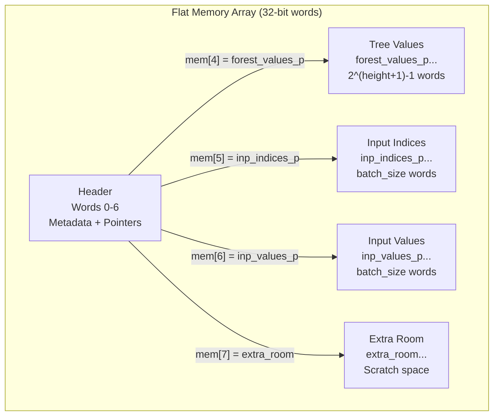
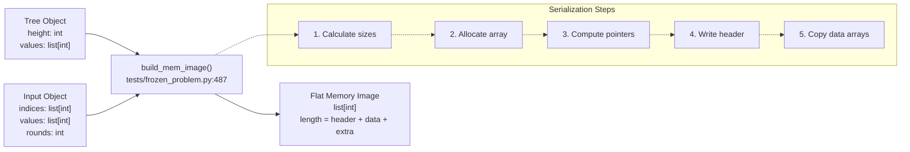
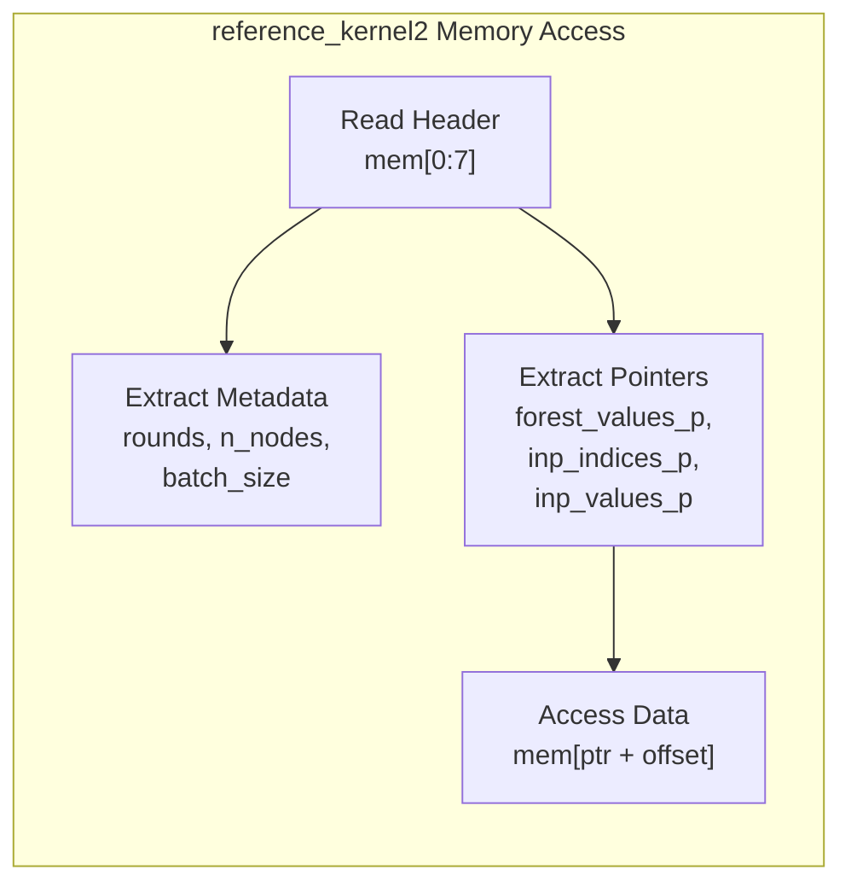
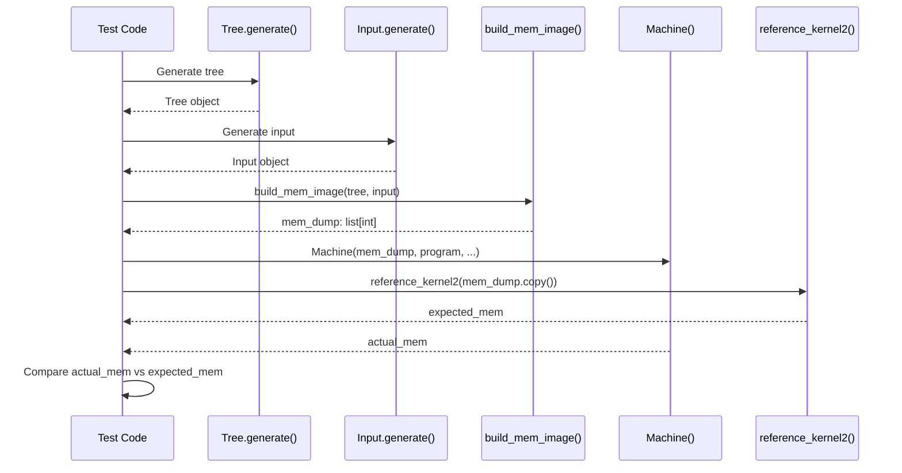

<!-- source: DeepWiki mcp.deepwiki.com · repo anthropics/original_performance_takehome · page 3.4 Memory Layout and Serialization · fetched 2026-10-26 -->

# Memory Layout and Serialization

<details>
<summary>Relevant source files</summary>

The following files were used as context for generating this wiki page:

- [problem.py](problem.py)
- [tests/frozen_problem.py](tests/frozen_problem.py)

</details>


## Purpose and Scope

This page documents how the `Tree` and `Input` data structures are serialized into a flat memory image for execution by the `Machine` simulator. The `build_mem_image` function transforms high-level Python objects into a contiguous array of 32-bit words that can be accessed by the generated kernel instructions.

For information about the `Tree` and `Input` data structures themselves, see **3.1 Data Structures: Tree and Input**. For details on how the `Machine` simulator accesses this memory, see **4.3 Memory Hierarchy**.

## Overview

The `Machine` simulator operates on a flat memory model consisting of an array of 32-bit words [tests/frozen_problem.py:80-83](). To execute the tree traversal algorithm, the simulator needs access to:
- Tree node values
- Input batch indices and values  
- Metadata (tree height, batch size, number of rounds)
- Pointers to locate data within memory

The serialization process converts the object-oriented `Tree` and `Input` structures into this flat representation through the `build_mem_image` function [tests/frozen_problem.py:487-513]().

**Sources:** [tests/frozen_problem.py:80-83](), [tests/frozen_problem.py:487-513]()

## Memory Layout Structure

The flat memory image follows a standardized layout convention with two main components:

1. **Header Section** - Fixed 7-word header containing metadata and pointers [tests/frozen_problem.py:491-508]()
2. **Data Sections** - Variable-length arrays containing the actual data [tests/frozen_problem.py:510-513]()



**Sources:** [tests/frozen_problem.py:487-513]()

## The build_mem_image Function

The serialization is performed by the `build_mem_image` function, which takes a `Tree` and `Input` object and returns a flat list of integers.

**Function Signature:**
`def build_mem_image(t: Tree, inp: Input) -> list[int]` [tests/frozen_problem.py:487]()

### Serialization Process



**Sources:** [tests/frozen_problem.py:487-513]()

## Header Format

The header occupies the first 7 words (indices 0-6) of the memory array and contains both metadata and pointers to data sections [tests/frozen_problem.py:501-508]().

| Word Index | Field Name | Description | Source |
|------------|------------|-------------|---------|
| `mem[0]` | `inp.rounds` | Number of rounds to execute | `Input` object |
| `mem[1]` | `len(t.values)` | Total number of tree nodes | `Tree` object |
| `mem[2]` | `len(inp.indices)` | Batch size | `Input` object |
| `mem[3]` | `t.height` | Tree height | `Tree` object |
| `mem[4]` | `forest_values_p` | Pointer to tree values array | Calculated |
| `mem[5]` | `inp_indices_p` | Pointer to input indices array | Calculated |
| `mem[6]` | `inp_values_p` | Pointer to input values array | Calculated |
| `mem[7]` | `extra_room` | Pointer to extra scratch space | Calculated |

**Header Constant:** The header size is fixed at 7 words [tests/frozen_problem.py:491]().

**Sources:** [tests/frozen_problem.py:501-508]()

## Pointer Calculation

Pointers are calculated sequentially based on the sizes of preceding sections [tests/frozen_problem.py:491-499]():

```python
header = 7
forest_values_p = header                              # Word 7
inp_indices_p = forest_values_p + len(t.values)      # After tree values
inp_values_p = inp_indices_p + len(inp.values)       # After input indices  
extra_room = inp_values_p + len(inp.values)          # After input values
```

These pointers enable the kernel and reference implementations to locate data within the flat memory array.

**Sources:** [tests/frozen_problem.py:491-499]()

## Data Sections

### Tree Values Section
**Location:** `mem[forest_values_p : inp_indices_p]`
Contains all node values from the binary tree in implicit array representation [tests/frozen_problem.py:510]().

### Input Indices Section
**Location:** `mem[inp_indices_p : inp_values_p]`
Contains the current tree node index for each element in the batch. These values are updated during kernel execution [tests/frozen_problem.py:511]().

### Input Values Section
**Location:** `mem[inp_values_p : extra_room]`
Contains the current hash values for each element in the batch [tests/frozen_problem.py:512]().

### Extra Room Section
**Location:** `mem[extra_room : end]`
Additional scratch space allocated for temporary computations. The size is calculated to provide space for vectorized operations and intermediate results [tests/frozen_problem.py:492]():
`extra_room_size = len(t.values) + len(inp.indices) * 2 + VLEN * 2 + 32`

**Sources:** [tests/frozen_problem.py:510-513](), [tests/frozen_problem.py:492]()

## Memory Access Patterns

### Reference Kernel Access

The `reference_kernel2` function demonstrates how to access the serialized memory [tests/frozen_problem.py:535-548]():



**Example Access Pattern:**
```python
# Read header [tests/frozen_problem.py:536-543]
rounds = mem[0]
n_nodes = mem[1]
batch_size = mem[2]
forest_height = mem[3]
forest_values_p = mem[4]
inp_indices_p = mem[5]
inp_values_p = mem[6]

# Access data using pointers [tests/frozen_problem.py:546-548]
idx = mem[inp_indices_p + i]           # Read index for batch element i
val = mem[inp_values_p + i]            # Read value for batch element i  
node_val = mem[forest_values_p + idx]  # Read tree node value at idx
```

**Sources:** [tests/frozen_problem.py:535-548]()

## Memory Size Calculation

The total memory allocation is the sum of the header, data arrays, and extra room [tests/frozen_problem.py:491-495](). For a standard tree of height 10 and batch size 256, this results in approximately 5206 words (20.8 KB).

**Sources:** [tests/frozen_problem.py:491-495]()

## Integration with Machine Simulator

The `Machine` class receives the memory image through its constructor and stores it in `self.mem` [tests/frozen_problem.py:99-110]().



**Sources:** [tests/frozen_problem.py:97-110](), [tests/frozen_problem.py:487-513]()

## Key Invariants

1. **Fixed Header Size:** The header always occupies exactly 7 words [tests/frozen_problem.py:491]().
2. **Contiguous Layout:** All sections are contiguous with no gaps or padding [tests/frozen_problem.py:491-499]().
3. **32-bit Words:** All values are stored as 32-bit integers [tests/frozen_problem.py:80]().
4. **Pointer Validity:** All pointers in the header point to valid locations within the allocated array [tests/frozen_problem.py:505-508]().

**Sources:** [tests/frozen_problem.py:487-513](), [tests/frozen_problem.py:80]()

---

