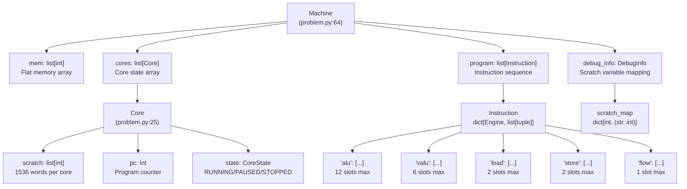
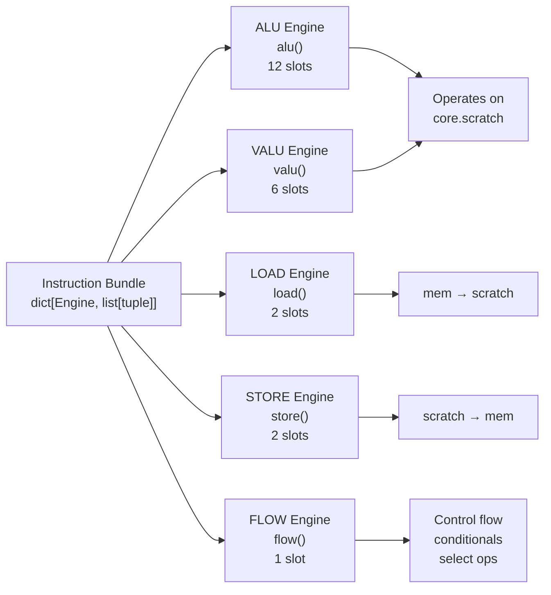

<!-- source: DeepWiki mcp.deepwiki.com · repo anthropics/original_performance_takehome · page 4 Machine Architecture · fetched 2026-10-26 -->

# Machine Architecture

<details>
<summary>Relevant source files</summary>

The following files were used as context for generating this wiki page:

- [problem.py](problem.py)
- [tests/frozen_problem.py](tests/frozen_problem.py)

</details>


This document provides comprehensive documentation of the custom VLIW SIMD simulator architecture implemented in the `Machine` class. This simulator executes instruction sequences generated by the `KernelBuilder` to solve the tree traversal problem. For information about optimizing the kernel code generation, see [Kernel Builder - The Optimization Target](#5). For information about instruction set details and individual operations, see [Instruction Set Reference](#4.2).

## Machine Simulator Overview

The `Machine` class in [problem.py:64-403]() implements a software simulator for a custom parallel architecture that combines VLIW (Very Long Instruction Word) and SIMD (Single Instruction Multiple Data) execution models. The simulator executes programs represented as lists of instruction bundles, operating on a flat memory space and maintaining per-core scratch space.

**Machine Entity Mapping**


**Sources:** [problem.py:64-122](), [problem.py:25-31](), [problem.py:34-42](), [problem.py:14-15]()

## Core Architectural Components

### Machine Class Structure

The `Machine` class manages the execution environment and coordinates instruction execution across all cores. Key attributes include:

| Attribute | Type | Purpose |
|-----------|------|---------|
| `cores` | `list[Core]` | Array of core state objects |
| `mem` | `list[int]` | Main memory (32-bit words) |
| `program` | `list[Instruction]` | Instruction sequence to execute |
| `debug_info` | `DebugInfo` | Scratch variable naming information |
| `cycle` | `int` | Current cycle counter |
| `enable_pause` | `bool` | Whether pause instructions take effect |
| `enable_debug` | `bool` | Whether debug instructions execute |

**Sources:** [problem.py:97-122]()

### Core Class Structure

Each `Core` object ([problem.py:25-31]()) represents an independent execution unit with its own state:

| Attribute | Type | Purpose |
|-----------|------|---------|
| `id` | `int` | Core identifier (0-indexed) |
| `scratch` | `list[int]` | Fast local storage (1536 words) |
| `trace_buf` | `list[int]` | Debug trace buffer |
| `pc` | `int` | Program counter (instruction index) |
| `state` | `CoreState` | Execution state enum |

The `CoreState` enum ([problem.py:18-22]()) defines three states:
- `RUNNING`: Core actively executes instructions
- `PAUSED`: Core halted via pause instruction, can resume
- `STOPPED`: Core completed execution or halted permanently

**Sources:** [problem.py:25-31](), [problem.py:18-22]()

## VLIW Architecture: Engine and Slot Model

The architecture follows a VLIW design where each instruction bundle can contain multiple operations that execute in parallel. Operations are grouped into specialized **engines**, each with a fixed number of **slots** that limit parallel execution capacity.

### Slot Limits Configuration

The `SLOT_LIMITS` constant ([problem.py:48-55]()) defines the parallelism capacity:

```python
SLOT_LIMITS = {
    "alu": 12,      # Scalar arithmetic/logic operations
    "valu": 6,      # Vector arithmetic/logic operations
    "load": 2,      # Memory reads to scratch
    "store": 2,     # Scratch writes to memory
    "flow": 1,      # Control flow operations
    "debug": 64,    # Debug/validation operations
}
```

**Interpretation:** In a single cycle, the machine can execute up to 12 scalar arithmetic operations, 6 vector operations, 2 loads, 2 stores, and 1 control flow operation simultaneously. For details on operation semantics, see [Instruction Set Reference](#4.2).

**Sources:** [problem.py:48-55]()

### Engine Type Mapping

**Engine Execution Logic**


Each engine is implemented as a method on the `Machine` class:
- `alu()`: [problem.py:219-253]()
- `valu()`: [problem.py:254-267]()
- `load()`: [problem.py:269-286]()
- `store()`: [problem.py:288-298]()
- `flow()`: [problem.py:300-335]()

**Sources:** [problem.py:219-335](), [problem.py:356-362]()

## SIMD Architecture: Vector Operations

The architecture supports SIMD parallelism through vector operations. The vector length is fixed at compile time by the `VLEN` constant ([problem.py:57]()).

```python
VLEN = 8  # Vector operations process 8 elements in parallel
```

Vector operations in the `valu` engine operate on consecutive scratch addresses. For example, a vector add operation `("+", dest, a1, a2)` computes `scratch[dest+i] = scratch[a1+i] + scratch[a2+i]` for `i` in `range(VLEN)`. For more details, see [VLIW SIMD Concepts](#4.1).

**Sources:** [problem.py:57](), [problem.py:254-267]()

## Configuration Constants

| Constant | Value | Purpose |
|----------|-------|---------|
| `VLEN` | 8 | Number of elements in vector operations |
| `N_CORES` | 1 | Number of cores (single-core in current version) |
| `SCRATCH_SIZE` | 1536 | Size of per-core scratch space in 32-bit words |
| `BASE_ADDR_TID` | 100000 | Thread ID offset for scratch variable traces |

**Note:** The comment at [problem.py:58-59]() indicates that older versions used multiple cores, but the current version is single-core only.

**Sources:** [problem.py:57-61]()

## Instruction Format

Instructions follow a dictionary-based format where keys are engine names and values are lists of operation tuples:

```python
Instruction = dict[Engine, list[tuple]]
```

Example instruction bundle ([problem.py:85-87]()):
```python
{
    "valu": [("*", 4, 0, 0), ("+", 8, 4, 0)],  # Two vector operations
    "load": [("load", 16, 17)]                   # One load operation
}
```

### Operand Addressing Convention

As documented in [problem.py:89-91]():
- **All numbers in instructions are scratch addresses** except for specific operations like `const`, `jump`, and `add_imm` which take immediate values or instruction pointers.
- **First operand is destination** for most operations except for `store` and some `flow` operations.

For details on memory addressing, see [Memory Hierarchy](#4.3).

**Sources:** [problem.py:14-15](), [problem.py:85-91]()

## Execution Flow

### Main Execution Loop

The `run()` method ([problem.py:197-217]()) implements the fetch-decode-execute cycle. Debug-only instructions do not increment the cycle counter ([problem.py:214-217]()). For a detailed breakdown of timing, see [Execution Model and Cycle Semantics](#4.4).

**Sources:** [problem.py:197-217]()

### Instruction Step Execution

The `step()` method ([problem.py:352-397]()) executes a single instruction bundle using a **two-phase commit model**:

1. **Read Phase** ([problem.py:363-387]()): All engine methods read from `core.scratch` and `self.mem` directly, seeing the state at the start of the cycle.
2. **Write Phase** ([problem.py:388-391]()): All writes go into `scratch_write` and `mem_write` dictionaries.
3. **Commit Phase** ([problem.py:388-391]()): After all operations complete, writes are applied atomically.

This ensures deterministic parallel execution even when multiple slots write to the same location (last write wins). For details, see [Execution Model and Cycle Semantics](#4.4).

**Sources:** [problem.py:352-397]()

## Machine Initialization

The `Machine.__init__()` method ([problem.py:97-122]()) initializes the execution environment. If `trace=True`, the simulator calls `setup_trace()` ([problem.py:151-195]()) to initialize Chrome Trace Event Format output to `trace.json`. For trace analysis details, see [Performance Analysis and Debugging](#7).

**Sources:** [problem.py:97-122]()

## Data Word Format

All data in memory and scratch space consists of **32-bit unsigned words**. Arithmetic operations automatically modulo by 2³² to maintain this constraint ([problem.py:251]()).

**Sources:** [problem.py:83](), [problem.py:251]()

## Frozen vs Development Simulators

Two implementations of the simulator exist:
- **Development version:** [problem.py:64-403]()
- **Frozen version:** [tests/frozen_problem.py:64-403]()

The frozen version is used for testing to ensure the machine behavior remains static. For details on when each is used, see [Frozen vs Development Simulators](#4.5).

**Sources:** [problem.py:1-6](), [tests/frozen_problem.py:1-6]()

## Related Documentation

- [VLIW SIMD Concepts](#4.1)
- [Instruction Set Reference](#4.2)
- [Memory Hierarchy](#4.3)
- [Execution Model and Cycle Semantics](#4.4)
- [Frozen vs Development Simulators](#4.5)

---

