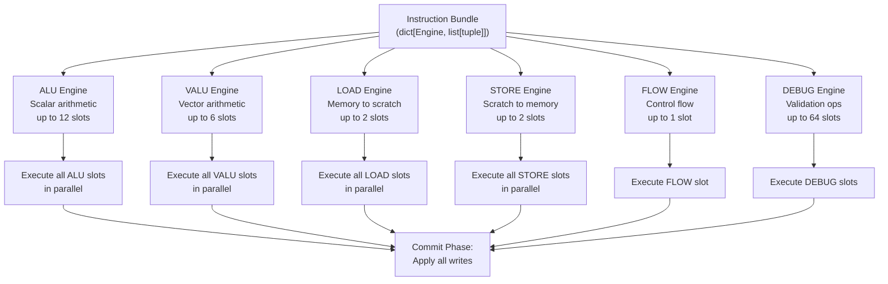
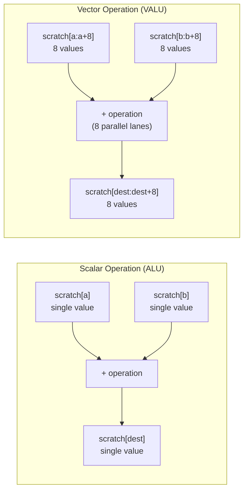
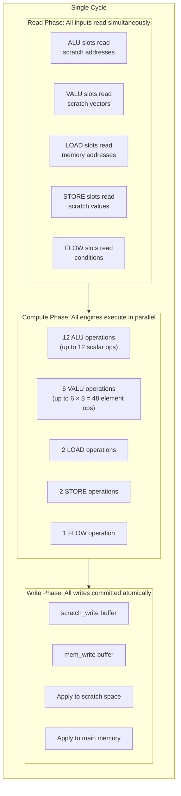
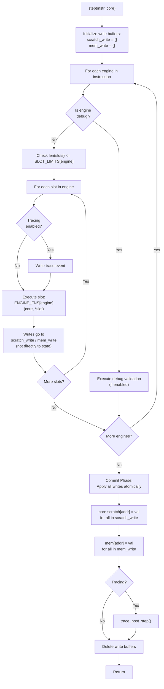

<!-- source: DeepWiki mcp.deepwiki.com · repo anthropics/original_performance_takehome · page 4.1 VLIW SIMD Concepts · fetched 2026-10-26 -->

# VLIW SIMD Concepts

<details>
<summary>Relevant source files</summary>

The following files were used as context for generating this wiki page:

- [problem.py](problem.py)
- [tests/frozen_problem.py](tests/frozen_problem.py)

</details>


## Purpose and Scope

This page explains the Very Large Instruction Word (VLIW) and Single Instruction Multiple Data (SIMD) architectural concepts that form the foundation of the custom machine simulator in this repository. It covers how these paradigms combine to enable instruction-level and data-level parallelism, and how they are implemented in the `Machine` class.

For details on specific instruction operations and their semantics, see [Instruction Set Reference](#4.2). For information on the execution model and cycle semantics, see [Execution Model and Cycle Semantics](#4.4). For the memory system, see [Memory Hierarchy](#4.3).

## VLIW: Very Large Instruction Word

### Concept

VLIW is a computer architecture paradigm where the compiler (rather than the hardware) explicitly schedules multiple operations to execute in parallel within a single instruction. Each instruction is a "bundle" containing operations for multiple execution units called **engines** [tests/frozen_problem.py:14-15]().

In this architecture, the optimizer (you) acts as the compiler, generating instruction bundles that pack as many operations as possible into each cycle while respecting hardware constraints [tests/frozen_problem.py:68-71]().

**VLIW Instruction Bundle Structure**



Sources: [tests/frozen_problem.py:14-15](), [tests/frozen_problem.py:48-55](), [tests/frozen_problem.py:64-95]()

### Engine Architecture and Slot Limits

The machine contains six engine types, each with a maximum number of **slots** (operations) it can execute per cycle [tests/frozen_problem.py:48-55]():

| Engine | Slot Limit | Purpose | Example Operations |
|--------|-----------|---------|-------------------|
| `alu` | 12 | Scalar arithmetic and logic | `+`, `-`, `*`, `^`, `<<`, `%`, `<`, `==` |
| `valu` | 6 | Vector arithmetic and logic | `vbroadcast`, `multiply_add`, vector ops |
| `load` | 2 | Memory → scratch transfers | `load`, `vload`, `const`, `load_offset` |
| `store` | 2 | Scratch → memory transfers | `store`, `vstore` |
| `flow` | 1 | Control flow and conditionals | `select`, `cond_jump`, `halt`, `pause` |
| `debug` | 64 | Correctness validation | `compare`, `vcompare` |

These limits are defined in the `SLOT_LIMITS` constant and enforced by the simulator during execution [tests/frozen_problem.py:48-55](), [tests/frozen_problem.py:383]().

### Instruction Format

An instruction is represented as a Python dictionary mapping engine names to lists of operation tuples [tests/frozen_problem.py:14-15]():

```python
Instruction = dict[Engine, list[tuple]]

# Example instruction with 3 engines active:
{
    "valu": [("*", 4, 0, 0), ("+", 8, 4, 0)],     # 2 vector operations
    "load": [("const", 16, 42)],                    # 1 load operation
    "flow": [("add_imm", 20, 16, 5)]               # 1 flow operation
}
```

All operations in this bundle execute **in parallel** during a single cycle. The first element of each tuple is the operation name; subsequent elements are operand addresses (except for immediate values like constants and jump targets) [tests/frozen_problem.py:86-94]().

## SIMD: Single Instruction Multiple Data

### Concept

SIMD allows a single instruction to operate on multiple data elements simultaneously. This architecture uses **vector operations** that process `VLEN = 8` elements in parallel using a single instruction slot [tests/frozen_problem.py:57](), [tests/frozen_problem.py:75-78]().

**SIMD Vector Operations**



Sources: [tests/frozen_problem.py:57](), [tests/frozen_problem.py:75-78](), [tests/frozen_problem.py:254-267]()

### Vector Length

The constant `VLEN = 8` defines the number of elements processed by vector operations [tests/frozen_problem.py:57](). All vector operations work on exactly 8 contiguous elements starting at the specified scratch address.

### Vector Operations in VALU Engine

The `valu` engine implements vector operations through the `Machine.valu()` method [tests/frozen_problem.py:254-267]():

**Core Vector Operations:**

1. **`vbroadcast`** - Broadcast a scalar to all 8 vector lanes:
   ```python
   ("vbroadcast", dest, src)
   # scratch[dest:dest+8] = [scratch[src]] * 8
   ```

2. **`multiply_add`** - Fused multiply-add on vectors:
   ```python
   ("multiply_add", dest, a, b, c)
   # scratch[dest+i] = (scratch[a+i] * scratch[b+i]) + scratch[c+i] for i in 0..7
   ```

3. **Element-wise ALU operations** - Apply any ALU operation to vectors:
   ```python
   ("+", dest, a1, a2)
   # scratch[dest+i] = scratch[a1+i] + scratch[a2+i] for i in 0..7
   ```

Sources: [tests/frozen_problem.py:254-267]()

### Vector Memory Operations

Vector loads and stores transfer 8 contiguous elements:

- **`vload`**: Load 8 words from memory to scratch vector [tests/frozen_problem.py:279-282]()
- **`vstore`**: Store 8 words from scratch vector to memory [tests/frozen_problem.py:293-296]()

**Important**: Vector memory operations can only access **contiguous** elements. Non-contiguous access patterns require multiple scalar loads/stores or data reorganization.

## Combined VLIW-SIMD Architecture

### Parallelism at Two Levels

This architecture exploits parallelism at two distinct levels simultaneously:

1. **Instruction-Level Parallelism (VLIW)**: Multiple engines execute different operations in parallel.
2. **Data-Level Parallelism (SIMD)**: Each vector operation processes 8 elements in parallel.

**Parallel Execution Within a Cycle**



Sources: [tests/frozen_problem.py:352-397]()

### Maximum Theoretical Throughput

In a single cycle, the architecture can theoretically execute [tests/frozen_problem.py:48-55](), [tests/frozen_problem.py:57]():

| Resource | Operations per Cycle | Elements per Cycle (with SIMD) |
|----------|---------------------|-------------------------------|
| ALU operations | 12 scalar | 12 |
| VALU operations | 6 vector | 6 × 8 = 48 |
| Memory loads | 2 (scalar or vector) | 2 to 16 |
| Memory stores | 2 (scalar or vector) | 2 to 16 |
| Control flow | 1 | 1 |
| **Total** | **23 slots** | **Up to 77+ elements** |

### Why This Combination Is Powerful

**VLIW advantages:**
- Exposes all parallelism opportunities to the optimizer.
- No hardware scheduling overhead; the compiler (optimizer) handles hazards.
- Deterministic, predictable performance.

**SIMD advantages:**
- Amortizes instruction fetch/decode overhead across 8 elements.
- Efficient for regular, predictable data access patterns.

**Combined benefits:**
- Can exploit both task parallelism (different operations) and data parallelism (same operation, multiple data).
- Particularly effective for the tree traversal problem, which has both batch parallelism (SIMD) and independent hashing operations (VLIW).

Sources: [tests/frozen_problem.py:64-95]()

## Code Implementation: Machine.step()

The VLIW-SIMD execution is implemented in the `Machine.step()` method [tests/frozen_problem.py:352-397]():

**Execution Flow**



Sources: [tests/frozen_problem.py:352-397]()

**Key Implementation Details:**

1. **Two-Phase Commit** [tests/frozen_problem.py:363-391](): All reads happen before any writes are visible.
   - Reads use current `core.scratch` and `self.mem` state.
   - Writes buffer into `scratch_write` and `mem_write` dictionaries.
   - Buffered writes are applied atomically after all slots execute.

2. **Slot Limit Enforcement** [tests/frozen_problem.py:383](): Asserts that each engine respects its defined limit in `SLOT_LIMITS`.

3. **Parallel Semantics**: Although Python executes slots sequentially, the two-phase commit ensures **as-if parallel** semantics where all slots in a cycle see the same input state.

## Performance Characteristics

### Cycle Counting

The simulator increments the cycle counter only for instructions containing non-debug operations [tests/frozen_problem.py:214-217]():

```python
if any(name != "debug" for name in instr.keys()):
    has_non_debug = True
if has_non_debug:
    self.cycle += 1
```

This means instructions with only `debug` slots are "free" and don't count toward performance metrics.

### Optimization Opportunities

The VLIW-SIMD architecture creates several optimization opportunities:

1. **Instruction Packing**: Fill multiple slots per engine to maximize work per cycle.
2. **Vectorization**: Use SIMD operations to process 8 elements at once.
3. **Load-Store Elimination**: Keep frequently accessed data in scratch space.
4. **Instruction Scheduling**: Reorder operations to avoid dependencies and maximize slot utilization.

Sources: [tests/frozen_problem.py:64-95](), [tests/frozen_problem.py:352-397]()

---

