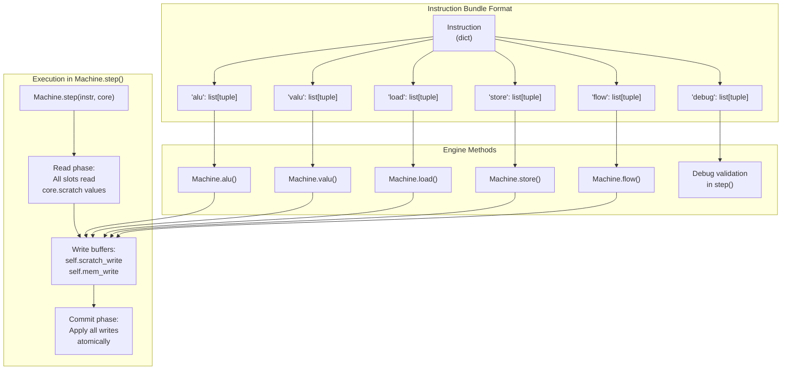
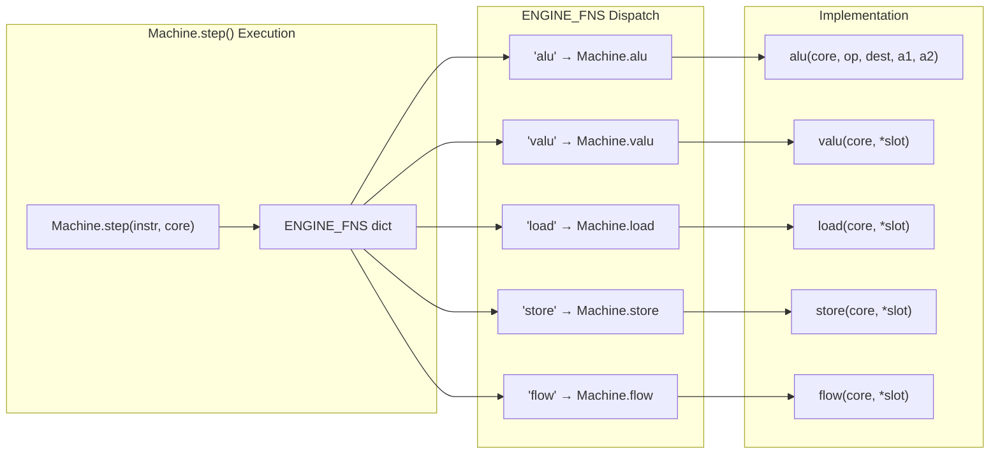

<!-- source: DeepWiki mcp.deepwiki.com · repo anthropics/original_performance_takehome · page 4.2 Instruction Set Reference · fetched 2026-10-26 -->

# Instruction Set Reference

<details>
<summary>Relevant source files</summary>

The following files were used as context for generating this wiki page:

- [problem.py](problem.py)
- [tests/frozen_problem.py](tests/frozen_problem.py)

</details>


This page provides a complete reference for all operations available in the custom VLIW SIMD machine architecture. Each instruction bundle can contain multiple operations across different engines, executed in parallel within a single cycle subject to slot limits.

For information about the execution model and cycle semantics, see [Execution Model and Cycle Semantics](#4.4). For details on memory organization and addressing, see [Memory Hierarchy](#4.3). For general VLIW SIMD architectural concepts, see [VLIW SIMD Concepts](#4.1).

## Instruction Format

An instruction is a Python dictionary mapping engine names to lists of operation tuples:

```python
Instruction = dict[Engine, list[tuple]]
Engine = Literal["alu", "load", "store", "flow", "valu", "debug"]
```

Example instruction bundle:
```python
{
    "valu": [("*", 4, 0, 0), ("+", 8, 4, 0)],
    "load": [("load", 16, 17)],
    "alu": [("+", 20, 16, 8)]
}
```

**Important addressing convention:** In general, every number in an instruction is a scratch space address, except for:
- `const` operation: the value is an immediate constant [tests/frozen_problem.py:274-274]()
- `jump` operation: the address is a program counter value [tests/frozen_problem.py:311-311]()
- `store` operations: the first operand is the memory address source [tests/frozen_problem.py:291-291]()
- Immediate offsets in certain operations (e.g., `add_imm`, `load_offset`) [tests/frozen_problem.py:272-272](), [tests/frozen_problem.py:307-307]()

Except for `store` and some `flow` operations, the **first operand after the operation name is the destination address**.

Sources: [tests/frozen_problem.py:14-16](), [tests/frozen_problem.py:86-94]()

## Instruction Structure and Execution Flow



**Diagram: Instruction Bundle Structure and Execution Path**

This diagram shows how an instruction dictionary maps to engine execution methods, and the two-phase execution model within `Machine.step()`.

Sources: [tests/frozen_problem.py:352-397](), [tests/frozen_problem.py:356-362]()

## Engine Slot Limits

Each engine can execute a limited number of operations per cycle as defined in `SLOT_LIMITS`:

| Engine | Slot Limit | Purpose |
|--------|-----------|---------|
| `alu` | 12 | Scalar arithmetic and logic operations |
| `valu` | 6 | Vector (SIMD) operations on VLEN=8 elements |
| `load` | 2 | Memory to scratch transfers, constants |
| `store` | 2 | Scratch to memory transfers |
| `flow` | 1 | Control flow, conditionals, core management |
| `debug` | 64 | Validation operations (not counted in cycles) |

Sources: [tests/frozen_problem.py:48-55](), [tests/frozen_problem.py:57]()

## ALU Engine Operations

The ALU engine performs scalar arithmetic and logical operations on scratch space values. All operations read operands and write one result. All results are computed modulo 2³².

### Operation Format

```python
("op", dest, a1, a2)
```

- `op`: Operation name (string)
- `dest`: Destination scratch address (writes result here)
- `a1`: First operand scratch address
- `a2`: Second operand scratch address

### ALU Operation Reference

| Operation | Semantics | Python Equivalent |
|-----------|-----------|-------------------|
| `"+"` | Addition | `(a1 + a2) % 2**32` |
| `"-"` | Subtraction | `(a1 - a2) % 2**32` |
| `"*"` | Multiplication | `(a1 * a2) % 2**32` |
| `"//"` | Integer division | `a1 // a2` |
| `"cdiv"` | Ceiling division | `(a1 + a2 - 1) // a2` |
| `"^"` | Bitwise XOR | `a1 ^ a2` |
| `"&"` | Bitwise AND | `a1 & a2` |
| `"\|"` | Bitwise OR | `a1 \| a2` |
| `"<<"` | Left shift | `(a1 << a2) % 2**32` |
| `">>"` | Right shift | `a1 >> a2` |
| `"%"` | Modulo | `a1 % a2` |
| `"<"` | Less than | `1` if `a1 < a2` else `0` |
| `"=="` | Equality | `1` if `a1 == a2` else `0` |

Sources: [tests/frozen_problem.py:219-252]()

## VALU Engine Operations

The VALU (Vector ALU) engine performs SIMD operations on vectors of `VLEN=8` consecutive scratch addresses.

### Operation Formats

**Standard vectorized ALU operations:**
```python
("op", dest, a1, a2)
```
Applies the ALU operation `op` to each element: for `i` in `range(VLEN)`, `scratch[dest+i] = op(scratch[a1+i], scratch[a2+i])` [tests/frozen_problem.py:263-267]().

**Vector broadcast:**
```python
("vbroadcast", dest, src)
```
Copies scalar `scratch[src]` to all 8 elements of vector starting at `dest` [tests/frozen_problem.py:255-257]().

**Fused multiply-add:**
```python
("multiply_add", dest, a, b, c)
```
Computes `scratch[dest+i] = (scratch[a+i] * scratch[b+i] + scratch[c+i]) % 2**32` for each element [tests/frozen_problem.py:258-262]().

Sources: [tests/frozen_problem.py:254-267](), [tests/frozen_problem.py:57]()

## LOAD Engine Operations

The LOAD engine transfers data from main memory to scratch space and loads immediate constants.

### Operation Formats and Reference

| Operation | Format | Semantics |
|-----------|--------|-----------|
| `"load"` | `(op, dest, addr)` | Load single word: `scratch[dest] = mem[scratch[addr]]` |
| `"load_offset"` | `(op, dest, addr, offset)` | Load with offset: `scratch[dest+offset] = mem[scratch[addr+offset]]` |
| `"vload"` | `(op, dest, addr)` | Vector load: `scratch[dest:dest+8] = mem[scratch[addr]:scratch[addr]+8]` |
| `"const"` | `(op, dest, val)` | Load constant: `scratch[dest] = val % 2**32` |

Sources: [tests/frozen_problem.py:269-286]()

## STORE Engine Operations

The STORE engine transfers data from scratch space to main memory.

### Operation Formats and Reference

| Operation | Format | Semantics |
|-----------|--------|-----------|
| `"store"` | `(op, addr, src)` | Store single word: `mem[scratch[addr]] = scratch[src]` |
| `"vstore"` | `(op, addr, src)` | Vector store: `mem[scratch[addr]:scratch[addr]+8] = scratch[src:src+8]` |

**Key point:** The **first operand is the source of the address**, not the destination [tests/frozen_problem.py:291-291](), [tests/frozen_problem.py:295-295]().

Sources: [tests/frozen_problem.py:288-298]()

## FLOW Engine Operations

The FLOW engine controls program flow and provides selection operations. Only one flow operation can execute per cycle [tests/frozen_problem.py:53]().

### Selection and Arithmetic

| Operation | Format | Semantics |
|-----------|--------|-----------|
| `"select"` | `(op, dest, cond, a, b)` | `scratch[dest] = scratch[a]` if `scratch[cond] != 0` else `scratch[b]` |
| `"vselect"` | `(op, dest, cond, a, b)` | Vectorized element-wise select |
| `"add_imm"` | `(op, dest, a, imm)` | `scratch[dest] = (scratch[a] + imm) % 2**32` |

### Control Flow

| Operation | Format | Semantics |
|-----------|--------|-----------|
| `"jump"` | `(op, addr)` | `core.pc = addr` (absolute PC) |
| `"jump_indirect"` | `(op, addr)` | `core.pc = scratch[addr]` |
| `"cond_jump"` | `(op, cond, addr)` | `core.pc = addr` if `scratch[cond] != 0` |
| `"cond_jump_rel"` | `(op, cond, offset)` | `core.pc += offset` if `scratch[cond] != 0` |

### Core and Debug

| Operation | Format | Semantics |
|-----------|--------|-----------|
| `"halt"` | `(op,)` | `core.state = CoreState.STOPPED` |
| `"pause"` | `(op,)` | `core.state = CoreState.PAUSED` |
| `"coreid"` | `(op, dest)` | `scratch[dest] = core.id` |
| `"trace_write"` | `(op, val)` | Append `scratch[val]` to `core.trace_buf` |

Sources: [tests/frozen_problem.py:300-335]()

## DEBUG Engine Operations

The DEBUG engine provides validation operations used during testing. These do not consume cycles and are only executed when `enable_debug=True` [tests/frozen_problem.py:366-381]().

| Operation | Format | Semantics |
|-----------|--------|-----------|
| `"compare"` | `(op, loc, key)` | Assert `scratch[loc] == value_trace[key]` |
| `"vcompare"` | `(op, loc, keys)` | Assert vector matches list of trace keys |

Sources: [tests/frozen_problem.py:366-381](), [tests/frozen_problem.py:54]()

## Engine Method Dispatch



**Diagram: Machine Engine Dispatch Mechanism**

This diagram illustrates how `Machine.step()` uses the `ENGINE_FNS` dictionary to route instruction slots to their respective implementation methods.

Sources: [tests/frozen_problem.py:352-397](), [tests/frozen_problem.py:217-217]()

---

