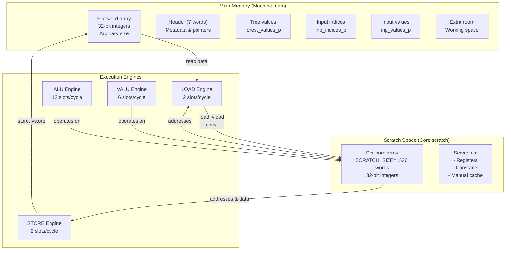
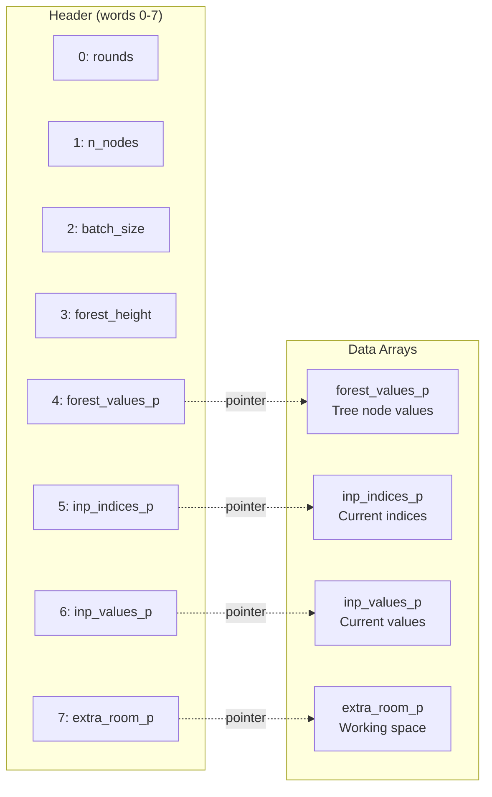
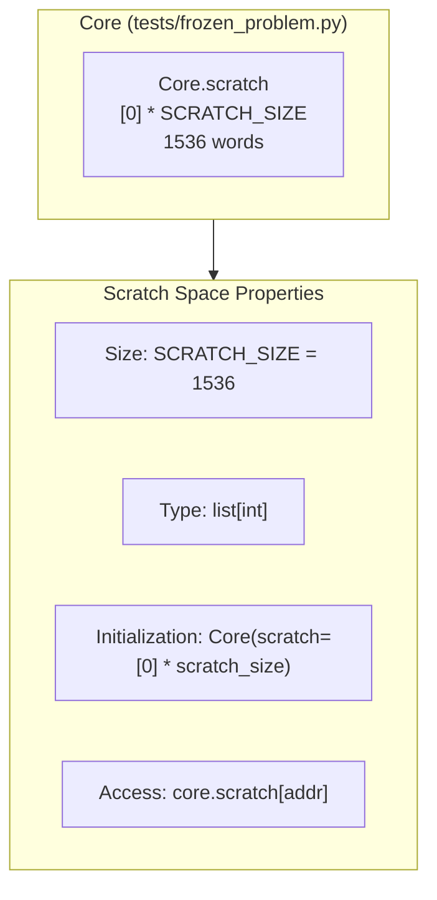
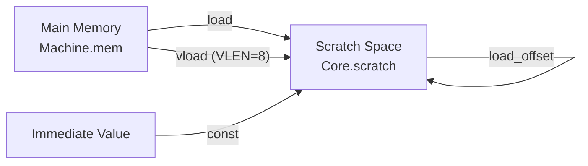
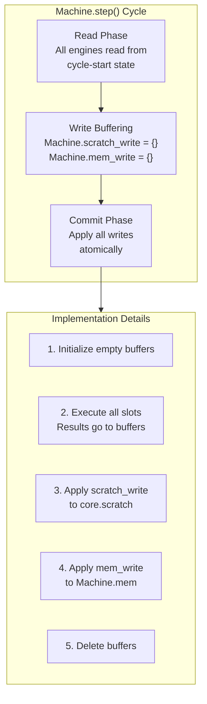

<!-- source: DeepWiki mcp.deepwiki.com · repo anthropics/original_performance_takehome · page 4.3 Memory Hierarchy · fetched 2026-10-26 -->

# Memory Hierarchy

<details>
<summary>Relevant source files</summary>

The following files were used as context for generating this wiki page:

- [problem.py](problem.py)
- [tests/frozen_problem.py](tests/frozen_problem.py)

</details>


## Purpose and Scope

This document describes the two-tier memory hierarchy implemented by the custom VLIW SIMD machine simulator. It covers the organization of main memory and scratch space, memory access operations, and the addressing model. For information about the instruction set operations that manipulate memory, see [Instruction Set Reference](#4.2). For details about the two-phase execution model that governs memory access, see [Execution Model and Cycle Semantics](#4.4).

---

## Two-Tier Memory Architecture

The machine implements a load-store architecture with two distinct memory tiers. ALU and VALU engines cannot directly access main memory; they operate exclusively on scratch space. Memory transfers occur through dedicated LOAD and STORE engines.



**Sources:** [tests/frozen_problem.py:64-95](), [tests/frozen_problem.py:107-110](), [tests/frozen_problem.py:59-61]()

---

## Main Memory

### Structure and Organization

Main memory (`self.mem`) is a flat array of 32-bit words. All values are stored modulo 2³², effectively treating the memory as unsigned 32-bit integers. The memory is initialized from a memory dump created by the `build_mem_image` function.

| Property | Value | Location |
|----------|-------|----------|
| Data type | `list[int]` | [tests/frozen_problem.py:110]() |
| Word size | 32 bits | [tests/frozen_problem.py:80-83]() |
| Initialization | `copy(mem_dump)` | [tests/frozen_problem.py:110]() |
| Addressing | Zero-indexed integers | - |

**Sources:** [tests/frozen_problem.py:110](), [tests/frozen_problem.py:80-83]()

### Memory Layout Convention

The `build_mem_image` function (defined in `perf_takehome.py`) establishes a standard memory layout convention with a 7-word header containing metadata and pointers to data regions:



**Sources:** [perf_takehome.py:487-513]()

The memory layout implementation:

```python
mem[0] = inp.rounds           # Number of traversal rounds
mem[1] = len(t.values)        # Total tree nodes
mem[2] = len(inp.indices)     # Batch size
mem[3] = t.height             # Tree height
mem[4] = forest_values_p      # Pointer to tree values array
mem[5] = inp_indices_p        # Pointer to indices array
mem[6] = inp_values_p         # Pointer to values array
mem[7] = extra_room           # Pointer to working space
```

**Sources:** [perf_takehome.py:501-508]()

### Memory Access Patterns

Main memory supports both scalar and vector access through the LOAD and STORE engines:

| Access Type | Operation | Description |
|-------------|-----------|-------------|
| Scalar load | `load` | Load single word from memory to scratch |
| Vector load | `vload` | Load VLEN=8 contiguous words |
| Scalar store | `store` | Store single word from scratch to memory |
| Vector store | `vstore` | Store VLEN=8 contiguous words |

**Sources:** [tests/frozen_problem.py:269-298]()

---

## Scratch Space

### Size and Organization

Each core maintains its own isolated scratch space. The scratch space is a flat array of 1536 words, indexed from 0 to 1535.



**Sources:** [tests/frozen_problem.py:60](), [tests/frozen_problem.py:108]()

### Multiple Roles

The scratch space serves three conceptual purposes, though they are not physically separated:

1. **Registers**: Fast temporary storage for computation results.
2. **Constant memory**: Storage for program constants loaded via `const` operation.
3. **Manual cache**: User-managed cache for frequently accessed main memory data.

The `KernelBuilder` (in `perf_takehome.py`) allocates scratch space addresses and tracks their usage through the `alloc_scratch` helper method. The `DebugInfo.scratch_map` provides symbolic names for scratch regions, mapping addresses to `(name, length)` tuples.

**Sources:** [tests/frozen_problem.py:80-83](), [tests/frozen_problem.py:40-42](), [tests/frozen_problem.py:140-144]()

### Per-Core Isolation

With `N_CORES = 1`, the current implementation uses a single core. However, the architecture supports multiple cores, each with its own isolated scratch space. The `Core` dataclass encapsulates this:

```python
@dataclass
class Core:
    id: int
    scratch: list[int]
    trace_buf: list[int]
    pc: int = 0
    state: CoreState = CoreState.RUNNING
```

**Sources:** [tests/frozen_problem.py:24-31](), [tests/frozen_problem.py:59]()

---

## Memory Transfer Operations

### LOAD Engine Operations

The LOAD engine provides operations to transfer data from main memory to scratch space. It can execute up to 2 slots per cycle.



| Operation | Syntax | Description |
|-----------|--------|-------------|
| `load` | `("load", dest, addr)` | Load `mem[scratch[addr]]` to `scratch[dest]` |
| `load_offset` | `("load_offset", dest, addr, offset)` | Load `mem[scratch[addr+offset]]` to `scratch[dest+offset]` |
| `vload` | `("vload", dest, addr)` | Load 8 contiguous words from `mem[scratch[addr]:scratch[addr]+8]` |
| `const` | `("const", dest, val)` | Load immediate value `val` to `scratch[dest]` |

**Sources:** [tests/frozen_problem.py:269-286](), [tests/frozen_problem.py:48-55]()

**Implementation Details:**

The `load` operation uses indirect addressing - the address stored in scratch space is used to access main memory:

```python
case ("load", dest, addr):
    self.scratch_write[dest] = self.mem[core.scratch[addr]]
```

The `vload` operation loads VLEN=8 contiguous words in a single slot:

```python
case ("vload", dest, addr):
    addr = core.scratch[addr]
    for vi in range(VLEN):
        self.scratch_write[dest + vi] = self.mem[addr + vi]
```

**Sources:** [tests/frozen_problem.py:271-282]()

### STORE Engine Operations

The STORE engine transfers data from scratch space to main memory. It can also execute up to 2 slots per cycle.


| Operation | Syntax | Description |
|-----------|--------|-------------|
| `store` | `("store", addr, src)` | Store `scratch[src]` to `mem[scratch[addr]]` |
| `vstore` | `("vstore", addr, src)` | Store 8 contiguous words to `mem[scratch[addr]:scratch[addr]+8]` |

**Implementation:**

```python
case ("store", addr, src):
    addr = core.scratch[addr]
    self.mem_write[addr] = core.scratch[src]

case ("vstore", addr, src):
    addr = core.scratch[addr]
    for vi in range(VLEN):
        self.mem_write[addr + vi] = core.scratch[src + vi]
```

**Sources:** [tests/frozen_problem.py:288-298]()

---

## Two-Phase Memory Commit Model

Memory operations use a two-phase commit model to enable parallel execution within a single cycle. This ensures deterministic behavior when multiple operations in the same instruction bundle access memory.



**Sources:** [tests/frozen_problem.py:352-397]()

### Read Phase

During the read phase, all operations read from the memory and scratch state as it existed at the start of the cycle. The `step` method initializes empty write buffers:

```python
self.scratch_write = {}
self.mem_write = {}
```

All read operations access `core.scratch[addr]` or `self.mem[addr]` directly, seeing the state from the beginning of the cycle.

**Sources:** [tests/frozen_problem.py:363-364]()

### Write Buffering

Operations accumulate their results in write buffers rather than modifying memory directly:

```python
# Example from alu operation
self.scratch_write[dest] = res

# Example from load operation
self.scratch_write[dest] = self.mem[core.scratch[addr]]

# Example from store operation
self.mem_write[addr] = core.scratch[src]
```

**Sources:** [tests/frozen_problem.py:252](), [tests/frozen_problem.py:273](), [tests/frozen_problem.py:292]()

### Commit Phase

After all engines execute their slots, writes are committed atomically:

```python
for addr, val in self.scratch_write.items():
    core.scratch[addr] = val
for addr, val in self.mem_write.items():
    self.mem[addr] = val

del self.scratch_write
del self.mem_write
```

This ensures that:
1. All reads see consistent state from the cycle start.
2. All writes become visible simultaneously at cycle end.
3. There are no read-after-write hazards within a cycle.
4. Parallel execution is deterministic.

**Sources:** [tests/frozen_problem.py:388-397]()

---

## Addressing Conventions

### Scratch Space Addressing

Scratch addresses are direct zero-indexed offsets into the `core.scratch` array. Most instruction operands are scratch addresses:

- Scalar operations use single addresses: `scratch[addr]`
- Vector operations use base addresses: `scratch[base], scratch[base+1], ..., scratch[base+VLEN-1]`

The general convention from the `Machine` class docstring:

> In general every number in an instruction is a scratch address except for const and jump, and except for store and some flow instructions the first operand is the destination.

**Sources:** [tests/frozen_problem.py:86-91]()

### Main Memory Addressing

Main memory uses indirect addressing through scratch space. To access `mem[N]`, you must:

1. Load the address N into a scratch location using `const`.
2. Use that scratch address in a `load` or `store` operation.

Example addressing pattern for loading from `mem[100]`:

```
{"load": [("const", 0, 100)]}        # scratch[0] = 100
{"load": [("load", 1, 0)]}           # scratch[1] = mem[scratch[0]] = mem[100]
```

**Sources:** [tests/frozen_problem.py:269-298]()

### Vector Addressing

Vector operations access VLEN=8 contiguous elements. The base address must refer to the start of an 8-word aligned region:

```python
# vload example
("vload", dest, addr)
# Loads: mem[scratch[addr]], mem[scratch[addr]+1], ..., mem[scratch[addr]+7]
# Into:  scratch[dest], scratch[dest+1], ..., scratch[dest+7]
```

**Sources:** [tests/frozen_problem.py:279-282](), [tests/frozen_problem.py:57]()

---

## Memory Constraints and Considerations

### Size Limits

| Resource | Limit | Constant |
|----------|-------|----------|
| Scratch space per core | 1536 words | `SCRATCH_SIZE` |
| Main memory | Arbitrary size | Depends on problem |
| Vector length | 8 words | `VLEN` |

**Sources:** [tests/frozen_problem.py:57](), [tests/frozen_problem.py:60]()

### Access Bandwidth

The LOAD and STORE engines limit memory bandwidth:

- Maximum 2 scalar loads per cycle.
- Maximum 2 scalar stores per cycle.
- Each `vload` or `vstore` consumes one slot but transfers 8 words.

This creates a bottleneck for memory-intensive operations. Effective optimization requires:
1. Maximizing scratch space reuse.
2. Using vector operations for bulk transfers.
3. Minimizing memory round-trips.

**Sources:** [tests/frozen_problem.py:48-55]()

### Alignment and Packing

The machine does not enforce alignment constraints, but vector operations expect contiguous storage:

- `vload` and `vstore` access sequential addresses.
- Scratch space for vectors should be allocated in contiguous blocks.
- The `KernelBuilder` (in `perf_takehome.py`) must manage allocation to prevent overlaps.

**Sources:** [tests/frozen_problem.py:279-296]()

---

