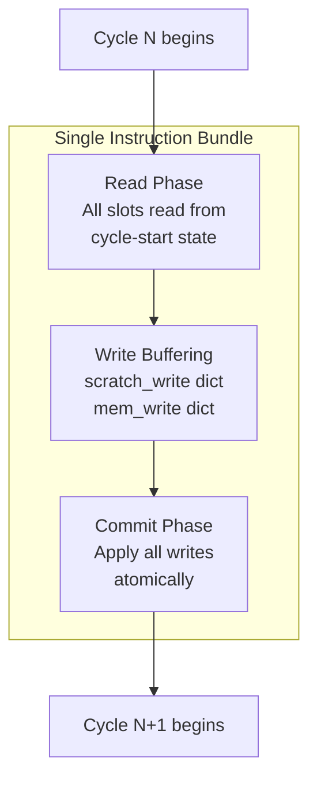
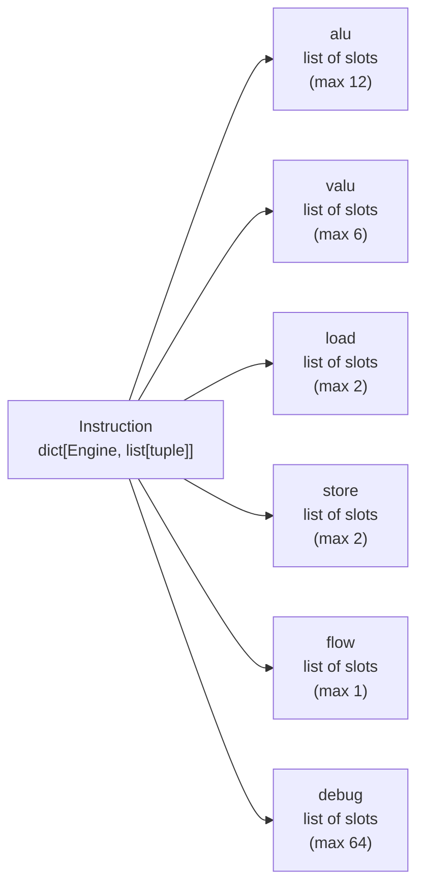
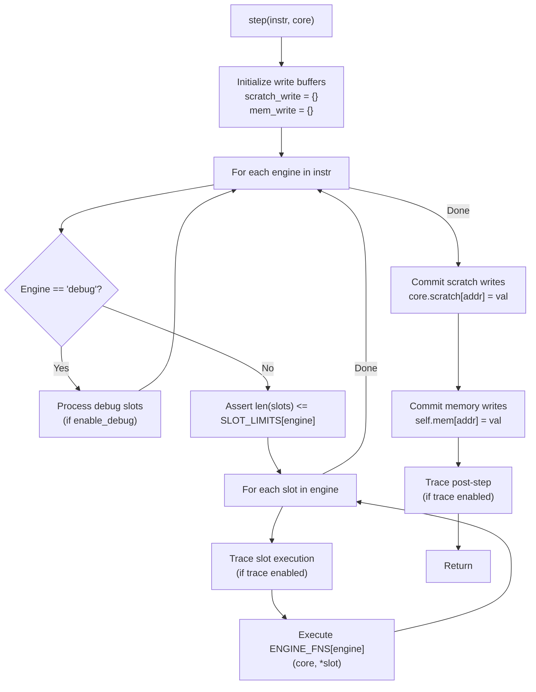
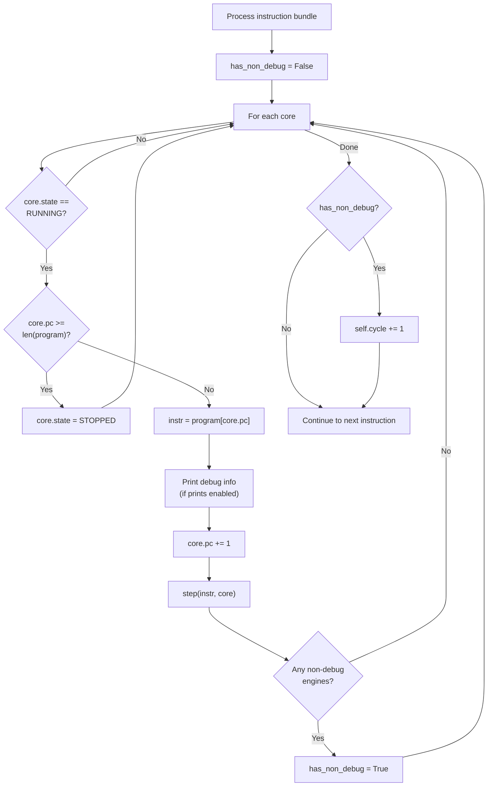
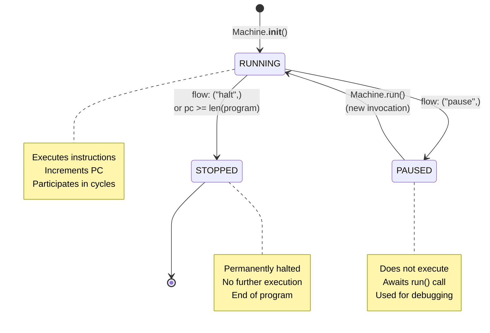
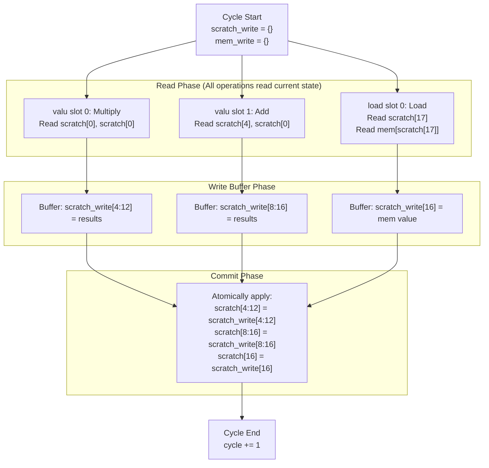

<!-- source: DeepWiki mcp.deepwiki.com · repo anthropics/original_performance_takehome · page 4.4 Execution Model and Cycle Semantics · fetched 2026-10-26 -->

# Execution Model and Cycle Semantics

<details>
<summary>Relevant source files</summary>

The following files were used as context for generating this wiki page:

- [problem.py](problem.py)
- [tests/frozen_problem.py](tests/frozen_problem.py)

</details>


## Purpose and Scope

This document explains how the `Machine` simulator executes instruction bundles and counts cycles. It details the two-phase commit execution model that enables deterministic parallel execution, the rules for cycle counting, and the semantics of instruction execution within a single cycle.

For information about the specific instruction types and their operations, see [Instruction Set Reference](#4.2). For details on the memory system accessed during execution, see [Memory Hierarchy](#4.3).

**Sources:** [tests/frozen_problem.py:64-403](), [problem.py:64-403]()

## Two-Phase Execution Model

The `Machine` implements a **two-phase commit execution model** to ensure deterministic parallel execution. This model prevents race conditions when multiple slots execute simultaneously within a single cycle.

### Execution Phases

Each cycle consists of three distinct phases:

1. **Read Phase**: All engine slots read their operands from the current state of scratch space and memory.
2. **Write Buffering**: All write operations are buffered in temporary dictionaries (`scratch_write` and `mem_write`).
3. **Commit Phase**: All buffered writes are applied atomically to scratch space and memory.

This ensures that all operations within a single instruction bundle see a consistent view of memory and scratch space at the start of the cycle, regardless of execution order.



**Diagram: Two-Phase Execution Cycle**

**Sources:** [tests/frozen_problem.py:352-397](), [problem.py:352-397]()

### Implementation Details

The `step()` method in the `Machine` class implements this two-phase model:

| Phase | Implementation | Code Reference |
|-------|---------------|----------------|
| **Initialization** | Create empty write buffers | [tests/frozen_problem.py:363-364]() |
| **Read & Buffer** | Execute all engine slots, populating write buffers | [tests/frozen_problem.py:365-387]() |
| **Commit** | Apply buffered writes to actual state | [tests/frozen_problem.py:388-391]() |
| **Cleanup** | Delete write buffers | [tests/frozen_problem.py:396-397]() |

The write buffers are implemented as dictionaries:

```python
self.scratch_write = {}  # Maps scratch_addr -> value
self.mem_write = {}      # Maps mem_addr -> value
```

Each engine operation writes to these buffers rather than directly modifying state. For example, the ALU operation at [tests/frozen_problem.py:252]() writes `self.scratch_write[dest] = res` rather than `core.scratch[dest] = res`.

**Sources:** [tests/frozen_problem.py:352-397](), [problem.py:352-397]()

## Instruction Bundle Execution

An instruction bundle is a dictionary mapping engine names to lists of operation slots. All slots in the bundle execute in parallel within a single cycle, subject to slot limits per engine.

### Bundle Structure



**Diagram: Instruction Bundle Structure**

**Sources:** [tests/frozen_problem.py:14-15](), [tests/frozen_problem.py:48-55]()

### Execution Flow

The `step()` method processes an instruction bundle as follows:



**Diagram: Instruction Bundle Execution Flow**

**Sources:** [tests/frozen_problem.py:352-397](), [problem.py:352-397]()

### Engine Functions

The `step()` method dispatches to engine-specific functions through the `ENGINE_FNS` dictionary:

| Engine | Function | Purpose |
|--------|----------|---------|
| `alu` | `self.alu()` | Scalar arithmetic operations on scratch space |
| `valu` | `self.valu()` | Vector arithmetic operations (VLEN=8) |
| `load` | `self.load()` | Load from memory to scratch space |
| `store` | `self.store()` | Store from scratch space to memory |
| `flow` | `self.flow()` | Control flow and special operations |

**Sources:** [tests/frozen_problem.py:356-362](), [tests/frozen_problem.py:219-335]()

## Cycle Counting Rules

Cycles are counted in the `run()` method based on specific rules that determine what constitutes a meaningful computational cycle.

### Cycle Counter Increment Logic



**Diagram: Cycle Counting Logic**

The key rules are:

1. **Debug Instructions Don't Count**: Instructions containing only `debug` engine operations do not increment the cycle counter.
2. **One Increment Per Round**: The cycle counter increments at most once per iteration of the main loop, even with multiple cores (though `N_CORES` is currently 1).
3. **Non-Running Cores**: Paused or stopped cores do not prevent cycle counting if other cores are running.

This is implemented at [tests/frozen_problem.py:214-217]():

```python
if any(name != "debug" for name in instr.keys()):
    has_non_debug = True
if has_non_debug:
    self.cycle += 1
```

**Sources:** [tests/frozen_problem.py:197-217](), [problem.py:197-217]()

### What Counts as a Cycle

| Scenario | Cycle Count | Reason |
|----------|-------------|--------|
| Instruction with ALU, LOAD, or STORE operations | +1 | Contains computational work |
| Instruction with only `debug` operations | +0 | Debug operations are for validation only |
| Multiple cores executing in parallel | +1 | All cores execute simultaneously in one cycle |
| Core in PAUSED or STOPPED state | +0 (for that core) | Core is not actively executing |
| Empty instruction (no engines) | +1 | Still consumes a cycle if non-debug engines are absent but keys exist |

**Sources:** [tests/frozen_problem.py:214-217]()

## Core State Management

Each core maintains a state that controls its participation in execution. The `CoreState` enum defines three states:



**Diagram: Core State Transitions**

### State Definitions

- **RUNNING**: Core actively executes instructions, advancing its program counter each cycle.
- **PAUSED**: Core temporarily halts execution but can be resumed by calling `run()` again. Enabled by the `enable_pause` flag.
- **STOPPED**: Core has permanently completed execution, either by reaching the end of the program or executing a `halt` instruction.

The states are defined at [tests/frozen_problem.py:18-21]() and managed in the `Core` dataclass at [tests/frozen_problem.py:24-30]().

**Sources:** [tests/frozen_problem.py:18-30](), [tests/frozen_problem.py:197-217](), [tests/frozen_problem.py:315-319]()

### State Transitions in Code

| Transition | Triggered By | Code Location |
|------------|--------------|---------------|
| Init → RUNNING | Core creation | [tests/frozen_problem.py:30]() |
| PAUSED → RUNNING | `run()` method start | [tests/frozen_problem.py:198-200]() |
| RUNNING → STOPPED | PC exceeds program length | [tests/frozen_problem.py:206-208]() |
| RUNNING → STOPPED | `halt` flow instruction | [tests/frozen_problem.py:315-316]() |
| RUNNING → PAUSED | `pause` flow instruction | [tests/frozen_problem.py:317-319]() |

**Sources:** [tests/frozen_problem.py:197-217](), [tests/frozen_problem.py:315-319]()

## Parallel Execution Within a Cycle

Multiple operations execute simultaneously within a single cycle, limited only by the slot constraints per engine. The two-phase commit model ensures deterministic results regardless of internal execution order.

### Slot Parallelism

Each engine can execute multiple slots in parallel:

| Engine | Slot Limit | Description |
|--------|-----------|-------------|
| `alu` | 12 | Up to 12 scalar operations per cycle |
| `valu` | 6 | Up to 6 vector operations (8 elements each) per cycle |
| `load` | 2 | Up to 2 memory reads per cycle |
| `store` | 2 | Up to 2 memory writes per cycle |
| `flow` | 1 | One control flow operation per cycle |
| `debug` | 64 | Up to 64 debug operations (don't count toward cycles) |

The limits are enforced at [tests/frozen_problem.py:383]() with an assertion: `assert len(slots) <= SLOT_LIMITS[name]`

**Sources:** [tests/frozen_problem.py:48-55](), [tests/frozen_problem.py:383]()

### Example: Parallel Execution

Consider this instruction bundle:

```python
{
    "valu": [("*", 4, 0, 0), ("+", 8, 4, 0)],
    "load": [("load", 16, 17)]
}
```

Execution sequence:



**Diagram: Example Parallel Execution**

Key observations:

1. All three operations read from the scratch/memory state at the start of the cycle.
2. The multiply operation at `scratch[4]` and the add operation at `scratch[8]` don't interfere with each other.
3. Even though the multiply writes to `scratch[4]` and the add reads from `scratch[4]`, the add sees the value from the start of the cycle, not the result of the multiply.
4. All writes are applied atomically at the end.

**Sources:** [tests/frozen_problem.py:352-397](), [tests/frozen_problem.py:254-267](), [tests/frozen_problem.py:269-286]()

### Deterministic Execution Guarantees

The two-phase model provides these guarantees:

1. **Read Consistency**: All operations within a cycle see the same initial state.
2. **Write Atomicity**: All writes appear to happen simultaneously at cycle end.
3. **Order Independence**: The execution order of slots within an engine doesn't affect the result.
4. **No Read-After-Write Within Cycle**: Operations cannot see the results of other operations in the same cycle.

These properties enable aggressive parallelization while maintaining predictable semantics, making the simulator easier to reason about and optimize for.

**Sources:** [tests/frozen_problem.py:352-397](), [problem.py:352-397]()

---

