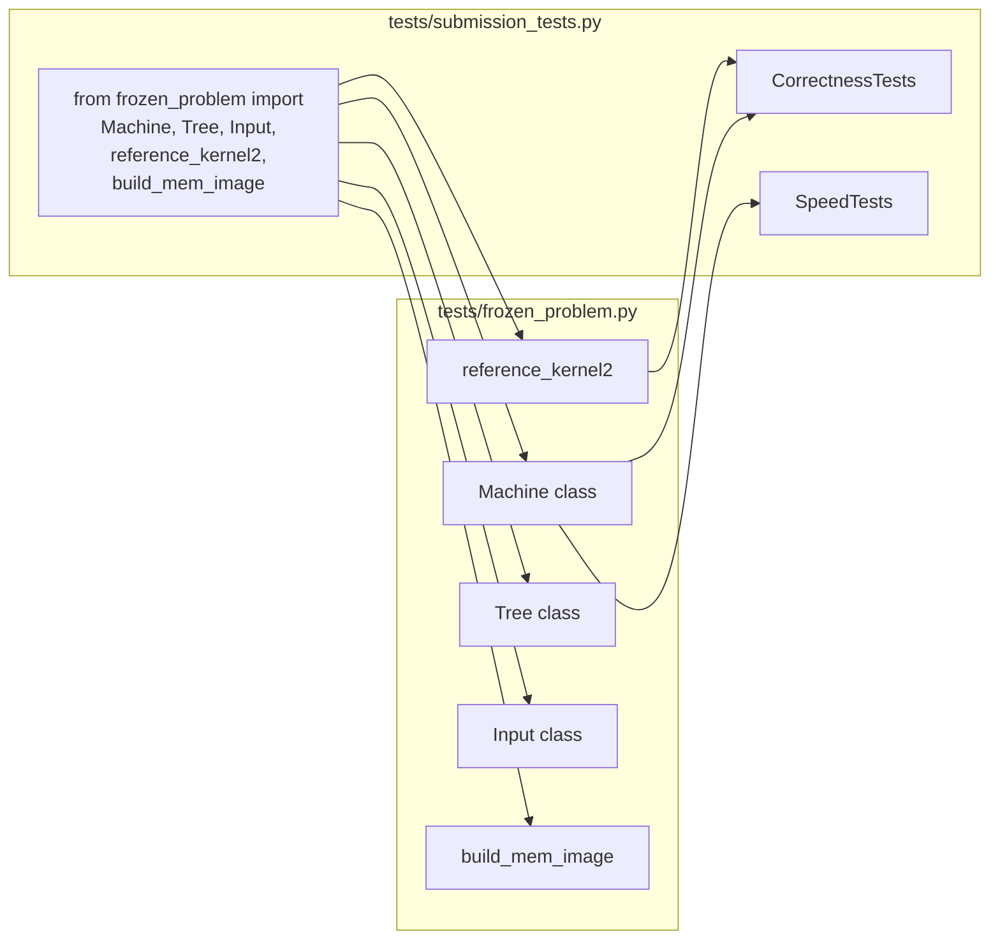
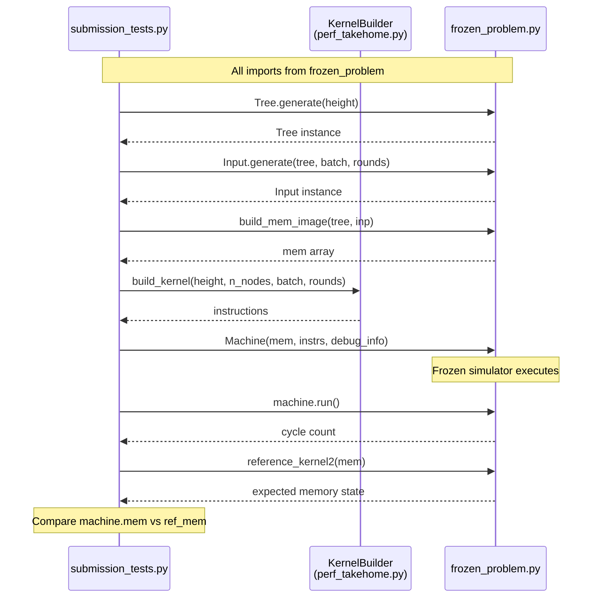
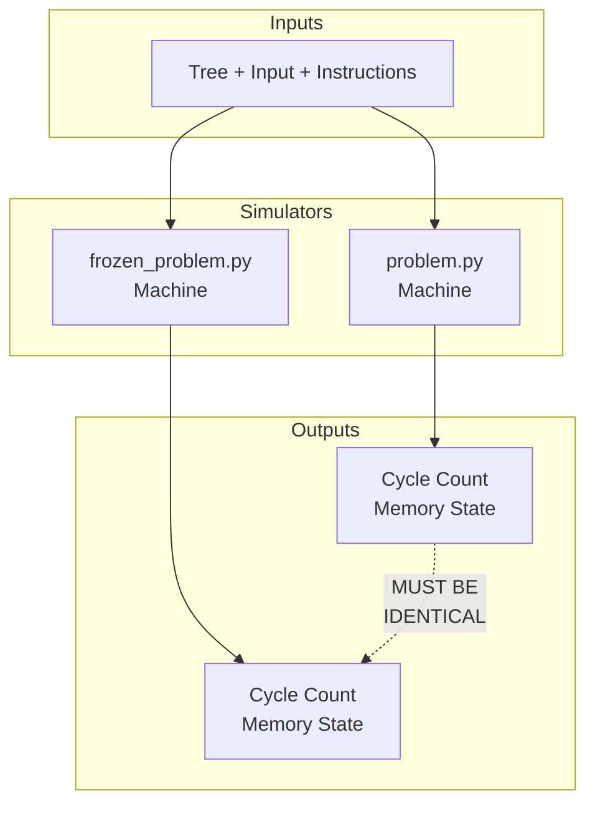
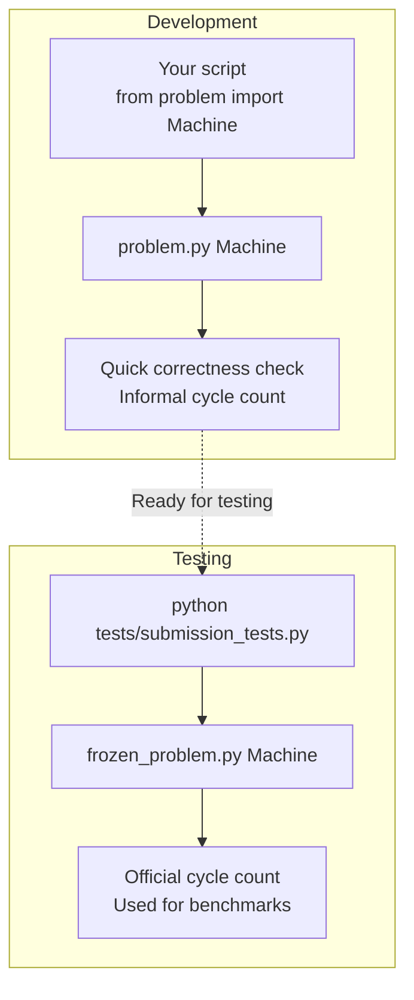

<!-- source: DeepWiki mcp.deepwiki.com · repo anthropics/original_performance_takehome · page 4.5 Frozen vs Development Simulators · fetched 2026-10-26 -->

# Frozen vs Development Simulators

<details>
<summary>Relevant source files</summary>

The following files were used as context for generating this wiki page:

- [problem.py](problem.py)
- [tests/frozen_problem.py](tests/frozen_problem.py)

</details>


This page explains why the repository contains two nearly identical simulator implementations and when to use each one. For details about the simulator architecture itself, see [Machine Architecture](#4). For information about running tests, see [Test Suite Structure](#6.1).

## Purpose and Scope

The repository maintains two separate implementations of the VLIW SIMD machine simulator: a frozen version for testing and a development version for iteration. This separation ensures fair performance comparison across different optimization attempts while allowing developers to experiment with simulator modifications during development.

## Why Two Simulator Versions Exist

The repository contains two functionally identical files:
- [problem.py:1-569]() - Development simulator
- [tests/frozen_problem.py:1-569]() - Frozen simulator for testing

Both files contain the same classes and functions:
- `Machine` - The VLIW SIMD simulator [problem.py:64-95]() [tests/frozen_problem.py:64-95]()
- `Core` - Dataclass representing core state [problem.py:24-31]() [tests/frozen_problem.py:24-31]()
- `DebugInfo` - Metadata for variable mapping [problem.py:33-42]() [tests/frozen_problem.py:33-42]()
- Supporting constants: `SLOT_LIMITS`, `VLEN`, `N_CORES`, `SCRATCH_SIZE` [problem.py:48-61]() [tests/frozen_problem.py:48-61]()

**Sources:** [problem.py:1-7](), [tests/frozen_problem.py:1-7]()

## The Frozen Simulator: Ensuring Fair Comparison

### Purpose

The frozen simulator in [tests/frozen_problem.py]() serves as the immutable reference implementation used by all submission tests. This guarantees that:

1. **Consistent validation** - All optimizations are validated against the same reference implementation.
2. **Fair benchmarking** - Cycle counts are measured using identical execution semantics.
3. **Reproducible results** - Test results remain stable across development sessions.

### Usage in Testing

The submission test suite imports exclusively from the frozen simulator to ensure that any local changes to `problem.py` do not accidentally invalidate benchmark results.

**Code Entity Mapping: Test Suite to Frozen Entities**


**Sources:** [tests/submission_tests.py:11-19]()

### Test Execution Flow

The test suite orchestrates the relationship between your optimized `KernelBuilder` and the `Machine` simulator defined in the frozen file.

**Sequence: Execution using Frozen Machine**


**Sources:** [tests/submission_tests.py:30-54]()

## The Development Simulator: Enabling Experimentation

### Purpose

The development simulator in [problem.py]() serves several purposes:

1. **Debugging tool** - Can be modified to add logging, assertions, or custom instrumentation.
2. **Experimentation** - Test hypothetical ISA extensions or execution model changes.
3. **Understanding** - Read and study the simulator without worrying about breaking tests.
4. **Trace generation** - Enable tracing during development without affecting test imports.

### When to Use the Development Simulator

Use [problem.py]() when:

| Scenario | Example |
|----------|---------|
| **Local testing** | Manually running your `KernelBuilder` to check correctness before running full tests. |
| **Debugging** | Adding print statements to `Machine.step()` to understand instruction execution. |
| **Trace generation** | Running with `trace=True` to generate Perfetto traces. |
| **ISA experimentation** | Testing whether a new instruction type would help your optimization. |
| **Learning** | Understanding how the VLIW execution model works. |

**Sources:** [problem.py:64-122](), [problem.py:151-196]()

## Key Architectural Guarantee

Both simulators implement **identical execution semantics**. The implementations are byte-for-byte copies (or nearly so), ensuring that results are consistent.

**System Mapping: Consistency between Implementations**


Both simulators share:
- **Same slot limits:** `SLOT_LIMITS` defined in [problem.py:48-55]() and [tests/frozen_problem.py:48-55]().
- **Same SIMD width:** `VLEN = 8` [problem.py:57]().
- **Same scratch size:** `SCRATCH_SIZE = 1536` [problem.py:60]().
- **Identical instruction semantics** in `run()` and internal engine processing [problem.py:197-217]().

**Sources:** [problem.py:48-61](), [tests/frozen_problem.py:48-61](), [problem.py:197-217](), [tests/frozen_problem.py:197-217]()

## Practical Implications

### For Optimization Work

| Activity | Use Simulator | Rationale |
|----------|---------------|-----------|
| **Running submission tests** | Frozen (automatic) | Tests always import from `frozen_problem` [tests/submission_tests.py:11-19](). |
| **Debugging your KernelBuilder** | Development | Can add instrumentation without affecting tests. |
| **Generating traces** | Development | Trace files don't affect test results [problem.py:160](). |
| **Understanding ISA** | Development | Study and experiment freely. |
| **Measuring final performance** | Frozen (automatic) | Tests provide official cycle counts. |

### What You Can Modify

**Development simulator (`problem.py`):**
- ✅ Add debug prints to `Machine.print_step()` [problem.py:134-139]().
- ✅ Modify `setup_trace()` to capture additional events [problem.py:151-196]().
- ✅ Add assertions to validate assumptions.

**Frozen simulator (`tests/frozen_problem.py`):**
- ❌ Do not modify - changes won't be used by the official benchmarking suite.
- ❌ Even if modified locally, the repository structure treats this as a read-only snapshot for testing.

### Performance Measurement Flow



**Sources:** [tests/submission_tests.py:30-54](), [tests/submission_tests.py:66-73]()

## The Copy Comment

Both files begin with this explanatory comment, reinforcing the design intent:

```python
"""
Read the top of perf_takehome.py for more introduction.

This file is separate mostly for ease of copying it to freeze the machine and
reference kernel for testing.
"""
```

**Sources:** [problem.py:1-6](), [tests/frozen_problem.py:1-6]()

---

