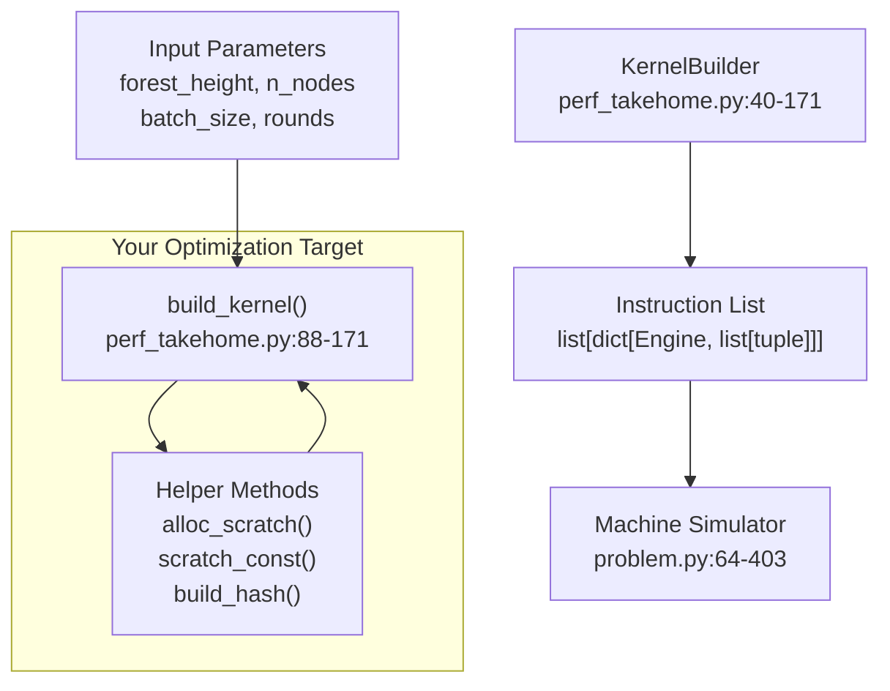
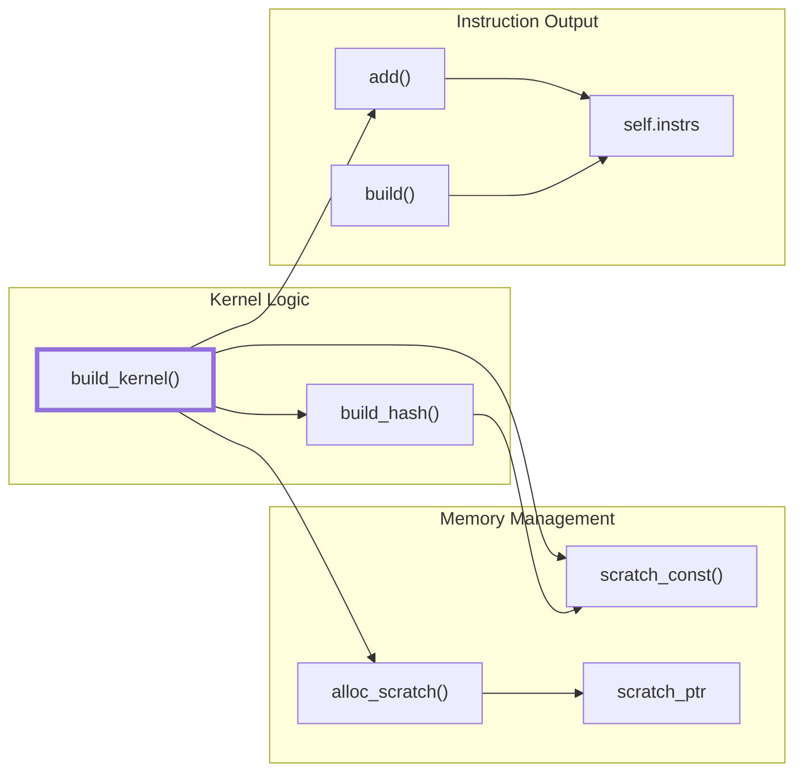

<!-- source: DeepWiki mcp.deepwiki.com · repo anthropics/original_performance_takehome · page 5 Kernel Builder - The Optimization Target · fetched 2026-10-26 -->

# Kernel Builder - The Optimization Target

Relevant source files

The following files were used as context for generating this wiki page:

- [perf_takehome.py](perf_takehome.py)

This document provides high-level documentation of the `KernelBuilder` class in [perf_takehome.py:40-171](), which is the **primary optimization target** of the performance challenge. The `KernelBuilder` is responsible for generating VLIW instruction bundles that execute the tree traversal algorithm on the custom simulator.

## KernelBuilder Role and Responsibilities

The `KernelBuilder` sits between the problem definition and the simulator, translating high-level algorithm structure into low-level VLIW instructions. It handles memory management for "scratch space" (the processor's fast local memory) and the assembly of instruction bundles.

Sources: [perf_takehome.py:40-171](), [problem.py:64-403]()

## Key Components

### KernelBuilder Class Overview
The class maintains the state of the kernel being built, including the instruction stream (`instrs`), a mapping of scratch space variables (`scratch`), and a constant cache (`const_map`). It provides the foundational API for allocating memory and adding operations to the execution pipeline.

For details, see [KernelBuilder Class Overview](#5.1).

### The build_kernel Method
This is the core method where the optimization challenge takes place. It implements the tree traversal logic by generating a sequence of instructions. The baseline implementation is a scalar, unrolled loop that processes one batch element at a time, resulting in a cycle count of approximately 147,734.

For details, see [The build_kernel Method](#5.2).

### Helper Methods and Utilities
The builder includes utility methods to simplify instruction generation:
*   `alloc_scratch`: Manages the limited `SCRATCH_SIZE` (1536 words) by allocating addresses for variables.
*   `scratch_const`: Loads a constant into scratch space and deduplicates it to save memory.
*   `build_hash`: Generates the 24-slot sequence required for the multi-stage hashing algorithm.

For details, see [Helper Methods and Utilities](#5.3).

### Optimization Strategies and Patterns
To reach the recruitment gate (1,487 cycles) or the top AI benchmarks (1,363 cycles), the kernel must be transformed from scalar execution to highly parallel VLIW/SIMD execution. This involves packing multiple operations into a single cycle and using vector instructions (`valu`, `vload`) to process 8 elements (the `VLEN`) simultaneously.

For details, see [Optimization Strategies and Patterns](#5.4).

## System Entity Mapping

The following diagram maps the high-level builder concepts to the specific code entities in the repository.

Sources: [perf_takehome.py:40-171]()

## Summary of Optimization Target

| Feature | Baseline Implementation | Optimization Goal |
| :--- | :--- | :--- |
| **Instruction Packing** | 1 slot per cycle [perf_takehome.py:54-56]() | Up to 23 slots per cycle [problem.py:48-55]() |
| **Data Width** | Scalar (1 element) | Vectorized (8 elements/`VLEN`) [problem.py:57]() |
| **Engine Usage** | `alu`, `load`, `store` | `valu`, `vload`, `vstore`, `flow` |
| **Cycle Count** | 147,734 | < 1,487 |

Sources: [perf_takehome.py:176](), [problem.py:48-57]()

---

