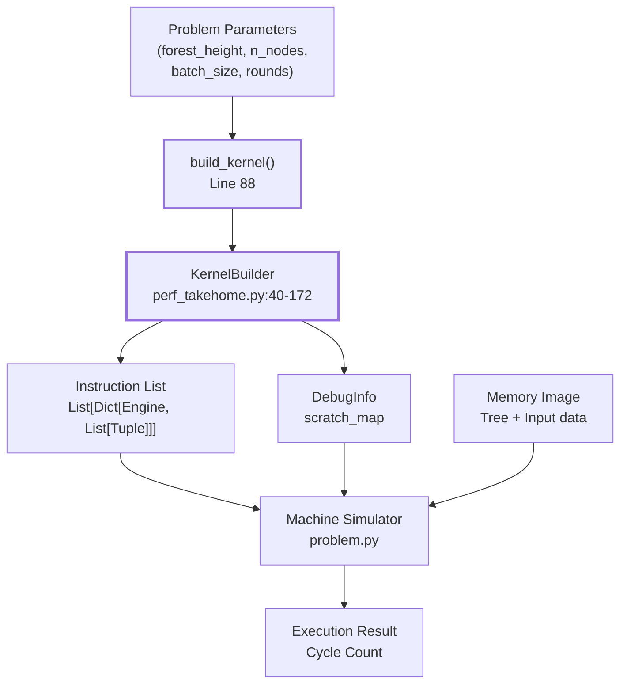
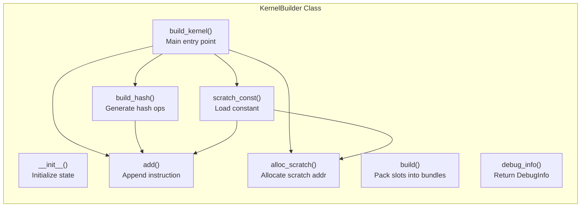
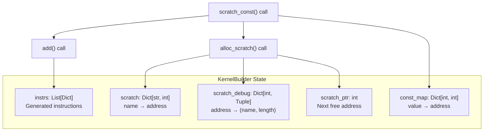
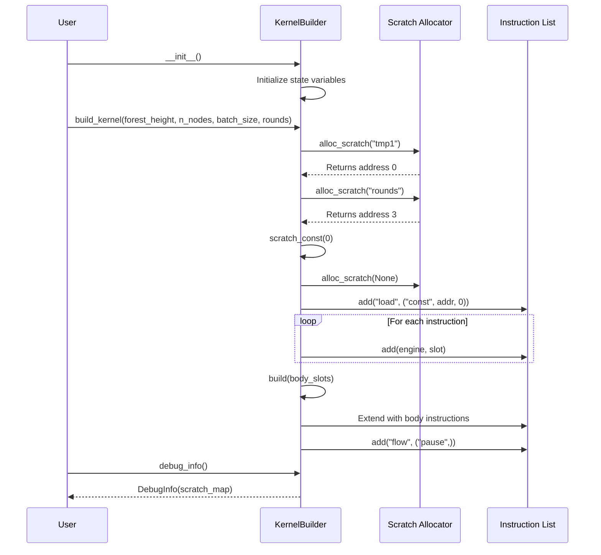
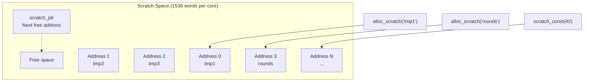
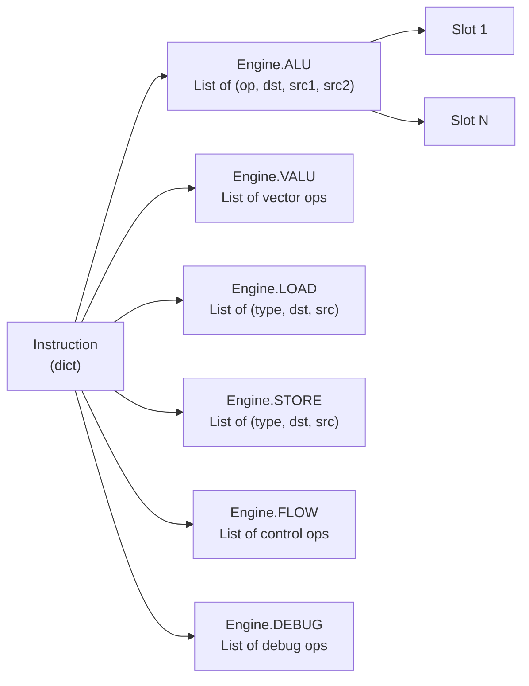
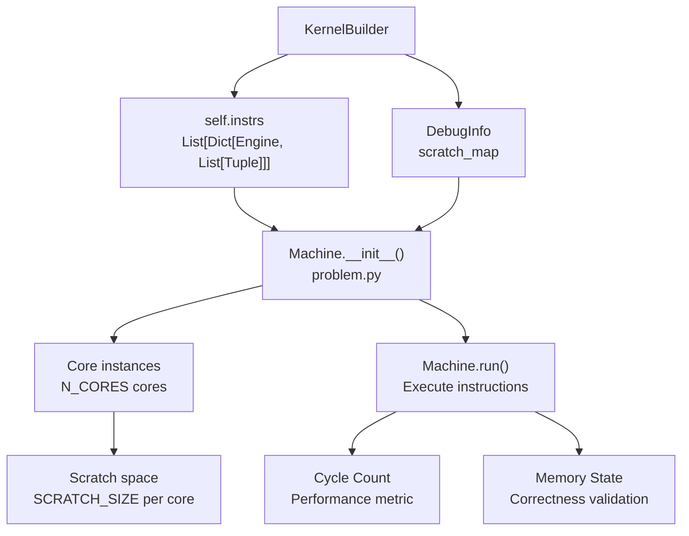

<!-- source: DeepWiki mcp.deepwiki.com · repo anthropics/original_performance_takehome · page 5.1 KernelBuilder Class Overview · fetched 2026-10-26 -->

# KernelBuilder Class Overview

<details>
<summary>Relevant source files</summary>

The following files were used as context for generating this wiki page:

- [perf_takehome.py](perf_takehome.py)

</details>


## Purpose and Scope

This document provides an overview of the `KernelBuilder` class defined in [perf_takehome.py:40-172](). The `KernelBuilder` is the primary optimization target in this performance benchmark—it generates instruction sequences that execute on the custom VLIW SIMD machine simulator. This page covers the class's role, structure, and responsibilities. For detailed implementation of specific methods, see [The build_kernel Method](5.2) and [Helper Methods and Utilities](5.3).

**Sources:** [perf_takehome.py:1-17](), [perf_takehome.py:40-172]()

## Role in System Architecture

The `KernelBuilder` sits at the center of the optimization challenge, transforming problem parameters into executable instruction sequences:



**Diagram: KernelBuilder in the execution pipeline**

The `KernelBuilder` receives dimensional information about the problem (tree height, batch size, etc.) and produces:
1. A list of instruction bundles (`self.instrs`) that the `Machine` simulator executes [perf_takehome.py:42]().
2. Debug information (`DebugInfo`) that maps scratch addresses to variable names for tracing [perf_takehome.py:48-49]().

**Sources:** [perf_takehome.py:40-50](), [perf_takehome.py:88-172](), [problem.py:288-305]()

## Class Structure and Responsibilities

The `KernelBuilder` class is defined at [perf_takehome.py:40-172]() and has three primary responsibilities:

| Responsibility | Description | Key Methods |
|---|---|---|
| **Instruction Generation** | Create VLIW instruction bundles for the target architecture | `add()`, `build()`, `build_kernel()` |
| **Scratch Memory Management** | Allocate and track scratch space addresses | `alloc_scratch()`, `scratch_const()` |
| **Constant Optimization** | Deduplicate and reuse constant values | `scratch_const()` via `const_map` |



**Diagram: KernelBuilder method relationships**

**Sources:** [perf_takehome.py:40-172]()

## Instance Variables

The `KernelBuilder` maintains state across instruction generation in several instance variables initialized at [perf_takehome.py:41-46]():

| Variable | Type | Purpose | Initialized To |
|---|---|---|---|
| `instrs` | `list` | Accumulates generated instruction bundles | `[]` |
| `scratch` | `dict` | Maps variable names to scratch addresses | `{}` |
| `scratch_debug` | `dict` | Maps scratch addresses to `(name, length)` tuples for debugging | `{}` |
| `scratch_ptr` | `int` | Current scratch space allocation pointer | `0` |
| `const_map` | `dict` | Maps constant values to their scratch addresses (deduplication) | `{}` |



**Diagram: Instance variable usage pattern**

**Sources:** [perf_takehome.py:41-46]()

## Method Categories

The `KernelBuilder` methods can be categorized by their function:

### Core Generation Methods

| Method | Lines | Purpose |
|---|---|---|
| `build_kernel()` | [perf_takehome.py:88-172]() | Main entry point that generates the complete kernel instruction sequence |
| `build()` | [perf_takehome.py:51-56]() | Packs a list of `(engine, slot)` tuples into instruction bundles |
| `add()` | [perf_takehome.py:58-59]() | Appends a single instruction bundle to `self.instrs` |

### Scratch Space Management

| Method | Lines | Purpose |
|---|---|---|
| `alloc_scratch()` | [perf_takehome.py:61-68]() | Allocates scratch space and updates tracking maps |
| `scratch_const()` | [perf_takehome.py:70-75]() | Loads a constant into scratch, reusing if already loaded |

### Helper Methods

| Method | Lines | Purpose |
|---|---|---|
| `build_hash()` | [perf_takehome.py:77-86]() | Generates instruction slots for the hash computation stages |
| `debug_info()` | [perf_takehome.py:48-49]() | Returns `DebugInfo` object for trace visualization |

**Sources:** [perf_takehome.py:40-172]()

## Instruction Generation Process

The `KernelBuilder` follows a specific workflow when generating instructions:



**Diagram: Instruction generation sequence**

The process consists of:

1. **Initialization**: Create `KernelBuilder` instance, initializing all state to empty/zero [perf_takehome.py:41-46]().
2. **Scratch Allocation**: Reserve scratch addresses for variables and constants [perf_takehome.py:95-116]().
3. **Instruction Emission**: Generate instruction slots and add them to `self.instrs` [perf_takehome.py:112-172]().
4. **Packing**: Convert slot lists into instruction bundles via `build()` method [perf_takehome.py:51-56]().
5. **Debug Info**: Extract debug information mapping for trace visualization [perf_takehome.py:48-49]().

**Sources:** [perf_takehome.py:40-174]()

## Scratch Memory Management Strategy

The `KernelBuilder` implements a simple linear allocator for scratch space, enforcing the `SCRATCH_SIZE` limit defined in [problem.py:29]():



**Diagram: Scratch space allocation**

Key characteristics:

- **Linear Allocation**: `scratch_ptr` increments by `length` on each allocation at [perf_takehome.py:66]().
- **Named Variables**: Optional `name` parameter creates entries in `scratch` and `scratch_debug` maps at [perf_takehome.py:63-65]().
- **Bounds Checking**: Asserts that `scratch_ptr <= SCRATCH_SIZE` at [perf_takehome.py:67]().
- **Constant Deduplication**: `scratch_const()` uses `const_map` to reuse previously loaded constants at [perf_takehome.py:70-75]().

**Sources:** [perf_takehome.py:61-75](), [problem.py:29]()

## Instruction Format and Engine Types

The `KernelBuilder` generates instructions as dictionaries mapping `Engine` types to lists of operation tuples:



**Diagram: Instruction bundle structure**

Example instruction bundle generated by `add("alu", ("+", dst, src1, src2))` [perf_takehome.py:59]():
```python
{"alu": [("+", dst, src1, src2)]}
```

The `build()` method at [perf_takehome.py:51-56]() currently creates one bundle per slot (no packing), but the `vliw` parameter in the method signature suggests the class is intended to support packing multiple operations into single cycles.

**Sources:** [perf_takehome.py:51-59](), [problem.py:24-26]()

## Relationship with Machine Simulator

The `KernelBuilder` output interfaces directly with the `Machine` simulator defined in [problem.py:305]():



**Diagram: KernelBuilder output to Machine simulator**

The `Machine` receives:
1. **Memory image**: Built by `build_mem_image()` from `Tree` and `Input` objects [problem.py:228-254]().
2. **Instructions**: `kb.instrs` list generated by `build_kernel()` [perf_takehome.py:171-172]().
3. **Debug info**: `kb.debug_info()` containing scratch variable mappings [perf_takehome.py:48-49]().

The `Machine` then executes the instruction sequence, updating memory and counting cycles until completion [problem.py:382-392]().

**Sources:** [perf_takehome.py:40-50](), [problem.py:228-254](), [problem.py:305-392]()

---

