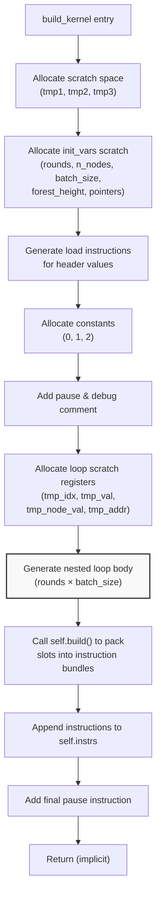
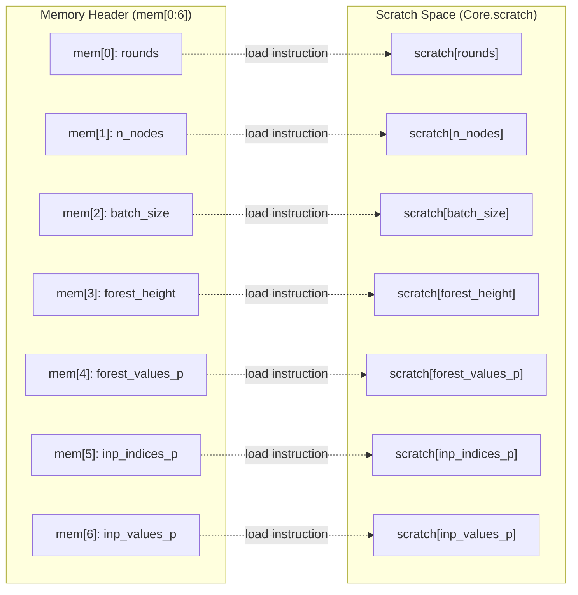
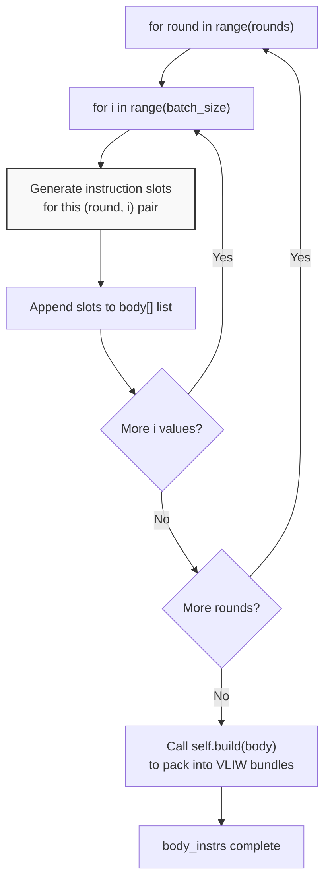
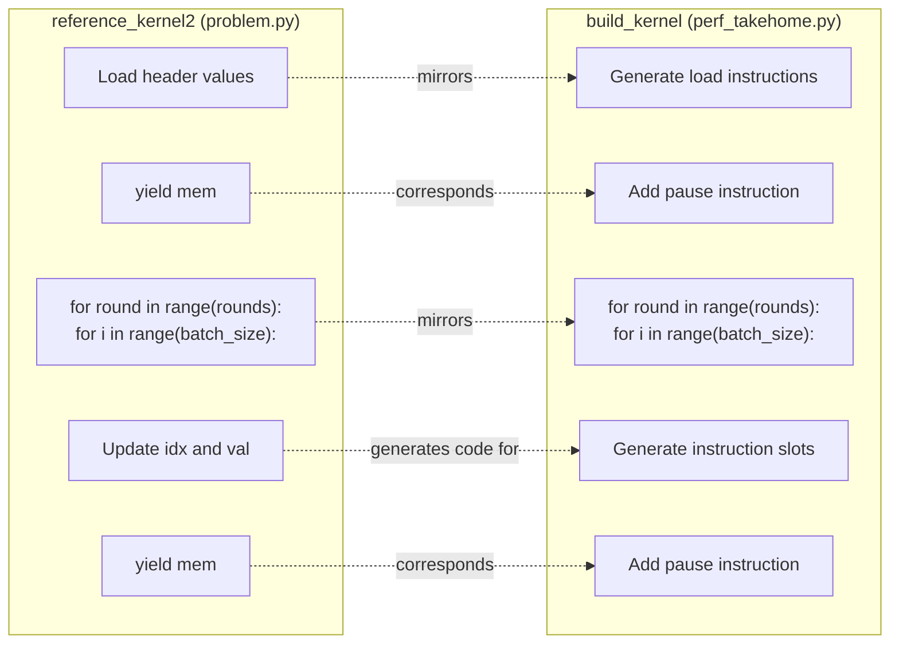

<!-- source: DeepWiki mcp.deepwiki.com · repo anthropics/original_performance_takehome · page 5.2 The build_kernel Method · fetched 2026-10-26 -->

# The build_kernel Method

<details>
<summary>Relevant source files</summary>

The following files were used as context for generating this wiki page:

- [perf_takehome.py](perf_takehome.py)

</details>


## Purpose and Scope

This page documents the `build_kernel` method in the `KernelBuilder` class [perf_takehome.py:40-175](), which is the core optimization target of this performance challenge. The method generates a sequence of VLIW instruction bundles that implement the tree traversal algorithm when executed by the `Machine` simulator.

The current implementation provides a functional baseline that uses scalar operations and no instruction packing. Achieving competitive cycle counts requires modifying this method to utilize the vector engine (VALU) and the VLIW capabilities of the architecture.

**Sources:** [perf_takehome.py:40-175]()

## Method Signature and Parameters

```python
def build_kernel(
    self, forest_height: int, n_nodes: int, batch_size: int, rounds: int
):
```
[perf_takehome.py:88-90]()

The method accepts four parameters that define the problem dimensions:

| Parameter | Type | Description | Example Value |
|-----------|------|-------------|---------------|
| `forest_height` | `int` | Height of the balanced binary tree | 10 |
| `n_nodes` | `int` | Total number of nodes in tree (2^(height+1) - 1) | 2047 |
| `batch_size` | `int` | Number of parallel tree traversals | 256 |
| `rounds` | `int` | Number of iterations per traversal | 16 |

These parameters are derived from `Tree` [problem.py:448-472]() and `Input` [problem.py:474-485]() objects. The method generates instructions based on these dimensions, which will later be executed by the `Machine` simulator on actual problem data.

**Sources:** [perf_takehome.py:88-90](), [problem.py:448-485]()

## Method Structure Overview

The `build_kernel` method follows a structured approach to instruction generation:



**Diagram: build_kernel Execution Flow**

The method generates instructions in phases. Note that `build_kernel` itself does not perform the tree traversal; it generates the code that the simulator will use to perform the traversal.

**Sources:** [perf_takehome.py:88-175]()

## Initialization Phase

### Temporary Variable Allocation

The method begins by allocating temporary scratch registers used throughout instruction generation:

[perf_takehome.py:95-97]()

These temporaries (`tmp1`, `tmp2`, `tmp3`) are reused across multiple operations to manage scratch space.

### Header Variable Loading

The method allocates scratch space for variables that correspond to the memory header layout defined by `build_mem_image` [problem.py:487-514]():

[perf_takehome.py:98-113]()



**Diagram: Header Loading - Memory to Scratch Mapping**

For each header variable, the method generates:
1. A `const` load to put the memory offset (0-6) into `tmp1` [perf_takehome.py:111]()
2. A `load` instruction to read `mem[tmp1]` into the designated scratch location [perf_takehome.py:112]()

### Constant Allocation

Commonly-used constants are allocated and cached using `scratch_const` [perf_takehome.py:70-75]():

[perf_takehome.py:114-116]()

**Sources:** [perf_takehome.py:70-75](), [perf_takehome.py:95-116](), [problem.py:487-514]()

## Synchronization and Debug Support

After initialization, the method adds a `pause` instruction and debug comment:

[perf_takehome.py:122-124]()

The `pause` instruction synchronizes with `yield` statements in `reference_kernel2` [problem.py:548](). During testing with `do_kernel_test`, the machine pauses here allowing correctness validation. The submission harness ignores pause instructions.

**Sources:** [perf_takehome.py:122-124](), [problem.py:535-569]()

## Main Loop Structure

### Loop Variable Allocation

Before generating the loop body, scratch registers are allocated for variables used in each iteration:

[perf_takehome.py:129-132]()

These correspond to logic in `reference_kernel2` [problem.py:549-565]():
- `tmp_idx`: Current tree node index.
- `tmp_val`: Current hash value.
- `tmp_node_val`: Tree node value fetched from memory.
- `tmp_addr`: Temporary address calculation.

### Nested Loop Generation

The method generates instructions for nested loops using Python loops:

[perf_takehome.py:134-170]()



**Diagram: Loop Unrolling Strategy**

This implementation **fully unrolls** both loops at kernel generation time. For the standard test case (rounds=16, batch_size=256), this generates 4,096 iterations. Each iteration produces approximately 36 instruction slots, resulting in a large linear sequence of instruction bundles.

**Sources:** [perf_takehome.py:134-170]()

## Tree Traversal Step Implementation

Each loop iteration generates instructions that implement one step of the tree traversal:

### Step 1: Load Current Index and Value
The kernel computes the address for `inp_indices_p + i` and `inp_values_p + i`, then loads the data into `tmp_idx` and `tmp_val` [perf_takehome.py:138-143]().

### Step 2: Load Node Value
The kernel uses the current index to fetch the node value from the tree: `mem[forest_values_p + idx]` [perf_takehome.py:146-147]().

### Step 3: Hash Computation
The current value is XORed with the node value [perf_takehome.py:150](), followed by a call to `build_hash` [perf_takehome.py:77-86](), which generates the multi-stage hash operations defined by `HASH_STAGES` [problem.py:439-446]().

### Step 4: Compute Next Index
Implements the logic: `idx = 2*idx + (1 if val % 2 == 0 else 2)` [perf_takehome.py:154-158]().
1. **ALU**: `tmp1 = val % 2`
2. **ALU**: `tmp1 = (tmp1 == 0)`
3. **FLOW**: `select` instruction to choose between `one_const` and `two_const`.
4. **ALU**: `idx = idx * 2 + selected_offset`.

### Step 5: Wrap Around and Store
The kernel checks if the index exceeds `n_nodes` and wraps to 0 if necessary [perf_takehome.py:161-162](). Finally, it stores the updated `idx` and `val` back to memory [perf_takehome.py:165-169]().

**Sources:** [perf_takehome.py:77-86](), [perf_takehome.py:134-170](), [problem.py:439-446](), [problem.py:549-565]()

## Instruction Building and VLIW Packing

After generating the `body[]` list of slots, the method packs them into instruction bundles:

[perf_takehome.py:171-172]()

The `build` method [perf_takehome.py:51-56]() currently uses a trivial packing strategy:

```python
def build(self, slots: list[tuple[Engine, tuple]], vliw: bool = False):
    instrs = []
    for engine, slot in slots:
        instrs.append({engine: [slot]})
    return instrs
```

This strategy puts only **one slot per bundle**, resulting in one cycle per operation. This is the primary bottleneck. The `Machine` architecture supports multiple slots per cycle (e.g., 12 ALU slots, 2 LOAD slots) [problem.py:48-55]().

**Sources:** [perf_takehome.py:51-56](), [perf_takehome.py:171-172](), [problem.py:48-55]()

## Relationship to Reference Implementation

The `build_kernel` method directly mirrors the structure of `reference_kernel2` [problem.py:535-569]():



**Diagram: Correspondence Between Reference and Generated Code**

**Sources:** [perf_takehome.py:88-175](), [problem.py:535-569]()

## Current Implementation Characteristics

| Characteristic | Description | Performance Impact |
|----------------|-------------|-------------------|
| **Scalar-only** | Uses only scalar engines (ALU, LOAD, etc.) | Does not utilize VLEN=16 vector engine |
| **Fully unrolled** | Loops are unrolled during kernel generation | No branch overhead, but high instruction count |
| **No VLIW packing** | One operation per cycle | Underutilizes available engine slots |
| **Naive scratch** | Linear allocation without reuse | High scratch space consumption |

These characteristics result in the BASELINE cycle count of 147,734 cycles [perf_takehome.py:176]().

**Sources:** [perf_takehome.py:88-176]()

---

