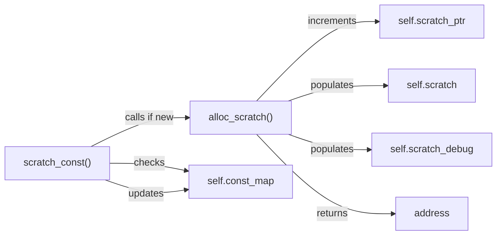
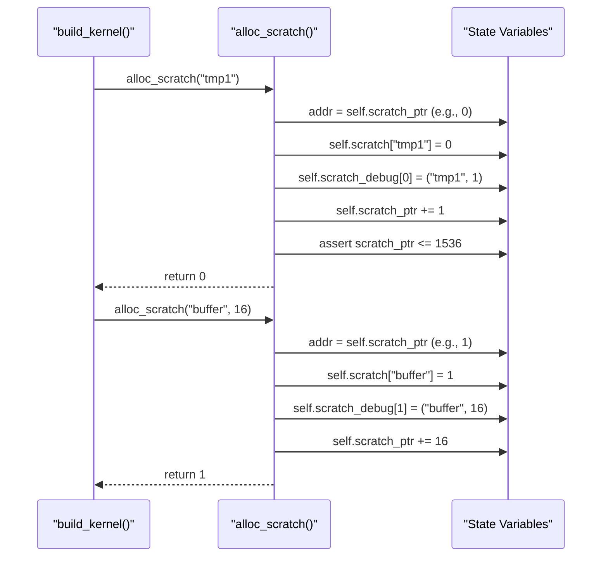
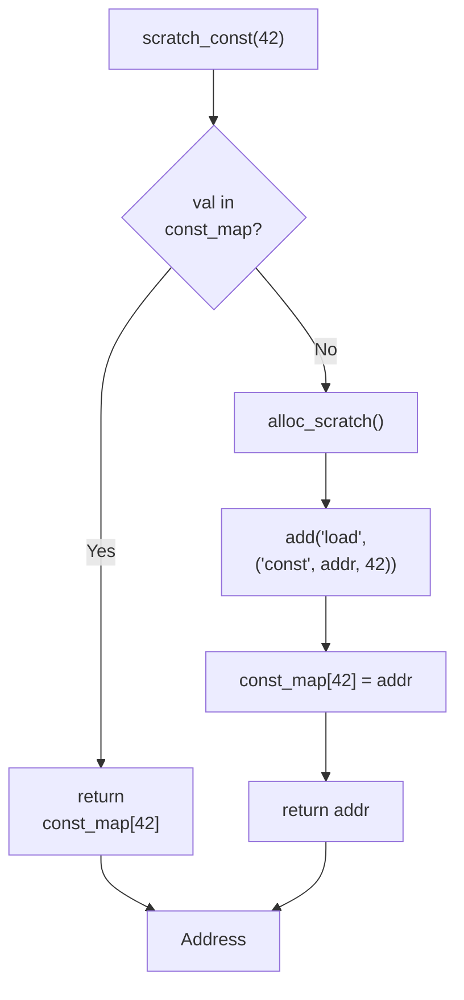
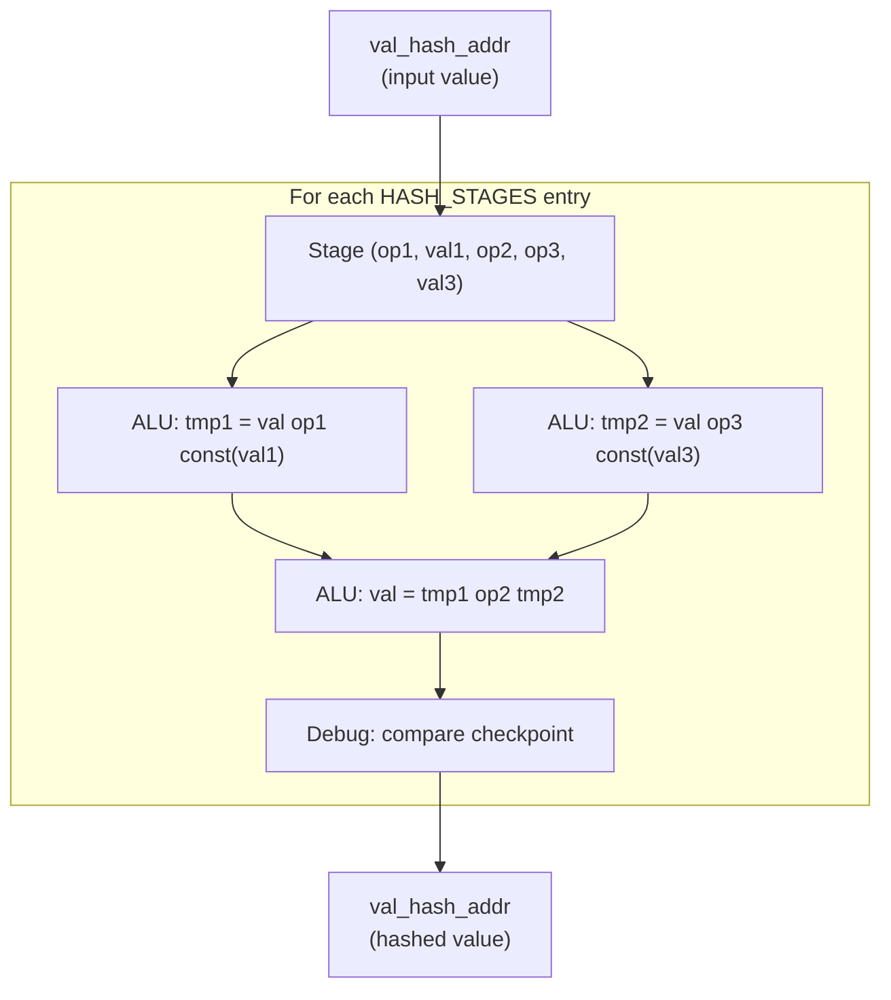
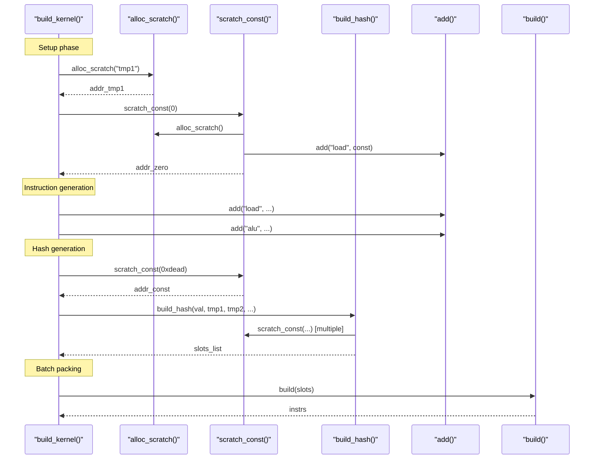

<!-- source: DeepWiki mcp.deepwiki.com · repo anthropics/original_performance_takehome · page 5.3 Helper Methods and Utilities · fetched 2026-10-26 -->

# Helper Methods and Utilities

<details>
<summary>Relevant source files</summary>

The following files were used as context for generating this wiki page:

- [perf_takehome.py](perf_takehome.py)

</details>


This page documents the helper methods and utility functions in the `KernelBuilder` class that support instruction generation. These methods handle memory allocation, constant management, instruction building, and hash computation generation. For the overall structure and responsibilities of `KernelBuilder`, see [5.1](). For the main optimization target, see [5.2]().

## Overview of Helper Methods

The `KernelBuilder` class provides several helper methods that abstract common instruction generation patterns. These utilities handle scratch space management, constant value caching, VLIW bundle construction, and specialized instruction sequences like hash computation.

**Key helper methods:**
- **Memory management**: `alloc_scratch()`, `scratch_const()`
- **Instruction generation**: `add()`, `build()`, `build_hash()`
- **Debug support**: `debug_info()`

Sources: [perf_takehome.py:40-86]()

## State Variables

The `KernelBuilder` maintains several internal state variables that track resource allocation during instruction generation:

| Variable | Type | Purpose | Initialized |
|----------|------|---------|-------------|
| `self.instrs` | `list` | Accumulator for generated instructions | `[]` |
| `self.scratch` | `dict[str, int]` | Maps variable names to scratch addresses | `{}` |
| `self.scratch_debug` | `dict[int, tuple]` | Maps addresses to (name, length) for debugging | `{}` |
| `self.scratch_ptr` | `int` | Current allocation pointer in scratch space | `0` |
| `self.const_map` | `dict[int, int]` | Maps constant values to their scratch addresses (cache) | `{}` |

These variables work together to manage scratch space allocation and prevent conflicts:



Sources: [perf_takehome.py:41-46]()

## Scratch Space Allocation

### `alloc_scratch(name=None, length=1)`

Allocates a contiguous region of scratch space and returns its starting address.

**Parameters:**
- `name` (str, optional): Variable name for debugging and reference via `self.scratch[name]`
- `length` (int, default=1): Number of consecutive words to allocate

**Returns:** `int` - The starting address of the allocated region

**Behavior:**
1. Captures current `self.scratch_ptr` as the allocation address [perf_takehome.py:62]().
2. If `name` is provided, stores mapping in `self.scratch[name]` and `self.scratch_debug[addr]` [perf_takehome.py:63-65]().
3. Advances `self.scratch_ptr` by `length` [perf_takehome.py:66]().
4. Asserts that total allocation doesn't exceed `SCRATCH_SIZE` (1536 words per core) [perf_takehome.py:67]().

**Example usage from build_kernel:**

```python
tmp1 = self.alloc_scratch("tmp1")                    # Allocate 1 word for tmp1
init_vars = ["rounds", "n_nodes", "batch_size", ...]
for v in init_vars:
    self.alloc_scratch(v, 1)                         # Named allocation
```

**Key constraint:** Scratch space is limited to 1536 words per core. The assertion at [perf_takehome.py:67]() catches over-allocation errors immediately.

Sources: [perf_takehome.py:61-68](), [perf_takehome.py:95-109]()

### Scratch Allocation Flow



Sources: [perf_takehome.py:61-68](), [perf_takehome.py:95-109]()

## Constant Value Management

### `scratch_const(val, name=None)`

Allocates scratch space for a constant value, loading it with a `const` instruction. Implements caching to avoid duplicate allocations for the same constant value.

**Parameters:**
- `val` (int): The constant value to load
- `name` (str, optional): Variable name for debugging

**Returns:** `int` - Scratch address containing the constant value

**Behavior:**
1. Checks if `val` already exists in `self.const_map` [perf_takehome.py:71]().
2. If not cached:
   - Allocates scratch space via `alloc_scratch(name)` [perf_takehome.py:72]().
   - Generates a `("load", ("const", addr, val))` instruction [perf_takehome.py:73]().
   - Caches the mapping in `self.const_map[val] = addr` [perf_takehome.py:74]().
3. Returns the cached address (new or existing) [perf_takehome.py:75]().

**Example usage from build_kernel:**

```python
zero_const = self.scratch_const(0)      # First call: allocates and loads
one_const = self.scratch_const(1)       # Allocates and loads
two_const = self.scratch_const(2)       # Allocates and loads

# Later in the code:
self.scratch_const(0)                   # Returns cached address, no new instruction
```

**Optimization benefit:** Eliminates redundant constant loads. For `build_kernel`, values 0, 1, 2, and all `i` values in `range(batch_size)` are reused multiple times.

Sources: [perf_takehome.py:70-75]()

### Constant Caching Mechanism



Sources: [perf_takehome.py:70-75]()

## Instruction Generation

### `add(engine, slot)`

Appends a single instruction bundle to `self.instrs`. The bundle contains one slot for the specified engine.

**Parameters:**
- `engine` (Engine): The execution engine (e.g., `"alu"`, `"load"`, `"store"`, `"flow"`, `"debug"`)
- `slot` (tuple): The operation specification (format depends on engine type)

**Behavior:**
Creates a dictionary with the engine as key and a single-element list containing the slot:
```python
self.instrs.append({engine: [slot]})
```

**Example usage:**
```python
self.add("load", ("const", tmp1, i))           # Load constant
self.add("alu", ("+", result, a, b))           # ALU operation
self.add("flow", ("pause",))                   # Control flow
```

**Note:** This method creates **unpacked VLIW bundles** (one operation per cycle). For optimization, consider manually building bundles with multiple slots per engine. See [5.4]() for VLIW packing strategies.

Sources: [perf_takehome.py:58-59]()

### `build(slots, vliw=False)`

Converts a list of `(engine, slot)` tuples into instruction bundles. The current implementation uses **naive packing** (one slot per bundle).

**Parameters:**
- `slots` (list[tuple[Engine, tuple]]): List of (engine, slot) pairs to pack
- `vliw` (bool, default=False): VLIW packing flag (currently unused in implementation)

**Returns:** `list[dict]` - List of instruction bundles

**Current implementation:**
```python
def build(self, slots: list[tuple[Engine, tuple]], vliw: bool = False):
    instrs = []
    for engine, slot in slots:
        instrs.append({engine: [slot]})  # One slot per bundle
    return instrs
```

**Optimization opportunity:** The `vliw` parameter suggests this method was intended to support VLIW packing. Implementing intelligent packing here (respecting `SLOT_LIMITS` and avoiding conflicts) could reduce cycle count significantly.

**Example usage from build_kernel:**
```python
body = []  # Accumulate (engine, slot) pairs
body.append(("alu", ("+", tmp_addr, base_addr, offset)))
body.append(("load", ("load", tmp_idx, tmp_addr)))
# ... more operations ...

body_instrs = self.build(body)  # Convert to instruction bundles
self.instrs.extend(body_instrs)
```

Sources: [perf_takehome.py:51-56](), [perf_takehome.py:171-172]()

## Hash Computation Generation

### `build_hash(val_hash_addr, tmp1, tmp2, round, i)`

Generates instruction slots for the `myhash` function computation, which applies multiple hash stages defined by `HASH_STAGES`.

**Parameters:**
- `val_hash_addr` (int): Scratch address containing the value to hash (input/output)
- `tmp1` (int): Scratch address for first temporary register
- `tmp2` (int): Scratch address for second temporary register
- `round` (int): Current round number (for debug tracing)
- `i` (int): Current batch index (for debug tracing)

**Returns:** `list[tuple[Engine, tuple]]` - List of (engine, slot) pairs

**Behavior:**
For each stage in `HASH_STAGES`, generates four operations:
1. **ALU operation 1:** `tmp1 = val_hash_addr op1 const(val1)` [perf_takehome.py:81]()
2. **ALU operation 2:** `tmp2 = val_hash_addr op3 const(val3)` [perf_takehome.py:82]()
3. **ALU combination:** `val_hash_addr = tmp1 op2 tmp2` [perf_takehome.py:83]()
4. **Debug checkpoint:** Compare intermediate result [perf_takehome.py:84]()

**Example generated sequence:**
```python
# For each hash stage (op1, val1, op2, op3, val3):
("alu", (">>", tmp1, val_hash_addr, const(13)))
("alu", ("^", tmp2, val_hash_addr, const(0xdead_beef)))
("alu", ("^", val_hash_addr, tmp1, tmp2))
("debug", ("compare", val_hash_addr, (round, i, "hash_stage", 0)))
# ... repeat for remaining stages
```

**Usage in build_kernel:**
```python
# After XOR with node value:
body.append(("alu", ("^", tmp_val, tmp_val, tmp_node_val)))
body.extend(self.build_hash(tmp_val, tmp1, tmp2, round, i))
```

Sources: [perf_takehome.py:77-86](), [perf_takehome.py:150-151]()

### Hash Computation Structure



Sources: [perf_takehome.py:77-86]()

## Debug Information

### `debug_info()`

Constructs a `DebugInfo` object containing the scratch space mapping for trace visualization.

**Returns:** `DebugInfo` - Object with `scratch_map` attribute

**Behavior:**
```python
def debug_info(self):
    return DebugInfo(scratch_map=self.scratch_debug)
```

The `DebugInfo` object is passed to the `Machine` simulator to enable named variable tracking in traces. The `scratch_map` dictionary maps scratch addresses to `(name, length)` tuples, allowing the trace viewer to display meaningful variable names instead of raw addresses.

**Example:**
```python
kb = KernelBuilder()
kb.build_kernel(...)
debug_info = kb.debug_info()  # Contains scratch_map
machine = Machine(mem, kb.instrs, debug_info, ...)
```

The trace visualization system uses this mapping to label scratch space variables in the Perfetto UI. See [7.1]() for trace generation details.

Sources: [perf_takehome.py:48-49]()

## Helper Method Interaction Pattern

The following diagram shows how helper methods are typically used together during kernel building:



Sources: [perf_takehome.py:88-175]()

## Optimization Considerations

When using these helper methods, consider the following optimization opportunities:

| Helper Method | Current Limitation | Optimization Opportunity |
|---------------|-------------------|--------------------------|
| `alloc_scratch()` | Sequential allocation | Could implement scratch reuse for non-overlapping lifetimes |
| `scratch_const()` | Caches by value only | Could deduplicate arithmetically related constants |
| `add()` | One slot per bundle | Should be replaced with VLIW-aware bundling |
| `build()` | Naive unpacking | Implement intelligent slot packing respecting `SLOT_LIMITS` |
| `build_hash()` | Returns unpacked slots | Could pre-pack hash operations into efficient bundles |

**Key insight:** The current helper methods prioritize correctness and readability over performance. The main optimization work involves either:
1. Modifying these helpers to generate more efficient instruction sequences
2. Bypassing them in performance-critical sections with hand-tuned VLIW bundles

For detailed optimization strategies, see [5.4]().

Sources: [perf_takehome.py:51-86]()

## Summary Table

| Method | Purpose | Key Parameters | Returns |
|--------|---------|----------------|---------|
| `alloc_scratch(name, length)` | Allocate scratch space | `name`: optional variable name<br/>`length`: word count (default 1) | Address (int) |
| `scratch_const(val, name)` | Load constant with caching | `val`: constant value<br/>`name`: optional debug name | Address (int) |
| `add(engine, slot)` | Add single instruction | `engine`: execution engine<br/>`slot`: operation tuple | None |
| `build(slots, vliw)` | Pack slots into bundles | `slots`: list of (engine, slot)<br/>`vliw`: unused flag | Instruction list |
| `build_hash(val_hash_addr, tmp1, tmp2, round, i)` | Generate hash computation | `val_hash_addr`: value address<br/>`tmp1, tmp2`: temp registers<br/>`round, i`: debug context | Slots list |
| `debug_info()` | Export debug mapping | None | DebugInfo object |

Sources: [perf_takehome.py:48-86]()

---

