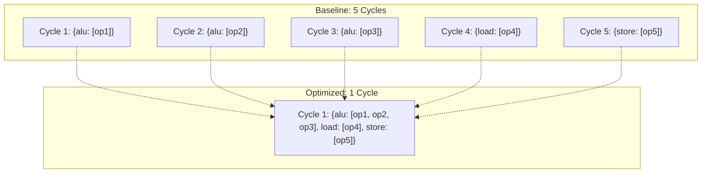
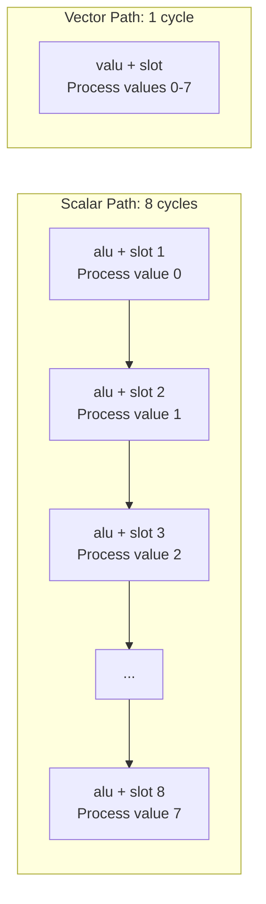
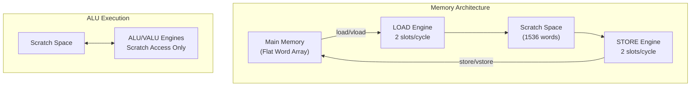
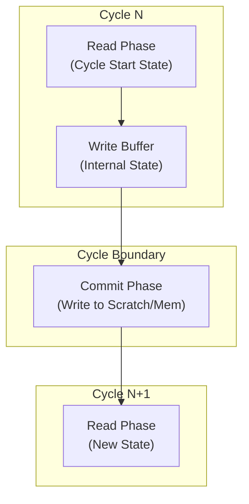

<!-- source: DeepWiki mcp.deepwiki.com · repo anthropics/original_performance_takehome · page 5.4 Optimization Strategies and Patterns · fetched 2026-10-26 -->

# Optimization Strategies and Patterns

<details>
<summary>Relevant source files</summary>

The following files were used as context for generating this wiki page:

- [perf_takehome.py](perf_takehome.py)
- [tests/frozen_problem.py](tests/frozen_problem.py)

</details>


## Purpose and Scope

This page documents optimization strategies and patterns for improving the performance of the `KernelBuilder.build_kernel` method [perf_takehome.py:88-90](). The goal is to reduce cycle count by exploiting the VLIW SIMD architecture's parallelism capabilities.

For details on the `KernelBuilder` class structure, see [5.1 KernelBuilder Class Overview](). For the baseline implementation details, see [5.2 The build_kernel Method](). For information on the machine architecture being optimized for, see [4 Machine Architecture]().

The baseline implementation achieves 147,734 cycles [perf_takehome.py:176](), while the best known result is 1,363 cycles (108.4x speedup). This page covers techniques to bridge that gap.

---

## VLIW Instruction Packing

The `Machine` architecture supports multiple operations per cycle through Very Large Instruction Word (VLIW) bundles [tests/frozen_problem.py:68-73](). Each engine can execute multiple slots in parallel within a single cycle, subject to `SLOT_LIMITS` [tests/frozen_problem.py:48-55]().

### Slot Limits Per Engine

| Engine | Slots Per Cycle | Purpose |
|--------|----------------|---------|
| `alu` | 12 | Scalar arithmetic operations |
| `valu` | 6 | Vector arithmetic (VLEN=8) |
| `load` | 2 | Memory → Scratch transfers |
| `store` | 2 | Scratch → Memory transfers |
| `flow` | 1 | Control flow and selections |
| `debug` | 64 | Debug/validation (ignored in submission) |

**Baseline Issue**: The default `build()` method in the take-home template creates one instruction bundle per slot [perf_takehome.py:51-56]():

```python
def build(self, slots: list[tuple[Engine, tuple]], vliw: bool = False):
    # Simple slot packing that just uses one slot per instruction bundle
    instrs = []
    for engine, slot in slots:
        instrs.append({engine: [slot]})
    return instrs
```

**Optimization Strategy**: Pack multiple operations into each instruction bundle to execute them in parallel.

### VLIW Packing Pattern



**Packing Algorithm**:
1. Accumulate operations that can execute in parallel (no data dependencies).
2. Group by engine type.
3. Check `SLOT_LIMITS` [tests/frozen_problem.py:48-55]() before adding to bundle.
4. Emit bundle when any engine hits its limit or a dependency forces a flush.

**Key Constraint**: Operations in the same cycle read from the core state at cycle start; writes take effect at cycle end (two-phase commit model) [tests/frozen_problem.py:71-73]().

Sources: [perf_takehome.py:51-56](), [tests/frozen_problem.py:48-55](), [tests/frozen_problem.py:64-95]()

---

## Vectorization with VALU Instructions

The architecture supports SIMD operations with `VLEN=8` [tests/frozen_problem.py:57](), allowing 8 values to be processed in a single slot.

### Vector Operation Types



**Available VALU Operations**:
- `vbroadcast`: Broadcast scalar to vector [tests/frozen_problem.py:254-257]().
- Arithmetic: `+`, `-`, `*`, `//`, `^`, `&`, `|`, `<<`, `>>`, `%`, `<`, `==` [tests/frozen_problem.py:258-267]().
- `multiply_add`: Fused multiply-add for hash optimization [tests/frozen_problem.py:261-262]().
- `vselect`: Vector conditional selection [tests/frozen_problem.py:288-298]().

**Memory Operations**:
- `vload`: Load 8 contiguous words from memory [tests/frozen_problem.py:269-277]().
- `vstore`: Store 8 contiguous words to memory [tests/frozen_problem.py:279-286]().

### Vectorization Pattern for Batch Processing

The baseline processes `batch_size` items sequentially [perf_takehome.py:135]().

**Optimization**: Process 8 items at once using vector operations:
1. `vload` input indices and values in chunks of `VLEN`.
2. Perform hashing and index calculations using `valu` instructions.
3. `vstore` updated state back to memory.

**Scratch Layout for Vectors**: Allocate consecutive addresses for vector values. A vector at address `X` occupies `X` through `X + VLEN - 1`.

Sources: [tests/frozen_problem.py:57](), [tests/frozen_problem.py:254-298](), [perf_takehome.py:135]()

---

## Loop Transformations

The baseline has nested loops with a small inner body [perf_takehome.py:134-135]().

### Loop Unrolling

**Purpose**: Reduce loop overhead and enable more instruction-level parallelism.

**Pattern**: Process multiple iterations (or vector chunks) in a single loop body to fill more VLIW slots.

**Benefits**:
- Fewer `flow` control operations.
- More opportunities for VLIW packing across iterations.
- Better utilization of scratch space.

### Full Loop Unrolling

For small, fixed iteration counts like the hash function, fully unroll the logic. The `build_hash` helper [perf_takehome.py:77-86]() already iterates through `HASH_STAGES`:

```python
for hi, (op1, val1, op2, op3, val3) in enumerate(HASH_STAGES):
    slots.append(("alu", (op1, tmp1, val_hash_addr, self.scratch_const(val1))))
    # ...
```

All 6 hash stages are known at compile time, so they can be unrolled and interleaved to hide latency.

Sources: [perf_takehome.py:77-86](), [perf_takehome.py:134-170]()

---

## Memory Access Optimization

Memory operations (`load`, `store` engines) are limited to 2 slots per cycle each [tests/frozen_problem.py:51-52]().

### Memory Access Pattern



### Prefetching and Latency Hiding

**Problem**: The baseline loads data immediately before use [perf_takehome.py:139-143](), creating bubbles.

**Solution**: Load data for iteration `N+1` while computing iteration `N`.

### Scratch Space as Cache

**Strategy**: Keep frequently accessed values in scratch space instead of repeatedly loading from memory.

**Key Values to Cache**:
- Constants: `0`, `1`, `2` [perf_takehome.py:114-116]().
- Base Pointers: `forest_values_p`, `inp_indices_p`, `inp_values_p` [perf_takehome.py:104-106]().
- Loop invariants: `n_nodes`, `batch_size`, `rounds` [perf_takehome.py:100-103]().

### Vector Memory Operations

Use `vload` and `vstore` to transfer 8 words per slot instead of 1 [tests/frozen_problem.py:269-286](). This effectively increases memory bandwidth by 8x.

Sources: [tests/frozen_problem.py:48-55](), [perf_takehome.py:100-116](), [perf_takehome.py:138-148]()

---

## Dependency Management

The two-phase execution model means all reads happen at cycle start, all writes at cycle end [tests/frozen_problem.py:71-73]().

### Read-After-Write (RAW) Dependencies



**Rule**: If instruction A writes to address X and instruction B reads from X, they cannot be in the same cycle.

**Optimization**: Schedule independent operations (e.g., processing different batch elements) between dependent operations to fill pipeline slots.

Sources: [tests/frozen_problem.py:71-73](), [tests/frozen_problem.py:219-252]()

---

## Scratch Space Allocation Strategies

The scratch space (1536 words) [tests/frozen_problem.py:60]() serves as registers and cache.

### Allocation Methods

- `alloc_scratch(name, length)`: Reserves a block of addresses [perf_takehome.py:61-68]().
- `scratch_const(val)`: Uses `const_map` to deduplicate and reuse addresses for the same constant value [perf_takehome.py:70-75]().

### Register Reuse

**Problem**: The baseline `alloc_scratch` inside `build_kernel` is for scalars that live throughout the kernel [perf_takehome.py:95-132]().

**Solution**: For complex kernels, manually manage scratch addresses to reuse them for different variables that have non-overlapping lifetimes.

### Vector Register Alignment

VALU operations treat a block of `VLEN` addresses as a single unit. Ensure vector allocations are planned to avoid overlapping with other critical scalars.

Sources: [perf_takehome.py:61-75](), [tests/frozen_problem.py:60]()

---

## Common Optimization Patterns

### Pattern 1: Interleaved Hashing
Interleave the 6 stages of `myhash` [perf_takehome.py:77-86]() for different vector chunks. While one chunk is waiting for the result of `alu` stage 1 to commit, another chunk can be processed in `alu` stage 1.

### Pattern 2: Branchless Index Selection
Use `flow.select` [tests/frozen_problem.py:288-298]() or `valu.vselect` to handle the tree traversal logic:
```python
# idx = 2*idx + (1 if val % 2 == 0 else 2)
```
This avoids `pause` or complex control flow that breaks VLIW packing.

### Pattern 3: Address Pre-calculation
The baseline computes `inp_indices_p + i` using ALU operations in the loop [perf_takehome.py:138](). These can be pre-calculated or incremented to save ALU slots for hashing.

Sources: [perf_takehome.py:77-86](), [perf_takehome.py:138-163](), [tests/frozen_problem.py:288-298]()

---

