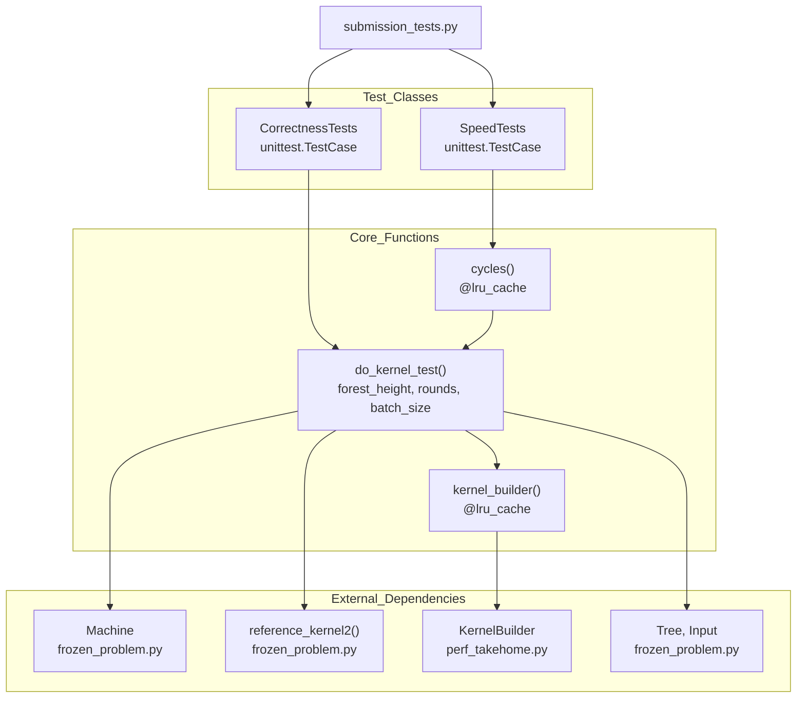
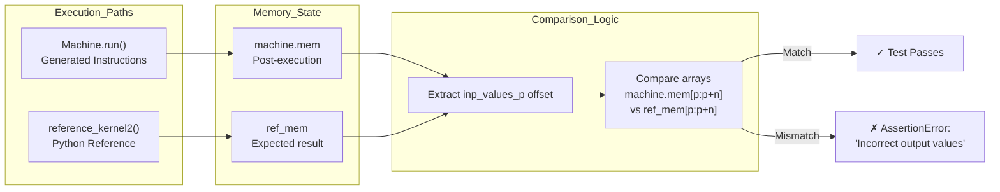

<!-- source: DeepWiki mcp.deepwiki.com · repo anthropics/original_performance_takehome · page 6 Testing Framework · fetched 2026-10-26 -->

# Testing Framework

Relevant source files

The following files were used as context for generating this wiki page:

- [tests/submission_tests.py](tests/submission_tests.py)

This document describes the testing infrastructure that validates the correctness and measures the performance of kernels generated by `KernelBuilder`. The testing framework is implemented in [tests/submission_tests.py]() and uses the frozen simulator and reference implementations from [frozen_problem.py](). For information about the `KernelBuilder` class itself, see [Kernel Builder - The Optimization Target](#5). For details about the simulator architecture, see [Machine Architecture](#4).

## Test Suite Structure

The testing framework consists of two main test classes that serve different purposes: correctness validation and performance benchmarking. It utilizes a central execution function and caching mechanisms to ensure efficiency and reliability. For details, see [Test Suite Structure](#6.1).

### Test Class Hierarchy

**Sources:** [tests/submission_tests.py:57-116]()

### Test Parameters and Constants

| Constant | Value | Description |
|----------|-------|-------------|
| `BASELINE` | 147,734 | Unoptimized baseline cycle count for performance comparison |
| Default `forest_height` | 10 | Tree height (2^11 - 1 = 2047 nodes) |
| Default `rounds` | 16 | Number of traversal rounds |
| Default `batch_size` | 256 | Number of parallel traversals |

**Sources:** [tests/submission_tests.py:63](), [tests/submission_tests.py:30-34]()

## Correctness Validation

The `do_kernel_test` function is the central mechanism that generates test data, builds the kernel, executes it on the simulator, and validates correctness against a reference. It compares the final state of output values in the simulator memory against the result of `reference_kernel2`. For details, see [Correctness Validation](#6.2).

### Validation Process

**Sources:** [tests/submission_tests.py:45-52]()

## Performance Measurement

The framework documents a performance ladder ranging from the unoptimized baseline (147,734 cycles) to highly optimized AI-generated targets. Performance is measured by the `cycle` attribute of the `Machine` after execution. Caching via `@lru_cache` ensures that the kernel is only built and measured once per test session. For details, see [Performance Measurement](#6.3).

### Performance Benchmark Ladder

| Test Method | Cycle Threshold | Description |
|-------------|-----------------|-------------|
| `test_kernel_speedup` | < 147,734 | Any improvement over baseline |
| `test_kernel_updated_starting_point` | < 18,532 | Performance of updated starter code |
| `test_opus4_many_hours` | < 2,164 | Claude Opus 4 (extended compute) |
| `test_opus45_casual` | < 1,790 | Claude Opus 4.5 casual (~best human 2hr) |
| `test_opus45_2hr` | < 1,579 | Claude Opus 4.5 (2hr harness) |
| `test_sonnet45_many_hours` | < 1,548 | Claude Sonnet 4.5 (extended compute) |
| `test_opus45_11hr` | < 1,487 | Claude Opus 4.5 (11.5hr) - Recruitment gate |
| `test_opus45_improved_harness` | < 1,363 | Claude Opus 4.5 (improved harness) |

**Sources:** [tests/submission_tests.py:85-115]()

## Running and Interpreting Tests

Tests are executed using `unittest`. Users can run the entire suite to see speedup over the baseline and verify that logic changes haven't broken the kernel. Output includes cycle counts and speedup calculations. For a practical guide on running tests and debugging failures, see [Running and Interpreting Tests](#6.4).

### Implementation Details

1. **Test Data Generation** [tests/submission_tests.py:33-35](): Creates random `Tree` and `Input` objects.
2. **Memory Image Construction** [tests/submission_tests.py:35](): Uses `build_mem_image()` to create a flat memory layout.
3. **Kernel Building** [tests/submission_tests.py:37](): Invokes the cached `kernel_builder()` function.
4. **Machine Configuration** [tests/submission_tests.py:40-42](): Creates `Machine` instance with memory and instructions.
5. **Execution** [tests/submission_tests.py:43](): Runs `machine.run()` to execute instructions and count cycles.
6. **Validation** [tests/submission_tests.py:48-52](): Compares the output values array in `machine.mem` with `ref_mem` at offset `inp_values_p`.

**Sources:** [tests/submission_tests.py:30-54]()

---

