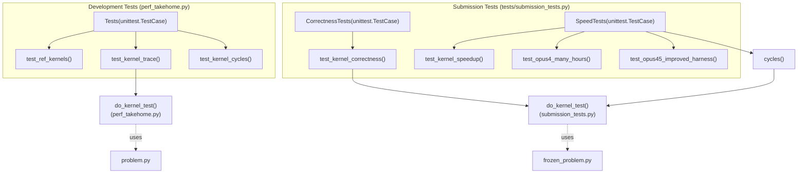
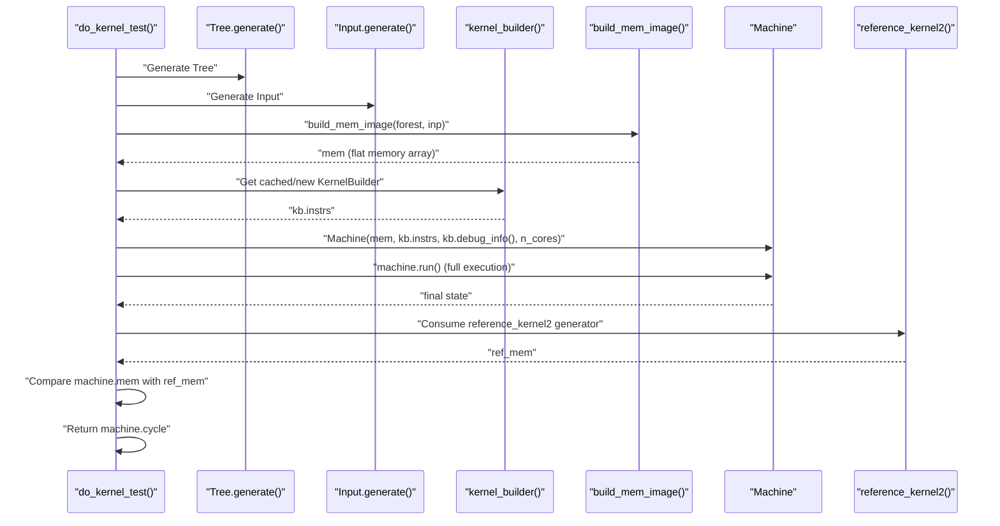
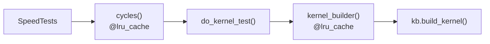

<!-- source: DeepWiki mcp.deepwiki.com · repo anthropics/original_performance_takehome · page 6.1 Test Suite Structure · fetched 2026-10-26 -->

# Test Suite Structure

Relevant source files

The following files were used as context for generating this wiki page:

- [tests/submission_tests.py](tests/submission_tests.py)

This page documents the organization and structure of the testing infrastructure used to validate correctness and measure performance of kernel implementations. It covers the test file organization, the test class hierarchy, and the core testing function `do_kernel_test`.

## Test File Organization

The repository contains two distinct test locations with different purposes and execution contexts:

### Development Tests: perf_takehome.py
The `Tests` class in `perf_takehome.py` [perf_takehome.py:225-256]() provides lightweight tests for development iteration. These tests use the simulator from `problem.py`, which allows for debugging features like pause points and trace generation.

**Key characteristics:**
- Uses `Machine` from `problem.py`.
- Enables `trace=True` and `prints=True` options in `do_kernel_test` [perf_takehome.py:175-182]().
- Contains `test_kernel_trace()` for generating execution traces [perf_takehome.py:241-243]().
- Validates against `reference_kernel2` at each pause point [perf_takehome.py:207-217]().
- Seeds random generator with `seed=123` for reproducibility [perf_takehome.py:183]().

### Submission Tests: tests/submission_tests.py
The `CorrectnessTests` and `SpeedTests` classes in `tests/submission_tests.py` [tests/submission_tests.py:57-116]() provide the official validation suite. These tests use the "frozen" simulator from `frozen_problem.py` to ensure fair performance comparison.

**Key characteristics:**
- Uses `Machine` from `frozen_problem.py` [tests/submission_tests.py:11-19]().
- Disables pause and debug features: `machine.enable_pause = False`, `machine.enable_debug = False` [tests/submission_tests.py:41-42]().
- Does not seed the random generator (tests must work for any random input) [tests/submission_tests.py:32]().
- Uses `@lru_cache` decorator to cache kernel builds [tests/submission_tests.py:23-27]().
- Implements the performance ladder with specific cycle thresholds [tests/submission_tests.py:85-115]().

**Diagram: Test File Structure and Class Hierarchy**

Sources: [perf_takehome.py:225-256](), [tests/submission_tests.py:1-119]()

## Core Test Function: do_kernel_test

Both test files implement a `do_kernel_test` function that serves as the core test execution engine. While the implementations differ slightly, they follow the same fundamental pattern of generating data, building the kernel, running the machine, and validating memory.

### Function Signature and Parameters

**Submission version** [tests/submission_tests.py:30]():
`do_kernel_test(forest_height: int, rounds: int, batch_size: int)`

| Parameter | Type | Purpose |
|-----------|------|---------|
| `forest_height` | `int` | Height of the binary tree (determines tree size: 2^(h+1)-1 nodes) |
| `rounds` | `int` | Number of rounds to execute the kernel |
| `batch_size` | `int` | Number of parallel computations per round |

### Execution Flow

**Diagram: do_kernel_test Execution Flow (Submission)**

Sources: [tests/submission_tests.py:30-54](), [perf_takehome.py:175-222]()

### Key Differences Between Versions

| Aspect | Development (perf_takehome.py) | Submission (submission_tests.py) |
|--------|--------------------------------|----------------------------------|
| Simulator | `problem.py` (mutable) | `frozen_problem.py` (frozen) |
| Random Seed | Fixed (`seed=123`) | Not seeded (random) |
| Pause Points | Validated at each `pause` | Disabled (`enable_pause = False`) |
| Debug Info | Included | Included via `kb.debug_info()` |
| Trace Generation | Optional (`trace=True`) | Not available |
| Validation | Incremental (at each pause) | Final state only |

Sources: [perf_takehome.py:175-222](), [tests/submission_tests.py:30-54]()

## Test Class Structure

### CorrectnessTests Class
The `CorrectnessTests` class [tests/submission_tests.py:57-61]() validates functional correctness by running multiple randomized test cases. It executes 8 iterations with different random seeds (no seed specified) using standard benchmark parameters: `forest_height=10, rounds=16, batch_size=256`.

### SpeedTests Class
The `SpeedTests` class [tests/submission_tests.py:76-116]() implements the performance ladder with progressively aggressive cycle count thresholds.

**Performance Thresholds:**

| Test Method | Threshold (cycles) | Description |
|-------------|-------------------|-------------|
| `test_kernel_speedup()` | 147734 | `BASELINE` - any improvement [tests/submission_tests.py:86]() |
| `test_kernel_updated_starting_point()` | 18532 | Updated starter code performance [tests/submission_tests.py:90]() |
| `test_opus4_many_hours()` | 2164 | Claude Opus 4 after many hours [tests/submission_tests.py:94]() |
| `test_opus45_casual()` | 1790 | Claude Opus 4.5 casual session [tests/submission_tests.py:99]() |
| `test_opus45_2hr()` | 1579 | Claude Opus 4.5 after 2 hours [tests/submission_tests.py:103]() |
| `test_sonnet45_many_hours()` | 1548 | Claude Sonnet 4.5 after many hours [tests/submission_tests.py:107]() |
| `test_opus45_11hr()` | 1487 | Claude Opus 4.5 after 11.5 hours [tests/submission_tests.py:111]() |
| `test_opus45_improved_harness()` | 1363 | Claude Opus 4.5 improved harness [tests/submission_tests.py:115]() |

Sources: [tests/submission_tests.py:76-116]()

## Caching Strategy

The submission test suite employs two levels of caching to improve test execution performance.

### Kernel Builder Cache
The `kernel_builder` function [tests/submission_tests.py:23-27]() is decorated with `@lru_cache(maxsize=None)` to cache compiled kernels. It ensures that `kb.build_kernel` is only called once for a specific set of parameters, regardless of how many tests require it.

### Cycle Count Cache
The `cycles` function [tests/submission_tests.py:66-73]() is also decorated with `@lru_cache(maxsize=None)`. This ensures that the actual `Machine` simulation is performed only once per test run. All `SpeedTests` methods call `cycles()` instead of `do_kernel_test` directly. If a correctness assertion fails, it returns `BASELINE * 2` [tests/submission_tests.py:73]().

**Diagram: Two-Level Caching Strategy**

Sources: [tests/submission_tests.py:23-27](), [tests/submission_tests.py:66-73]()

## Test Parameters

All submission tests use identical benchmark parameters to ensure consistent performance measurement:

| Parameter | Value | Description |
|-----------|-------|-------------|
| `forest_height` | 10 | `n_nodes = 2^11 - 1 = 2047` |
| `rounds` | 16 | Number of complete traversal rounds |
| `batch_size` | 256 | Number of parallel tree traversals |
| `BASELINE` | 147734 | Original unoptimized cycle count [tests/submission_tests.py:63]() |

The `do_kernel_test` function uses these to instantiate `Tree` and `Input` [tests/submission_tests.py:33-34](), build the memory image [tests/submission_tests.py:35](), and initialize the `Machine` with `N_CORES` [tests/submission_tests.py:40]().

Sources: [tests/submission_tests.py:30-54](), [tests/submission_tests.py:63]()

---

