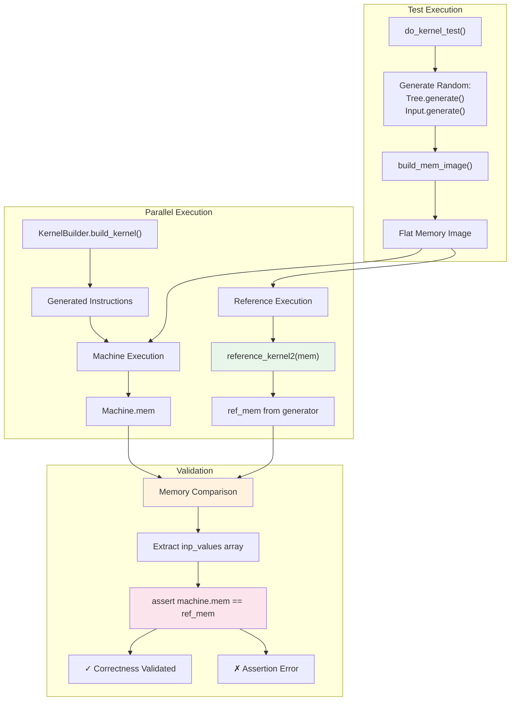
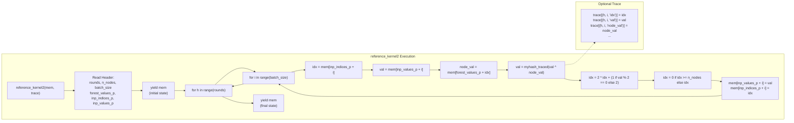
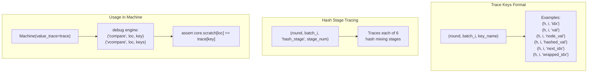
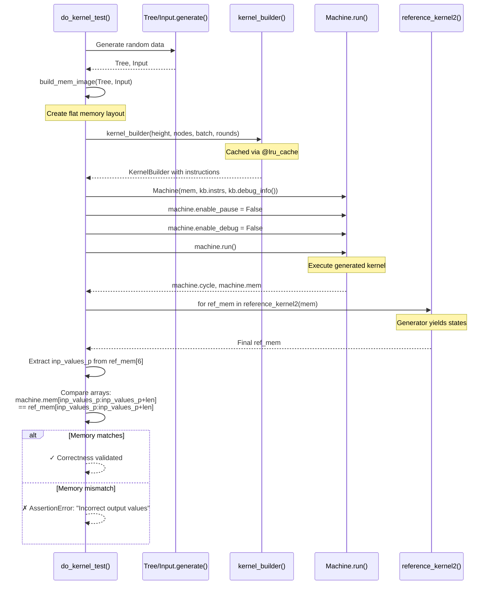
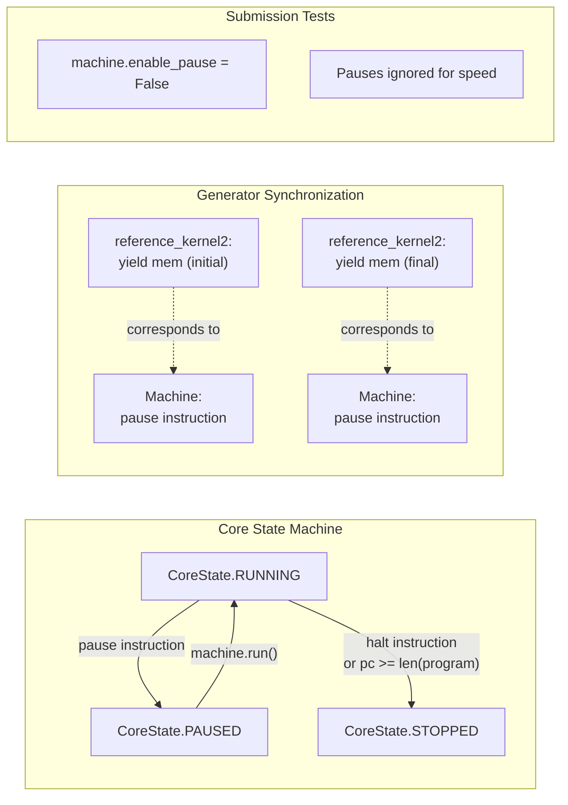
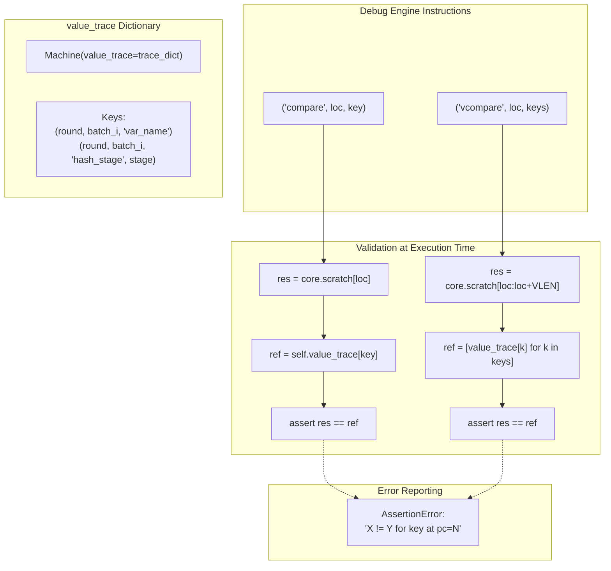

<!-- source: DeepWiki mcp.deepwiki.com · repo anthropics/original_performance_takehome · page 6.2 Correctness Validation · fetched 2026-10-26 -->

# Correctness Validation

<details>
<summary>Relevant source files</summary>

The following files were used as context for generating this wiki page:

- [tests/frozen_problem.py](tests/frozen_problem.py)
- [tests/submission_tests.py](tests/submission_tests.py)

</details>


This page explains how the testing framework validates that generated kernels produce functionally correct results. For information about performance measurement and cycle counting, see [6.3 Performance Measurement](). For the overall test suite structure, see [6.1 Test Suite Structure]().

## Purpose and Scope

Correctness validation ensures that the instructions generated by `KernelBuilder.build_kernel` [perf_takehome.py:53-54]() produce the same output as the reference implementation. The system uses a **reference implementation strategy** where a ground-truth Python implementation runs on the same flat memory layout and produces expected results for comparison. This approach validates that optimizations in the generated kernel preserve functional correctness regardless of how instructions are reordered, vectorized, or parallelized.

## Validation Strategy Overview



**Sources:** [tests/submission_tests.py:30-54](), [tests/frozen_problem.py:535-568]()

The validation strategy follows these principles:

1. **Same Memory Layout**: Both the Machine simulator and reference implementation operate on the same flat memory image format produced by `build_mem_image` [tests/frozen_problem.py:469-487]().
2. **Generator Pattern**: `reference_kernel2` is a generator function that yields memory states at validation checkpoints [tests/frozen_problem.py:535-568]().
3. **Output Comparison**: Tests compare specific memory regions (the `inp_values` array) rather than instruction-by-instruction execution [tests/submission_tests.py:48-52]().
4. **Random Testing**: Correctness tests run multiple iterations with different random data to catch edge cases [tests/submission_tests.py:58-60]().

## Reference Implementation: reference_kernel2

The `reference_kernel2` function in [tests/frozen_problem.py:535-568]() is the ground truth implementation that defines correct behavior:



**Sources:** [tests/frozen_problem.py:535-568](), [tests/frozen_problem.py:516-532]()

### Memory Layout Dependencies

The reference implementation reads the memory layout convention from the header [tests/frozen_problem.py:539-547]():

| Offset | Field | Description |
|--------|-------|-------------|
| `mem[0]` | `rounds` | Number of traversal rounds |
| `mem[1]` | `n_nodes` | Total tree nodes |
| `mem[2]` | `batch_size` | Number of parallel traversals |
| `mem[3]` | `forest_height` | Tree height |
| `mem[4]` | `forest_values_p` | Pointer to tree values array |
| `mem[5]` | `inp_indices_p` | Pointer to input indices array |
| `mem[6]` | `inp_values_p` | Pointer to input values array |

The reference implementation directly indexes into these arrays: `mem[forest_values_p + idx]`, `mem[inp_indices_p + i]`, `mem[inp_values_p + i]`. This ensures it operates on the same data layout as the Machine simulator.

**Sources:** [tests/frozen_problem.py:539-547]()

### Trace Dictionary Mechanism

The optional `trace` dictionary parameter enables fine-grained debugging by recording intermediate values:



**Sources:** [tests/frozen_problem.py:516-532](), [tests/frozen_problem.py:551-562](), [tests/frozen_problem.py:366-381]()

The trace dictionary maps tuple keys `(round, batch_i, variable_name)` to expected values. This enables:
- **Debugging individual operations**: Check if specific intermediate calculations match reference [tests/frozen_problem.py:551-562]().
- **Hash stage validation**: The `myhash_traced` function records output after each of 6 mixing stages [tests/frozen_problem.py:528-530]().
- **Debug instructions**: The Machine's debug engine can insert `compare` instructions to validate scratch space values against the trace [tests/frozen_problem.py:370-381]().

### Generator Yield Points

The `reference_kernel2` function yields memory states at specific checkpoints:

1. **Initial state** [tests/frozen_problem.py:548](): `yield mem` after reading header but before computation.
2. **Final state** [tests/frozen_problem.py:568](): `yield mem` after all rounds complete.

The comment at [tests/frozen_problem.py:565-567]() notes: "You can add new yields or move this around for debugging as long as it's matched by pause instructions." This allows intermediate validation points where the Machine uses `pause` instructions to synchronize with reference yields.

**Sources:** [tests/frozen_problem.py:548](), [tests/frozen_problem.py:565-568]()

## Validation Flow in Tests



**Sources:** [tests/submission_tests.py:30-54]()

### The do_kernel_test Function

The core validation logic resides in `do_kernel_test` [tests/submission_tests.py:30-54]():

1. **Generate random test data** [tests/submission_tests.py:33-35](): Creates a random `Tree` and `Input` (note: no seed, so each run is different).
2. **Build memory image** [tests/submission_tests.py:35](): Converts to flat memory layout using `build_mem_image` [tests/frozen_problem.py:469]().
3. **Get cached kernel builder** [tests/submission_tests.py:37](): Uses `@lru_cache` to avoid rebuilding identical kernels.
4. **Execute Machine** [tests/submission_tests.py:40-43]():
   - `machine.enable_pause = False`: Disables pause instructions for speed.
   - `machine.enable_debug = False`: Disables debug instruction validation.
5. **Iterate reference generator** [tests/submission_tests.py:45-46](): Consumes all yields to get final state.
6. **Compare output arrays** [tests/submission_tests.py:48-52](): Validates `inp_values` array matches.

### Memory Comparison Logic

The validation specifically compares the `inp_values` array:

```python
inp_values_p = ref_mem[6]  # Read pointer from header
assert (
    machine.mem[inp_values_p : inp_values_p + len(inp.values)]
    == ref_mem[inp_values_p : inp_values_p + len(inp.values)]
), "Incorrect output values"
```

**Why only inp_values?** The `inp_indices` array at `mem[5]` is also modified during execution, but the final indices depend on implementation details (e.g., order of operations). The `inp_values` array is the primary output that must match exactly. The tree values at `mem[4]` remain constant.

**Sources:** [tests/submission_tests.py:48-52]()

### Multiple Random Test Runs

The `CorrectnessTests` class runs validation multiple times with different random data:

```python
def test_kernel_correctness(self):
    for i in range(8):
        do_kernel_test(10, 16, 256)
```

This catches:
- **Edge cases**: Rare value combinations that trigger bugs.
- **Race conditions**: If the kernel has any non-determinism.
- **Memory corruption**: Writes to wrong addresses might not manifest every time.

Since `Tree.generate` and `Input.generate` use `random.randint` without seeding [tests/frozen_problem.py:417-436](), each iteration has different data.

**Sources:** [tests/submission_tests.py:57-60]()

## Pause/Resume Mechanism

The Machine simulator supports **pausing execution** for intermediate validation:



**Sources:** [tests/frozen_problem.py:18-22](), [tests/frozen_problem.py:317-319](), [tests/frozen_problem.py:199-200]()

### How Pause Instructions Work

1. **flow engine instruction** [tests/frozen_problem.py:317-319](): `("pause",)` sets `core.state = CoreState.PAUSED`.
2. **Execution stops** [tests/frozen_problem.py:201](): The run loop skips cores in PAUSED state.
3. **Resume on next run()** [tests/frozen_problem.py:199-200](): Calling `machine.run()` again resets PAUSED cores to RUNNING.

This enables:
- **Checkpoint validation**: Compare machine.mem with reference_kernel2 yields at intermediate points.
- **Debugging**: Inspect memory/scratch state mid-execution.
- **Incremental testing**: Test kernel correctness round-by-round rather than only final output.

### Why Submission Tests Disable Pauses

The submission tests set `machine.enable_pause = False` [tests/submission_tests.py:41]() because:
- **Performance**: Validation at intermediate points would require multiple Machine.run() calls.
- **Simplicity**: Final output comparison is sufficient for correctness.
- **Speed**: Tests run faster without pause/resume overhead.

Developers can enable pauses during debugging by modifying this flag or running the Machine manually with pauses enabled.

**Sources:** [tests/submission_tests.py:41-42]()

## Debug Instrumentation

Beyond basic memory comparison, the system provides **fine-grained validation** through debug instructions:



**Sources:** [tests/frozen_problem.py:366-381]()

### compare and vcompare Instructions

The debug engine [tests/frozen_problem.py:366-382]() supports two validation instructions:

1. **`("compare", loc, key)`**: Validates a scalar scratch variable [tests/frozen_problem.py:370-375]().
   - Reads `core.scratch[loc]`.
   - Looks up expected value in `self.value_trace[key]`.
   - Asserts they match with detailed error message.

2. **`("vcompare", loc, keys)`**: Validates a vector scratch variable [tests/frozen_problem.py:376-381]().
   - Reads `core.scratch[loc : loc + VLEN]` (8 consecutive words).
   - Looks up expected values for each element in `keys` list.
   - Asserts entire vector matches.

### Usage in Kernel Builder

A kernel can insert debug instructions to validate intermediate results. These instructions execute during `Machine.run()` and will raise `AssertionError` immediately if values don't match the reference trace. This catches errors closer to their source than final memory comparison.

### Disabling Debug Instructions

Submission tests disable debug validation with `machine.enable_debug = False` [tests/submission_tests.py:42]() because:
- **Performance**: Checking every intermediate value is slow.
- **Trace dependency**: Requires running reference_kernel2 with trace collection first.
- **Not needed**: Final memory comparison is sufficient for correctness validation.

Developers can enable debug instructions during development to catch errors early.

**Sources:** [tests/submission_tests.py:42](), [tests/frozen_problem.py:366-368]()

## Summary

Correctness validation in this system uses a **reference implementation strategy** where:

1. **reference_kernel2** defines ground truth behavior on the same flat memory layout [tests/frozen_problem.py:535]().
2. **Generator pattern** allows validation at multiple checkpoints (though submission tests only use final state) [tests/frozen_problem.py:548, 568]().
3. **Memory comparison** validates the `inp_values` output array matches exactly [tests/submission_tests.py:49-52]().
4. **Random testing** runs validation 8 times with different data to catch edge cases [tests/submission_tests.py:59-60]().
5. **Debug instrumentation** provides optional fine-grained validation of intermediate values [tests/frozen_problem.py:366-381]().

This approach validates functional correctness independently of performance optimizations, allowing the kernel builder to explore aggressive transformations like vectorization, reordering, and loop unrolling while maintaining confidence in correctness.

**Sources:** [tests/submission_tests.py:30-60](), [tests/frozen_problem.py:535-568](), [tests/frozen_problem.py:366-381]()

---

