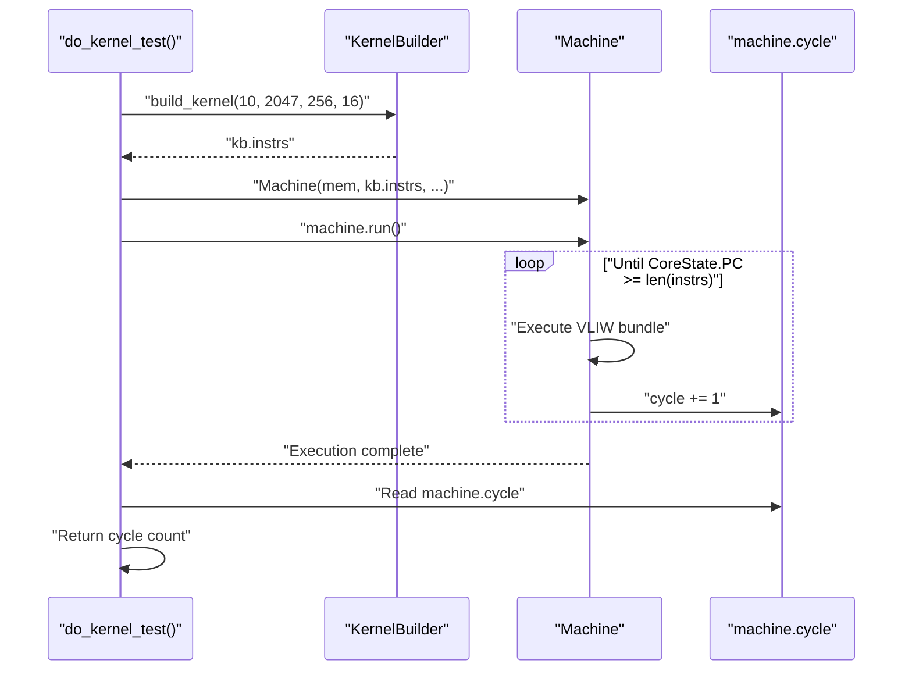
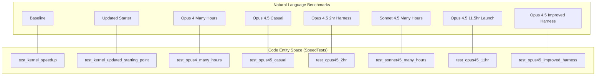
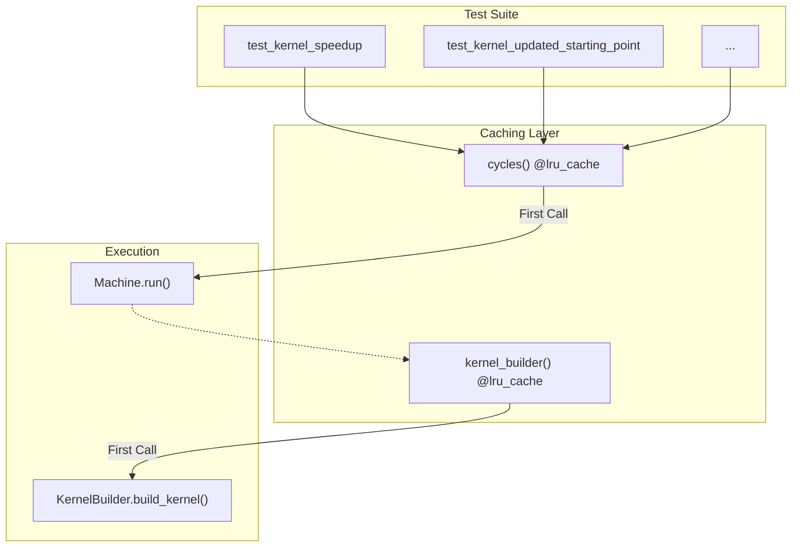

<!-- source: DeepWiki mcp.deepwiki.com · repo anthropics/original_performance_takehome · page 6.3 Performance Measurement · fetched 2026-10-26 -->

# Performance Measurement

<details>
<summary>Relevant source files</summary>

The following files were used as context for generating this wiki page:

- [tests/submission_tests.py](tests/submission_tests.py)

</details>


This page documents how the testing framework measures performance in cycle counts, calculates speedup over baseline, and implements caching strategies to avoid redundant measurements. For information about test suite organization and test execution, see [Test Suite Structure](#6.1). For correctness validation mechanisms, see [Correctness Validation](#6.2).

## Overview

Performance measurement in this system is straightforward: count the number of simulated machine cycles required to execute the generated kernel. The `Machine` simulator maintains a `cycle` counter that increments after each instruction bundle executes. The testing framework compares this cycle count against a baseline and various performance thresholds to assess optimization quality.

## Cycle Counting Mechanism

The cycle counter is maintained by the `Machine` class in `frozen_problem.py`. Each time an instruction bundle executes, the cycle counter increments by one, regardless of how many operations execute in parallel within that bundle.

### Measurement Data Flow


Sources: [tests/submission_tests.py:30-54](), [frozen_problem.py:596-608]()

The measurement occurs in the `do_kernel_test` function:

| Step | Code Location | Action |
|------|---------------|--------|
| 1. Create Machine | [tests/submission_tests.py:40]() | `machine = Machine(mem, kb.instrs, kb.debug_info(), n_cores=N_CORES)` |
| 2. Configure | [tests/submission_tests.py:41-42]() | Disable pause and debug modes for performance runs |
| 3. Execute | [tests/submission_tests.py:43]() | `machine.run()` executes all instructions |
| 4. Read Counter | [tests/submission_tests.py:53]() | `return machine.cycle` provides the total cycle count |

Sources: [tests/submission_tests.py:40-54]()

## Baseline Measurement

The `BASELINE` constant represents the cycle count of the initial unoptimized implementation provided as a starting point:

```python
BASELINE = 147734
```

This baseline serves as the denominator in speedup calculations. All performance comparisons are relative to this reference point.

Sources: [tests/submission_tests.py:63]()

## Speedup Calculation

Speedup is computed as the ratio of baseline cycles to optimized cycles:

```
Speedup = BASELINE / cycles()
```

This formula yields:
- `1.0x` for implementations matching the baseline.
- `~7.97x` for the updated starting point (18,532 cycles).
- `>100x` for high-performance AI-optimized kernels.

The speedup is printed after the main test execution:

```python
print("Speedup over baseline: ", BASELINE / res)
```

Sources: [tests/submission_tests.py:70-71]()

## Performance Thresholds Hierarchy

The `SpeedTests` class defines a ladder of performance targets, ranging from the baseline to the best known performance achieved by Claude Opus 4.5.

### Threshold Association Diagram


Sources: [tests/submission_tests.py:85-115]()

### Threshold Details

| Test Method | Cycle Threshold | Description |
|-------------|----------------|-------------|
| `test_kernel_speedup` | `< 147734` | Beat the original baseline. |
| `test_kernel_updated_starting_point` | `< 18532` | Beat the updated starter code given to candidates. |
| `test_opus4_many_hours` | `< 2164` | Claude Opus 4 after extended compute. |
| `test_opus45_casual` | `< 1790` | Claude Opus 4.5 in a casual session (~best human 2hr). |
| `test_opus45_2hr` | `< 1579` | Claude Opus 4.5 after 2 hours in a compute harness. |
| `test_sonnet45_many_hours` | `< 1548` | Claude Sonnet 4.5 after extended compute. |
| `test_opus45_11hr` | `< 1487` | Claude Opus 4.5 after 11.5 hours; the recruitment gate. |
| `test_opus45_improved_harness` | `< 1363` | Claude Opus 4.5 in an improved test-time compute harness. |

Sources: [tests/submission_tests.py:76-116]()

## Caching Strategy

The testing framework implements a two-level caching strategy using `functools.lru_cache` to ensure that expensive operations—kernel generation and machine execution—are only performed once per test run.


Sources: [tests/submission_tests.py:23-28](), [tests/submission_tests.py:66-74]()

### Implementation Details

1.  **`kernel_builder()`**: Decorated with `@lru_cache(maxsize=None)` [tests/submission_tests.py:23](). It ensures that for a specific set of parameters (`forest_height`, `n_nodes`, `batch_size`, `rounds`), the `KernelBuilder` only builds the kernel once [tests/submission_tests.py:24-27]().
2.  **`cycles()`**: Decorated with `@lru_cache(maxsize=None)` [tests/submission_tests.py:66](). It calls `do_kernel_test` and caches the resulting cycle count [tests/submission_tests.py:69-71](). This prevents the `Machine` from re-running the same instructions for every threshold check in `SpeedTests`.

## Error Handling in Measurement

If a correctness assertion fails during the execution of `do_kernel_test`, the `cycles()` function catches the `AssertionError`:

```python
try:
    res = do_kernel_test(10, 16, 256)
    return res
except AssertionError as e:
    return BASELINE * 2
```

By returning `BASELINE * 2` (295,468 cycles), the framework ensures that an incorrect implementation fails all speed tests (since they all check for values less than `BASELINE` or smaller thresholds).

Sources: [tests/submission_tests.py:68-73]()

## Test Parameters

The standard performance benchmark uses the following parameters, defined in the `cycles()` function:

| Parameter | Value | Description |
|-----------|-------|-------------|
| `forest_height` | 10 | The height of the binary tree. |
| `rounds` | 16 | Number of hash rounds per batch item. |
| `batch_size` | 256 | Total items to process. |

Sources: [tests/submission_tests.py:69]()

## Standard Test Output

When running `python tests/submission_tests.py`, the measurement logic produces status updates to the console:

1.  **Execution Start**: `Testing forest_height=10, rounds=16, batch_size=256` [tests/submission_tests.py:31]()
2.  **Cycle Count**: `CYCLES: <count>` [tests/submission_tests.py:53]()
3.  **Speedup**: `Speedup over baseline: <ratio>` [tests/submission_tests.py:70]()

Sources: [tests/submission_tests.py:31-70]()

---

