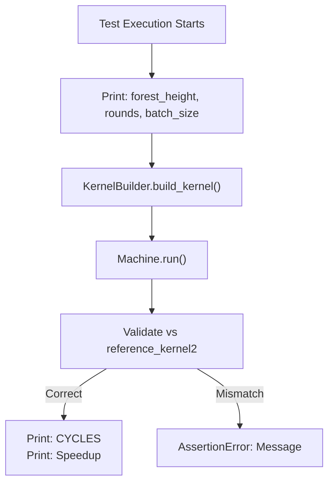
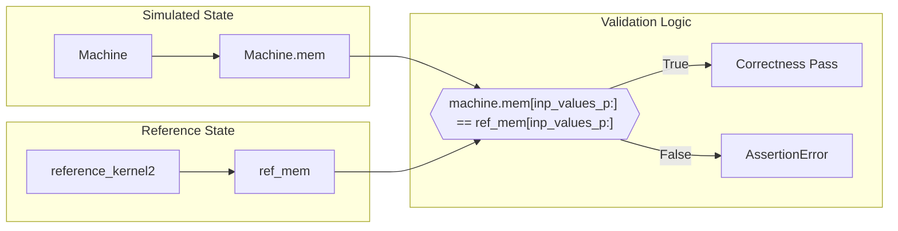
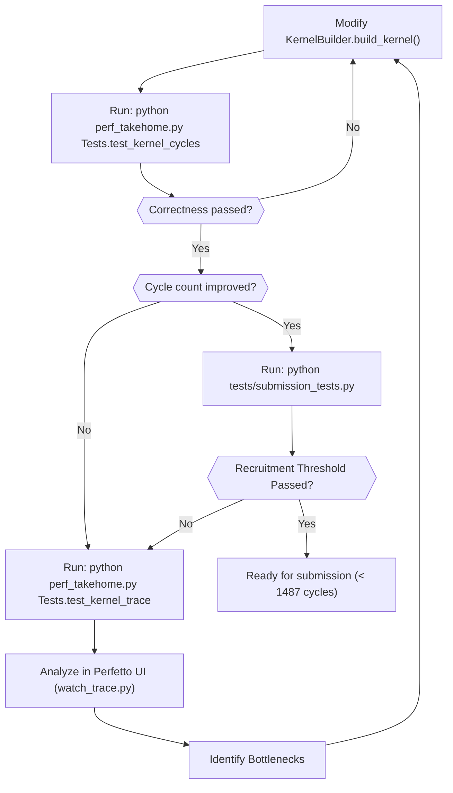

<!-- source: DeepWiki mcp.deepwiki.com · repo anthropics/original_performance_takehome · page 6.4 Running and Interpreting Tests · fetched 2026-10-26 -->

# Running and Interpreting Tests

<details>
<summary>Relevant source files</summary>

The following files were used as context for generating this wiki page:

- [Readme.md](Readme.md)
- [tests/submission_tests.py](tests/submission_tests.py)

</details>


This page provides a practical guide for executing tests, understanding their output, debugging failures, and iterating on optimizations. For information about test suite structure and organization, see [Test Suite Structure](#6.1). For details on correctness validation mechanisms, see [Correctness Validation](#6.2). For performance measurement methodology, see [Performance Measurement](#6.3).

## Test Execution Overview

The repository provides two test entry points serving different purposes:

| Test File | Purpose | Simulator Used | When to Use |
|-----------|---------|---------------|-------------|
| `perf_takehome.py` | Development and debugging | `problem.py` (live) | During optimization work, with trace enabled |
| `tests/submission_tests.py` | Final validation and scoring | `frozen_problem.py` | Before submission, to check threshold performance |

Sources: [perf_takehome.py:1-273](), [tests/submission_tests.py:1-120]()

## Running Development Tests

### Basic Test Execution

Execute tests from the repository root:

```bash
# Run all tests in perf_takehome.py
python perf_takehome.py

# Run specific test
python perf_takehome.py Tests.test_kernel_cycles

# Run with trace generation (for debugging)
python perf_takehome.py Tests.test_kernel_trace
```

Sources: [perf_takehome.py:258-267]()

### Available Development Tests

The `Tests` class in `perf_takehome.py` provides:

**`test_ref_kernels()`** [perf_takehome.py:226-239]()
- Validates that `reference_kernel` and `reference_kernel2` produce identical results.
- Runs 10 randomized test cases with varying tree heights and batch sizes.
- Useful for verifying reference implementation consistency.

**`test_kernel_trace()`** [perf_takehome.py:241-243]()
- Executes the full-scale benchmark (height=10, rounds=16, batch=256) with tracing enabled.
- Generates `trace.json` for visualization with Perfetto UI.
- **Recommended for debugging** - see [Trace Generation](#7.1) for visualization workflow.

**`test_kernel_cycles()`** [perf_takehome.py:254-255]()
- Measures cycle count for standard benchmark parameters.
- Quick performance check during development.
- Uses development simulator (allows debug output).

Sources: [perf_takehome.py:225-256]()

## Running Submission Tests

### Execution Commands

```bash
# Run all submission tests
python tests/submission_tests.py

# Run only correctness tests
python tests/submission_tests.py CorrectnessTests

# Run only speed tests
python tests/submission_tests.py SpeedTests

# Run specific threshold test
python tests/submission_tests.py SpeedTests.test_opus45_11hr
```

Sources: [tests/submission_tests.py:118-120]()

### Test Classes

#### CorrectnessTests

The `CorrectnessTests.test_kernel_correctness()` validates functional correctness across multiple random inputs [tests/submission_tests.py:57-60]():

```python
def test_kernel_correctness(self):
    for i in range(8):
        do_kernel_test(10, 16, 256)
```

- Runs 8 iterations with non-deterministic random seeds [tests/submission_tests.py:32-33]().
- Each iteration generates a new `Tree` and `Input` configuration [tests/submission_tests.py:33-34]().
- Tests against standard benchmark parameters (height=10, rounds=16, batch=256) [tests/submission_tests.py:60]().
- **Must pass** before performance is meaningful.

#### SpeedTests

The `SpeedTests` class contains progressive performance thresholds [tests/submission_tests.py:76-116](). Each test method asserts `cycles() < THRESHOLD`:

| Test Method | Threshold | Description |
|-------------|-----------|-------------|
| `test_kernel_speedup()` | 147,734 | Beat baseline (any improvement) |
| `test_kernel_updated_starting_point()` | 18,532 | Updated starter code performance |
| `test_opus4_many_hours()` | 2,164 | Claude Opus 4 extended optimization |
| `test_opus45_casual()` | 1,790 | Best human 2-hour performance |
| `test_opus45_2hr()` | 1,579 | Claude Opus 4.5 2-hour harness |
| `test_sonnet45_many_hours()` | 1,548 | Claude Sonnet 4.5 extended |
| `test_opus45_11hr()` | 1,487 | **Recruitment threshold** |
| `test_opus45_improved_harness()` | 1,363 | Best known performance |

Sources: [tests/submission_tests.py:76-116](), [Readme.md:13-18]()

### Caching Behavior

The `cycles()` function uses `@lru_cache(maxsize=None)` to avoid redundant simulation [tests/submission_tests.py:66-71]():

```python
@lru_cache(maxsize=None)
def cycles():
    try:
        res = do_kernel_test(10, 16, 256)
        print("Speedup over baseline: ", BASELINE / res)
        return res
    except AssertionError as e:
        return BASELINE * 2
```

**Implications:**
- Cycle count is computed **once** per test run, then cached [tests/submission_tests.py:66-71]().
- All `SpeedTests` methods use the same cached result.
- Correctness failures return `BASELINE * 2` (295,468 cycles), causing all speed tests to fail [tests/submission_tests.py:73]().
- To re-measure after code changes, restart the Python process.

Sources: [tests/submission_tests.py:66-73]()

## Understanding Test Output

### Standard Output Format

Diagram: Test Execution Logic Flow



Sources: [perf_takehome.py:175-222](), [tests/submission_tests.py:30-54]()

### Example Output: Success

```
Testing forest_height=10, rounds=16, batch_size=256
CYCLES:  18532
Speedup over baseline:  7.971459383753502
.
----------------------------------------------------------------------
Ran 1 test in 0.234s

OK
```

**Interpretation:**
- Test completed successfully (correctness validated).
- Required 18,532 cycles to complete.
- Achieved ~7.97x speedup over baseline (147,734 cycles).

### Example Output: Correctness Failure

```
Testing forest_height=10, rounds=16, batch_size=256
Traceback (most recent call last):
  ...
AssertionError: Incorrect output values
```

**Interpretation:**
- Generated instructions produced incorrect results.
- Memory state at `inp_values_p` differs from reference implementation [tests/submission_tests.py:49-52]().

### Example Output: Performance Failure

```
Testing forest_height=10, rounds=16, batch_size=256
CYCLES:  2500
Speedup over baseline:  59.0936
F
======================================================================
FAIL: test_opus45_casual (tests.submission_tests.SpeedTests)
----------------------------------------------------------------------
...
AssertionError: assert 2500 < 1790
```

**Interpretation:**
- Correctness validation passed.
- Cycle count (2,500) exceeds threshold (1,790) [tests/submission_tests.py:99]().

Sources: [tests/submission_tests.py:30-54](), [tests/submission_tests.py:85-115]()

## Interpreting Test Failures

### Debugging Correctness Failures

Diagram: Data Space Validation Comparison



Sources: [tests/submission_tests.py:40-52](), [frozen_problem.py:284-300]()

The assertion at [tests/submission_tests.py:49-52]() compares the `inp_values` array in memory:

```python
inp_values_p = ref_mem[6]
assert (
    machine.mem[inp_values_p : inp_values_p + len(inp.values)]
    == ref_mem[inp_values_p : inp_values_p + len(inp.values)]
), "Incorrect output values"
```

**Common Causes:**

1. **Missing or incorrect hash stages**: The `build_hash()` method must implement all `HASH_STAGES` operations in order [perf_takehome.py:74-83]().
2. **Incorrect scratch register reuse**: Overwriting values still needed in subsequent operations.
3. **Wrong VLIW packing**: Multiple operations in the same bundle that create read-after-write conflicts within a single cycle.
4. **Missing pause points**: If using development tests with `reference_kernel2` yields, `pause` instructions must match the reference yield points [perf_takehome.py:115-119]().

**Debugging Strategy:**

Enable debug comparisons and prints in `do_kernel_test()` within `perf_takehome.py` [perf_takehome.py:202-218]():

```python
machine.prints = True  # Set this to enable output
for i, ref_mem in enumerate(reference_kernel2(mem, value_trace)):
    machine.run()
    if prints:
        print(machine.mem[inp_values_p : inp_values_p + len(inp.values)])
        print(ref_mem[inp_values_p : inp_values_p + len(inp.values)])
```

This shows your output vs expected output at each pause point, allowing identification of where divergence occurs.

Sources: [perf_takehome.py:175-222]()

### Debugging Performance Issues

When correctness passes but cycle count is too high:

**Step 1: Measure baseline for your implementation**
Run `test_kernel_cycles` to get your current cycle count [perf_takehome.py:254-255]().

**Step 2: Enable tracing**
Run `test_kernel_trace` and visualize with Perfetto UI [perf_takehome.py:241-243]().

**Step 3: Identify bottlenecks**
In Perfetto UI, examine:
- **Engine utilization**: Are ALU/VALU slots being filled efficiently?
- **Memory access patterns**: Are LOAD/STORE engines saturated?
- **Parallelization**: Are operations serialized that could be parallel?
- **Scratch allocation**: Is scratch space used efficiently?

Sources: [perf_takehome.py:241-243](), [perf_takehome.py:262-266]()

## Test Iteration Workflow

Diagram: Development Iteration Cycle



Sources: [perf_takehome.py:241-273](), [tests/submission_tests.py:1-120](), [Readme.md:21-21]()

### Workflow Phases

**Phase 1: Rapid Iteration (Development Tests)**
Use `perf_takehome.py` for fast feedback:
- Test correctness with `test_kernel_cycles` [perf_takehome.py:254-255]().
- Quick cycle count measurement.
- Uses development simulator (not frozen).

**Phase 2: Deep Analysis (Trace Mode)**
When performance plateaus:
- Generate trace with `test_kernel_trace` [perf_takehome.py:241-243]().
- Visualize execution with Perfetto UI.
- Identify specific bottlenecks.

**Phase 3: Validation (Submission Tests)**
Before final submission:
- Run full `CorrectnessTests` (8 random seeds) [tests/submission_tests.py:58-60]().
- Check `SpeedTests` to see which thresholds you pass [tests/submission_tests.py:76-116]().
- Uses frozen simulator for deterministic results.

Sources: [perf_takehome.py:258-273](), [tests/submission_tests.py:57-116]()

## Key Command Reference

| Command | Purpose | Output Location |
|---------|---------|----------------|
| `python perf_takehome.py` | Run all development tests | stdout |
| `python perf_takehome.py Tests.test_kernel_cycles` | Quick performance check | stdout (cycle count) |
| `python perf_takehome.py Tests.test_kernel_trace` | Generate execution trace | `trace.json` |
| `python tests/submission_tests.py` | Run all validation tests | stdout (pass/fail) |
| `python tests/submission_tests.py CorrectnessTests` | Validate correctness only | stdout |
| `python tests/submission_tests.py SpeedTests` | Check performance thresholds | stdout |
| `python watch_trace.py` | Start trace visualization server | localhost:8000 |

Sources: [perf_takehome.py:258-273](), [tests/submission_tests.py:118-119]()

## Notes on Test Determinism

**Development Tests (`perf_takehome.py`)**
- Use fixed seed (`seed=123`) [perf_takehome.py:179-184]().
- Deterministic for debugging; same tree and input every run.

**Submission Tests (`tests/submission_tests.py`)**  
- **No seed set** [tests/submission_tests.py:32-33]().
- Non-deterministic tree and input generation.
- Tests robustness across varied inputs.
- Cycle count may vary slightly across runs.

This design ensures that optimizations work correctly for arbitrary inputs, not just a single test case.

Sources: [perf_takehome.py:175-187](), [tests/submission_tests.py:30-35]()

---

