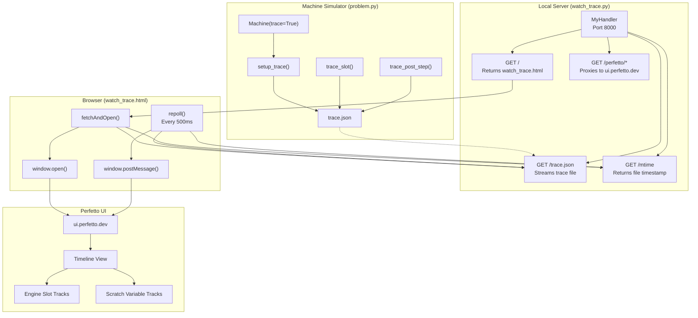
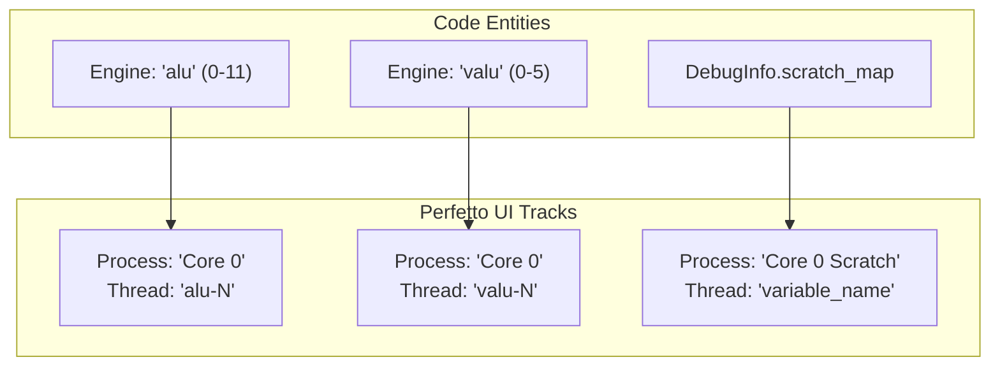

<!-- source: DeepWiki mcp.deepwiki.com · repo anthropics/original_performance_takehome · page 7 Performance Analysis and Debugging · fetched 2026-10-26 -->

# Performance Analysis and Debugging

Relevant source files

The following files were used as context for generating this wiki page:

- [watch_trace.html](watch_trace.html)
- [watch_trace.py](watch_trace.py)

This document covers the trace visualization system used for debugging performance issues and understanding execution behavior in the VLIW SIMD simulator. The trace system generates Chrome Trace Event Format files that can be visualized using Perfetto UI, providing detailed insight into instruction execution, slot utilization, and scratch space updates across cycles.

For information about the machine architecture being traced, see [Machine Architecture](#4). For information about performance measurement in tests, see [Performance Measurement](#6.3). For optimization strategies, see [Optimization Strategies and Patterns](#5.4).

## Trace System Architecture

The trace visualization pipeline consists of three integrated components: trace generation in the simulator, a local HTTP server for serving trace files, and a web interface that communicates with Perfetto UI.

### System Flow Diagram
Title: Trace Visualization Pipeline Architecture

Sources: [watch_trace.py:9-67](), [watch_trace.html:36-130]()

## Trace Generation (#7.1)

Traces are enabled by passing `trace=True` to the `Machine` constructor. The simulator records two primary types of data: engine slot activity and scratch memory state.

*   **Slot Tracing:** Every operation in every engine (e.g., `alu`, `valu`, `load`) is recorded as a duration event.
*   **Scratch Tracing:** Changes to scratch memory addresses are recorded. If a `DebugInfo` object is provided with a `scratch_map`, these addresses are labeled with human-readable names in the UI.
*   **Output Format:** The system produces a `trace.json` file compatible with the Chrome Trace Event Format.

For details, see [Trace Generation](#7.1).

## Trace Visualization Server (#7.2)

The `watch_trace.py` script runs a specialized `http.server.BaseHTTPRequestHandler` called `MyHandler` on port 8000. It serves three main functions:
1.  **File Hosting:** Serves `watch_trace.html` and the `trace.json` file.
2.  **State Polling:** Provides a `/mtime` endpoint that returns the last modified timestamp of `trace.json` so the browser can detect when a new simulation has finished.
3.  **Perfetto Proxying:** Proxies requests to `https://ui.perfetto.dev` while applying patches to the Perfetto frontend code (e.g., auto-expanding tracks and fixing known UI bugs).

For details, see [Trace Visualization Server](#7.2).

Sources: [watch_trace.py:9-67](), [watch_trace.py:74-79]()

## Web Interface Usage (#7.3)

The `watch_trace.html` file provides the frontend logic for the debugging system. It automates the process of loading local trace data into the cloud-hosted Perfetto UI using the `window.postMessage` API.

*   **Handshake:** It performs a "PING/PONG" handshake with the Perfetto window to ensure the UI is ready before sending data.
*   **Live Reload:** It implements a `repoll()` function that checks `/mtime` every 500ms. If the timestamp changes, it automatically refetches the trace and pushes it to the open Perfetto tab.

For details, see [Web Interface Usage](#7.3).

Sources: [watch_trace.html:43-90](), [watch_trace.html:103-120]()

## Perfetto UI Integration (#7.4)

Perfetto UI provides a high-fidelity timeline view of the kernel execution.

### Visualization Mapping
Title: Code Entity to Perfetto Track Mapping

Sources: [watch_trace.py:55-59](), [watch_trace.html:75-90]()

Users can use the UI to:
*   Identify cycles where engines are idle (bubbles in the pipeline).
*   Verify that vector operations are correctly aligned.
*   Monitor the values of scratch variables across the entire execution.

For details, see [Perfetto UI Integration](#7.4).

## Debugging Workflows and Strategies (#7.5)

Effective performance analysis involves identifying why specific engine slots are empty and finding ways to fill them.

*   **Bottleneck Identification:** Use the selection tool to see which engine (e.g., `load` vs `alu`) is the limiting factor for a loop iteration.
*   **Dependency Tracking:** Observe the "Core 0 Scratch" tracks to see if an instruction is stalled waiting for a value written in a previous cycle.
*   **Parallelization:** Look for opportunities to move scalar `alu` operations into empty slots during long `valu` or `load` sequences.

For details, see [Debugging Workflows and Strategies](#7.5).

---

