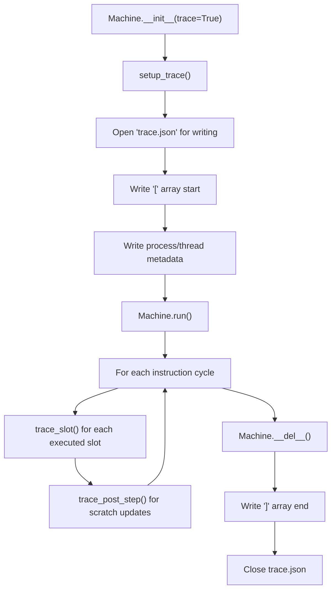
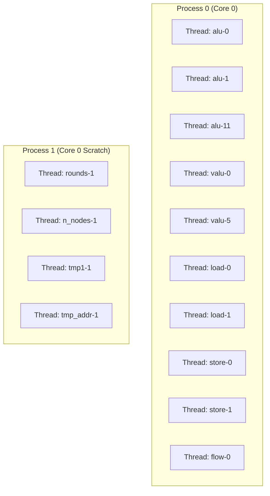
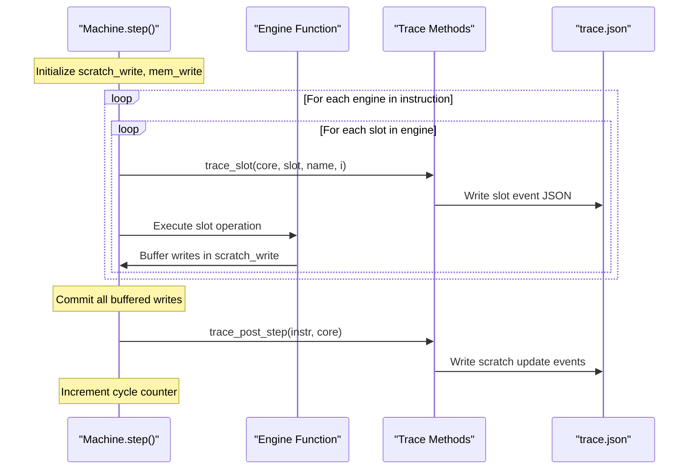

<!-- source: DeepWiki mcp.deepwiki.com · repo anthropics/original_performance_takehome · page 7.1 Trace Generation · fetched 2026-10-26 -->

# Trace Generation

<details>
<summary>Relevant source files</summary>

The following files were used as context for generating this wiki page:

- [problem.py](problem.py)
- [tests/frozen_problem.py](tests/frozen_problem.py)

</details>


This page documents the trace generation system built into the `Machine` simulator, which produces execution traces in Chrome Trace Event Format for performance visualization and debugging. For information about the visualization server and UI that consumes these traces, see [7.2 Trace Visualization Server]() and [7.3 Web Interface Usage]().

## Purpose and Scope

The trace generation system captures fine-grained execution events during kernel simulation, writing them to a `trace.json` file that can be visualized in Perfetto UI. This enables developers to:

- Observe parallel slot execution across engine types (`alu`, `valu`, `load`, `store`, `flow`)
- Monitor scratch variable state changes over time
- Identify performance bottlenecks and underutilized execution slots
- Debug instruction scheduling and VLIW packing effectiveness

The tracing infrastructure is completely optional and has no effect on cycle counting or correctness validation.

## Enabling Trace Generation

Trace generation is controlled by the `trace` parameter when constructing a `Machine` instance:

```python
machine = Machine(
    mem,
    instructions,
    debug_info,
    n_cores=N_CORES,
    trace=True  # Enable tracing
)
```

When `trace=True`, the `Machine` constructor calls `setup_trace()` to initialize the trace file [tests/frozen_problem.py:118-119](). When `trace=False` (the default), no trace file is generated and the tracing methods become no-ops [tests/frozen_problem.py:121]().

Sources: [tests/frozen_problem.py:97-121](), [problem.py:97-121]()

### Test Integration

The test suite provides a dedicated test for trace generation in `submission_tests.py`:

```python
def test_kernel_trace(self):
    do_kernel_test(10, 16, 256, trace=True, prints=False)
```

This test runs the full-scale benchmark kernel with tracing enabled, producing a comprehensive `trace.json` file for analysis [tests/submission_tests.py:100-102]().

Sources: [tests/submission_tests.py:100-102]()

## Chrome Trace Event Format

The simulator outputs traces in [Chrome's Trace Event Format](https://docs.google.com/document/d/1CvAClvFfyA5R-PhYUmn5OOQtYMH4h6I0nSsKchNAySU/preview), a JSON-based format designed for performance visualization tools [tests/frozen_problem.py:153-158](). This format is compatible with:

- **Perfetto UI** (ui.perfetto.dev) - recommended
- **chrome://tracing** - Chrome's built-in trace viewer

The format uses structured JSON events with specific fields:

| Field | Purpose |
|-------|---------|
| `name` | Event name/label displayed in UI |
| `ph` | Phase type (`M` = metadata, `X` = duration event) |
| `pid` | Process ID (maps to cores) |
| `tid` | Thread ID (maps to engine slots or scratch variables) |
| `ts` | Timestamp (cycle number) |
| `dur` | Duration (always 1 cycle for slot events) |
| `cat` | Category (e.g., "op" for operations) |
| `args` | Additional structured data |

Sources: [tests/frozen_problem.py:160-196]()

## Trace File Lifecycle



**Diagram: Trace File Lifecycle**

Sources: [tests/frozen_problem.py:97-121](), [tests/frozen_problem.py:151-196](), [tests/frozen_problem.py:399-402]()

## Trace Setup and Metadata

The `setup_trace()` method initializes the trace file and writes structural metadata that defines the visualization hierarchy [tests/frozen_problem.py:151-160]().

### Process and Thread Metadata

The trace format organizes events into a two-level hierarchy:

1. **Processes** - Represent individual cores or scratch variable groups [tests/frozen_problem.py:165-167]().
2. **Threads** - Represent engine slots or specific scratch variables within a core [tests/frozen_problem.py:173-175]().



**Diagram: Trace Hierarchy Structure**

Each core gets two processes:
- **Core N**: Contains threads for each engine slot (e.g., "alu-0" through "alu-11") [tests/frozen_problem.py:166-176]().
- **Core N Scratch**: Contains threads for each named scratch variable [tests/frozen_problem.py:189-195]().

Sources: [tests/frozen_problem.py:151-196]()

### Thread ID Assignment

Thread IDs are assigned systematically:

```python
tid_counter = 0
self.tids = {}
for ci, core in enumerate(self.cores):
    for name, limit in SLOT_LIMITS.items():
        if name == "debug":
            continue
        for i in range(limit):
            tid_counter += 1
            self.tids[(ci, name, i)] = tid_counter
```

For scratch variables, thread IDs are derived from scratch addresses plus `BASE_ADDR_TID` (100000) [tests/frozen_problem.py:194]():

```python
BASE_ADDR_TID = 100000
# Scratch variable at address 5 gets TID 100005
```

This ensures scratch variable TIDs don't collide with slot TIDs [tests/frozen_problem.py:61]().

Sources: [tests/frozen_problem.py:162-196](), [tests/frozen_problem.py:61]()

### Slot Limits and Thread Count

Each engine type has a maximum number of slots that can execute per cycle, defined in `SLOT_LIMITS` [tests/frozen_problem.py:48-55]():

| Engine | Slot Limit | Threads Created |
|--------|-----------|-----------------|
| `alu` | 12 | 12 (alu-0 through alu-11) |
| `valu` | 6 | 6 (valu-0 through valu-5) |
| `load` | 2 | 2 (load-0, load-1) |
| `store` | 2 | 2 (store-0, store-1) |
| `flow` | 1 | 1 (flow-0) |
| `debug` | 64 | 0 (not traced) |

Sources: [tests/frozen_problem.py:48-55]()

## Event Capture During Execution

The `Machine.step()` method integrates trace capture into the execution cycle [tests/frozen_problem.py:352-397](). Two methods handle event generation:

### Slot Execution Events

`trace_slot()` is called for each executed slot before the slot's operation is performed [tests/frozen_problem.py:384-386]():

```python
def trace_slot(self, core, slot, name, i):
    self.trace.write(
        f'{{"name": "{slot[0]}", "cat": "op", "ph": "X", '
        f'"pid": {core.id}, "tid": {self.tids[(core.id, name, i)]}, '
        f'"ts": {self.cycle}, "dur": 1, '
        f'"args":{{"slot": "{str(slot)}", "named": "{str(self.rewrite_slot(slot))}" }} }},\n'
    )
```

This creates a duration event (`"ph": "X"`) showing the operation type, cycle number, and operands [tests/frozen_problem.py:347-350]().

Sources: [tests/frozen_problem.py:347-350](), [tests/frozen_problem.py:384-386]()

### Scratch Variable Updates

`trace_post_step()` is called after all writes are committed, capturing scratch variable state changes [tests/frozen_problem.py:393-394]():

```python
def trace_post_step(self, instr, core):
    for addr, (name, length) in self.debug_info.scratch_map.items():
        if any((addr + vi) in self.scratch_write for vi in range(length)):
            val = str(core.scratch[addr : addr + length])
            # ... formatting and write ...
```

This creates events on the "Core N Scratch" process showing the new value of any scratch variable that was modified during the cycle [tests/frozen_problem.py:337-345]().

Sources: [tests/frozen_problem.py:337-345](), [tests/frozen_problem.py:393-394]()

### Execution Flow Integration



**Diagram: Trace Integration in Execution Cycle**

Sources: [tests/frozen_problem.py:352-397]()

## Variable Name Resolution

The `rewrite_slot()` method converts scratch addresses to human-readable variable names for the trace [tests/frozen_problem.py:146-149]():

```python
def rewrite_slot(self, slot):
    return tuple(
        self.debug_info.scratch_map.get(s, (None, None))[0] or s 
        for s in slot
    )
```

This uses the `DebugInfo.scratch_map` dictionary [tests/frozen_problem.py:34-42](). In traces, this allows viewing operations like:
- Raw: `('+', 5, 3, 4)` 
- Named: `('+', tmp1, rounds, n_nodes)`

Sources: [tests/frozen_problem.py:146-149](), [tests/frozen_problem.py:34-42]()

## Trace File Finalization

The trace file is properly closed when the `Machine` object is destroyed [tests/frozen_problem.py:399-402]():

```python
def __del__(self):
    if self.trace is not None:
        self.trace.write("]")
        self.trace.close()
```

This completes the JSON array. If the simulator crashes, the file may be left in an invalid state.

Sources: [tests/frozen_problem.py:399-402]()

---

