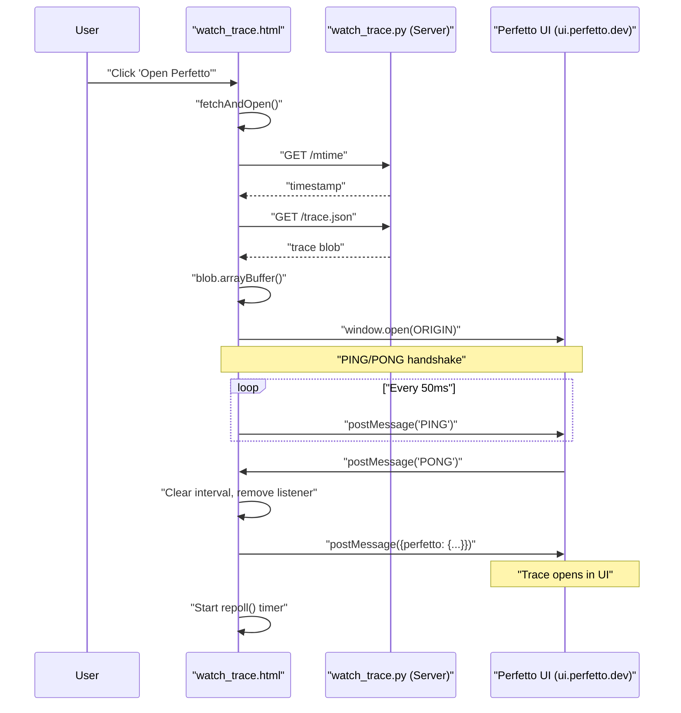
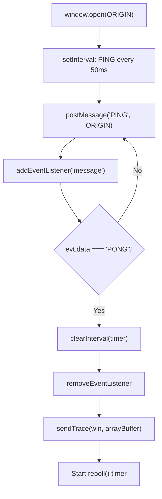
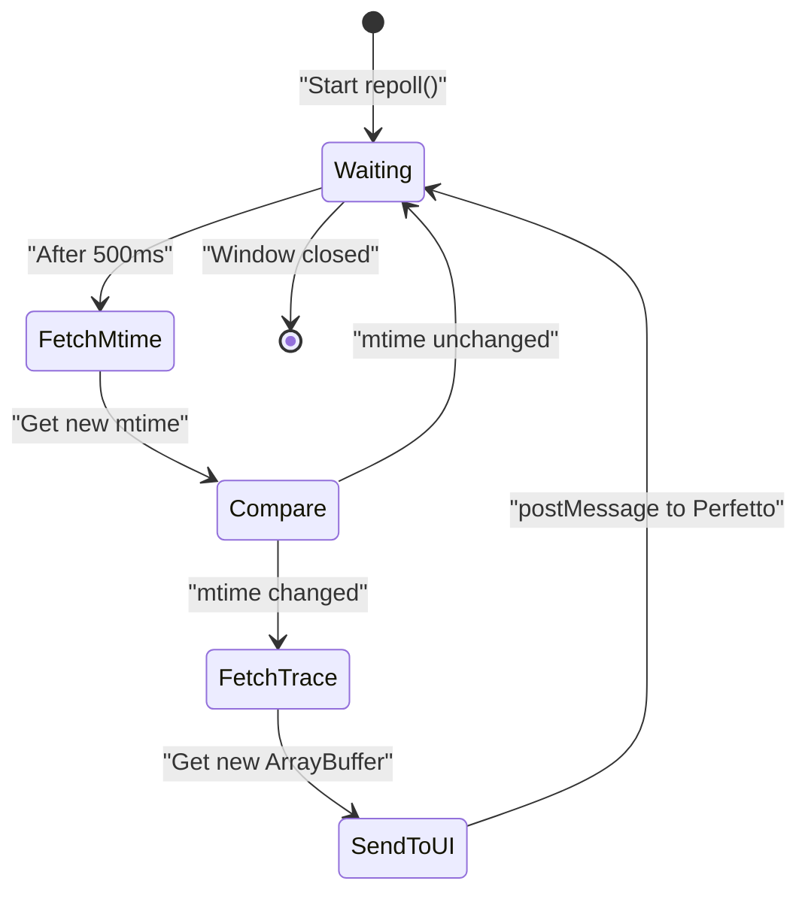
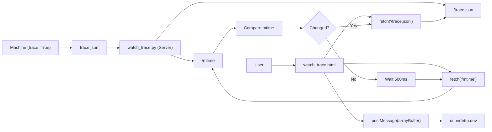

<!-- source: DeepWiki mcp.deepwiki.com · repo anthropics/original_performance_takehome · page 7.3 Web Interface Usage · fetched 2026-10-26 -->

# Web Interface Usage

<details>
<summary>Relevant source files</summary>

The following files were used as context for generating this wiki page:

- [watch_trace.html](watch_trace.html)

</details>


## Purpose and Scope

This page documents `watch_trace.html`, the browser-based web interface for trace visualization. The interface serves as a bridge between the local trace file and Perfetto UI, providing automatic trace fetching, live reload functionality, and cross-window communication. For information about the backend server that serves this interface, see [Trace Visualization Server](#7.2). For details about using Perfetto UI itself, see [Perfetto UI Integration](#7.4).

---

## Interface Components

The web interface consists of a minimal HTML page with three main UI elements:

| Element | Type | Purpose |
|---------|------|---------|
| `#source` | `<select>` dropdown | Selects which trace file to load (default: `/trace.json`) |
| `#btn_fetch` | `<button>` | Triggers trace fetching and opens Perfetto UI window |
| `#logs` | `<pre>` | Displays status messages and debugging information |

The interface is intentionally minimal, focusing on functionality over aesthetics. The primary interaction is clicking the "Open Perfetto" button, which initiates the trace loading workflow.

**Sources:** [watch_trace.html:24-34]()

---

## Configuration Constants

The interface uses a single configuration constant that determines where Perfetto UI is hosted:

```javascript
const ORIGIN = "https://ui.perfetto.dev";
```

This points to the official Perfetto UI hosted by Google. An alternative localhost configuration is commented out at [watch_trace.html:37-38](), which could be used if proxying through the local server via the `/perfetto/` endpoint.

**Sources:** [watch_trace.html:37-38]()

---

## Trace Loading Workflow

The trace loading process follows a multi-step sequence involving fetch operations, window management, and inter-window communication:

**Figure 1: Trace Loading Sequence**


### Key Functions

**`fetchAndOpen(traceUrl)`** - Entry point for trace loading:

[watch_trace.html:49-58]()

This function:
1. Fetches the current modification time via `getMtime()`
2. Fetches the trace file as a blob
3. Converts the blob to an ArrayBuffer
4. Calls `openTrace()` to open Perfetto UI and send the data

**`getMtime()`** - Retrieves trace file modification timestamp:

[watch_trace.html:43-47]()

This simple wrapper fetches the `/mtime` endpoint provided by the local server, which returns the modification time of `trace.json` formatted as a timestamp string.

**`openTrace(arrayBuffer, traceUrl, mtime)`** - Opens Perfetto UI and initiates handshake:

[watch_trace.html:92-120]()

This function handles:
- Opening a new browser window to `ui.perfetto.dev`
- Detecting popup blockers and providing fallback UI
- Initiating the PING/PONG handshake to detect when Perfetto is ready
- Calling `sendTrace()` once the handshake completes
- Starting the `repoll()` timer for live reload

**Sources:** [watch_trace.html:43-120]()

---

## PING/PONG Handshake Protocol

Before sending trace data, the interface must ensure Perfetto UI is fully loaded and ready to receive messages. This is accomplished through a handshake protocol:

**Figure 2: Handshake Logic**


The handshake implementation at [watch_trace.html:103-119]():

1. **Timer Setup**: Sends "PING" messages every 50ms
2. **Event Listener**: Waits for "PONG" response from Perfetto UI
3. **Cleanup**: Once PONG received, clears interval and removes listener
4. **Data Transfer**: Calls `sendTrace()` to send the trace ArrayBuffer
5. **Live Reload**: Starts the `repoll()` loop

### Popup Blocker Handling

If `window.open()` returns `null` (popup blocked), the interface gracefully degrades:

[watch_trace.html:94-100]()

- Changes button background color to yellow (`#f3ca63`)
- Updates button text to inform user of popup blocker
- Changes button `onclick` to retry opening the trace

**Sources:** [watch_trace.html:92-120]()

---

## Live Reload Mechanism

The interface implements automatic trace reloading by polling the `/mtime` endpoint every 500ms:

**Figure 3: Live Reload State Machine**


**`repoll(win, traceUrl, mtime)`** - Implements the live reload loop:

[watch_trace.html:60-73]()

Algorithm:
1. Fetch current modification time via `getMtime()`
2. Compare with previous `mtime`
3. If changed:
   - Fetch new trace file from `traceUrl`
   - Convert to ArrayBuffer
   - Call `sendTrace()` to update Perfetto UI
4. Schedule next poll after 500ms with updated `mtime`

This creates a continuous monitoring loop that automatically refreshes the Perfetto UI whenever the trace file is regenerated.

**Sources:** [watch_trace.html:60-73]()

---

## Perfetto Communication Protocol

Communication with Perfetto UI uses the `postMessage` API with a specific message format:

**`sendTrace(win, arrayBuffer, traceUrl)`** - Sends trace data to Perfetto:

[watch_trace.html:75-90]()

The message structure follows Perfetto's API:

```javascript
{
    perfetto: {
        buffer: arrayBuffer,        // The trace data
        title: "trace.json",        // Display name
        url: reopenUrl.toString(),  // URL to reopen this trace
        keepApiOpen: true          // Keep communication channel open
    }
}
```

### Reopen URL Feature

The interface constructs a special URL that allows Perfetto to link back to reload the same trace:

```javascript
const reopenUrl = new URL(location.href);
reopenUrl.hash = `#reopen=${traceUrl}`;
```

When a user follows this link from Perfetto's sidebar, the interface detects it and automatically reloads:

[watch_trace.html:122-126]()

If the page loads with a hash starting with `#reopen=`, it extracts the trace URL and immediately calls `fetchAndOpen()`.

**Sources:** [watch_trace.html:75-126]()

---

## Data Flow Architecture

The complete data flow from trace generation to visualization:

**Figure 4: System Data Flow**


**Sources:** [watch_trace.html:1-132]()

---

## Usage Scenarios

### Basic Usage

1. Start the local server: `python watch_trace.py`
2. Server automatically opens browser to `http://localhost:8000`
3. Interface loads and displays "Open Perfetto" button
4. Click button to fetch `trace.json` and open Perfetto UI
5. Trace visualization appears in new window

### Live Development Workflow

1. Run tests with tracing enabled to generate `trace.json`
2. Open web interface (if not already open)
3. Click "Open Perfetto" to view current trace
4. Make changes to kernel builder
5. Re-run tests to regenerate `trace.json`
6. Interface automatically detects change and reloads Perfetto
7. Review updated trace in same Perfetto window
8. Iterate without manual refreshing

### Troubleshooting Popup Blockers

If the "Open Perfetto" button shows yellow background with "Popups blocked" message:

1. Allow popups for `localhost:8000` in browser settings
2. Click the button again
3. Alternatively, manually navigate to `ui.perfetto.dev` and drag-drop `trace.json`

**Sources:** [watch_trace.html:94-100]()

---

## Implementation Details

### Event Listener Management

The interface carefully manages event listeners to avoid memory leaks:

- Adds message listener before PING/PONG handshake: [watch_trace.html:119]()
- Removes listener after handshake completes: [watch_trace.html:113]()
- Uses named function `onMessageHandler` for proper cleanup

### Timer Management

Two types of timers are used:

| Timer | Interval | Purpose | Cleanup |
|-------|----------|---------|---------|
| PING interval | 50ms | Detect Perfetto UI ready | `clearInterval()` on PONG |
| Repoll timeout | 500ms | Check for trace updates | Self-scheduling via `setTimeout()` |

The PING interval is aggressive (50ms) to minimize latency when opening traces. The repoll timeout is more conservative (500ms) to avoid overwhelming the server with `mtime` checks.

### Blob Handling

Trace data flows through multiple representations:

1. HTTP Response → `Response` object
2. `Response.blob()` → `Blob` object
3. `Blob.arrayBuffer()` → `ArrayBuffer`
4. `postMessage(arrayBuffer)` → Transferred to Perfetto

The ArrayBuffer is necessary because Perfetto's API expects raw binary data, and `postMessage` can efficiently transfer ArrayBuffers between windows.

**Sources:** [watch_trace.html:52-68]()

---

## Integration with Server Endpoints

The interface depends on three server endpoints provided by `watch_trace.py`:

| Endpoint | Method | Response Type | Purpose |
|----------|--------|---------------|---------|
| `/` | GET | HTML | Serves this interface |
| `/trace.json` | GET | JSON | Streams trace file |
| `/mtime` | GET | Text | Returns trace modification time |

The `/mtime` endpoint is critical for the live reload feature. It returns a formatted timestamp string that changes whenever `trace.json` is modified. The interface treats this as an opaque string for comparison purposes.

**Sources:** [watch_trace.html:43-47](), [watch_trace.html:61-63]()

---

