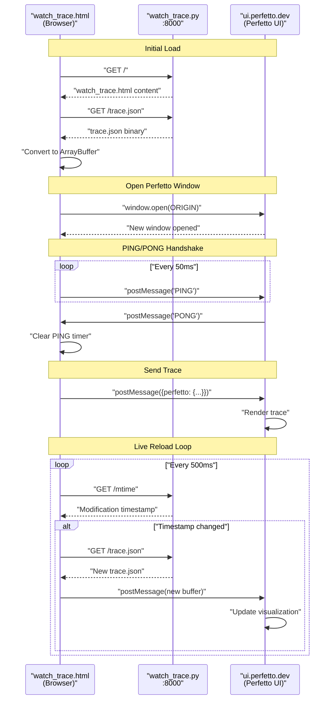
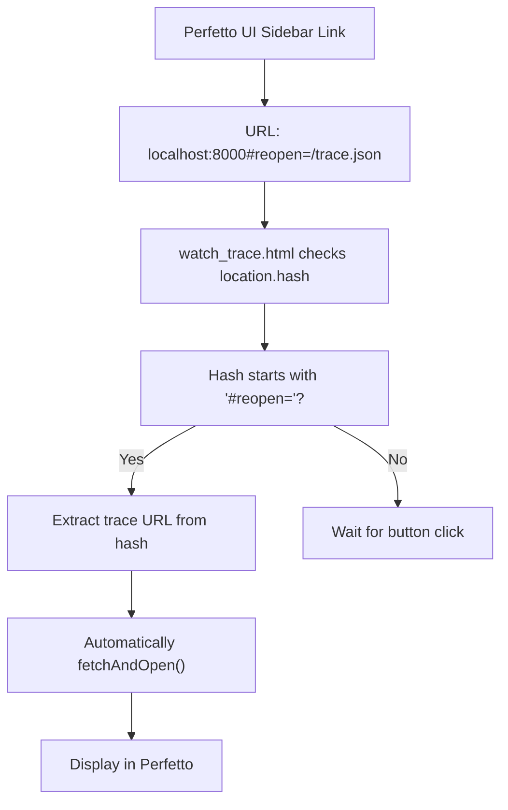
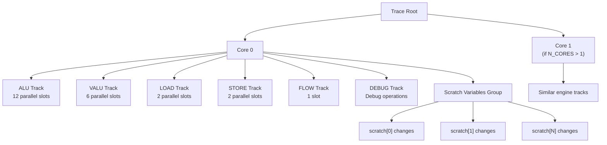

<!-- source: DeepWiki mcp.deepwiki.com · repo anthropics/original_performance_takehome · page 7.4 Perfetto UI Integration · fetched 2026-10-26 -->

# Perfetto UI Integration

<details>
<summary>Relevant source files</summary>

The following files were used as context for generating this wiki page:

- [watch_trace.html](watch_trace.html)
- [watch_trace.py](watch_trace.py)

</details>


This page documents the integration between the Machine simulator's trace output and Perfetto UI, a professional-grade performance visualization tool. It covers the communication protocol, live-reload functionality, and how to use Perfetto UI to analyze execution traces for performance debugging.

For information on generating traces from the simulator, see [Trace Generation](#7.1). For practical debugging workflows using Perfetto, see [Debugging Workflows and Strategies](#7.5).

---

## Integration Architecture

The Perfetto UI integration uses a browser-based `postMessage` API to communicate between the local web interface and the external Perfetto UI. This architecture enables seamless trace visualization with automatic updates when traces are regenerated.

### Communication Flow



Sources: [watch_trace.html:36-130](), [watch_trace.py:1-84]()

### postMessage Protocol

The integration implements a custom protocol over the browser's `postMessage` API defined in `watch_trace.html`:

| Message Direction | Content | Purpose |
|------------------|---------|---------|
| `watch_trace.html` → Perfetto | `"PING"` | Detect when Perfetto UI is ready [watch_trace.html:103-106]() |
| Perfetto → `watch_trace.html` | `"PONG"` | Signal that UI has loaded [watch_trace.html:108-109]() |
| `watch_trace.html` → Perfetto | `{perfetto: {buffer, title, url, keepApiOpen}}` | Send trace data [watch_trace.html:79-89]() |

The handshake ensures the trace is only sent after Perfetto UI has fully loaded:

```mermaid
stateDiagram-v2
    [*] --> "Opening_Window"
    Opening_Window --> "Sending_PING": "window.open() succeeds"
    Opening_Window --> "Popup_Blocked": "window.open() returns null"
    Popup_Blocked --> [*]: "User clicks retry button"
    
    Sending_PING --> "Sending_PING": "No PONG received (50ms timer)"
    Sending_PING --> "Ready": "PONG received"
    Ready --> "Sending_Trace": "Clear timer, remove listener"
    Sending_Trace --> "Polling_Mtime": "sendTrace() complete"
    
    Polling_Mtime --> "Polling_Mtime": "mtime unchanged (500ms)"
    Polling_Mtime --> "Sending_Trace": "mtime changed, fetch new trace"
```

Sources: [watch_trace.html:103-120](), [watch_trace.html:43-73]()

### Live Reload Mechanism

The interface implements automatic trace reloading by polling the modification time of `trace.json` via the `repoll` function:

1. **Initial mtime fetch**: When opening the trace, the current `mtime` is captured by `getMtime()` [watch_trace.html:51]().
2. **Polling loop**: Every 500ms, the interface fetches `/mtime` from the server [watch_trace.html:72]().
3. **Change detection**: If the `newMtime` differs from the stored `mtime`, a new trace is fetched [watch_trace.html:63]().
4. **Update transmission**: The new trace buffer is sent via `sendTrace` to the already-open Perfetto window [watch_trace.html:69]().

This enables a rapid iteration workflow: modify kernel → regenerate trace → automatic visualization update.

Sources: [watch_trace.html:60-73](), [watch_trace.py:29-38]()

---

## Opening Traces in Perfetto

### Using the Web Interface

To open a trace in Perfetto UI:

1. **Start the server**: Run `python watch_trace.py` from the repository root [watch_trace.py:74-84]().
2. **Browser opens automatically**: The `run()` function calls `webbrowser.open("http://localhost:8000")` [watch_trace.py:78]().
3. **Select trace source**: The dropdown in `watch_trace.html` shows `/trace.json` (the default) [watch_trace.html:24-26]().
4. **Click "Open Perfetto"**: This triggers `fetchAndOpen()`, which fetches the trace and opens Perfetto UI [watch_trace.html:30](), [watch_trace.html:128-129]().

```mermaid
graph LR
    RunScript["python watch_trace.py"] --> "Server_Start[HTTP Server :8000]"
    Server_Start --> "Browser_Open[Browser opens localhost:8000]"
    Browser_Open --> "Interface[watch_trace.html UI]"
    Interface --> "Click[User clicks 'Open Perfetto']"
    Click --> "Fetch[Fetch /trace.json]"
    Fetch --> "Open[Open ui.perfetto.dev window]"
    Open --> "Display[Perfetto displays trace]"
    
    Display -.->|"Every 500ms"| Poll["Poll /mtime"]
    Poll -.->|"If changed"| Reload["Reload trace in same window"]
```

Sources: [watch_trace.py:74-84](), [watch_trace.html:128-129]()

### Handling Popup Blockers

If the browser blocks the Perfetto popup window, the `openTrace` function provides fallback handling:

- **Detection**: `window.open()` returns `null` when blocked [watch_trace.html:94]().
- **Visual feedback**: Button background changes to `#f3ca63` (orange) [watch_trace.html:95]().
- **Manual retry**: Button text changes to "Popups blocked, click here to open the trace file" [watch_trace.html:99]().
- **User action**: Clicking the modified button retries the window opening [watch_trace.html:96]().

Sources: [watch_trace.html:94-100]()

### Reopening from Perfetto Sidebar

Perfetto UI includes a sidebar link that reopens traces. When following this link, the URL hash contains `#reopen=/trace.json`:



Sources: [watch_trace.html:123-126](), [watch_trace.html:76-77]()

---

## Perfetto UI Interface Overview

Perfetto UI is a Chrome-based timeline visualizer that displays execution events across multiple parallel tracks. The simulator's trace format maps directly to Perfetto's track model.

### Key Interface Components

| Component | Description | Usage |
|-----------|-------------|-------|
| **Timeline View** | Horizontal time axis showing execution events | Pan with mouse drag, zoom with scroll wheel |
| **Track List** | Left sidebar showing all available tracks | Click to select, expand/collapse hierarchies |
| **Event Details** | Bottom panel showing selected event information | Click any event to view details |
| **Search Bar** | Filter events by name or properties | Press `/` to focus search |
| **Minimap** | Overview of entire trace at top | Click to jump to time regions |

### Navigation Controls

Common keyboard shortcuts for Perfetto UI:

| Action | Shortcut | Description |
|--------|----------|-------------|
| Zoom in | `W` or scroll up | Increase temporal resolution |
| Zoom out | `S` or scroll down | Decrease temporal resolution |
| Pan left/right | `A` / `D` or drag | Move along timeline |
| Select event | Click | Display event details in bottom panel |
| Search | `/` | Open search bar |
| Zoom to selection | Double-click event | Center and zoom to event |

---

## Track Organization

The Machine simulator generates traces with a hierarchical track structure organized by execution engine and scratch space variables.

### Per-Engine Tracks

Each execution engine creates a separate track showing which operations execute in each cycle:



Sources: Based on trace generation patterns in the Machine simulator and the `collapsed: false` patching in [watch_trace.py:55-59]().

### Track Naming Conventions

Tracks follow a consistent naming pattern derived from the `trace.json` event names:

| Track Pattern | Example | Meaning |
|--------------|---------|---------|
| `core_{N}` | `core_0` | All activity for core N |
| `core_{N}.{ENGINE}` | `core_0.alu` | Specific engine on core N |
| `core_{N}.{ENGINE}.slot_{S}` | `core_0.alu.slot_3` | Individual slot within engine |
| `core_{N}.scratch[{ADDR}]` | `core_0.scratch[42]` | Value changes for scratch address |

---

## Custom Integration Features

The local proxy server `watch_trace.py` applies custom modifications to Perfetto UI to improve the debugging experience.

### Auto-Expanded Tracks

By default, Perfetto collapses track hierarchies. The proxy modifies the Perfetto JavaScript bundle to expand all tracks automatically:

**Modifications applied** [watch_trace.py:55-59]():
- Changes `collapsed: true` → `collapsed: false`
- Changes `collapsed: !hasHeapProfiles` → `collapsed: false`

This eliminates the need to manually expand each engine and scratch variable track when opening a trace.

### Bug Fix Patch

The proxy applies a fix for a Perfetto UI bug where disposed engines throw errors:

**Original code**:
```javascript
throw new Error(`EngineProxy ${this.tag} was disposed.`);
```

**Patched code** [watch_trace.py:51-54]():
```javascript
return null;
```

This prevents errors when quickly reloading traces, as the old Perfetto instance may still be processing events when the new trace arrives.

### Proxy Architecture

The proxy in `MyHandler` serves two purposes:

1. **Offline operation**: Allows running Perfetto UI locally by proxying the remote UI [watch_trace.py:40-64]().
2. **Custom modifications**: Applies JavaScript patches to improve UX [watch_trace.py:48-59]().

The proxy intercepts requests to `/perfetto/*` and forwards them to `https://ui.perfetto.dev`, modifying responses in transit:

| Request Path | Action |
|-------------|--------|
| `/perfetto/frontend_bundle.js` | Fetch, apply patches, serve modified JS [watch_trace.py:48-59]() |
| `/perfetto/*` (other files) | Fetch and serve unmodified [watch_trace.py:40-47]() |

Sources: [watch_trace.py:40-64]()

---

## Configuration Options

The integration supports two deployment modes configured via the `ORIGIN` constant in `watch_trace.html`:

**Production mode** [watch_trace.html:38]():
```javascript
const ORIGIN = "https://ui.perfetto.dev";
```
- Connects directly to official Perfetto UI.
- Requires internet connection.
- Always uses latest Perfetto version.

**Local proxy mode** [watch_trace.html:37]() (commented out):
```javascript
// const ORIGIN = 'http://localhost:8000/perfetto/';
```
- Routes through local proxy server in `watch_trace.py`.
- Enables offline operation.
- Applies custom modifications described above.

To switch modes, modify the `ORIGIN` constant in `watch_trace.html`.

Sources: [watch_trace.html:37-38](), [watch_trace.py:40-64]()

---

