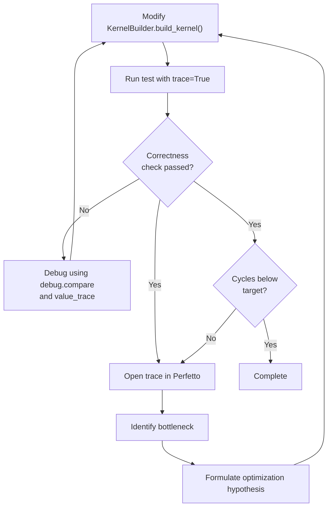
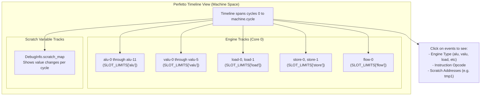
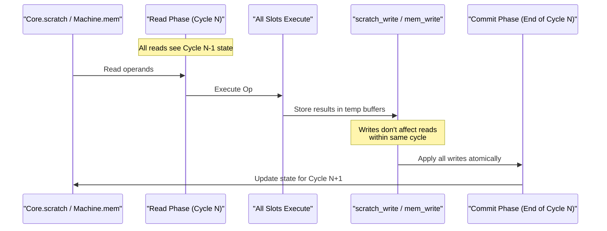
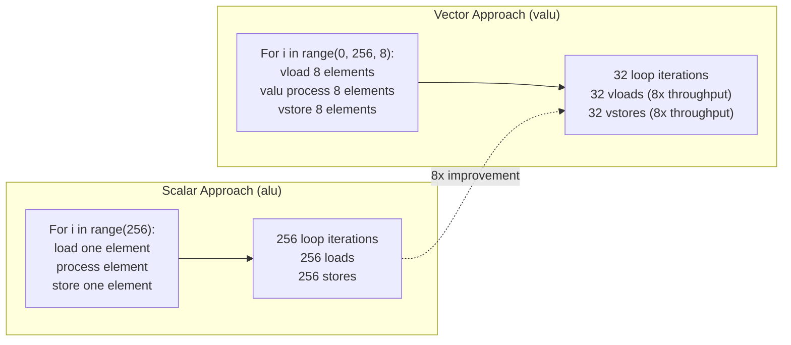
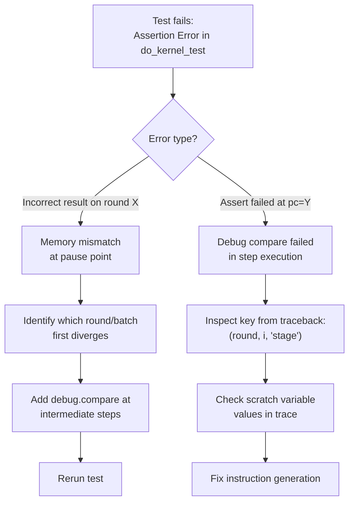

<!-- source: DeepWiki mcp.deepwiki.com · repo anthropics/original_performance_takehome · page 7.5 Debugging Workflows and Strategies · fetched 2026-10-26 -->

# Debugging Workflows and Strategies

<details>
<summary>Relevant source files</summary>

The following files were used as context for generating this wiki page:

- [perf_takehome.py](perf_takehome.py)
- [tests/frozen_problem.py](tests/frozen_problem.py)

</details>


This page documents practical debugging approaches for optimizing kernel performance in the VLIW SIMD architecture. It covers systematic workflows for identifying bottlenecks, analyzing slot utilization, finding parallelization opportunities, and avoiding common pitfalls during optimization.

For information about enabling and generating traces, see [7.1 Trace Generation](). For details on the visualization tools themselves, see [7.4 Perfetto UI Integration](). For general optimization techniques, see [5.4 Optimization Strategies and Patterns]().

## The Debug-Optimize Iteration Cycle

The fundamental debugging workflow is a tight iteration loop between code generation, execution measurement, and trace analysis:



**Sources:** [perf_takehome.py:241-256](), [perf_takehome.py:175-222]()

## Workflow 1: Baseline Analysis

Start by understanding the current implementation's performance characteristics:

### Step 1: Measure Baseline Performance

```bash
python tests/submission_tests.py CorrectnessTests.test_kernel_cycles
```

This executes `do_kernel_test` with `trace=False` and reports cycle count and speedup versus `BASELINE` (147,734 cycles) [perf_takehome.py:176-178]().

**Key metrics to record:**
- Absolute cycle count.
- Speedup ratio.
- Which performance threshold you're targeting (see [2.2 Performance Benchmarks and Thresholds]()).

### Step 2: Generate Initial Trace

```bash
# Set trace=True in the test call within submission_tests.py or your local script
```

Running `Machine` with `trace=True` [tests/frozen_problem.py:118-121]() generates `trace.json` in Chrome Trace Event Format [tests/frozen_problem.py:151-161]().

### Step 3: Launch Trace Viewer

```bash
python watch_trace.py
# Opens browser to localhost:8000, click "Open Perfetto"
```

The `watch_trace.py` server provides live reload - any regenerated `trace.json` automatically updates in Perfetto [watch_trace.py:74-84]().

**Sources:** [perf_takehome.py:176-178](), [tests/frozen_problem.py:118-161](), [watch_trace.py:74-84]()

## Workflow 2: Identifying Execution Bottlenecks

Use Perfetto timeline visualization to identify where cycles are being wasted. The simulator maps hardware engines to specific "threads" in the trace [tests/frozen_problem.py:168-176]().



### Bottleneck Patterns

| Pattern | Symptom | Root Cause | Solution |
|---------|---------|------------|----------|
| **Sparse slot usage** | Many empty slots in ALU/VALU tracks | Poor VLIW packing in `build()` [perf_takehome.py:51-56]() | Pack multiple operations into same instruction bundle |
| **Load/store saturation** | All load/store slots filled (2/cycle), but ALU mostly idle | Memory bandwidth bottleneck [tests/frozen_problem.py:51-52]() | Use scratch space as a cache, batch memory ops |
| **Sequential ALU operations** | Operations that could be parallel are sequential | Not exploiting instruction-level parallelism | Reorder operations to remove dependencies |
| **Scalar operations on vectors** | ALU slots used where VALU could vectorize | Missing vectorization opportunities | Use `valu` engine with `VLEN=8` SIMD operations [tests/frozen_problem.py:57-78]() |
| **Repeated constant loads** | Multiple `load.const` for same value | `scratch_const()` cache misses | Check `const_map` is being used correctly [perf_takehome.py:70-75]() |

**Sources:** [tests/frozen_problem.py:48-60](), [tests/frozen_problem.py:151-196](), [perf_takehome.py:51-56](), [perf_takehome.py:70-75]()

## Workflow 3: Analyzing VLIW Slot Utilization

The VLIW architecture allows parallel execution within a single cycle. Analyze utilization to maximize parallelism. How many slots each engine can execute per cycle is limited by `SLOT_LIMITS` [tests/frozen_problem.py:68-72]().

### Calculating Slot Efficiency

For each cycle, count how many slots are used versus available:

```
Total Available = 12 (ALU) + 6 (VALU) + 2 (LOAD) + 2 (STORE) + 1 (FLOW) = 23 slots
```

**Low utilization (<30%)** indicates poor instruction packing.

### Identifying Packing Opportunities

The baseline `build()` method uses simple 1-slot-per-instruction packing [perf_takehome.py:51-56]():

```python
# Baseline implementation in KernelBuilder.build()
def build(self, slots: list[tuple[Engine, tuple]], vliw: bool = False):
    instrs = []
    for engine, slot in slots:
        instrs.append({engine: [slot]}) # Wasteful: one instruction per slot
    return instrs
```

**Optimization:** Pack independent operations into the same instruction bundle (a dictionary mapping engine names to lists of slots) [tests/frozen_problem.py:15]().

### Data Dependency Analysis

The simulator's two-phase commit model helps identify what can be packed. Effects of instructions don't take effect until the end of the cycle [tests/frozen_problem.py:70-73]().



**Safe to pack:** Operations reading different addresses or writing to different addresses.
**Unsafe to pack:** Operation B reads from address that operation A writes to in the same cycle; B will see the *old* value [tests/frozen_problem.py:70-73]().

**Sources:** [perf_takehome.py:51-56](), [tests/frozen_problem.py:15](), [tests/frozen_problem.py:48-55](), [tests/frozen_problem.py:70-73]()

## Workflow 4: Vectorization Analysis

The `valu` engine provides SIMD operations on `VLEN=8` elements [tests/frozen_problem.py:57-78]().

### Vectorization Strategy



### VALU Operations Available

| Operation | Syntax | Semantics |
|-----------|--------|-----------|
| `vbroadcast` | `("vbroadcast", dest, src)` | Broadcast scalar `src` to vector `dest[0..7]` [tests/frozen_problem.py:310-312]() |
| Vector arithmetic | `(op, dest, a1, a2)` | Element-wise: `dest[i] = a1[i] op a2[i]` [tests/frozen_problem.py:273-281]() |
| `vload` | `("vload", dest, addr)` | Load 8 words from `mem[addr..addr+7]` [tests/frozen_problem.py:254-257]() |
| `vstore` | `("vstore", addr, src)` | Store 8 words to `mem[addr..addr+7]` [tests/frozen_problem.py:263-267]() |

**Key constraint:** Vector operations require contiguous scratch addresses. Use `alloc_scratch(length=VLEN)` to allocate vector registers [perf_takehome.py:61-68]().

**Sources:** [tests/frozen_problem.py:57-78](), [tests/frozen_problem.py:254-312](), [perf_takehome.py:61-68]()

## Workflow 5: Correctness Debugging with Debug Instructions

When optimizations break correctness, use `debug` instructions to pinpoint divergence from the reference implementation.

### Debug Infrastructure

The simulator supports `debug` engine instructions that validate against a `value_trace` [tests/frozen_problem.py:366-382]().

```python
# In KernelBuilder.build_kernel
body.append(("debug", ("compare", tmp_idx, (round, i, "idx"))))
```

This checks `core.scratch[tmp_idx]` against `value_trace[(round, i, "idx")]` populated by `reference_kernel2` [perf_takehome.py:140]().

### Debug Workflow



**Tip:** The `debug` engine is ignored by the submission simulator if you follow the recruitment rules, so they don't affect performance measurement cycles [perf_takehome.py:123-124]().

**Sources:** [tests/frozen_problem.py:366-382](), [perf_takehome.py:137-166](), [perf_takehome.py:123-124]()

## Common Pitfalls and Solutions

### Pitfall 1: Exceeding Scratch Space

**Symptom:** `AssertionError: Out of scratch space` in `alloc_scratch` [perf_takehome.py:67]().

**Cause:** More than `SCRATCH_SIZE` (1536) words allocated [tests/frozen_problem.py:60]().

**Solution:**
- Reuse scratch addresses for temporary values with non-overlapping lifetimes.
- Use fewer vector registers (each requires `VLEN=8` words).

### Pitfall 2: Violating Slot Limits

**Symptom:** `AssertionError` in `step()` when checking `len(slots) <= SLOT_LIMITS[name]` [tests/frozen_problem.py:383]().

**Cause:** Too many operations packed into single engine in one instruction bundle.

**Limits [tests/frozen_problem.py:48-55]():**
- ALU: 12 slots
- VALU: 6 slots  
- LOAD: 2 slots
- STORE: 2 slots
- FLOW: 1 slot

### Pitfall 3: Forgetting Pause Instructions

**Symptom:** `do_kernel_test` hangs or produces incorrect comparison at intermediate steps.

**Cause:** Number of `pause` instructions doesn't match `yield` statements in `reference_kernel2` [perf_takehome.py:118-122]().

**Required pauses [perf_takehome.py:122, 174]():**
1. After loading header variables.
2. After the main loop body completes.

**Sources:** [perf_takehome.py:67](), [tests/frozen_problem.py:60](), [tests/frozen_problem.py:48-55](), [tests/frozen_problem.py:383](), [perf_takehome.py:118-174]()

## Interpreting Performance Results

### Performance Ladder Reference

| Threshold | Cycles | Speedup | Description |
|-----------|--------|---------|-------------|
| Baseline | 147,734 | 1.0x | Unoptimized scalar [perf_takehome.py:176]() |
| Updated Starting Point | 18,532 | 7.97x | Basic improvements [perf_takehome.py:221]() |
| Claude Opus 4 | 2,164 | 68.3x | Many hours optimization [perf_takehome.py:224]() |
| **Recruitment Gate** | **1,487** | **99.3x** | Claude Opus 4.5 11hr [perf_takehome.py:236]() |
| Best Known | 1,363 | 108.4x | Claude Opus 4.5 improved [perf_takehome.py:239]() |

**Goal:** Beat 1,487 cycles to qualify for recruitment review [perf_takehome.py:236]().

**Sources:** [perf_takehome.py:176-239]()

---

