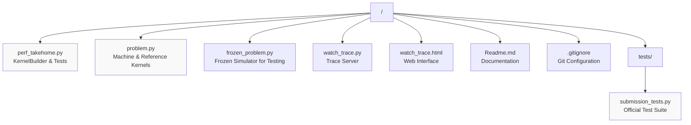
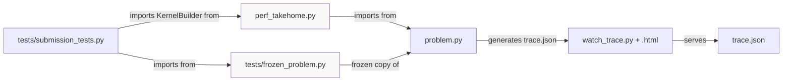
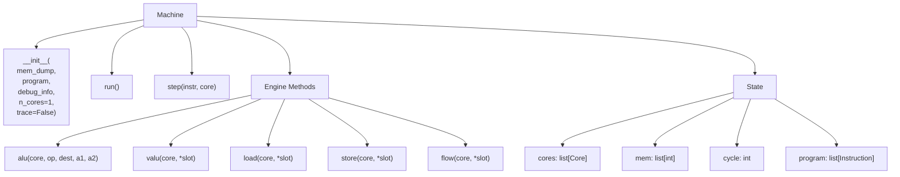
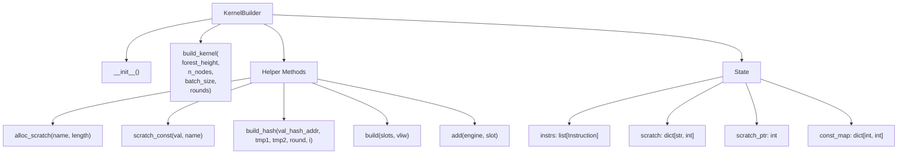
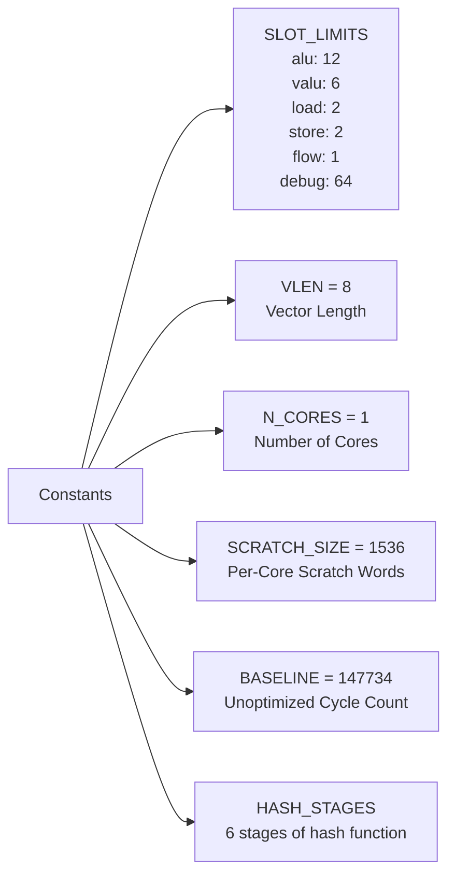
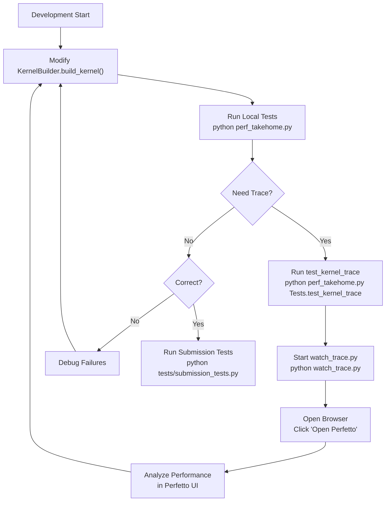
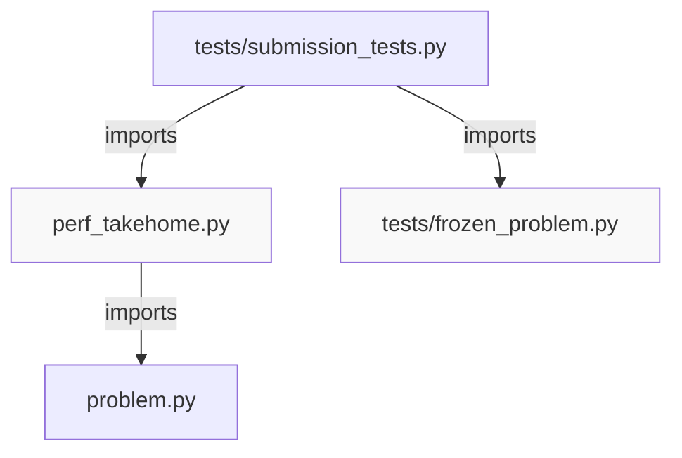

<!-- source: DeepWiki mcp.deepwiki.com · repo anthropics/original_performance_takehome · page 8 Developer Reference · fetched 2026-10-26 -->

# Developer Reference

<details>
<summary>Relevant source files</summary>

The following files were used as context for generating this wiki page:

- [perf_takehome.py](perf_takehome.py)
- [problem.py](problem.py)
- [tests/frozen_problem.py](tests/frozen_problem.py)

</details>


This page provides reference documentation for developers working with or extending the codebase. It covers repository structure, key API components, and development environment setup.

For detailed information about the optimization challenge, see [The Optimization Challenge](#2). For detailed machine architecture documentation, see [Machine Architecture](#4). For testing infrastructure, see [Testing Framework](#6).

## Repository Structure

The repository is organized with core implementation files at the root and tests in a subdirectory:



**Sources:** [perf_takehome.py:1-273](), [problem.py:1-569](), [.gitignore:1-5]()

### Core Files

| File | Purpose | Key Components |
|------|---------|----------------|
| `perf_takehome.py` | Optimization target and development tests | `KernelBuilder`, `do_kernel_test()`, `BASELINE` |
| `problem.py` | Machine simulator and problem definition | `Machine`, `Tree`, `Input`, `reference_kernel()`, `reference_kernel2()` |
| `frozen_problem.py` | Frozen simulator copy for fair testing | Identical to `problem.py` but used by official tests |
| `watch_trace.py` | Local HTTP server for trace visualization | HTTP server on port 8000, proxies Perfetto UI |
| `watch_trace.html` | Web interface for trace viewing | Auto-reload functionality, Perfetto integration |
| `tests/submission_tests.py` | Official correctness and performance tests | `CorrectnessTests`, `SpeedTests` classes |

**Sources:** [perf_takehome.py:1-17](), [problem.py:1-6](), [tests/frozen_problem.py:1-6]()

### File Relationships



**Sources:** [perf_takehome.py:23-37](), [tests/frozen_problem.py:4-6]()

## API Reference

### Core Classes

#### Machine

The VLIW SIMD simulator that executes generated instruction sequences.



**Location:** [problem.py:64-403]()

**Key Attributes:**
| Attribute | Type | Description |
|-----------|------|-------------|
| `cores` | `list[Core]` | List of `Core` objects tracking per-core state |
| `mem` | `list[int]` | Main memory (flat array of 32-bit words) |
| `program` | `list[Instruction]` | List of VLIW instruction bundles |
| `cycle` | `int` | Current execution cycle count |
| `debug_info` | `DebugInfo` | Mapping data for trace naming |

**Key Methods:**
| Method | Parameters | Description |
|--------|------------|-------------|
| `run()` | None | Execute until all cores reach `STOPPED` or `PAUSED` |
| `step(instr, core)` | `Instruction`, `Core` | Execute one VLIW bundle on a specific core |
| `alu(...)` | Core, Op, Dest, A1, A2 | Execute scalar arithmetic/logic |
| `valu(...)` | Core, *slot | Execute vector SIMD operations |
| `load(...)` | Core, *slot | Execute memory-to-scratch transfers |
| `store(...)` | Core, *slot | Execute scratch-to-memory transfers |

**Sources:** [problem.py:64-118](), [problem.py:197-254]()

#### KernelBuilder

Generates instruction sequences for the machine. This is the primary optimization target.



**Location:** [perf_takehome.py:40-175]()

**Key Methods:**
| Method | Parameters | Description |
|--------|------------|-------------|
| `build_kernel(...)` | height, nodes, batch, rounds | The core optimization target |
| `alloc_scratch(name, length)` | str, int | Reserves scratch space and returns the base address |
| `scratch_const(val, name)` | int, str | Allocates or retrieves a scratch location for a constant |
| `build_hash(...)` | addr, tmp1, tmp2, r, i | Generates the `HASH_STAGES` instruction slots |
| `add(engine, slot)` | Engine, tuple | Appends a single-engine instruction bundle |

**Sources:** [perf_takehome.py:40-175]()

#### Core

Represents the state of a single core in the machine.

**Location:** [problem.py:25-31]()

**Attributes:**
| Attribute | Type | Description |
|-----------|------|-------------|
| `id` | `int` | Core identifier |
| `scratch` | `list[int]` | Fast per-core memory (size: `SCRATCH_SIZE`) |
| `pc` | `int` | Program counter |
| `state` | `CoreState` | `RUNNING`, `PAUSED`, or `STOPPED` |

**Sources:** [problem.py:18-31]()

### Key Constants



**Sources:** [problem.py:48-62](), [perf_takehome.py:176]()

#### Engine Slot Limits

Defined in `SLOT_LIMITS` dictionary at [problem.py:48-55]():

| Engine | Slots Per Cycle | Description |
|--------|-----------------|-------------|
| `alu` | 12 | Scalar ALU operations |
| `valu` | 6 | Vector SIMD operations |
| `load` | 2 | Concurrent load operations |
| `store` | 2 | Concurrent store operations |
| `flow` | 1 | Branching/Flow control |

**Sources:** [problem.py:48-55]()

### Key Functions

#### reference_kernel2()

Reference implementation operating on flat memory, used for correctness validation.

**Location:** [problem.py:535-568]()

**Signature:**
```python
def reference_kernel2(mem: list[int], trace: dict[Any, int] = {}) -> Generator[list[int], None, None]
```

Yields memory state at each `pause` point. Populates `trace` dict with intermediate values for debugging.

**Sources:** [problem.py:535-568]()

#### build_mem_image()

Serializes `Tree` and `Input` into flat memory layout.

**Location:** [problem.py:487-513]()

**Signature:**
```python
def build_mem_image(t: Tree, inp: Input) -> list[int]
```

**Memory Layout Header:**
| Offset | Content |
|--------|---------|
| 0 | `rounds` |
| 1 | `n_nodes` |
| 2 | `batch_size` |
| 3 | `forest_height` |
| 4 | `forest_values_p` (Pointer) |
| 5 | `inp_indices_p` (Pointer) |
| 6 | `inp_values_p` (Pointer) |

**Sources:** [problem.py:487-513]()

## Configuration and Development Setup

### Git Configuration

The `.gitignore` file excludes development artifacts and bytecode:

**Location:** [.gitignore:1-5]()

```
trace.json
**/*.pyc
.hypothesis
.DS_Store
```

### Development Workflow



**Sources:** [perf_takehome.py:1-17](), [problem.py:151-160]()

### Module Import Structure



**Import Pattern:**
- `perf_takehome.py` imports from `problem.py` for development. [perf_takehome.py:23-37]()
- `tests/submission_tests.py` imports from `frozen_problem.py` for final validation.

For details, see [Repository Structure](#8.1), [API Reference](#8.2), and [Configuration and Development Setup](#8.3).

---

