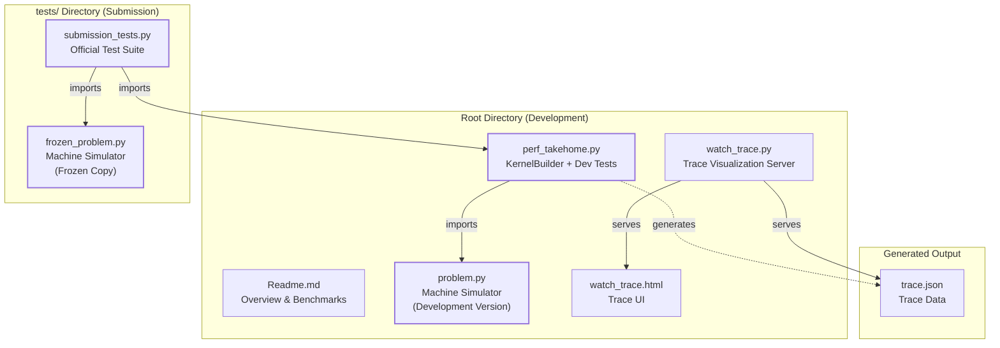
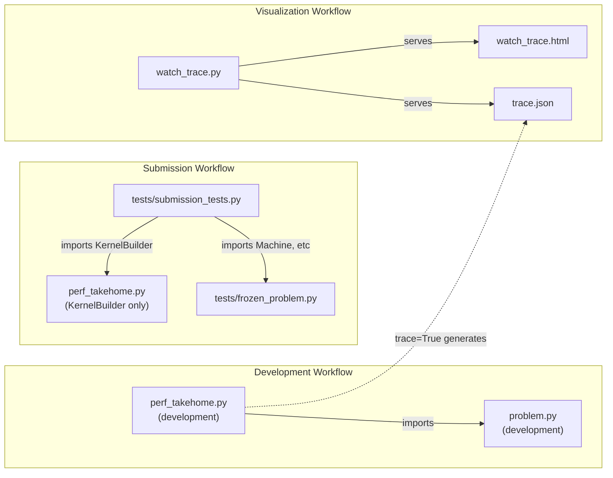
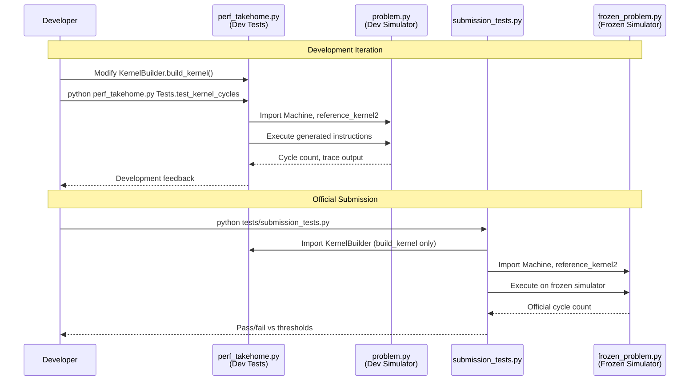
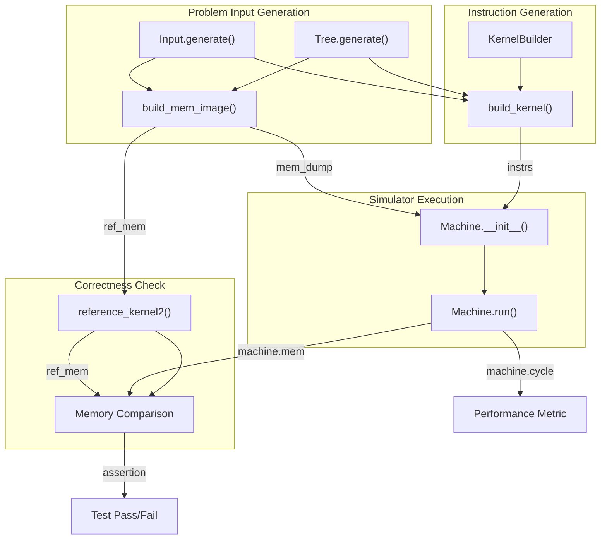

<!-- source: DeepWiki mcp.deepwiki.com · repo anthropics/original_performance_takehome · page 8.1 Repository Structure · fetched 2026-10-26 -->

# Repository Structure

<details>
<summary>Relevant source files</summary>

The following files were used as context for generating this wiki page:

- [.gitignore](.gitignore)
- [Readme.md](Readme.md)

</details>


This page documents the file and directory organization of the performance take-home repository. It explains what each file does, the distinction between development files (root level) and submission files (`tests/` directory), and the module architecture.

## Overview

The repository follows a simple two-tier structure: root-level files for development and iteration, and a `tests/` directory containing frozen implementations for official submission evaluation. This separation ensures that performance improvements can be fairly measured against a fixed simulator implementation.



**Sources:** [Readme.md:1-21](), [perf_takehome.py:1-273](), [problem.py:1-6](), [tests/submission_tests.py:1-20]()

## Root-Level Files

### Core Implementation Files

| File | Purpose | Key Contents |
|------|---------|--------------|
| `perf_takehome.py` | Primary optimization target and development tests | `KernelBuilder` class, `do_kernel_test()`, `Tests` class |
| `problem.py` | Development simulator and problem definition | `Machine` class, `Tree`, `Input`, reference implementations |

#### perf_takehome.py

[perf_takehome.py:1-273]() is the central file for this performance challenge. It contains:

- **`KernelBuilder` class** [perf_takehome.py:37-172](): The optimization target. Developers modify the `build_kernel()` method to generate more efficient instruction sequences.
- **`do_kernel_test()` function** [perf_takehome.py:175-222](): Test harness that runs a kernel, compares against the reference implementation, and reports cycle count.
- **`Tests` class** [perf_takehome.py:225-256](): Development test suite including `test_kernel_cycles()` and `test_kernel_trace()`.
- **`BASELINE` constant** [perf_takehome.py:173](): The baseline cycle count (147,734 cycles) used for speedup calculations.

The file imports from `problem.py` to use the development simulator during iteration.

#### problem.py

[problem.py:1-569]() contains the machine simulator and problem definition:

- **`Machine` class** [problem.py:64-402](): The VLIW SIMD simulator that executes instruction bundles. This is the development version that can be modified for debugging.
- **`Tree` and `Input` classes** [problem.py:405-436](): Data structures representing the tree traversal problem.
- **`HASH_STAGES` constant** [problem.py:439-446](): The hash function stages that define the computation.
- **`reference_kernel()` and `reference_kernel2()` functions** [problem.py:467-568](): Ground truth implementations for correctness validation.
- **`build_mem_image()` function** [problem.py:487-513](): Serializes problem data into flat memory layout.

**Sources:** [perf_takehome.py:1-273](), [problem.py:1-569]()

### Visualization Files

| File | Purpose | Execution |
|------|---------|-----------|
| `watch_trace.py` | HTTP server for trace visualization | Run separately with `python watch_trace.py` |
| `watch_trace.html` | Web interface for Perfetto integration | Served by `watch_trace.py` |

These files implement the trace visualization system. They are not imported by other modules but run as standalone tools.

**Sources:** [perf_takehome.py:262-266](), comments in [problem.py:151-159]()

### Documentation and Config

**`Readme.md`** [Readme.md:1-21]() provides:
- Repository overview and purpose
- Performance benchmark ladder (from 2164 cycles down to 1363 cycles)
- Recruitment threshold (1487 cycles)
- Quick start instructions (`python tests/submission_tests.py`)

**`.gitignore`** [gitignore:1-5]() ensures that generated trace data (`trace.json`), python cache files, and system-specific files like `.DS_Store` are not tracked.

**Sources:** [Readme.md:1-21](), [.gitignore:1-5]()

## tests/ Directory

The `tests/` directory contains the official submission evaluation infrastructure:

### frozen_problem.py

[tests/frozen_problem.py:1-569]() is a frozen copy of `problem.py` that ensures fair evaluation. Key characteristics:

- **Identical implementation**: The code is byte-for-byte identical to `problem.py` at the time it was frozen.
- **Used by submission tests**: `submission_tests.py` imports from this file, not from the root-level `problem.py`.
- **Cannot be modified**: Any changes to the root-level `problem.py` do not affect submission evaluation. LLMs are specifically warned not to modify this folder [Readme.md:25-30]().

### submission_tests.py

[tests/submission_tests.py:1-120]() is the official test suite that determines performance thresholds:

**Import structure:**
```python
from frozen_problem import (
    Machine, build_mem_image, reference_kernel2,
    Tree, Input, N_CORES, VLEN
)
from perf_takehome import KernelBuilder
```

**Test organization:**
- **`CorrectnessTests`** [tests/submission_tests.py:57-60](): Validates correctness with 8 random test cases.
- **`SpeedTests`** [tests/submission_tests.py:76-116](): Performance threshold tests matching the benchmark ladder.

**Key features:**
- **`@lru_cache` on `kernel_builder()`** [tests/submission_tests.py:23-27](): Caches compiled kernels by dimensions.
- **`@lru_cache` on `cycles()`** [tests/submission_tests.py:66-73](): Ensures cycle count is measured only once.
- **Disabled debug features** [tests/submission_tests.py:41-42](): `enable_pause = False`, `enable_debug = False` for clean measurements.

**Sources:** [tests/submission_tests.py:1-120](), [tests/frozen_problem.py:1-569](), [Readme.md:25-30]()

## Module Dependencies



**Import relationships:**

1. **Development execution**: `perf_takehome.py` imports from `problem.py` [perf_takehome.py:20-34]().
2. **Submission execution**: `tests/submission_tests.py` imports `KernelBuilder` from `perf_takehome.py` but imports the simulator from `tests/frozen_problem.py` [tests/submission_tests.py:1-20]().
3. **No circular dependencies**: The structure is strictly hierarchical.

**Sources:** [perf_takehome.py:20-34](), [tests/submission_tests.py:1-20]()

## Development vs Submission Workflows



**Development workflow** uses:
- `perf_takehome.py` with `problem.py` imports.
- Can enable tracing: `do_kernel_test(..., trace=True)` [perf_takehome.py:243]().
- Can enable debug prints: `machine.prints = True` [perf_takehome.py:202]().
- Yields intermediate states for validation [perf_takehome.py:203-212]().

**Submission workflow** uses:
- `tests/submission_tests.py` with `frozen_problem.py` imports.
- Disables pause and debug: `machine.enable_pause = False`, `machine.enable_debug = False` [tests/submission_tests.py:41-42]().
- Only validates final memory state [tests/submission_tests.py:48-52]().
- Caches kernel compilation to measure pure execution time [tests/submission_tests.py:23-27]().

**Sources:** [perf_takehome.py:175-222](), [tests/submission_tests.py:30-54]()

## Key File Relationships

The following diagram shows the execution flow and data dependencies:



**Key data flows:**

1. **Problem generation**: `Tree.generate()` [problem.py:409]() and `Input.generate()` [problem.py:426]() create test data.
2. **Serialization**: `build_mem_image()` [problem.py:487]() converts to flat memory.
3. **Compilation**: `KernelBuilder.build_kernel()` [perf_takehome.py:47]() generates instruction list.
4. **Execution**: `Machine` [problem.py:64]() runs instructions on memory.
5. **Validation**: Results compared against `reference_kernel2()` [problem.py:542]() output.

**Sources:** [perf_takehome.py:175-222](), [tests/submission_tests.py:30-54](), [problem.py:487-568]()

## Constants and Configuration

Key constants are defined in `problem.py` and mirrored in `frozen_problem.py`:

| Constant | Value | Purpose | Location |
|----------|-------|---------|----------|
| `SLOT_LIMITS` | `{"alu": 12, "valu": 6, ...}` | Engine slot capacities | [problem.py:48-55]() |
| `VLEN` | `8` | SIMD vector length | [problem.py:57]() |
| `N_CORES` | `1` | Number of cores (always 1 in this version) | [problem.py:59]() |
| `SCRATCH_SIZE` | `1536` | Scratch space per core (words) | [problem.py:60]() |
| `HASH_STAGES` | 6 stages | Hash function definition | [problem.py:439-446]() |
| `BASELINE` | `147734` | Baseline cycle count | [perf_takehome.py:173]() |

**Sources:** [problem.py:48-60](), [problem.py:439-446](), [perf_takehome.py:173]()

## Generated Files

The repository generates output files during execution:

**`trace.json`**: Generated when running with `trace=True` [perf_takehome.py:243]():
- Format: Chrome Trace Event Format.
- Contains: Per-cycle slot execution, scratch variable updates.
- Size: Can be large for full runs.
- Used by: Perfetto UI via `watch_trace.py` server.
- Ignored by Git: Listed in `.gitignore` [gitignore:1]().

This file is created by `Machine.__del__()` [problem.py:399-402]() and is not version-controlled.

**Sources:** [problem.py:151-196](), [problem.py:399-402](), [.gitignore:1]()

---

