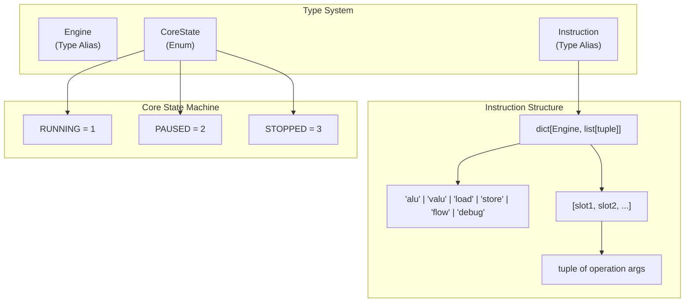
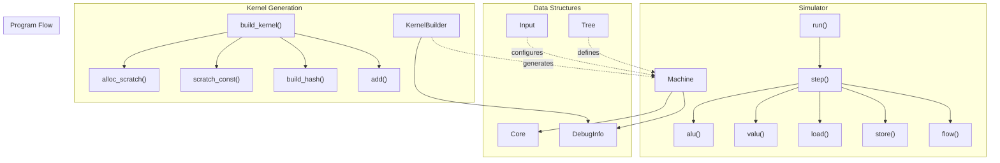
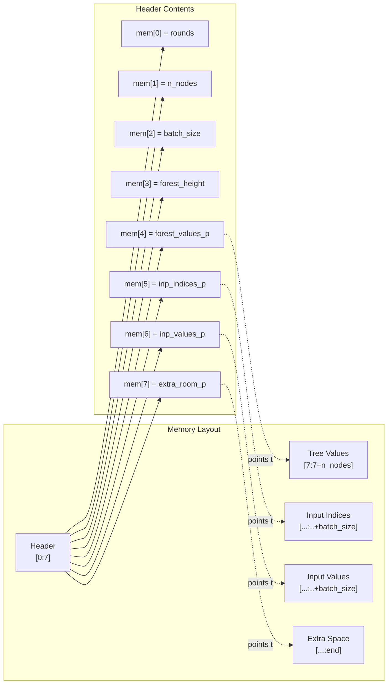
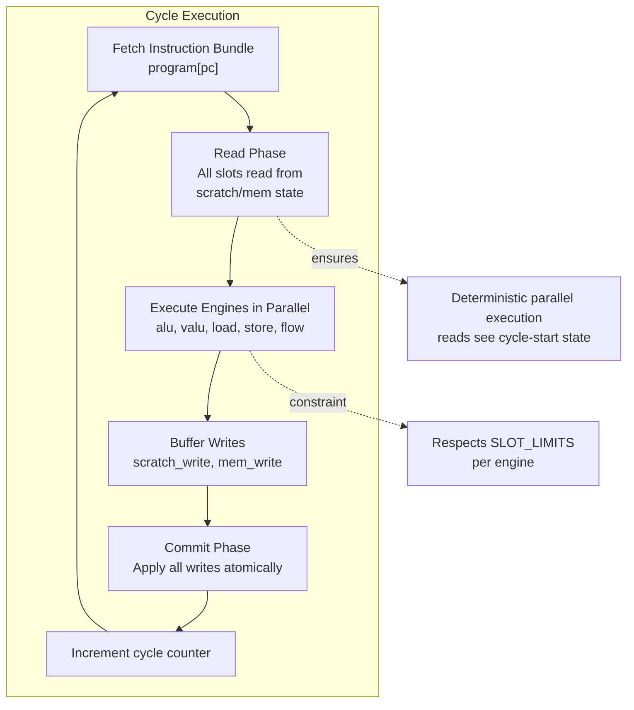

<!-- source: DeepWiki mcp.deepwiki.com · repo anthropics/original_performance_takehome · page 8.2 API Reference · fetched 2026-10-26 -->

# API Reference

<details>
<summary>Relevant source files</summary>

The following files were used as context for generating this wiki page:

- [perf_takehome.py](perf_takehome.py)
- [problem.py](problem.py)
- [tests/frozen_problem.py](tests/frozen_problem.py)

</details>


This page provides a quick reference for the key classes, functions, constants, and type definitions used throughout the codebase. For conceptual explanations of the machine architecture, see [Machine Architecture](#4). For details on optimization strategies in KernelBuilder, see [Kernel Builder - The Optimization Target](#5).

## Overview

The API is organized into three main modules:
- **problem.py**: Contains the simulator (`Machine`), data structures (`Tree`, `Input`), and reference implementations. [problem.py:1-570]()
- **frozen_problem.py**: Identical frozen copy of `problem.py` used for testing to ensure a stable evaluation environment. [tests/frozen_problem.py:1-570]()
- **perf_takehome.py**: Contains the `KernelBuilder` class and the primary optimization target `build_kernel`. [perf_takehome.py:40-172]()

## Core Type System

### Type Aliases and Enums

| Type | Definition | Purpose |
|------|------------|---------|
| `Engine` | `Literal["alu", "load", "store", "flow"]` | Valid engine types for instructions. [problem.py:14]() |
| `Instruction` | `dict[Engine, list[tuple]]` | A single VLIW instruction bundle mapping engines to slot lists. [problem.py:15]() |

**Sources:** [problem.py:14-15](), [tests/frozen_problem.py:14-15]()

### CoreState Enum

```python
class CoreState(Enum):
    RUNNING = 1   # Core is actively executing
    PAUSED = 2    # Core is paused at a pause instruction
    STOPPED = 3   # Core has halted or reached end of program
```

**Sources:** [problem.py:18-22](), [tests/frozen_problem.py:18-22]()

### Type Relationships Diagram



**Sources:** [problem.py:14-22](), [tests/frozen_problem.py:14-22]()

## Configuration Constants

### Machine Configuration

| Constant | Value | Description |
|----------|-------|-------------|
| `SLOT_LIMITS` | `{"alu": 12, "valu": 6, "load": 2, "store": 2, "flow": 1, "debug": 64}` | Maximum slots per engine per cycle. [problem.py:48-55]() |
| `VLEN` | `8` | Vector length for SIMD operations. [problem.py:57]() |
| `N_CORES` | `1` | Number of cores (fixed in this version). [problem.py:59]() |
| `SCRATCH_SIZE` | `1536` | Size of scratch space per core in words. [problem.py:60]() |
| `BASE_ADDR_TID` | `100000` | Base thread ID for trace visualization. [problem.py:61]() |

**Sources:** [problem.py:48-61](), [tests/frozen_problem.py:48-61]()

### Hash Configuration

| Constant | Value | Description |
|----------|-------|-------------|
| `HASH_STAGES` | List of 6 tuples | Defines the `myhash` function stages: `(op1, val1, op2, op3, val3)`. [problem.py:439-446]() |

**Sources:** [problem.py:439-446](), [tests/frozen_problem.py:439-446]()

### Performance Baseline

| Constant | Value | Description |
|----------|-------|-------------|
| `BASELINE` | `147734` | Baseline cycle count for speedup calculation. [perf_takehome.py:176]() |

**Sources:** [perf_takehome.py:176]()

## Data Classes

### Core

Represents a single execution core with its state. [problem.py:25-30]()

```python
@dataclass
class Core:
    id: int                      # Core identifier
    scratch: list[int]           # Scratch space array (SCRATCH_SIZE words)
    trace_buf: list[int]         # Buffer for trace_write instructions
    pc: int = 0                  # Program counter
    state: CoreState = CoreState.RUNNING  # Current execution state
```

**Sources:** [problem.py:25-30](), [tests/frozen_problem.py:25-30]()

### DebugInfo

Container for debugging metadata passed to Machine. [problem.py:34-41]()

```python
@dataclass
class DebugInfo:
    scratch_map: dict[int, (str, int)]  # Maps scratch addr -> (name, length)
```

**Sources:** [problem.py:34-41](), [tests/frozen_problem.py:34-41]()

### Tree

Represents an implicit balanced binary tree structure. [problem.py:406-418]()

```python
@dataclass
class Tree:
    height: int          # Tree height (0-indexed)
    values: list[int]    # Node values (length = 2^(height+1) - 1)
    
    @staticmethod
    def generate(height: int) -> Tree
```

**Sources:** [problem.py:406-418](), [tests/frozen_problem.py:406-418]()

### Input

Represents a batch of traversal inputs. [problem.py:422-436]()

```python
@dataclass
class Input:
    indices: list[int]   # Current node indices
    values: list[int]    # Current hash values
    rounds: int          # Number of traversal rounds
    
    @staticmethod
    def generate(forest: Tree, batch_size: int, rounds: int) -> Input
```

**Sources:** [problem.py:422-436](), [tests/frozen_problem.py:422-436]()

## Core Classes

### Machine

The VLIW SIMD architecture simulator. [problem.py:64-403]()

#### Constructor

```python
Machine(
    mem_dump: list[int],          # Initial memory image
    program: list[Instruction],   # Instruction sequence
    debug_info: DebugInfo,        # Debug metadata
    n_cores: int = 1,             # Number of cores
    scratch_size: int = SCRATCH_SIZE,  # Scratch space size
    trace: bool = False,          # Enable trace generation
    value_trace: dict[Any, int] = {}   # Reference values for debug compare
)
```

#### Key Methods

| Method | Purpose |
|--------|---------|
| `run()` | Execute until all cores stop or pause. [problem.py:197-217]() |
| `step(instr, core)` | Execute one instruction bundle on a core. [problem.py:352-397]() |
| `alu(core, op, dest, a1, a2)` | Execute scalar ALU operation. [problem.py:219-252]() |
| `valu(core, *slot)` | Execute vector ALU operation. [problem.py:254-267]() |
| `load(core, *slot)` | Execute load operation. [problem.py:269-286]() |
| `store(core, *slot)` | Execute store operation. [problem.py:288-298]() |
| `flow(core, *slot)` | Execute control flow operation. [problem.py:300-335]() |
| `setup_trace()` | Initialize trace file generation. [problem.py:151-195]() |

**Sources:** [problem.py:64-403](), [tests/frozen_problem.py:64-403]()

### KernelBuilder

Builder class for generating kernel instructions. [perf_takehome.py:40-172]()

#### Key Methods

| Method | Signature | Purpose |
|--------|-----------|---------|
| `alloc_scratch` | `(name=None, length=1) -> int` | Allocate scratch space, returns address. [perf_takehome.py:61-68]() |
| `scratch_const` | `(val, name=None) -> int` | Allocate and initialize constant, returns address. [perf_takehome.py:70-75]() |
| `add` | `(engine, slot)` | Add instruction to sequence. [perf_takehome.py:58-59]() |
| `build` | `(slots, vliw=False) -> list[Instruction]` | Convert slot list to instructions. [perf_takehome.py:51-56]() |
| `build_hash` | `(val_hash_addr, tmp1, tmp2, round, i) -> list` | Generate hash computation slots. [perf_takehome.py:77-86]() |
| `build_kernel` | `(forest_height, n_nodes, batch_size, rounds)` | Main optimization target. [perf_takehome.py:88-172]() |

**Sources:** [perf_takehome.py:37-172]()

### Class Interaction Diagram



**Sources:** [perf_takehome.py:37-172](), [problem.py:64-403]()

## Utility Functions

### myhash

32-bit hash function implementation. [problem.py:449-464]()

```python
def myhash(a: int) -> int:
    """
    A simple 32-bit hash function.
    Applies 6 stages of mixing operations defined in HASH_STAGES.
    """
```

**Sources:** [problem.py:449-464](), [tests/frozen_problem.py:449-464]()

### reference_kernel2

Reference implementation operating on flat memory with yielding for correctness validation. [problem.py:535-568]()

```python
def reference_kernel2(
    mem: list[int],
    trace: dict[Any, int] = {}
) -> Generator[list[int], None, None]:
    """
    Reference implementation on flat memory layout.
    Yields memory state at pause points for validation.
    """
```

**Sources:** [problem.py:535-568](), [tests/frozen_problem.py:535-568]()

### build_mem_image

Serializes Tree and Input into flat memory layout. [problem.py:487-513]()

```python
def build_mem_image(t: Tree, inp: Input) -> list[int]:
    """
    Build flat memory image with header containing rounds, 
    n_nodes, and pointers to data arrays.
    """
```

**Sources:** [problem.py:487-513](), [tests/frozen_problem.py:487-513]()

## Instruction Format Reference

### ALU Operations

| Operation | Format | Description |
|-----------|--------|-------------|
| Arithmetic | `("+", dest, a1, a2)` | Also: `-`, `*`, `//`, `%`. [problem.py:219-252]() |
| Bitwise | `("^", dest, a1, a2)` | Also: `&`, `|`, `<<`, `>>`. [problem.py:219-252]() |
| Comparison | `("<", dest, a1, a2)` | Also: `==`. [problem.py:219-252]() |

### LOAD Operations

| Operation | Format | Description |
|-----------|--------|-------------|
| Load | `("load", dest, addr)` | Load from `mem[scratch[addr]]`. [problem.py:270]() |
| Vector Load | `("vload", dest, addr)` | Load `VLEN` contiguous words. [problem.py:278]() |
| Constant | `("const", dest, val)` | Load immediate constant. [problem.py:284]() |

**Sources:** [problem.py:219-335](), [tests/frozen_problem.py:219-335]()

## Memory Layout Convention

The `build_mem_image` function creates a standard memory layout:



**Sources:** [problem.py:487-513](), [tests/frozen_problem.py:487-513]()

## Machine Execution Model



**Sources:** [problem.py:197-217](), [problem.py:352-397]()

---

