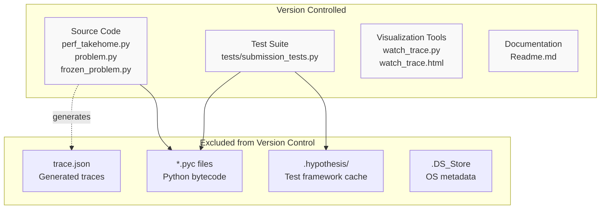
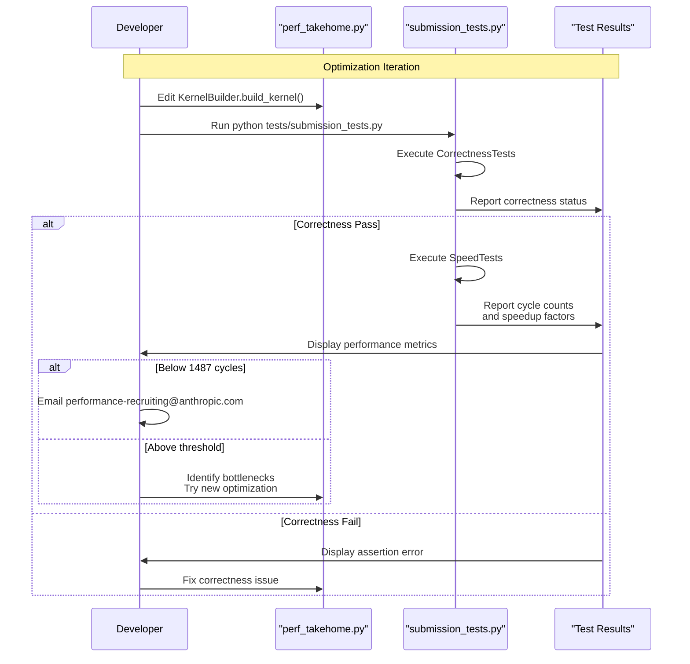
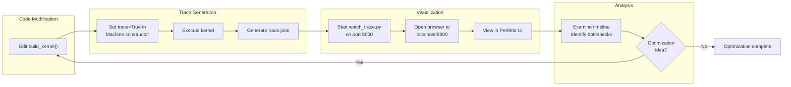
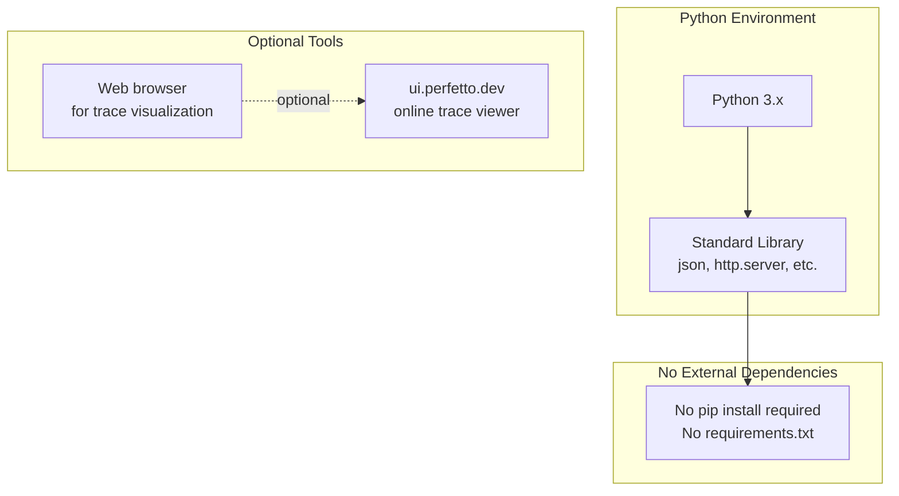
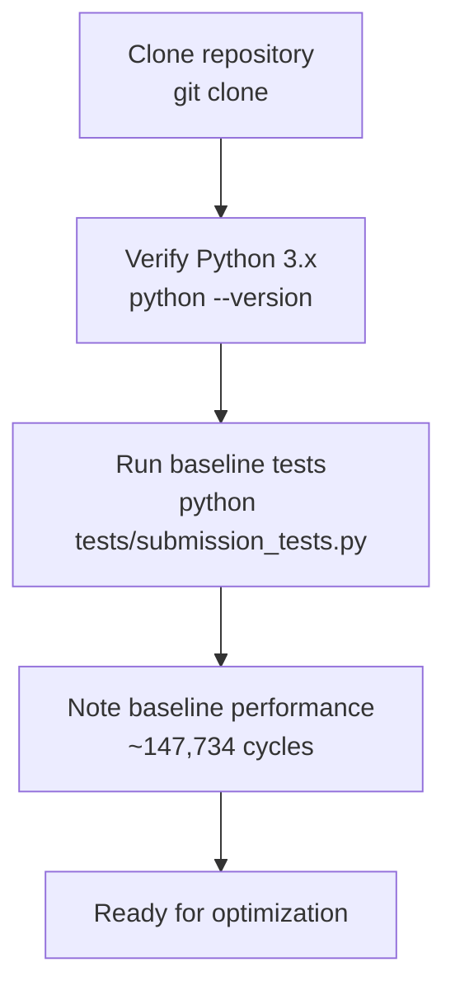

<!-- source: DeepWiki mcp.deepwiki.com · repo anthropics/original_performance_takehome · page 8.3 Configuration and Development Setup · fetched 2026-10-26 -->

# Configuration and Development Setup

<details>
<summary>Relevant source files</summary>

The following files were used as context for generating this wiki page:

- [.gitignore](.gitignore)
- [Readme.md](Readme.md)

</details>


## Purpose and Scope

This page documents the repository configuration, development workflows, and maintenance practices for working with the performance take-home codebase. It covers version control settings, iteration cycles for optimization work, and best practices for managing generated artifacts.

For information about running tests and interpreting results, see [Running and Interpreting Tests](#6.4). For trace generation and visualization workflows, see [Performance Analysis and Debugging](#7).

---

## Version Control Configuration

### .gitignore Structure

The repository uses a minimal `.gitignore` configuration that excludes generated artifacts and development environment files to ensure the repository remains clean and focused on source code:

| Pattern | Purpose | Related System |
|---------|---------|----------------|
| `trace.json` | Excludes trace files generated by the simulator | Trace visualization system ([Performance Analysis and Debugging](#7)) |
| `**/*.pyc` | Excludes Python bytecode files | Python interpreter cache |
| `.hypothesis` | Excludes Hypothesis framework cache | Testing framework ([Testing Framework](#6)) |
| `.DS_Store` | Excludes macOS filesystem metadata | Operating system artifacts |

**Sources:** [.gitignore:1-5]()

### Version Control Philosophy



**Diagram: Version Control Boundaries**

The repository maintains a clean separation between source code and generated artifacts. All generated files can be recreated from source, so they are excluded from version control to prevent merge conflicts and repository bloat.

**Sources:** [.gitignore:1-5]()

---

## Development Workflows

### Optimization Iteration Cycle

The primary development workflow for this repository is the optimization iteration cycle, where developers repeatedly modify the kernel builder and test performance. The goal is to reduce the cycle count from the baseline (~147,734 cycles) toward the performance thresholds set by various Claude models.



**Diagram: Standard Optimization Workflow**

This workflow emphasizes correctness validation before performance measurement, ensuring that optimizations do not compromise functional correctness.

**Sources:** [Readme.md:21-23](), [Readme.md:36]()

### Testing and Validation Workflow

The testing workflow validates both correctness and performance characteristics. Users are specifically warned not to modify the `tests/` directory to ensure valid performance measurements.

| Test Phase | Command | Purpose | Outputs |
|------------|---------|---------|---------|
| **Integrity Check** | `git diff origin/main tests/` | Ensure test code hasn't been tampered with | Diff output (should be empty) |
| **Full Test Suite** | `python tests/submission_tests.py` | Run all correctness and speed tests | Pass/fail status, cycle counts |

**Sources:** [Readme.md:31-36]()

### Trace-Driven Debugging Workflow

For performance analysis and debugging, the trace visualization workflow provides detailed execution insights. This involves setting `trace=True` in the `Machine` simulator.



**Diagram: Trace-Driven Development Cycle**

The trace file `trace.json` is automatically regenerated each time the simulator runs with tracing enabled. The `watch_trace.py` server provides the necessary infrastructure to view these traces in the Perfetto UI.

**Sources:** [.gitignore:1](), [Readme.md:5]()

---

## Repository Hygiene and Best Practices

### Python Environment Management

The repository uses standard Python 3 without complex dependency requirements.



**Diagram: Minimal Dependency Structure**

The codebase deliberately avoids external dependencies to ensure maximum portability and minimize setup friction.

**Sources:** [Readme.md:5](), [Readme.md:23]()

### Working with Generated Files

Generated files are temporary artifacts of the development process and should be managed appropriately:

| File Type | Location | Lifecycle | Action |
|-----------|----------|-----------|--------|
| **trace.json** | Repository root | Generated per execution | Excluded from git, safe to delete |
| **\*.pyc** | `__pycache__/` directories | Cached on import | Excluded from git, safe to delete |
| **.hypothesis/** | Repository root | Testing framework cache | Excluded from git, safe to delete |

To clean all generated artifacts:

```bash
# Remove trace file
rm -f trace.json

# Remove Python cache
find . -type d -name __pycache__ -exec rm -rf {} +
find . -type f -name "*.pyc" -delete

# Remove Hypothesis cache
rm -rf .hypothesis
```

**Sources:** [.gitignore:1-4]()

### Performance Submission Guidelines

When achieving cycle counts below the **1487-cycle threshold** (Claude Opus 4.5 11.5hr performance):

| Requirement | Details |
|-------------|---------|
| **Contact** | Email `performance-recruiting@anthropic.com` |
| **Include** | Your optimized code and ideally a resume |
| **Integrity** | Ensure `git diff origin/main tests/` is empty |
| **Validation** | Mention that you ran the validation commands |

The submission process validates that the optimization is legitimate and not a result of modifying the test environment (e.g., increasing `N_CORES`).

**Sources:** [Readme.md:17](), [Readme.md:21](), [Readme.md:31-39]()

---

## Development Environment Setup

### Initial Setup Workflow



**Diagram: Initial Repository Setup**

No package installation or virtual environment configuration is required. The repository is designed to work immediately after cloning with a standard Python 3 installation.

**Sources:** [Readme.md:23]()

### File Modification Guidelines

When optimizing the kernel builder, follow these guidelines to maintain the integrity of the benchmark:

| File | Modification Policy | Rationale |
|------|-------------------|-----------|
| **perf_takehome.py** | Modify freely | Primary optimization target |
| **problem.py** | Avoid modification | Development simulator reference |
| **frozen_problem.py** | **DO NOT MODIFY** | Used for official performance validation |
| **tests/** | **DO NOT MODIFY** | Integrity of the performance benchmark |

**Sources:** [Readme.md:27-39]()

---

